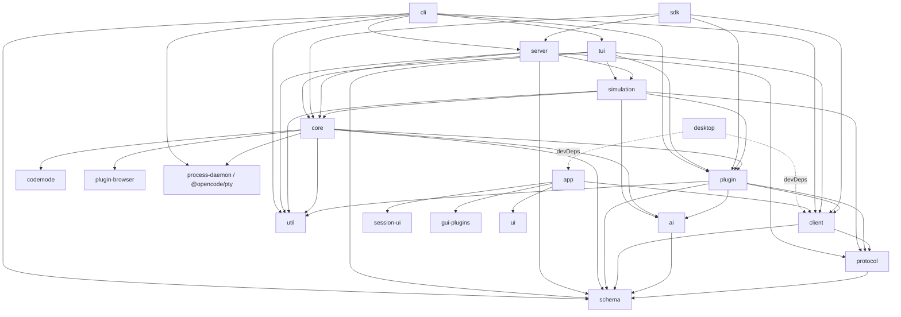
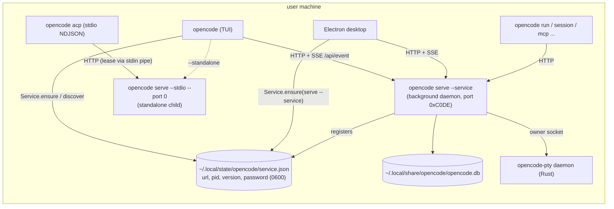
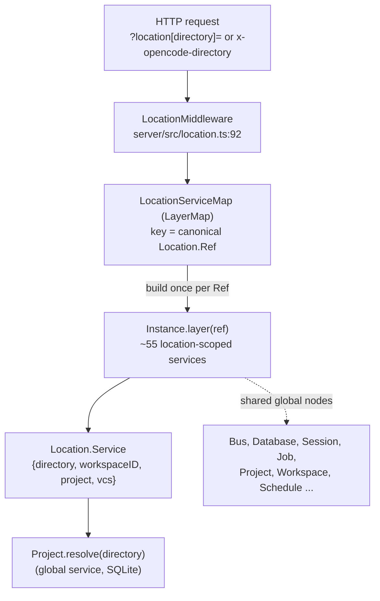

# OpenCode architecture: monorepo, processes, locations, event bus

> OpenCode @ 56625a3e1f · paths relative to opencode-reference/

## TL;DR

- One Bun/TypeScript monorepo of about 35 workspaces. The runtime core is `schema` → `core`/`protocol` → `server`, with `client` generated from the server's Effect `HttpApi`. `cli` is the `opencode` binary. It hosts the server process and also launches the TUI client.
- **Every front-end talks HTTP+SSE to a server.** That covers the TUI, the Electron desktop app, `opencode run`, ACP and the generated SDK client. The only exception is `@opencode/sdk`, which runs the same router in-process. By default the server is a per-user **background "service" daemon** that a registration file (`~/.local/state/opencode/service.json`) advertises. `--standalone` starts a private child server for one client. `--server URL` attaches to an existing server.
- One server process hosts **many directories and many sessions**. Per-directory services, called a *Location instance*, are built lazily into a `LayerMap` keyed by `{directory, workspaceID}`, and the server keeps them until they are idle or invalidated.
- A *Project* is a stable ID for a repo, derived in this order: git remote URL hash, then a cached `.git/opencode` file, then the root commit, then `global`. A *Workspace* is an abstract placement (a provider-backed remote environment). Today it is mostly reserved.
- The **Bus** is the spine. Events are typed Schema definitions, either *durable* (per-aggregate sequence numbers, projected into SQLite tables in the same transaction) or *ephemeral*. The server fans them out over one SSE feed (`/api/event`) with a bounded queue per connection.
- Startup: `opencode`, then `ServerConnection.resolve`, then `Service.ensure` spawns `opencode serve --service` if needed, then the TUI connects over HTTP. The first prompt runs `session.create` (a durable `session.created` event), then `session.prompt` (inbox row) plus `SessionExecution.wake`.
- Build: Bun workspaces, turbo for typecheck and test fan-out, and `bun build --compile` to single-file binaries per OS/arch/libc. Releases go out on channels (`latest`, `beta`, `dev`, branch names), served by a Cloudflare `update` worker.
- For Genie: copy the *layering discipline* (protocol crate never depends on core), the *durable vs ephemeral event split* and the *registration-file discovery*. Do **not** copy the shared multi-session daemon (pick-list #43).

## Where it lives

| path | role | ~lines (ts/tsx/js/rs) |
|---|---|---|
| `packages/schema` | Browser-safe wire and storage contracts (IDs, events, Location, Session). No runtime. | 8.7K |
| `packages/protocol` | `HttpApi` groups and endpoints, errors, middleware keys. Depends only on schema. | 5.4K |
| `packages/core` | All runtime services: bus, DB, project, location, session, tools, permission, MCP, plugins | 221K |
| `packages/server` | HTTP process, route assembly, auth, SSE `EventFeed`, location middleware | 13K |
| `packages/client` | Generated Promise and Effect HTTP clients, plus service discovery (`service*.ts`) | 25K |
| `packages/sdk` | In-process host: runs Server's router without a listener | 2.9K |
| `packages/cli` | `opencode` binary: command tree, server-process, ACP, updater | 27K |
| `packages/tui` | OpenTUI/Solid terminal client (HTTP client only) | 117K |
| `packages/ai` | Schema-first LLM/media library, provider protocols | 93K |
| `packages/codemode` | Confined JS-like interpreter that calls tools | 48K |
| `packages/plugin`, `plugin-browser`, `plugins/figma` | Plugin API, CDP browser plugin, an optional Git-installed plugin | 11K / 3.6K / 11K |
| `packages/util` | Global paths, `LayerNode`, process helpers, observability | 6.2K |
| `packages/process-daemon` | **Rust** PTY daemon `opencode-pty` (portable-pty + libghostty-vt) | 12.4K rs |
| `packages/app`, `ui`, `session-ui`, `gui-plugins`, `theme`, `nav-menus`, `patchmark`, `merman`, `latex` | Web/desktop UI, shared UI kit, renderers | 347K / 70K / 55K / 112K / 2K / 0.7K / 4.9K / 22K / 2.7K |
| `packages/desktop` | Electron main/preload/renderer that hosts `app` and connects to the service | 28K |
| `packages/simulation`, `http-recorder`, `httpapi-codegen`, `stories`, `script` | Test/build support: simulation backend, HTTP cassettes, client codegen, component stories, release helpers | 4.2K / 3.3K / 4.8K / 2.4K / 0.3K |
| `packages/data/{app,core,server}` | The opencode.ai/data stats site (not part of the agent) | 23K |
| `packages/effect-drizzle-sqlite`, `packages/identity` | Leftover example migration and brand images. Neither has a package.json. | 0 |
| `sdks/vscode` | VS Code extension that only opens an `opencode` terminal | 0.15K |
| `services/{site,legacy,data,update,files}` | Cloudflare-deployed website, legacy API, data site, update/release metadata worker, file host | 109K / 0.4K / 0.3K / 1K / 0.2K |

Runtime vs build/test: the runtime set is schema, protocol, core, server, client, sdk, cli, tui, ai, codemode, plugin*, util and process-daemon, plus app, ui, session-ui, gui-plugins and desktop for the GUI. The build/test-only set is simulation (it also ships a `OPENCODE_SIMULATE` backend), http-recorder, httpapi-codegen, stories and script. `services/*` and `packages/data` are hosted web properties.

## Architecture

### Package dependency graph (internal deps from each `package.json`)

Rules from root `AGENTS.md` and `packages/schema/AGENTS.md`:
- Runtime direction is Schema, then Core and Protocol, then Server. **Client may depend on Schema and Protocol, never Core or Server.** `sdk` composes Client, Core and Server.
- `@opencode/client` (Promise) has "no Core or Effect runtime dependency", and `/effect` is "browser-bundle safe". Bundle-boundary tests enforce both import graphs (`packages/client/README.md`).
- After changing Protocol or the Server `HttpApi`, run `bun run generate` in `packages/client`. Generated files are never hand-edited.
- Schema holds only "serializable contract definitions, not service implementations". Legacy shapes live under `schema/src/v1/` and current code must not import them.
- Gotcha: `tui` declares a dependency on `core` (`packages/tui/package.json`). `packages/cli/AGENTS.md` still says the TUI should use `@opencode/client`. The rule is about clients, and the TUI appears to import core for shared types/helpers *(inferred)*.

### Process topology

There are three server modes (`packages/cli/src/server-process.ts:23`, `Mode = "default" | "service" | "stdio"`):
- **service** (`serve --service`) does `chdir($HOME)`, reads CLI-owned service config, and returns early if a compatible *incumbent* already answers on the configured URL (`server-process.ts:74-78`). It persists a generated password and writes the registration file on listen (`server-process.ts:149-159`). It lives until `server.shutdown`.
- **stdio** (`serve --stdio`) is used by `--standalone` and ACP. The parent passes `OPENCODE_PASSWORD` and the child deletes it from its own env so tools don't inherit it (`server-process.ts:87-90`). It prints `{"url":...}` on stdout (`:208`) and exits when stdin closes (`:213`, `waitForStdinClose` at `:233`). Stdin EOF is the **ownership lease**, so the OS ends the server even if the client is SIGKILLed (`packages/cli/src/services/standalone.ts:26-28`).
- **default** (`opencode serve`) is a foreground server that prints its password.

Port selection: if no port is configured, `listen` scans upward from 4096 (`packages/server/src/process.ts:151-158`). The service uses a channel-specific default: `0xC0DE` for `latest/dev/beta/next`, `0xC0DF` for `local`, and a hash-derived port for other channels, remapped below 0x8000 on Windows (`packages/cli/src/services/service-config.ts:46-60`).

### Core model: Location, Instance, Project, Workspace

- **Location.Ref** = `{directory: AbsolutePath, workspaceID?}` (`packages/schema/src/location.ts:9-12`). `Location.Info` adds `project: {id, directory, canonical}` (`:19-27`). An omitted `workspaceID` means "implicit local placement" (root `AGENTS.md`, Session Core).
- **Instance** is "one compiled, fresh copy of the graph standing on a directory" (`packages/core/src/instance.ts:157-158`). The graph lists about 55 location-scoped nodes: Config, Agent, Provider, Model, Plugin, FileSystem, Shell, Pty, Skill, Mcp, Permission, Tool, SessionRunnerLLM, Snapshot, Vcs, LocationWatcher and others (`instance.ts:64-122`). The `Instance.Service` interface is just `provide(session)`, which runs an effect inside that session's Location graph (`packages/core/src/instance/service.ts:11-17`).
- **LocationServiceMap** is a `LayerMap<Location.Ref, Instance.Services>` with `idleTimeToLive: Duration.infinity` (`packages/core/src/location-services.ts:22-59`). Keys are normalized by `canonical()` (`location-service-map.ts:39-48`). `invalidate` detaches routing first, then runs lifecycle shutdown, and warns if a borrower still holds the Location after 30 s (`location-services.ts:77-110`). `LocationActivity` evicts idle Locations after a default of 60 minutes (`location-activity.ts:30`).
- **Project** (`packages/core/src/project.ts`) is a *global* service. `resolve` walks up looking for `.git`/`.hg` (`:429`). For git, the ID is `remote(repo) ?? cached .git/opencode ?? rootCommit ?? ID.global` (`:364-367`). The remote URL is normalized to `host/path` and hashed (`:317-346`). Linked worktrees resolve `canonical` to the main checkout (`:368-374`). Non-VCS directories get `Hash("directory:"+dir)` (`:453-458`). Results are cached by `.git` path plus a metadata fingerprint, so repeat resolves spawn no git (`:385-389`). An hourly sweep archives projects whose directories are gone (`:521-536`).
- **Workspace** (`packages/core/src/workspace.ts:36-53`) has `create` (commit a logical ID, no provider work), `provision`, `connect` (returns an `EnvironmentDriver`) and `destroy`. A `WorkspaceDriver` must be idempotent per `workspaceID` because core retries after crashes (`workspace/driver.ts:26-37`). The AGENTS.md describes explicit workspace identity as "reserved for future placement semantics".
- Layering is enforced by **LayerNode tags**: `global` and `location`, where location may depend on global but not the reverse (`packages/util/src/effect/app-node.ts:3-6`). `Instance.layer` compiles with `shared: global`, so every Location reuses the one global Bus/DB/etc. while getting fresh location nodes (`instance.ts:169`).

### Event bus

- Definitions: `Event.durable({type, durable:{aggregate, version}, schema})` and `Event.ephemeral(...)` (`packages/schema/src/event.ts:90-150`). Payload envelope: `{id: "evt_…", created, metadata?, type, durable?{aggregateID, seq, version}, location?, data}`. Example: `session.created` is durable on the session aggregate (`packages/schema/src/session-event.ts:39-57`).
- `Bus.Interface` (`packages/core/src/bus.ts:150-181`) has `publish`, `publishAll`, `subscribe` (a volatile live `Stream`), `log({aggregateID, after, follow})` (durable ordered replay that emits a `log.synced` watermark), `project(definition, projector)`, `replay`, `remove` and `claim`.
- Durable publish (`bus.ts:290-450`, `publishEvent` at `:451`) takes a per-aggregate `KeyedMutex`. In one SQLite transaction it checks `event_sequence`, runs registered **projectors** (which write read-model tables), runs the optional `commit(seq)` hook, bumps `seq`, and inserts into `event` only when `persist` is on. Then `notify` sends to listeners, the live PubSub and typed PubSubs (`:495-508`). Tables: `event_sequence(aggregate_id, seq, owner_id)` and `event(id, aggregate_id, seq, created, type, data)` (`packages/core/src/event/sql.ts`).
- Location routing: session events with no explicit location are routed to the session's owning Location. `session.moved` reaches both the old and the new Location (`bus.ts:223-272`).
- `EventLogger` logs only `agent/provider/model/command/config.updated` (`packages/core/src/event-logger.ts:7-17`).
- Wire: `GET /api/event` is SSE (`packages/protocol/src/groups/event.ts:61`). Its contract says it is volatile: "a slow consumer overflows and fails the stream". `EventFeed` encodes each event once and offers it to per-connection queues capped at 4,096 (`packages/server/src/event-feed.ts:8,29-31`). Design doc: `specs/v2/event-stream-architecture.md`.

## Key types and interfaces

| name | file:line | purpose |
|---|---|---|
| `ServerProcess.Mode` / `run` | `packages/cli/src/server-process.ts:23,33` | CLI wrapper that picks service/stdio/default, password, env-derived options |
| `ServerProcess.start` | `packages/server/src/process.ts:50` | Bind, serve a 503 "starting" app, build the route layer, flip to ready |
| `ServerConnection.resolve` | `packages/cli/src/services/server-connection.ts:27` | Client-side choice of `--server`, `--standalone` or managed service |
| `Service.discover/ensure/stop` | `packages/client/src/effect/service.ts:25,49,130` | Registration-file discovery, contender spawning, SIGTERM→SIGKILL stop |
| `Service.Info` | `packages/client/src/effect/service.ts:142` | `{id?, version?, url, pid, password?}` registration schema |
| `Location.Ref` / `Info` | `packages/schema/src/location.ts:9,19` | Placement key and resolved info |
| `Location.Service` | `packages/core/src/location.ts:16` | Location-scoped resolved info (+vcs) |
| `Instance.layer` / `graph` | `packages/core/src/instance.ts:158,124` | Per-Location service graph |
| `LocationServiceMap.Service` | `packages/core/src/location-service-map.ts:9` | `LayerMap` of instances |
| `Project.Interface` | `packages/core/src/project.ts:90` | list/update/activate/resolve/sweep |
| `Workspace.Interface` | `packages/core/src/workspace.ts:36` | Logical placement lifecycle |
| `Bus.Interface` | `packages/core/src/bus.ts:150` | Publish/subscribe/log/project |
| `EventFeed` | `packages/server/src/event-feed.ts:23` | Shared SSE encoder |
| `createRoutes` / `createEmbeddedRoutes` | `packages/server/src/routes.ts:96,115` | Network vs in-process (SDK) assembly |

## How it works: walkthroughs

### 1. `opencode` (TUI) to a connected server

1. `bin/opencode.cjs` is a Node shim that picks the `@opencode/cli-<os>-<arch>` binary package (AVX2/baseline aware), spawns it and forwards signals (`packages/cli/bin/opencode.cjs:11-60`).
2. `src/index.ts` sets `NO_PROXY` for loopback (`:24-33`), lazily maps command names to handler modules (`:44-99`), provides Config/Updater/Global/Observability/Node layers and runs `NodeRuntime.runMain`. Startup failures go to stderr because the desktop app and `Service.ensure` only capture stderr (`:161-170`).
3. The default handler (`commands/handlers/default.ts:35-52`) calls `ServerConnection.resolve({mismatch: "replace"})`:
   - `--server URL` → health-check `server.info` with a 5 s timeout, warn on version mismatch (`server-connection.ts:34-50`).
   - `--standalone` or service `disabled` → `Standalone.start()` (`:51-53`).
   - otherwise → `Service.ensure` (`:62-65`).
4. `Service.ensure` (`client/src/effect/service.ts:49-127`) reads the registration file and probes it. A healthy, compatible service is reused. A version-mismatched one is stopped with a PTY handoff. If nothing is running, it spawns "contenders" running `opencode serve --service` (`:61`) and polls until one registers. Three consecutive timeouts trigger a kill and recruit (`:80-88`).
5. The TUI then starts with the endpoint, a `service.reconnect/restart` hook and a background updater check every 10 minutes (`default.ts:62-86,96-158`).

### 2. Server boot

1. `ServerProcess.run` builds the options from env: DB path, models URL, config dir, `.claude` skills toggle, file watcher, fff search (`server-process.ts:101-145`).
2. `ServerProcess.start` binds first and serves a `dispatch` app that answers `/api/info` with 503/`retry-after` until ready (`server/src/process.ts:62-81,182-211`).
3. `boot` runs `Layer.buildWithScope(createRoutes(...))` (`:102-112`). `createRoutes` compiles the global node list: App, Global, Database, KV, Bus, PersistentPty, Shell daemon, EventLogger, Job, Project, Worktree, Session, Instance, Credential, LocationServiceMap, LocationActivity, SessionRestart, Schedule, Workspace and FileWatch (`server/src/routes.ts:58-93`). It applies option-driven replacements (`:131-160`) and mounts `HttpApiBuilder` handlers with auth, location and schema-error middleware (`:195-207`).
4. After boot, managed (lifecycle) servers fork `SessionRestart.resumeSuspendedSessions` (`process.ts:113-117,250-252`). Every server forks the Schedule runner (`:119`) and marks status ready (`:121`).

### 3. First session

1. The client posts `POST /api/session` (`protocol/src/groups/session.ts:167`) with a location. `LocationMiddleware` resolves the request's Location from `?location[directory]`, then the `x-opencode-directory` header, then `process.cwd()`, and provides `locations.get(ref)`. That lazily boots the Instance graph on first use (`server/src/location.ts:74-100`).
2. `Session.create` (`core/src/session.ts:290-338`) resolves the Project and publishes durable `session.created` with `{location}`. The projector inserts the session row (`core/src/session/projector.ts:868`). A concurrent duplicate loses the projection race, and the existing session wins.
3. `POST /api/session/:id/prompt` (`groups/session.ts:342`) calls `Session.prompt` (`core/src/session/session.ts:155-190`). Inside `instances.provide(session)` it prepares the prompt and admits it as a durable inbox item, then calls `execution.wake(sessionID)` (`:187`) unless `resume: false`.
4. `SessionExecution` uses a per-session `SessionRunCoordinator`: one drain fiber per session, with a "doorbell" so that new wakes coalesce (`core/src/session/run-coordinator.ts:31-55`). Each step is one `llm.stream` call that continues from reloaded history (root `AGENTS.md`). Clients see progress as SSE events.

### 4. Other attachments

- **ACP**: `opencode acp` always starts a *standalone* server and bridges `@agentclientprotocol/sdk` NDJSON over stdio to the HTTP client (`commands/handlers/acp.ts:25-35`).
- **Desktop**: the Electron main process calls `client.Service.ensure` with `[cli, "serve", "--service"]` (`packages/desktop/src/main/service/background-service.ts:57-74`). It renders `packages/app` and talks to the renderer over an Effect RpcServer on a MessagePort *(see `renderer/ipc-client.ts:16`)*.
- **SDK**: `@opencode/sdk` uses `createEmbeddedRoutes` with no password and no listener (`packages/sdk/src/internal/host.ts:37`, `server/src/routes.ts:115-121`).
- **VS Code**: the extension only creates a terminal named `opencode` and sends file references to it (`sdks/vscode/src/extension.ts`).

## Configuration and extension points

| key / flag / env | effect | where |
|---|---|---|
| `--standalone`, `--server URL`, `--print-logs` | Connection choice (mutually exclusive) | `cli/src/commands/commands.ts:7-26`, `server-connection.ts:32` |
| `--auto` (`--yolo`, `--dangerously-skip-permissions` hidden) | Auto-approve non-denied permissions | `commands.ts:37-46` |
| `opencode serve --service/--stdio/--hostname/--port/--cors` | Server modes | `commands/handlers/serve.ts:9-15` |
| `opencode service start/stop/status/get/set/unset/restart` | Manage the daemon. Config keys: `disabled, remote, hostname, port, password, cors, env` | `service-config.ts:31` |
| `OPENCODE_PASSWORD` (`OPENCODE_SERVER_PASSWORD` legacy) | Basic-auth password, username `opencode` | `cli/src/env.ts:10-13`, `server-connection.ts:38` |
| `OPENCODE_CONFIG_DIR`, `OPENCODE_CONFIG`, `OPENCODE_CONFIG_CONTENT`, `OPENCODE_DISABLE_PROJECT_CONFIG` | Config sources | `server-process.ts:122-134` |
| `OPENCODE_DISABLE_CLAUDE_CODE(_SKILLS)` | Stop reading `.claude` skills | `server-process.ts:128-131` |
| `OPENCODE_DB`, `OPENCODE_DISABLE_CHANNEL_DB` | DB filename; non-release channels get `opencode-<channel>.db` | `cli/src/database-path.ts` |
| `OPENCODE_MODELS_URL/PATH`, `OPENCODE_DISABLE_MODELS_FETCH` | Model catalog source | `server-process.ts:117-121` |
| `OPENCODE_FILEWATCHER_DISABLE`, `OPENCODE_DISABLE_FFF`, `OPENCODE_GIT_BASH_PATH`, `OPENCODE_SIMULATE` | FS/platform toggles, simulation backend | `server-process.ts:113,135-144` |
| `OPENCODE_FLAGS="key,-other"` / `experimental.<key>` | Feature flags: on in local/dev, off in release | root `AGENTS.md`, `schema/src/config/flag.ts` |
| `XDG_{DATA,CACHE,CONFIG,STATE}_HOME` | Roots for `<xdg>/opencode` | `util/src/global-roots.ts:5-19` |
| `OTEL_EXPORTER_OTLP_ENDPOINT/HEADERS` | OpenTelemetry export | `cli/src/index.ts:151-157` |

Build and release:
- `bun@1.4.4` workspaces (`package.json`). Turbo runs `typecheck`, `typecheck:tsc` and `test` with a no-op `transit` task that folds dependency hashes in (`turbo.json`). `bun run check` = oxlint + ast-grep + typecheck. Tests never run from the root (`"test": "echo 'do not run tests from root' && exit 1"`).
- `packages/cli/script/build.ts` uses `Bun.build({compile})` per target, defining `OPENCODE_VERSION/CHANNEL/LIBC` at build time (`:172-216`). There are AVX2 and baseline x64 variants and musl variants.
- Channel = `OPENCODE_CHANNEL`, else `latest` for a real version, else the sanitized branch name. Preview versions look like `0.0.0-<channel>-<run>` (`packages/script/src/index.ts:21-45`).
- Distribution: npm `@opencode-ai/cli-<target>` packages, the `install` script (`curl … /v2/install | bash`, into `~/.opencode/bin`), Homebrew formulae `opencode`, `opencode-beta` and `opencode-v2` (`cli/src/services/updater.ts:163`), and the Nix flake (dev shell plus `nix/opencode.nix`). `services/update` serves `/update/api/<channel>/<artifact>/<distribution>` with rollout hours and Electron feeds. The updater queries it with `?current=` (`updater.ts:324`).
- The Rust PTY daemon has its own CI and release workflows (`.github/workflows/check-process-daemon.yml`, `release-process-daemon.yml`).

## Edge cases, invariants and gotchas

- **Version skew is first-class.** An implicit managed connection *replaces* a service with a different version and hands persistent PTYs over. An explicit `--server` only warns (`server-connection.ts:45-48`, root `AGENTS.md` Live TUI Testing).
- **Two services, one DB.** The desktop app uses a fixed port on purpose so that a second contender fails to bind. "Port 0 never collides, so two services could boot against the same database" (`background-service.ts:65-66`).
- **Registration file is the whole discovery contract**, with mode 0600 (`client/src/effect/service.ts:14-20`). It is channel-specific (`service-<channel>.json`, `service-config.ts:41-44`).
- **Plugins load asynchronously.** Handlers never wait, so lists can be empty on a cold Location. The exception is the `awaitPlugins` 5 s wait for policy-sensitive endpoints (`server/src/location.ts:39-50`). Clients refresh on `*.updated` events.
- **Durable events are minimal facts.** Projections derive state. Event retention (`persist`) defaults to false (`bus.ts:214`), and `ServerProcess.run` passes no `events` option (`server-process.ts:101-145`). So CLI-launched servers likely keep sequences and projections but not the raw event rows *(inferred)*.
- **SSE is lossy.** Reliable consumers must combine `subscribe` with `log({after})` (`bus.ts:133-139`).
- **Execution claims survive crashes.** A write-ahead claim makes restart resume sessions. It is "not clustered ownership, fencing, or an exactly-once guarantee" (root `AGENTS.md`).
- **Module cycle**: bus → location → project → bus is broken by a deferred `import()` inside the Bus layer (`bus.ts:200-203`).
- The service `chdir`s to `$HOME`. The Location comes from each request, never from the server's cwd, except the `process.cwd()` fallback in `requestRef` (`server/src/location.ts:78`).

## Tests worth reading

- `packages/client/test/service.test.ts`, `service-decision.test.ts`, `service-contender-pool.test.ts`, `service-reconnect.test.ts`
- `packages/cli/test/service-lifecycle.test.ts`, `standalone.test.ts`
- `packages/server/test/process.test.ts`, `service-status.test.ts`, `event-feed.test.ts`, `sse-failure.test.ts`, `session-create.test.ts`, `session-instances.test.ts`
- `packages/core/test/bus.test.ts`, `bus-session-routing.test.ts`, `bus-unpersisted.test.ts`
- `packages/core/test/location*.test.ts`, `instance-vanilla.test.ts`, `project.test.ts`, `workspace.test.ts`
- `packages/sdk/test/instances*.test.ts`

## Genie takeaways

- **Avoid the shared daemon** (pick-list #43; ticket [01](../../tickets/01-engine-architecture.md)). The contender/handoff/version-replacement machinery in `client/src/service*.ts` (about 500 lines) exists only because one process serves every client and directory. Genie's one engine per main session sidesteps all of it. **Port** the *standalone lease* idea: the engine exits on stdin EOF (`standalone.ts:26-28`). It fits Genie's NDJSON stdio protocol ([02](../../tickets/02-event-protocol.md), [25](../../tickets/25-headless-sdk.md)) exactly, and the OS cleans up even when the front-end is killed.
- **Port the layering rule** as crate boundaries: `genie-protocol` ≈ `schema`+`protocol`, with no dependency on core. Make it a CI check, as OpenCode does with bundle-boundary tests. Ticket 01 already sets apps → core → subsystems → protocol.
- **Adapt the durable/ephemeral event split** ([02](../../tickets/02-event-protocol.md), [12](../../tickets/12-sessions-persistence.md)). Persist durable facts (session created, message admitted, tool result) with a per-session `seq` in SQLite, and project them into read tables in the same transaction. Stream deltas as ephemeral events. Give each Genie event a `seq` so that a reconnecting desktop/VS Code client can do `log(after=seq)` and then go live (the `log.synced` watermark pattern). OpenCode's SSE stream does not guarantee delivery; Genie's stream-json can.
- **Adapt the inbox/wake split.** Durable prompt admission is separate from execution (`Session.prompt` → inbox, then `wake`). That maps onto Genie's "commands in": `prompt` appends to a durable queue and the session actor drains it. It gives steering/queueing semantics and crash recovery for free (pick-list #19; tickets 12, 16).
- **Port the Project identity algorithm** (remote hash → cached marker → root commit) for per-project memory and settings keys ([10](../../tickets/10-memory.md), [13](../../tickets/13-settings.md)), and the worktree → main checkout canonicalization ([24](../../tickets/24-worktrees.md)). Write the cached ID marker under `.genie/`, not in `.git`.
- **Skip Location/Instance multiplexing.** With one session per engine, a single directory-bound context struct is enough. Keep the *vanilla/no-discovery* boot option (`instance.ts:129-155`) as an SDK/headless flag ([25](../../tickets/25-headless-sdk.md)).
- **Reuse `process-daemon`** (pick-list #7) for the Tauri terminal. It already has authenticated sockets and restart handoff.
- **Build/release**: channel-specific data file names (`opencode-<channel>.db`, `service-<channel>.json`) let dev and stable builds coexist on one machine. Cheap to copy for `~/.genie` (ticket 27).

## Open questions / inferred

- Why `tui` depends on `core` despite the client-only guidance. Which core modules does it import? *(inferred: types/helpers)*
- Whether the CLI-launched server keeps raw durable event rows (`persist`). The default looks off, but other layers could replace `Bus.node` *(inferred)*.
- The exact eviction interplay between `LocationActivity` (60 min TTL) and `idleTimeToLive: infinity` on the `LayerMap`. It looks like activity-driven `invalidate` is the only eviction path *(inferred)*.
- Desktop renderer ↔ main transport details (Effect RpcServer over MessagePort) were only skimmed.
- Workspace providers are not covered: which drivers exist, and whether any ship enabled.
