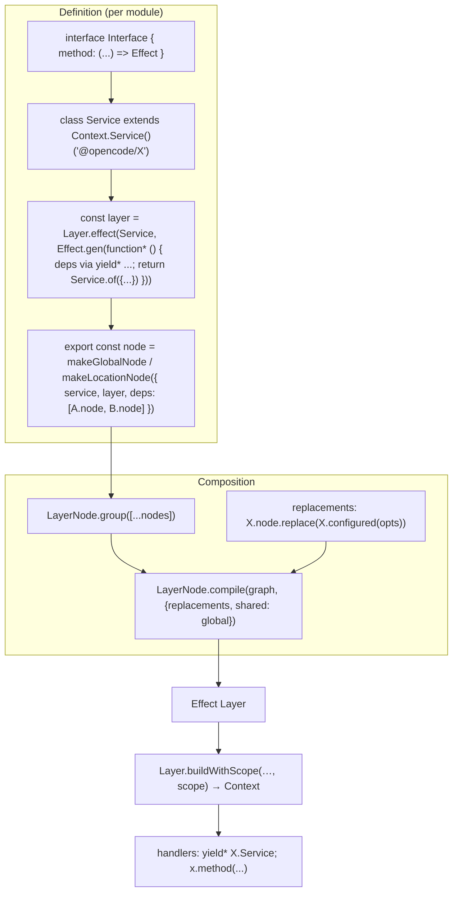

# Effect v4 runtime patterns in OpenCode (and their Rust translations)

> OpenCode @ 56625a3e1f · paths relative to opencode-reference/

## TL;DR

- Effect `4.1.0` is pinned through the workspace catalog (`package.json`, `"effect": "4.1.0"`). Nearly all runtime code (core, server, cli, client/effect, ai, util) is written as `Effect.gen` generators. Across those packages there are about 1,060 `Effect.fn(...)` and 480 `Effect.fnUntraced(...)` call sites, 128 `Context.Service` classes and 222 `Schema.TaggedError` classes (grep counts).
- A **service** is three things: an `Interface` of Effect-returning methods, a `class Service extends Context.Service<Service, Interface>()("@opencode/Name")` tag, and a `Layer.effect(Service, Effect.gen(...))` implementation. OpenCode wraps the layer in its own **`LayerNode`** graph (`makeGlobalNode` / `makeLocationNode`). Nodes declare their `deps` explicitly and can be swapped with `.replace(...)` for tests, embedding and configuration.
- **Errors are values in the type.** Expected failures are `Schema.TaggedError` classes in the `E` channel, caught by tag (`Effect.catchTag("Session.NotFoundError", …)`). Bugs and invariant violations become **defects** (`Effect.die`, `Effect.orDie`). HTTP handlers translate domain errors to protocol errors at the edge.
- **Schema everywhere**: branded IDs (`ses_…`, `evt_…`), `Schema.Class` records, event definitions, config, HTTP API contracts, JSON decoding at boundaries (`Schema.fromJsonString`). The same schema drives the generated client.
- **Scopes own resources.** Layers acquire with `Effect.addFinalizer` or `Effect.acquireRelease`. Background loops are `Effect.forkScoped` / `forkIn(scope)`, so closing a Location or the server interrupts them. `LayerMap`/`RcMap` give ref-counted per-key service graphs.
- **Concurrency** uses fibers plus `Deferred`, `PubSub`, `Queue`, `Semaphore`, `FiberSet` and a custom `KeyedMutex`. Interruption is the cancellation mechanism. Critical sections are fenced with `Effect.uninterruptible` / `uninterruptibleMask(restore)`.
- House style is enforced by **ast-grep** (`script/ast-grep/**`) and **oxlint JS plugins** (`script/oxlint/anti-slop/effect`). Examples: no nested service yields, no `Effect.die("string")`, `mapError` instead of catch-then-fail, `Match` instead of manual `_tag` switches.
- For Genie (Rust): Service+Layer ≈ trait + struct built by an async constructor that takes its deps explicitly. Scope ≈ a `CancellationToken` tree plus a `JoinSet`/`TaskTracker` plus `Drop` guards. TaggedError ≈ `thiserror` enums. Defect ≈ `panic!`/`anyhow` at the boundary. Fiber interrupt ≈ token cancel plus abort-on-drop.

## Where it lives

| path | role | ~lines |
|---|---|---|
| `packages/util/src/effect/layer-node.ts` | `LayerNode` graph DSL: `make`, `unbound`, `group`, `replace`, `compile` | 360 |
| `packages/util/src/effect/app-node.ts` | Tags `global` and `location`, plus `makeGlobalNode`/`makeLocationNode` | 14 |
| `packages/core/src/effect/app-node-builder.ts` | Wires `Instance` + `LocationServiceMap` into a compiled app | 30 |
| `packages/core/src/location-services.ts` | `LayerMap` of per-Location graphs, shutdown semantics | 125 |
| `packages/core/src/instance.ts` | The location-scoped node list and `Instance.layer` | 191 |
| `packages/core/src/project.ts` | Representative *global* service | 536 |
| `packages/core/src/permission.ts` | Representative *location* service with Deferred-based asks | 388 |
| `packages/core/src/bus.ts` | Representative resource-heavy service (PubSub, Stream, transactions) | 909 |
| `packages/core/src/session/run-coordinator.ts` | Fiber-per-key execution coordinator | 198 |
| `packages/core/src/effect/keyed-mutex.ts` | Per-key lock | ~45 |
| `packages/schema/src/*` | Schema contracts (IDs, events, records) | 8.7K |
| `script/ast-grep/`, `script/oxlint/anti-slop/effect/` | Effect lint rules | — |
| `.opencode/skills/effect/SKILL.md` | The repo's own Effect guidance for agents | — |
| `packages/core/test/lib/effect.ts` | `testEffect` harness with network refusal | — |

## Architecture



```mermaid
sequenceDiagram
  participant H as HTTP handler fiber
  participant P as Permission (Location layer)
  participant B as Bus
  participant C as Client (TUI/SSE)
  H->>P: assert(input)
  P->>P: evaluate rules (findLast)
  alt deny
    P-->>H: fail BlockedError (typed)
  else ask
    P->>P: Deferred.make; pending.set
    P->>B: publish permission.asked
    B-->>C: SSE event
    C->>P: reply (HTTP)
    P->>P: Deferred.succeed / fail(DeclinedError)
    P-->>H: resume (Declined → defect tunnel)
  end
  Note over P: Layer finalizer close(): reject all pending, fail Deferreds
```

## Key types and interfaces

| name | file:line | purpose |
|---|---|---|
| `LayerNode.make` / `unbound` / `group` / `compile` | `packages/util/src/effect/layer-node.ts:193,219,224,244` | Declare nodes, group them, compile to a `Layer` |
| `NodeValue.replace` | `layer-node.ts:82` | Type-checked swap: the replacement must provide the same outputs and no new errors |
| `CompileOptions.shared` | `layer-node.ts:232-233` | Share subgraphs with a given tag across builds (global services across Locations) |
| `Node.tags` | `packages/util/src/effect/app-node.ts:3-6` | `location` may depend on `global`, never the reverse |
| `AppNodeBuilder.build` | `packages/core/src/effect/app-node-builder.ts:23` | Root compile with the `Instance`/`LocationServiceMap` bindings |
| `Project.Service` | `packages/core/src/project.ts:101` | Global service example |
| `Project` `Now` reference | `project.ts:73` | `Context.Reference` with a default value (an injectable clock) |
| `Permission.Service` / `Unattended` | `packages/core/src/permission.ts:124,63` | Location service; `Context.Reference` for headless rulesets |
| `Bus.Service` | `packages/core/src/bus.ts:183` | PubSub + SQLite durable log |
| `SessionRunCoordinator.Coordinator` | `packages/core/src/session/run-coordinator.ts:7` | Per-key serialized execution with interrupt |
| `SessionID` | `packages/schema/src/session-id.ts:5-11` | Branded, prefix-checked ID with a `create()` static |
| `Event.durable` / `ephemeral` | `packages/schema/src/event.ts:90,128` | Schema-built event definitions |
| `Env.password` | `packages/cli/src/env.ts:10-13` | `Config.Redacted` env reading with fallback |

## How it works: walkthroughs

### 1. A global service: `Project`

1. **Interface and tag.** `Interface` (`project.ts:90-99`) lists `list`, `update` (fails with `NotFoundError`), `activate`, `resolve` and `sweep`, each returning `Effect.Effect<A, E>` with `R = never`. Dependencies never leak into method signatures. The tag is `class Service extends Context.Service<Service, Interface>()("@opencode/Project")` (`:101`).
2. **Typed error**: `class NotFoundError extends Schema.TaggedError<NotFoundError>()("Project.NotFoundError", { projectID: ID })` (`:36-38`). Tagged errors can be yielded directly: `return yield* new NotFoundError({...})` (the same pattern appears in `Session.create`, `core/src/session.ts:295`).
3. **Layer.** `const layer = Layer.effect(Service, Effect.gen(function* () {...}))` (`:129`). It acquires deps once with `yield* Bus.Service`, `Database.Service` and so on (`:132-137`), then closes over them in plain functions. Each method is `Effect.fn("Project.resolve")(function* (...) {...})` (`:426`). `Effect.fn` names a tracing span and accepts trailing combinators, for example `Effect.fn("Project.root")(gen, Effect.orElseSucceed(() => undefined))` (`:50-64`).
4. **In-layer caching.** `Cache.make({capacity: 512, lookup})` is keyed by `.git` path plus fingerprint (`:385-389`). Non-cacheable failures invalidate their entry (`:438-440`).
5. **Injectable time.** `const Now = Context.Reference<() => number>("@opencode/Project/Now", {defaultValue: () => Date.now})` (`:73`). `configured({now})` provides a test clock via `Layer.provide(Layer.succeed(Now, …))` (`:511-517`).
6. **Node.** `makeGlobalNode({service, layer, deps: [Bus.node, Database.node, FSUtil.node, Git.node, AppProcess.node]})` (`:512-516`). If `deps` misses a service the layer uses, that is a *type error* (`CheckDependencies`, `layer-node.ts:134-138`).
7. **Background job as a layer.** `sweepNode` is `Layer.effectDiscard(project.sweep().pipe(Effect.ignoreCause({log: "Error"}), Effect.repeat(Schedule.spaced(1h)), Effect.forkScoped))` (`:521-536`). The fiber lives exactly as long as the layer's scope.

### 2. A location service with suspended asks: `Permission`

1. **Pure evaluation.** `evaluate(action, resource, ...rulesets)` returns the **last** matching rule, with `ask` as the default (`permission.ts:94-104`).
2. **Layer state** is plain mutable JS (`pending = new Map<ID, Pending>()`, `closed`) captured by closures (`:132-145`). Fibers run on one JS thread, so no lock is needed, but every multi-step mutation is wrapped in `Effect.uninterruptible` (`create`, `:229-246`).
3. **Suspension.** For `ask`, `create` makes a `Deferred<void, DeclinedError | CorrectedError>`, records it, and publishes `permission.asked` on the Bus. `assert` then runs `restore(Deferred.await(item.deferred))` inside `uninterruptibleMask`. Only the wait is interruptible, and `Effect.ensuring` always removes the pending entry (`:256-285`).
4. **Defect tunnel.** A plain decline is converted to a defect with `Effect.catchTag("Permission.DeclinedError", e => Effect.die(e))` so that tool-level `mapError` blankets can't turn it into model-visible tool output. It is re-typed later at `SessionModelRequest.executeTool` (comment at `:273-277`). This is deliberate use of the defect channel as a non-catchable control signal.
5. **Shutdown.** `yield* Effect.addFinalizer(() => close)` (`:157`). When the Location scope closes, every pending ask is replied `reject` and its Deferred fails (`:147-156`). Waiting tool fibers therefore wake up instead of leaking.
6. **Node.** `makeLocationNode({service, layer, deps: [Bus.node, Location.node, Agent.node, SessionStore.node, PermissionSaved.node, PluginHooks.node]})` (`:384-388`). Bus and SessionStore are global, Location and Agent are per-Location. The tag system allows that direction.
7. **Ambient override.** `Unattended` is a `Context.Reference<Ruleset | undefined>` (`:63`), read with `yield* Unattended` (`:199`). Headless callers provide it per-effect without changing the service.

### 3. A resource-heavy service: `Bus`

1. **Acquire.** In `configured()` (`bus.ts:193-210`) the layer creates `PubSub.unbounded` for the live stream, maps for typed and durable subscribers, and a `KeyedMutex`. A deferred `import()` breaks a module cycle (`:200-203`).
2. **Release.** `Effect.addFinalizer` shuts down every PubSub (`:274-288`), which ends all subscriber Streams.
3. **Subscriptions as scoped resources.** `subscribe(defs)` is `Stream.unwrap(Effect.acquireRelease(PubSub.unbounded().pipe(register), unregister+shutdown))` piped into `Stream.fromSubscription` (`:735-760`). Unsubscribing happens automatically when the consumer's stream is interrupted or completes.
4. **Transactions.** The durable commit runs `db.transaction(() => Effect.gen(...))` inside `Effect.uninterruptible` (`:314-320`), holding `durableLocks.withLock(aggregateID)` (`:470`). Invariant violations (sequence mismatch, replay divergence) are `Effect.die(new InvalidDurableEventError(...))`: bugs, not recoverable errors (`:362-379`).
5. **Listener isolation.** For durable events, listener failures are caught and logged unless the cause contains an interruption (`catchCauseIf(c => !Cause.hasInterrupts(c), …)`, `:487-493`). Interrupts still propagate.

### 4. Concurrency and interruption: `SessionRunCoordinator`

1. `make` needs a `Scope` and creates `FiberSet.makeRuntime()` (`run-coordinator.ts:71`). Every execution fiber is owned by that set, so the coordinator's scope interrupts them all at shutdown.
2. One execution per key. `wake` "rings the doorbell", so an active drain loops again instead of ending. `run` joins the active execution via a `Deferred` (`:13-16,31-55`).
3. `interrupt(key)` records the reason and then fires `Fiber.interrupt(execution.owner)` through the FiberSet runtime without awaiting cleanup (`:160-165`). Callers get an immediate acknowledgement while finalizers run on their own time. `SessionExecution.terminal` classifies an exit as interrupted with `Cause.hasInterrupts` (`core/src/session/execution.ts:48-50`).
4. `Session.prompt` wraps admission in `Effect.uninterruptibleMask(restore => ...)`. Only prompt *preparation* is interruptible, while the durable admit is not (`core/src/session/session.ts:155-190`).

### 5. Program edge: `main`, HTTP handlers, Promise interop

1. The CLI's `main` is one `Effect.gen` piped through `Effect.provide(Config.layer)`, `Updater.layer`, a compiled `LayerNode` of Global/AppProcess/Npm/EffectFlock, `Observability.layer`, `NodeServices.layer`, then `Effect.scoped` and `NodeRuntime.runMain` with a custom teardown (`packages/cli/src/index.ts:101-183`).
2. HTTP handlers are thin. `handle("session.prompt", Effect.fn(function* (ctx) {...}))` calls the service and maps tags to protocol errors (`ConflictError`, `InvalidRequestError`) with `catchTag` (`packages/server/src/handlers/session.ts:289-320`).
3. Non-Effect consumers (the TUI's Solid code) get bridges like `Effect.runPromiseWith(context)` and `Effect.runForkWith(context)` that capture the current services (`packages/cli/src/commands/handlers/default.ts:91-94`).
4. Callback APIs become effects with `Effect.callback(resume => { …; return cleanupEffect })` (`packages/cli/src/server-process.ts:233-246`).

## Configuration and extension points

- **Swapping implementations**: `X.node.replace(layerOrNode)`. Server options become replacements (`Database.configured(options.database)`, `Bus.configured({persist})`, `Config.configured({...})`, `packages/server/src/routes.ts:131-160`). Simulation mode appends `simulationReplacements` (`:170-177`). Vanilla instances replace `Config`/`InstructionDiscovery` (`packages/core/src/instance.ts:152-155`).
- **Env/config reading** goes through `effect`'s `Config` (`Config.Redacted("OPENCODE_PASSWORD").pipe(Config.orElse(...), Config.withDefault(undefined))`, `packages/cli/src/env.ts:10-13`). That keeps the env surface in one typed place.
- **Feature flags**: `Flag.enabled("<key>")` from `@opencode/core/flag`, with keys declared in `packages/schema/src/config/flag.ts` (root `AGENTS.md`).
- **Tracing**: every `Effect.fn("Name")` is a span. `Effect.fnUntraced` is used for process-lifetime effects so they don't parent every request (`server-process.ts:32-33`). The OTLP exporter is configured from `OTEL_EXPORTER_OTLP_*` (`cli/src/index.ts:150-158`).

### Lint rules that enforce the patterns

| rule | config | what it enforces |
|---|---|---|
| `no-nested-effect-service-yield` | `script/ast-grep/rules/no-nested-effect-service-yield.yml:5-11` | Forbids `(yield* Foo.Service).bar()`; bind the service to a name first |
| `no-effect-die-string` | `rules/no-effect-die-string.yml` | `Effect.die(new Error(...))`, never a string or template |
| `no-json-parse-cast` | `rules/no-json-parse-cast.yml` | No `JSON.parse(x) as T`; decode with Schema |
| `no-star-import`, `no-import-alias`, `no-drizzle-column-name` | `rules/*.yml` | Import hygiene, snake_case Drizzle columns |
| `no-effect-catch-fail` | `effect-simplifications/rules/no-effect-catch-fail.yml` | `catch(e => Effect.fail(f(e)))` becomes `mapError(f)` (autofix) |
| `no-effect-catch-succeed` | `…/no-effect-catch-succeed.yml` | Constant recovery becomes `Effect.orElseSucceed` |
| `no-effect-flat-map-suspend` | `…/no-effect-flat-map-suspend.yml` | Use `Effect.andThen` when the value is ignored |
| `no-effect-and-then-succeed-undefined` | `…/no-effect-and-then-succeed-undefined.yml` | Use `Effect.as(undefined)` |
| `no-identity-pipe` | `…/no-identity-pipe.yml` | No `.pipe(x => x)` |
| `anti-slop-effect/*` (oxlint) | `.oxlintrc.json:91-104` | `no-manual-tag-comparison` (use `Match.tag`/`Predicate.isTagged`), `no-manual-tagged-construction`, `no-manual-effect-error-tag`, `no-service-constructor-imports`, `prefer-effect-match`. **Warn-level, GUI packages only.** |

Scripts: `lint:effect-patterns` scans util/core/server/protocol/cli. `lint:effect-simplifications` scans all packages. `test:lint-rules` snapshot-tests the rules (root `package.json`). `script/ast-grep/effect-simplifications/README.md` explains the conservative "unused `_param`" proof the autofixes rely on.

## Edge cases, invariants and gotchas

- **Layer memoization is per compile.** `LayerNode.compile` with `shared: global` gives each Location fresh location nodes but one copy of global nodes (`layer-node.ts:232-233`, `instance.ts:169`). Building a layer twice without the shared memo map would create a *second* Bus/Database. That is why `LocationServiceMap` borrows its owner's map (`location-services.ts:112-121`).
- **Replacements are ordered, last wins**: vanilla defaults, then caller replacements, then instance bindings (`instance.ts:160-167`). A replacement must not widen errors or drop outputs (`layer-node.ts:116-132`), and it must keep the same tag (`:87`).
- **Boot failure classification.** `Instance.layer` turns `DirectoryNotFoundError` into a typed failure and *every other* boot error into a defect (`instance.ts:171-181`). The server maps the former to `LocationNotFoundError` (`server/src/location.ts:20-34`).
- **The `orDie` habit.** There are about 294 `Effect.orDie` uses in runtime packages. DB errors are generally treated as defects (`bus.ts:31,48`). The typed channel is reserved for domain outcomes.
- **Interrupt-aware error handling.** Wherever errors are swallowed, the code checks `Cause.hasInterrupts`/`hasInterruptsOnly` so cancellation is never logged as failure or masked (`bus.ts:489`, `cli/src/index.ts:166`, `server/src/process.ts:133`).
- **Uninterruptible regions are small** and paired with `restore` for the part that waits on users or the network (`permission.ts:262-283`, `session/session.ts:156-188`).
- **Request-trace hygiene.** Long-lived fibers are started `withoutParentSpan` or `fnUntraced`. Otherwise every request would nest under the startup trace (`server/src/process.ts:72,100-101`).
- **Single-threaded state.** Services mutate `Map`s without locks. That is only safe because JS is single-threaded and the mutations sit in uninterruptible blocks. **A Rust port must add real synchronization.**
- **Skill vs code drift.** `.opencode/skills/effect/SKILL.md` recommends `Schema.TaggedErrorClass`, but the code uses `Schema.TaggedError` (222 vs 0 occurrences).

## Tests worth reading

- `packages/core/test/lib/effect.ts`: `testEffect`, scoped tests, network refusal for any non-loopback fetch.
- `packages/core/test/effect/layer-node/layer-node.test.ts`, `layer-node-types.test.ts`: replacement and sharing semantics, including the type-level checks.
- `packages/core/test/effect/keyed-mutex.test.ts`, `effect-simplification-types.test.ts`
- `packages/core/test/permission.test.ts`, `core/test/plugin/permission-assert.test.ts`: Deferred asks, close semantics.
- `packages/core/test/bus.test.ts`, `bus-unpersisted.test.ts`: transactions, replay divergence, stream lifecycles.
- `packages/core/test/location-layer.test.ts`, `location-retain.test.ts`: LayerMap borrow and shutdown.
- `script/ast-grep/rule-tests/*.yml` and `effect-simplifications/rule-tests/*.yml`: concrete good/bad examples for each lint.

## Genie takeaways

Rust translation table (for [01](../../tickets/01-engine-architecture.md)):

| Effect (OpenCode) | Genie (Rust/tokio) |
|---|---|
| `Interface` + `Context.Service` tag | `trait Foo: Send + Sync` + `Arc<dyn Foo>` (or a concrete struct when there is one impl) |
| `Layer.effect(Service, gen)` with `yield* Dep.Service` | `async fn new(deps: FooDeps) -> Result<Arc<Foo>>`; deps passed explicitly, no service locator |
| `LayerNode` graph + `.replace()` | One `EngineBuilder` that constructs subsystems in order; test doubles injected via builder methods. **Don't** build a DI graph engine: Genie has one session per process, so the graph is small and static |
| `global` vs `location` tags | Process-wide (`Store`, `ProviderRegistry`, MCP pool) vs session-scoped (`Permissions`, `ToolCtx`, cwd) structs. Enforce the direction with crate visibility |
| `Scope` + `addFinalizer` | Parent `CancellationToken` → `child_token()` per session/turn/tool; `TaskTracker`/`JoinSet` for spawned tasks; RAII guards for files and processes |
| `Effect.forkScoped(loop)` | `tracker.spawn(async move { tokio::select! { _ = token.cancelled() => {}, _ = loop_body => {} } })` |
| Fiber interrupt (fire-and-forget) | `token.cancel()` and return immediately; await the `JoinHandle` only where a caller needs cleanup to finish (mirrors `run-coordinator.ts:160-165`) |
| `uninterruptible` / `uninterruptibleMask(restore)` | Do the critical write in a section that doesn't poll the token (or `tokio::spawn` it so a dropped future can't cancel it); only `select!` on the token around the waiting part |
| `Deferred` | `tokio::sync::oneshot` (single waiter) or `watch` |
| `PubSub` + `Stream` subscribe | `tokio::sync::broadcast` (lossy, like OpenCode's SSE) for live events; durable replay from SQLite by `seq` |
| `KeyedMutex` | `DashMap<Key, Arc<tokio::sync::Mutex<()>>>`. Genie has one session, so mostly unnecessary |
| `Schema.TaggedError` union in `E` | `#[derive(thiserror::Error)] enum PermissionError { Blocked{..}, Corrected{..} }` per subsystem |
| Defect (`die`, `orDie`) | `panic!` for invariants, or `anyhow::Error`/`Internal` variant mapped to a protocol `internal_error`; never shown to the model |
| Defect tunnel for "user declined" | A dedicated `ControlFlow`/`Interrupted` result variant that tool wrappers must not convert to tool output. Make it a separate enum so the compiler enforces it |
| `Schema` + branded IDs | `serde` structs + newtypes (`SessionId(String)` with prefix validation) + `schemars` for the JSON schema export in `genie-protocol` ([02](../../tickets/02-event-protocol.md)) |
| `Context.Reference` with default | A field on the session context with `Default`, overridable per call (e.g. a headless permission override) |
| `Effect.fn("Name")` spans | `#[tracing::instrument(name = "permission.assert", skip_all)]` |
| `Config.Redacted` env reading | A single `env.rs` module with `secrecy::SecretString` |

What to port, adapt or avoid:
- **Port the permission wait pattern** ([08](../../tickets/08-permissions.md), pick-list #9). Record the request, emit `permission_request` (in Genie, a `control_request`), await a oneshot raced against the turn's cancellation token, and **on session shutdown fail every pending ask as rejected**. Also port the "decline is not tool output" distinction. **Do not** port `findLast` ordering. Genie checks deny → ask → allow by rule *class*, so evaluation must not depend on file order.
- **Adapt the coordinator's doorbell semantics** for Genie's single session actor ([12](../../tickets/12-sessions-persistence.md), [16](../../tickets/16-context-management.md)). Commands arriving mid-turn set a "pending" flag, and the actor drains again before going idle. Interrupt acknowledges immediately and cleanup runs asynchronously.
- **Port the scoped-subscription idea**. Each front-end subscription is a guard whose `Drop` unregisters it. Make event streams per-session and bounded, with overflow → resync-from-`seq` rather than a silent drop ([02](../../tickets/02-event-protocol.md)).
- **Adopt the error-channel discipline**: typed domain errors inside the engine, defects for bugs, and a single translation layer to protocol errors at the `genie-protocol` edge, mirroring thin HTTP handlers. Subagents ([19](../../tickets/19-subagents.md)) and hooks ([20](../../tickets/20-hooks.md)) should get their cancellation tokens as children of the parent turn's token.
- **Adopt lint-as-architecture.** OpenCode encodes conventions as ast-grep rules with snapshot tests. Genie's equivalents: `clippy` lints (`unwrap_used`, `await_holding_lock`), a `cargo deny`/custom check that `genie-protocol` has no internal deps, and a small `dylint` or grep CI step for project-specific rules (for example "no `tokio::spawn` outside `TaskTracker`").
- **Avoid** reproducing `LayerNode`, `LayerMap`/`RcMap` per-directory graphs and runtime service location. They solve multi-directory, multi-session hosting, which Genie rejected (pick-list #43).

## Glossary (as used in this repo)

- **Effect<A, E, R>**: a lazy program that succeeds with `A`, fails with typed `E`, and needs services `R`.
- **Effect.gen / `yield*`**: generator syntax that sequences effects like `async/await`.
- **Effect.fn("Name")**: defines an effectful function with a tracing span. `fnUntraced` does the same without the span.
- **Context.Service / tag**: a typed key for a service in the environment. `Service.of({...})` builds the implementation value.
- **Context.Reference**: a service key with a default value, so it needs no provider.
- **Layer**: a recipe that builds services (possibly using other services) inside a Scope. It is memoized per build.
- **LayerNode / node**: OpenCode's wrapper that adds explicit `deps`, a `global`/`location` tag and typed `.replace()`.
- **LayerMap / RcMap**: ref-counted maps from a key (here `Location.Ref`) to a built layer or resource.
- **Scope / finalizer**: the lifetime of resources. `addFinalizer`/`acquireRelease` register cleanup that runs on close, including on interruption.
- **Fiber**: a lightweight green thread. `fork*` variants choose which scope owns it (`forkScoped`, `forkIn`, `FiberSet`).
- **Interruption**: cooperative cancellation of a fiber. `uninterruptible`/`uninterruptibleMask` protect regions.
- **Deferred**: a one-shot promise that fibers can await (a oneshot channel).
- **PubSub / Queue / Stream**: broadcast hub, bounded or unbounded mailbox, and pull-based async sequence.
- **Schema**: runtime codec plus type. `Schema.Class` for records, `brand` for nominal IDs, `TaggedError` for error classes with `_tag`.
- **Defect**: an unexpected failure (`die`, `orDie`) outside the typed `E` channel. It is caught only by `catchDefect`/`catchCause`.
- **Cause**: the full failure tree (failures, defects, interrupts). `Cause.hasInterrupts` separates cancellation from errors.

## Open questions / inferred

- How `LayerNode.compile` handles a node declared in both shared and local subgraphs was only skimmed (`layer-node.ts:244-300`). Treat the sharing description as *(inferred)* beyond the documented `shared` option.
- Whether the `anti-slop-effect` oxlint rules will be promoted beyond GUI packages or to error level is unknown.
- How much `Effect.orDie` on DB calls matters in practice (e.g. SQLITE_BUSY becoming a defect that crashes a request) was not traced. A `busy_timeout = 5000` pragma mitigates it (`core/src/database/database.ts:46`).
- Effect v4 is newer than most public material. The API names here (`Context.Service`, `Effect.catch`, `Effect.callback`, `Schema.TaggedError`) are as used in this repo at `effect@4.1.0`. Don't assume v3 docs apply.
