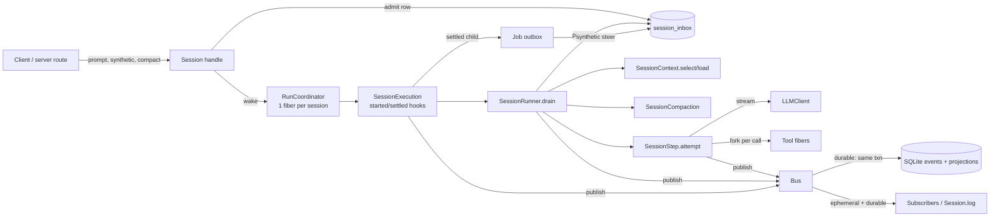
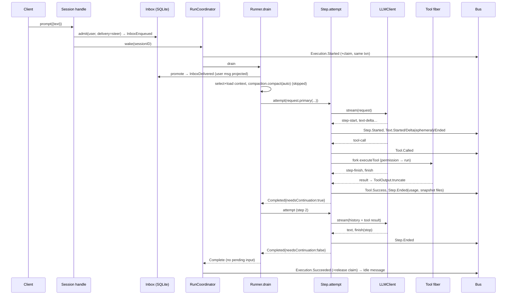
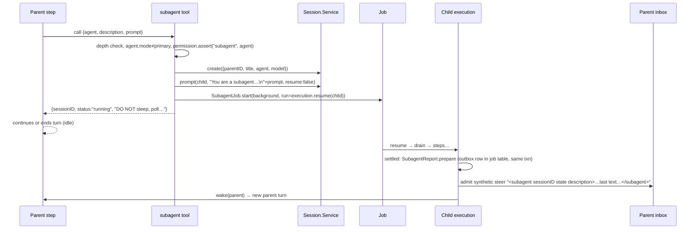

# Sessions and the agent loop

> OpenCode @ 56625a3e1f · paths relative to opencode-reference/

## TL;DR

- **Event-sourced sessions.** Nothing writes messages directly. Every change is a typed event on the `Bus`. Durable events are committed to SQLite and projected into `session_message` rows in the same transaction. Ephemeral events (text/reasoning/tool-input deltas, tool progress, usage totals) are live-only. Clients replay with `Session.log({after, follow})`.
- **Prompts go into an inbox first.** `Session.prompt` admits a durable inbox row (`delivery: "steer" | "queue"`, default `steer`) and then rings a per-session "doorbell" (`execution.wake`). A run coordinator gives each session one fiber at a time, and wakes that arrive mid-run coalesce into another drain.
- **One drain is one turn. One step is one model call.** `SessionRunner.drain` loops `advanceToStep → runStep`. A step continues when the model made at least one client-executed tool call. The agent's `steps` field caps steps by injecting a `MAX_STEPS_PROMPT` assistant message and setting `toolChoice: "none"`. Tool definitions stay in the request so the cached prefix is kept.
- **Tools run while the model is still streaming.** Each `tool-call` event forks a tool fiber right away (unbounded parallelism), and the step waits for all of them after the stream ends. The core runner calls `LLMClient.stream` directly. The `LLM.loop` helper in `packages/ai` is a separate, simpler loop for SDK and one-shot use.
- **Layered recovery.** Retries use `ModelRetry` (exponential backoff from 2s, 10s cap, 10 retries, `retry-after` honoured, a separate 1-hour budget for "network unreachable"). Context overflow triggers compaction and a re-send. A `length` finish injects a "continue in smaller pieces" synthetic message, up to two times in a row. Unsettled tool calls left by a crash are failed when the next drain starts.
- **Subagents are child sessions run as background Jobs.** The `subagent` tool creates a child session (or follows up on one by `sessionID`) and returns `status: "running"` immediately. When the child goes idle, its last assistant text is delivered to the parent as a steered synthetic `<subagent …>` message, which wakes the parent.
- **Crash safety is a property of the database.** `Execution.Started` writes a claim in the same transaction. Only terminal events release it, so a turn that dies is resumed on the next start, with up to 10 attempts per turn.

## Where it lives

| path | role | ~lines |
|---|---|---|
| `packages/core/src/session.ts` | Public `Session.Service` (create/fork/remove/prompt/compact/interrupt/background/revert) | 577 |
| `packages/core/src/session/session.ts` | Per-session handle: admission, synthetic, interrupt, revert | 445 |
| `packages/schema/src/session-message.ts` | Message and part data model | 347 |
| `packages/schema/src/session-event.ts` | All session event definitions (durable/ephemeral) | 739 |
| `packages/schema/src/session-inbox.ts`, `core/src/session/inbox.ts` | Inbox items, steer/queue promotion | 98 + 625 |
| `packages/core/src/session/execution.ts` | Process-local execution, lifecycle events, claims, subagent report hook | 235 |
| `packages/core/src/session/run-coordinator.ts` | Per-key single-fiber "doorbell" coordinator | 198 |
| `packages/core/src/session/runner/llm.ts` | `drain`/`runStep`: the turn loop | 470 |
| `packages/core/src/session/runner/step.ts` | One model attempt: stream, tool fibers, settlement | 401 |
| `packages/core/src/session/runner/publish-llm-event.ts` | LLM event → session event translation | 637 |
| `packages/core/src/session/runner/{retry,max-steps}.ts` | Retry wrapper, step-cap prompt | 78 + 16 |
| `packages/core/src/model-retry.ts` | Backoff policy | 134 |
| `packages/ai/src/{llm,loop,tool-runtime}.ts` | Generic stream/loop/dispatch helpers | 336 + 214 + 109 |
| `packages/ai/src/generation.ts` | Polling for long-running *media* generations (not text) | 210 |
| `packages/core/src/job.ts`, `core/src/job/*` | Job registry, background/block/cancel, durable outbox | 730 + ~150 |
| `packages/core/src/tool/plugin/subagent.ts` | `subagent` tool | 276 |
| `packages/core/src/session/{subagent-job,subagent-completion}.ts`, `execution/subagent-report.ts` | Child job start, report formatting and delivery | 61 + 81 + 201 |
| `packages/core/src/session/{title,generate,revert}.ts`, `plugin/{agent,fork-notice}.ts` | Hidden agents, fork, revert | 174 + 78 + 112 + 119 + 30 |

## Architecture

## Key types and interfaces

| name | file:line | purpose |
|---|---|---|
| `Session.Interface` | `core/src/session.ts:126` | Full session API (list, create, fork, prompt, compact, interrupt, background, revert…) |
| `SessionMessage.Info` | `schema/src/session-message.ts:306` | Union of 11 message kinds: `agent-switched`, `model-switched`, `location-switched`, `user`, `synthetic`, `system`, `skill`, `shell`, `assistant`, `compaction`, `idle` |
| `Assistant` | `schema/src/session-message.ts:221` | `content: (text|reasoning|tool)[]`, `snapshot{start,end,files}`, `finish`, `tokens`, `cost`, `error`, `retry`, timing (`firstToken`, `streamed`, `completed`) |
| `AssistantTool` / `ToolState` | `schema/src/session-message.ts:171`, `:165` | Tool part. State is `streaming → running → completed | error`. `executed` is false for provider-hosted tools. `native` is the provider replay blob |
| `Idle` | `schema/src/session-message.ts:299` | Turn boundary marker with `outcome: succeeded|failed|interrupted` |
| `SessionInbox.Item` | `schema/src/session-inbox.ts:53` | `user | synthetic | compaction | move`, each with `delivery: steer|queue` |
| `Promotable` | `core/src/session/inbox.ts:57` | `"steer"` promotes only steers (mid-turn step boundary). `"input"` also allows one queued item (idle boundary) |
| `Execution.*` events | `schema/src/session-event.ts:244` | `started/succeeded/failed/interrupted`. Interrupt reason is `user|shutdown|superseded|inactivity` |
| `SessionRunner.Interface.drain` | `core/src/session/runner/index.ts:33` | Drains durable work. Returns `Complete | Moved | Reloaded` |
| `SessionStep.Outcome` | `core/src/session/runner/step.ts:30` | `Completed{needsContinuation} | Retry | RecoverFull | Compacted | OutputLimit` |
| `Agent.Info` | `schema/src/agent.ts:23` | `system?`, `mode: subagent|primary|all`, `hidden`, `steps?`, `model?`, `permissions` |
| `Job.Interface` | `core/src/job.ts:159` | `start/wait/block/background/backgroundAll/cancel/cancelSession` plus subagent outbox methods |
| `Job.Recovery` | `core/src/job/recovery.ts` | Durable resume record: `shell | image | subagent{parentSessionID, childSessionID, agent, description, outstanding?}` |

## How it works: walkthroughs

### 1. Prompt to idle (one tool call)

1. **Admission.** `Session.prompt` (`core/src/session/session.ts:155-191`) runs uninterruptibly. It calls `admission.reconcile` so retries with the same message id are idempotent (`:161-167`), then `SessionPrompt.prepare` resolves files, skills and agent mentions. A staged revert is committed only after preparation succeeds (`:173`). The item is admitted with default delivery `steer` (`:165`), and finally `execution.wake` runs (`:187`). Passing `resume: false` admits the item without waking. Subagents rely on this.
2. **Coordinator.** `RunCoordinator.make` (`core/src/session/run-coordinator.ts:66`) keeps one `Execution` per session. `wake` (`:135-144`) starts a fiber when the session is idle. Otherwise it sets `pendingWake`, and the loop (`:73-84`) drains again before it settles. Coalesced wakes keep the widest scope (`input` beats `steer`).
3. **Lifecycle hooks.** `started` publishes `Execution.Started` with `claimOnCommit` (`core/src/session/execution.ts:80-82`, `:133-147`). `settled` maps the exit to a terminal event (`:150-171`). A shutdown interrupt keeps the claim so the next process start resumes the turn, and `execution/restart.ts` injects "The server restarted while you were working…" with `DEFAULT_MAX_ATTEMPTS = 10` (`execution/restart.ts:42`).
4. **Drain.** `SessionRunner.drain` (`core/src/session/runner/llm.ts:63-225`) first fails stale `running` compactions and stale `streaming/running` tool calls left by a crash (`:389-442`). Then it loops: `advanceToStep` handles control items first (manual compaction `:129-176`, location move `:124-128`). Next it calls `prepareContext` → `InstructionState.prepare` → `SessionInbox.promote`. When new input was promoted and the root session is untitled, title generation forks in a `FiberMap` so it never delays the model (`:202-205`). Promoted input resets `step = 1` (`:206`). When nothing is pending and at least one step ran, the plugin hook `experimental.idle` can admit more input before the session goes idle (`:177-190`).
5. **Step policy.** `runStep` (`:237-387`) estimates the prompt and runs `compaction.compact({reason:"auto"})`. If that compacts, it loops with a fresh assistant id. Then `compaction.precompute` runs. `stepLimitReached = agent.steps !== undefined && step >= agent.steps` (`:261`). On the last step it appends `Message.assistant(MAX_STEPS_PROMPT)` and sets `toolChoice: "none"` while keeping the tool definitions, to preserve the cache (`:276-280`). It then builds the request via `context.request.primary` (chapter 04).
6. **Attempt.** `SessionStep.attempt` (`core/src/session/runner/step.ts:77-333`) forks a start snapshot so it overlaps the request (`:80`), streams events through `publisher.publish`, and for each non-provider-executed `tool-call` forks `executeTool → toolOutput.truncate → publisher.toolExecution` in a scoped fiber (`:145-158`). After the stream ends it waits for all tool fibers (`:182`), classifies declines, interrupts and defects (`:345-367`), fails any unsettled calls, captures the end snapshot, diffs the changed files, and publishes `Step.Ended` with usage and cost (`:289-315`).
7. **Continuation.** `needsContinuation` is true when any client-executed tool was called or settled (`publish-llm-event.ts:615-618`) and tools were not disabled (`step.ts:328`). The drain loop then runs another step (`llm.ts:216-224`). At each step boundary only *steered* inbox items are promoted, so a user can steer mid-turn. Queued items wait for idle.
8. **Idle.** `Execution.Succeeded/Failed/Interrupted` is projected into an `idle` message by `message-updater.ts:70`, `:149-153`. The idle marker groups every step since the previous one into one turn.

### 2. Parallel tools, retries, cancellation

- **Parallel.** Tool fibers start as soon as each call arrives, with no concurrency cap (`step.ts:145-158`). The default system prompt says "Prefer parallelizing independent tool calls" (`runner/prompt/system.txt:6`). The generic `ai` loop runs a step's calls with `concurrency: "unbounded"` and returns results in call order (`ai/src/tool-runtime.ts:51-59`).
- **Retry.** `ModelRetry.policy` (`core/src/model-retry.ts:67-89`) uses jittered exponential backoff (2s → 10s cap) for 10 recurrences (`:25-36`). The delay is at least the provider's `retry-after`, clamped to 15 minutes (`:12-20`). Network-unreachable codes (`ENOTFOUND`, `EAI_AGAIN`, `ENETUNREACH`…) get a separate 1-hour budget with a 30s gap cap (`:43-61`). Timeouts retry at most 3 times (`:65`). `SessionRunnerRetry.policy` lets the `session.retry` plugin hook veto the retry or change its delay (`runner/retry.ts:32-55`). `wait` publishes `RetryScheduled` and then sleeps (`:60-76`). In the step, a failure *before any output* reuses the same assistant message; a failure after output starts a fresh one (`step.ts:255-259`, `:317-318`). Transport failures with `retry-full` recovery return `RecoverFull` once (`:237-243`). One-shot calls (title, generate) use `retryOneShot`, which only retries rate limits, 503/529 and not-sent transport errors, at most 3 times (`model-retry.ts:104-134`).
- **Output limit.** A `length` finish returns `OutputLimit`. The runner publishes the `CONTINUE_AFTER_OUTPUT_LIMIT` synthetic text (`llm.ts:38-39`, `:374`) and fails after three consecutive `length` assistant messages (`:348-372`).
- **Cancellation.** `Session.interrupt` → `coordinator.interrupt(key,"user")` marks the execution as stopping, clears pending wakes and interrupts the owner fiber without waiting for it (`run-coordinator.ts:146-170`). In the step, `stopTools` first triggers each tool's cooperative `cancel`. Tools that do not settle within `COOPERATIVE_STOP = "5 seconds"` are interrupted (`step.ts:109-117`, `:370`, `makeCancel` `:378-401`). Unsettled tools fail with "Tool execution interrupted" and the assistant with "Step interrupted" (`:271-280`). A user declining a permission or question also ends the step as an interrupt (`:321-324`). `interrupt({resume:true})` immediately re-wakes for any pending *steer* or control item (`execution.ts:179-196`).

### 3. Jobs and background work

`Job.start` (`core/src/job.ts:353`) registers an `Active` job in a `SynchronizedRef` map, gives it its own `Scope` and generation number, and forks `run`. Background jobs with a `recovery` record are written to the `job` table *before* the work forks (`:394-395`), so a restart can find them. `block` (`:442-469`) lets a tool (for example the shell tool, `tool/plugin/shell.ts:425`) wait for either `done` or `backgrounded`. The shell tool moves the job to the background on timeout. `Session.background` (`core/src/session.ts:524-541`) calls `jobs.backgroundAll` and then injects a synthetic message telling the model the work is unfinished and that it must not sleep or poll for it. `Session.remove` interrupts, waits for idle, cancels the session's jobs and removes children recursively (`:402-416`). Cancel and shutdown are different: only an explicit cancel runs the job's `cancel` effect and releases the child's claim (`session/subagent-job.ts:33-37`).

### 4. Subagents

- The tool schema is `agent, description, prompt, model?, sessionID?` (`tool/plugin/subagent.ts:29-43`). Its description and result text tell the model that subagents always run in the background (`:18-27`, `:50-56`).
- Depth is measured by walking `parentID`s. The limit is `experimental.subagent_depth`, default 1 (`:117-133`). Agents with `mode: "primary"` are rejected (`:136-137`). Permission action is `subagent`, resource the agent id (`:138-145`).
- **Follow-ups.** When `sessionID` is passed, the session must be a child of the caller (`:158-161`). A different agent switches the child's agent and/or model (`:165-176`). If the child is running, the prompt is admitted *with* a wake and joins the current run. Otherwise it is admitted with `resume:false`, and the new Job's `resume` starts it (`:194-214`).
- Model precedence is explicit `model` > agent's model > parent's model (`:178`). New children get the prefix "You are a subagent spawned by another session." (`:206`).
- A `context`/`compaction`/`generate` hook appends "Available subagents:" to the tool description. Hidden and primary agents and denied agents are left out (`:247-274`).
- **Idle notification.** The execution `settled` hook calls `SubagentReport.prepare` (`execution.ts:162-169`). That looks up the child's last assistant text after the period started (`execution/subagent-report.ts:55-72`), records an outbox row in the Job table inside the terminal event's transaction (`:152-182`), and afterwards admits a **steered synthetic** into the parent and wakes it (`:73-128`). The body comes from `SubagentCompletion.deliver` (`session/subagent-completion.ts:55-81`): `<subagent sessionID="…" state="…" description="…">` + text, plus "Background work still running:" lines for any outstanding shells, images or grandchildren. A report goes out every time the child goes idle, not only the first time.
- Built-in agents (`plugin/agent.ts:56-116`): `build` (default, primary), `general` (subagent; `question` and `subagent` denied), `explore` (subagent; read-only allowlist plus its own `system`), and three hidden primary agents: `compaction`, `title`, `summary`.

### 5. Fork, revert, title, summary, generate

- **Fork** (`core/src/session.ts:341-394`) copies history up to a boundary (`before` = exclusive, otherwise `through` the latest message) via a single `Forked` event. It adopts the parent's *newest* instruction state, not the state at the boundary. Then it fires the `session.fork` hook. `ForkNoticePlugin` uses that hook to inject a synthetic `<fork-notice>`: background work belongs to the original, and shared files and branches need checking first (`plugin/fork-notice.ts:7-28`).
- **Revert** is two-phase. `stage` restores files from snapshots and publishes `RevertEvent.Staged`, and it refuses while the session is active (`session/session.ts:332-343`, `revert.ts:22-56`). `clear` undoes the staging. `commit` (explicit, or implicit on the next prompt or compaction) publishes `Committed{to}`. The projector then deletes later rows and rewinds instruction state (`projector.ts:1132-1162`).
- **Title.** A hidden `title` agent with a naming prompt (`plugin/agent.ts:19-38`). The model is chosen by `selectTitle`: the agent's model, else the provider's `small` model at a minimal reasoning variant, else the primary model at a lower variant (`session/context.ts:99-134`). Input is capped (`title.ts:21-23`) and wrapped as "Here is the first message… Reply with only the title." (`:36-39`). Usage is published as `UsageRecorded{source:"title"}`.
- **Summary.** The `summary` agent ("write like a PR description", `plugin/agent.ts:40-50`, `:110-116`) is registered but nothing in the repository refers to it by id *(inferred: legacy or unused in v2 core)*.
- **Generate.** `Session.generate` (`session/generate.ts:34-78`) runs a side request over the current context plus a user prompt, with no change to history, and records usage with `source:"generate"`.

### 6. Event publication during a turn

`Bus.publish` takes a per-aggregate lock, inserts the durable event, and runs registered projectors in one SQLite transaction (`core/src/bus.ts:296-440`). Any `commit` hook (claims, outbox) runs inside the same transaction. Durable step events are `Step.Started/FirstToken/Streamed/Ended/Failed`, `Text|Reasoning.Started/Ended`, `Tool.Input.Started/Ended`, `Tool.Called/Success/Failed`, `RetryScheduled` and `Compaction.*`. Ephemeral events are `Text.Delta`, `Reasoning.Delta`, `Tool.Input.Delta`, `Tool.Progress` and `UsageUpdated` (`schema/src/session-event.ts:420-536`). After each `Step.Ended/Failed` or `UsageRecorded`, the projector re-reads the session totals and publishes ephemeral `UsageUpdated` (`projector.ts:90-118`, `:1165-1176`). `Session.log` replays durable events after a cursor, emits a `Synced` watermark, then tails live (`core/src/session.ts:186-197`, `:484-494`).

## Configuration and extension points

| key / hook | effect |
|---|---|
| `agents.<id>.steps` (`schema/src/config/agent.ts:23`) | Max steps before the forced text-only final step |
| `agents.<id>.system`, `.model`, `.mode`, `.permissions` | Agent behaviour. `mode` controls subagent eligibility |
| `experimental.subagent_depth` (`schema/src/config/experimental.ts:43`) | Nesting limit, default 1 |
| `experimental.location_idle_timeout` | Unloads idle location services (default 60 min) |
| Plugin session hooks: `context`, `compaction`, `generate`, `title`, `retry`, `model.request`, `http.request/response`, `experimental.idle`, `fork` | Rewrite requests, veto retries, keep a session busy on idle, react to forks |
| Tool hooks: `execute.before/after` (`core/src/tool.ts:124`, `:158`) | Rewrite or observe tool input and output |
| `OPENCODE_FLAGS` / `experimental.<flag>` (`schema/src/config/flag.ts`) | Feature flags such as `background_compaction`, `schedules`, `todo` |

## Edge cases, invariants and gotchas

- **Steer vs queue.** Steered input is promoted at the next step boundary of the *current* turn. Queued input waits for idle. A compaction or move item in the steer list is moved ahead of earlier steers, so their text stays verbatim after the checkpoint (`inbox.ts:608-625`).
- **Interrupt acknowledges before cleanup.** Callers that need settlement must `awaitIdle` (`execution.ts:27-40`).
- **Declines are defects.** `Permission.DeclinedError` and `QuestionTool.CancelledError` are thrown as defects so tools cannot turn a "no" into model-visible output. `executeTool` recovers them as failures (`model-request.ts:441-458`).
- **A process handoff leaves tools unsettled on purpose,** so the next server can adopt the running PTYs (`step.ts:187-196`).
- **The step counter resets on promoted input** (`llm.ts:206`). `steps` therefore caps model calls per stretch of user input, not per session.
- Title generation only runs for root sessions (`llm.ts:202`). Children are titled from the tool's `description`.
- Removing a parent deletes the parent row first, then the children (`session.ts:409-415`). The comment explains a race with a report path.

## Tests worth reading

`packages/core/test/session-runner.test.ts`, `session-step.test.ts`, `session-runner-retry.test.ts`, `session-runner-tool-events.test.ts`, `session-runner-recorded.test.ts`, `session-execution.test.ts`, `job.test.ts`, `tool-subagent.test.ts`, `subagent-report.test.ts`, `subagent-completion.test.ts`, `subagent-idle-e2e.test.ts`, `subagent-lifetime.test.ts`, `session-revert.test.ts`, `session-title.test.ts`, `packages/ai/test/loop.test.ts`, `loop-steps.test.ts`.

## Genie takeaways

- **Port the inbox + doorbell design** for "commands in, events out" ([01](../../tickets/01-engine-architecture.md), [02](../../tickets/02-event-protocol.md)). A `user_message` control_request maps to an admit + wake. Steer/queue maps directly to Claude-style "send now" vs "queue next" input. Keep one coordinator fiber (tokio task) per session. In Genie that means one per engine.
- **Port design:** stream-time tool dispatch, with tools forked as `tool-call` blocks finish, joined at step end, and results ordered by call id. It cuts latency noticeably compared with the `ai/loop.ts` "collect, then run" approach. Combine it with Genie's permission pipeline (deny→ask→allow) inside `executeTool`. A permission prompt then becomes a control_request out while other tools keep running ([06](../../tickets/06-builtin-tools.md), [08](../../tickets/08-permissions.md)).
- **Adapt event sourcing to SQLite** ([12](../../tickets/12-sessions-persistence.md), pick-list #14). Durable events and projections in one transaction, with deltas kept ephemeral, are what make NDJSON replay and resume cheap. The "claim on Started, release on terminal" trick gives crash resume without shutdown hooks. Copy it.
- **Max steps:** keep the tools in the request on the final step and set `tool_choice:none`, so the cache prefix stays intact. Use a neutral, Genie-written prompt; MAX_STEPS_PROMPT is MIT text (pick-list #28).
- **Retry policy:** port `model-retry.ts` almost line for line (pick-list #1/#3 context; [03](../../tickets/03-provider-layer.md)). It includes the bounded `retry-after`, the separate unreachable budget, the timeout cap, and "fresh assistant only after output started".
- **Subagents (pick-list #15, [19](../../tickets/19-subagents.md)):** port "child session + background Job + idle report as a steered synthetic". The pieces are follow-up by `sessionID`, a depth limit, the outbox row written in the terminal transaction, and a report on *every* idle. **Adapt** the session model: Genie runs one main session per engine, so children should be in-engine sub-sessions in the same SQLite file, not separate engines. Expose them on the protocol as `parent_tool_use_id`-tagged events. **Avoid** OpenCode's always-background rule as the only mode. Claude-style foreground Task calls are easier for headless `-p` runs ([25](../../tickets/25-headless-sdk.md)).
- **Jobs (pick-list #19):** port `block`/`background`/`cancel` with the distinction between cancel and shutdown, and inject a synthetic "backgrounded work is unfinished; do not poll" note.
- **Fork notice and two-phase revert** are cheap wins for Desktop "rewind" ([23](../../tickets/23-checkpoints.md), pick-list #12).
- **Avoid** Effect-specific machinery (FiberMap, Scope generations). Re-express it with tokio `JoinSet`, cancellation tokens and `watch` channels.

## Open questions / inferred

- The `summary` agent appears unused in core v2. It may be used by `packages/app` or older v1 paths *(inferred)*.
- The HTTP/SSE route that exposes `Session.log` and ephemeral events was not traced in this chapter *(inferred: `packages/server`)*.
- Whether the `experimental.idle` hook is used by any bundled plugin (for example goals or schedules) was not verified *(inferred: `plugin/goal`)*.
- The exact `superseded`/`inactivity` interrupt producers were not traced.
