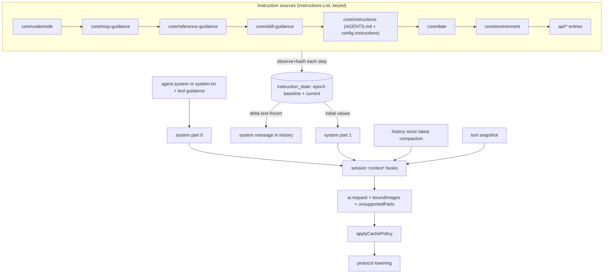
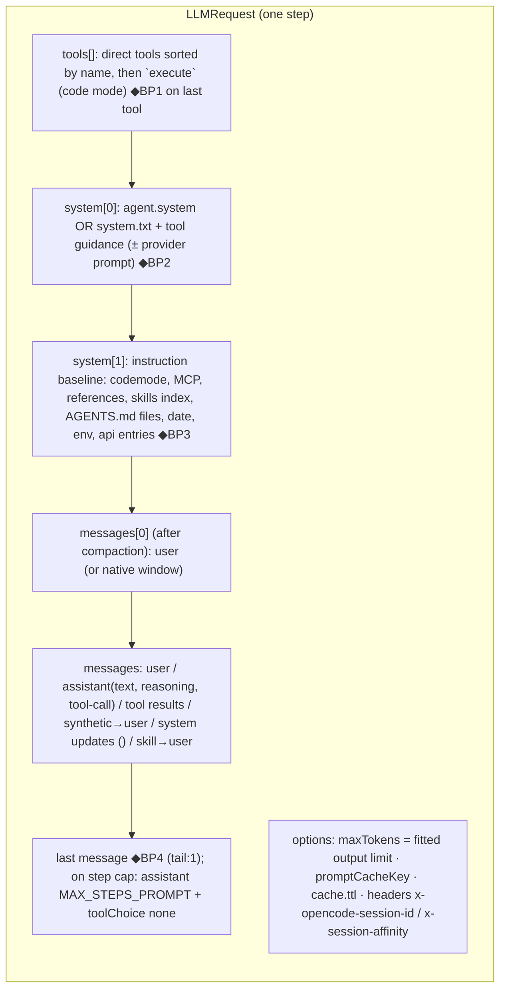
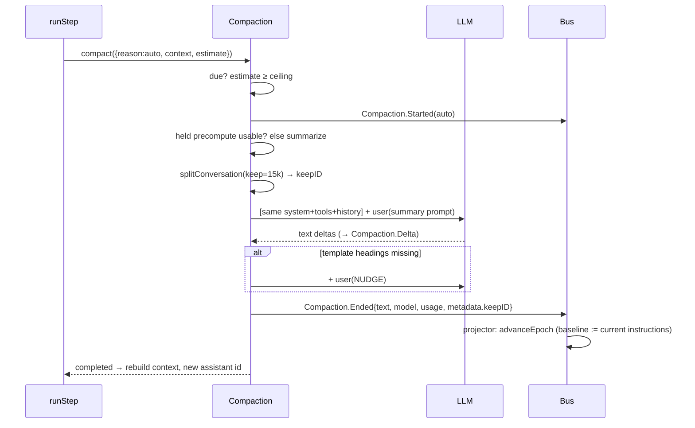

# Context assembly and compaction

> OpenCode @ 56625a3e1f · paths relative to opencode-reference/

## TL;DR

- **The system prompt has two parts.** Part 0 is a short base prompt rendered with tool-specific guidance (`runner/prompt/system.txt`), or the agent's `system` field, which **replaces** the base prompt. Plugins can override or append a provider-specific prompt. Part 1 is the **instruction baseline**: a set of keyed, versioned sources ordered from most to least shared across sessions. The order is code-mode catalog → MCP guidance → references → skills index → AGENTS.md/instructions → date + environment → API-supplied entries.
- **Instructions are versioned like data, so they stay cache-stable.** Every source is hashed per session. The baseline stays frozen until the next compaction. Later changes (an edited AGENTS.md, a new skill, a new day) are delivered as chronological `system` messages in history. On Anthropic these are wrapped in `<system-update>` blocks. The prefix is never rewritten.
- **Prompt caching.** `cache-policy.ts` places up to 4 breakpoints: the last tool, the first and last system part, and the conversation tail. This only happens on routes that honour inline hints, with per-gateway exceptions. A stable `promptCacheKey` comes from the root session ID, and a TTL comes from the model catalog.
- **Token accounting combines measured and estimated counts.** The last same-provider assistant's reported usage is the measured count. Everything after it is estimated at 4 characters per token. The result drives the compaction trigger and the per-request `maxTokens`, which is fitted to the room left in the window with 15% estimate error and 1% headroom.
- **Tool output is truncated at 2,000 lines or 50 KiB, whichever comes first.** The full text spills to `<data>/tool-output/tool_<id>` and is kept for 7 days. A marker such as `[showing lines 1-N of M; full output saved to …]` tells the model where it went. This is configurable via `tool_output.max_lines/max_bytes`.
- **Auto-compaction triggers at `window − max(15% of window, 16k)`** by default. `compaction.buffer` can set this as a percentage or a token count. The summary request sends the *same prefix* as a normal request plus a summary prompt, so it reads from the cache. It asks for a fixed Markdown template (Objective / Requirements / Decisions / Work State / Next Move / Relevant Files / Important Context). About 15k tokens of recent messages are kept verbatim beside it in a `<conversation-checkpoint>`.
- **Three triggers and two mechanisms.** Triggers are `auto` (threshold), `overflow` (provider rejected the request; shrink to 85%→70%→50%→35%) and `manual` (`/compact` inbox item). Mechanisms are `summary` (LLM writes text) and `native` (provider compaction endpoint/trigger, which stores an encrypted replacement window). An experimental flag adds *background precompute* of the summary.

## Where it lives

| path | role | ~lines |
|---|---|---|
| `packages/core/src/session/model-request.ts` | `baseTranscript`, output limit, media bounding, hook pipeline, `ai.request` | 480 |
| `packages/core/src/session/context.ts` | Selects agent, tools and instruction sources (order), loads model and history | 235 |
| `packages/core/src/session/system-prompt.ts`, `runner/prompt/system.txt` | Base system prompt and tool guidance | 28 + 15 |
| `packages/core/src/plugin/optimize.ts`, `plugin/system-prompt/*.txt` | Per-model prompt override/append (GPT, Claude, Kimi, Trinity, Meta) | 104 + 333 |
| `packages/core/src/instructions/{index,builtins}.ts` | Instruction source abstraction, date/env sources | 287 + 60 |
| `packages/core/src/instruction-discovery.ts`, `config/plugin/instruction.ts` | AGENTS.md and `instructions` config discovery, watch and reload | 150 + 254 |
| `packages/core/src/session/{instruction-state,instructions,history}.ts` | Baseline/epoch, nested AGENTS.md injection, history window | 277 + 126 + 405 |
| `packages/core/src/{skill,mcp,reference,codemode}/instructions.ts` | Skills index, MCP guidance, references, code-mode catalog | 84 + 100 + 82 + 164 |
| `packages/core/src/session/runner/to-llm-message.ts` | Session message → canonical LLM message | 320 |
| `packages/ai/src/cache-policy.ts` | Cache breakpoint placement | 247 |
| `packages/core/src/tool-output.ts` | Truncation and spill | 220 |
| `packages/core/src/session/compaction.ts` | Compaction (summary, native, precompute, shrink) | 1274 |
| `packages/core/src/session/usage.ts`, `util/token.ts` | Token normalisation and cost, char estimate | 64 + 5 |
| `packages/schema/src/config/{compaction,tool-output}.ts` | Config schemas | 23 + 9 |

## Architecture

### Final request layout

The order on the wire, with tools before system, is the Anthropic prefix order. Other protocols lower tools and system into their own fields *(inferred from `cache-policy.ts` comments; not traced per protocol)*.

## Key types and interfaces

| name | file:line | purpose |
|---|---|---|
| `SessionContext.Selection` / `Loaded` | `core/src/session/context.ts:29`, `:36` | Session + agent + instruction list + tool snapshot, then + model, initial baseline and messages |
| `baseTranscript` | `core/src/session/model-request.ts:106` | Builds `system[0..1]` and converts history with `toLLMMessages` |
| `outputLimit` | `core/src/session/model-request.ts:96` | `maxTokens` = min(catalog output or 32k, 256k), fitted to the room left |
| `SessionModelRequest.Interface` | `core/src/session/model-request.ts:258` | `primary | compaction | generate | title`, each running its own plugin hook |
| `Instructions.Source` | `core/src/instructions/index.ts:34` | `{key, read, initial, changed, removed}` over canonical JSON |
| `Instructions.combine` | `core/src/instructions/index.ts:126` | Ordered list, duplicate keys throw |
| `InstructionState.initial` / `advanceEpoch` | `core/src/session/instruction-state.ts:160`, `:126` | Renders the epoch baseline. On compaction end, the baseline becomes the current values |
| `SessionCompaction.Settings` | `core/src/session/compaction.ts:43` | `auto`, `buffer`, `keep`, `precompute` |
| `SessionCompaction.Trigger` | `core/src/session/compaction.ts:58` | `auto | overflow | manual` |
| `CompactionCompleted` | `schema/src/session-message.ts:267` | `summary`, `native?` (replacement window), `model`, usage of the compaction call |
| `ConfigCompaction.Info` | `schema/src/config/compaction.ts:16` | `{auto?, keep?:{tokens?}, buffer?: "N%" | int}` |
| `ConfigToolOutput.Info` | `schema/src/config/tool-output.ts` | `{max_lines?, max_bytes?}` |
| `Model.Info.limit` | `schema/src/model.ts:136` | `{context, input?, output}`. Unknown models default to 200k/32k (`:157`) |
| `Provider.Compaction` | `schema/src/provider.ts:38` | `summary | native` per model/provider |

## How it works: walkthroughs

### 1. Assembling one request

1. **Select** (`core/src/session/context.ts:136-176`). Interrupt if the session moved to another location. Flush MCP tools. Resolve the agent. Merge agent and session permissions (`:146`). In parallel, load the tool snapshot filtered by permissions, built-ins, discovery, skills, references, MCP guidance and API entries (`:147-158`). Combine the instruction sources in this order: code-mode catalog, MCP, references, skills, discovery (AGENTS.md), built-ins (date/env), entries (`:165-173`). The comment says the order goes "from most to least shared across sessions so the baseline stays a reusable prompt-cache prefix" (`:162-164`).
2. **Instruction observation.** `prepareContext` runs `InstructionState.prepare` at every step (`runner/llm.ts:227-234`). That reads all sources, hashes the values, and commits `InstructionsUpdated`. The first observation sets the baseline. Later deltas carry **frozen rendered text** (`instruction-state.ts:38-60`) and are projected as `system` messages with `metadata.notice:"instructions"` (`message-updater.ts:154-165`). A source that is temporarily unavailable on first use blocks the turn with `InitializationBlocked` and leaves the input pending (`instructions/index.ts:144-146`).
3. **Load** (`context.ts:178-194`). Resolve the model. `SessionHistory.entriesForRunner` reads, in one transaction, the epoch baseline (`InstructionState.initial`) and the messages from the latest completed compaction on (`history.ts:193-240`). It drops instruction-update messages from before the epoch, because the baseline already covers them (`:236`).
4. **System prompt** (`model-request.ts:116-126`). Part 0 is `agent.system` if set, else `SessionSystemPrompt.make(toolNames)`. That inserts guidance lines only for the tools that exist (`shell`, `write`, `edit`; `system-prompt.ts:9-27`) into `system.txt` (15 lines: harness, `<system-reminder>` semantics, parallel tool calls, communication, codebase etiquette). Part 1 is `Instructions.join(initial)`: the sources' text joined by blank lines (`instructions/index.ts:178-180`). Empty parts are filtered out.
5. **Instruction texts.** Date: `Today's date: …` (`instructions/builtins.ts:24-32`). Environment: an `<env>` block with working directory, workspace root, git yes/no, platform and preferred tmp dir (`:33-53`). AGENTS.md: `Instructions from: <path>\n<content>`, global (`~/.config/opencode/AGENTS.md` *(inferred path from `global.config`)*) first, then the ancestor walk from the location up to the project root (or home), then configured `instructions` globs/URLs (`config/plugin/instruction.ts:41-58`, `:190-200`). Changes are rendered as a unified diff when that is shorter than restating the file (`instruction-discovery.ts:127-150`). Skills index: an `<available_skills>` list of id/name/description, excluding skills with `autoinvoke:false` or ones the permissions deny (`skill/instructions.ts:25-33`, `:61-68`).
6. **Nested AGENTS.md.** After a successful `read`, the read tool walks up from the file to the location root and injects newly found AGENTS.md files as a **durable synthetic** user message (`tool/plugin/read.ts:131-153`, `session/instructions.ts:58-66`). The message metadata is the de-dup ledger. If compaction or revert drops the message, the file is re-injected on the next read (`session/instructions.ts:28-33`).
7. **Per-model prompt.** `OptimizePlugin` hooks `context`, `compaction` and `generate`. For GPT, Kimi, Trinity and Meta models it **overrides** `system[0]`. For Claude it **appends** a short "Code comments" note. Agents with their own `system` are skipped (`plugin/optimize.ts:16-30`, `:78-103`).
8. **Messages** (`runner/to-llm-message.ts:244-312`). `user` → user, with skill texts first, then text, then attachments. `synthetic` and `skill` → user. `system` → a system message. `shell` → user "The following shell command was executed by the user…". A completed `compaction` → a user `<conversation-checkpoint>` with `
` and optional `<recent-context>`, or the decoded native window. `agent-switched` and `idle` → nothing.
9. **Prepare** (`model-request.ts:273-460`). Plugin hooks see deep copies of the tool definitions and may rename, edit or drop them. Tools a hook invented are dropped. The default `maxTokens` is set for `primary` and `compaction` only (`:300-306`). Headers include session, parent and affinity IDs. `promptCacheKey` = affinity, which is the root session (`affinity.ts:7-8`, `model-request.ts:336`). `cache.ttl` comes from the model (`:337`). Messages pass through `unsupportedParts` (media the model can't take becomes `ERROR: Cannot read …`) and `boundImages` (`:340-349`).
10. **Image budget** (`model-request.ts:225-253`). When inline images exceed 25 MiB, the oldest are replaced with a "this image was removed…" note until 15 MiB remain. The cut only moves every ~10 MiB, so the replaced prefix (and the cache) stays stable between cuts.
11. **Cache policy** (`ai/src/route/client.ts:550`, `cache-policy.ts:215-227`). The default `AUTO` puts one breakpoint each on the last tool, the first and last system part, and the last message. Manual hints count against the cap of 4 (`:34`). It only applies to routes in `RESPECTS_INLINE_HINTS` (Anthropic-style, Bedrock Converse, OpenRouter…; `:62-78`). OpenRouter and Vercel use `anthropic/*` → AUTO, `qwen` → system + tail, anything else → none, because Gemini only uses the last breakpoint (`:80-90`). OpenAI and Gemini rely on implicit prefix caching.
12. **System updates on the wire.** For Anthropic, mid-history system messages are held and placed after the latest user turn as native system messages where allowed. Otherwise they are appended to the user turn as `<system-update>…</system-update>` text (`protocols/anthropic-messages.ts:801-828`, `protocols/shared.ts:224-225`). An update that would split a tool call from its result is rejected (`anthropic-messages.ts:824-825`). `normalizeToolHistory` holds updates until every pending call has its result (`ai/src/tool-history.ts:6-30`).

### 2. Token accounting and output budget

- **Normalisation** (`session/usage.ts:11-19`). The usage fields are `input` (non-cached), `output` (visible), `reasoning`, `cache.read` and `cache.write`. Cost uses the endpoint-reported `usage.cost` if present (a reported zero counts), else catalog pricing with context-tier selection (`:22-51`).
- **Prompt estimate** (`compaction.ts:1132-1157`). The anchor is the last assistant message from the *same provider*, without an error and with a prompt count above zero (`:1192-1197`). `measured = input + cache.read + cache.write + output + reasoning` of the anchor. `estimated` = chars/4 (`util/token.ts:3-5`) of everything after it, including the anchor's local tool results. With no anchor, everything is estimated, including tool schemas.
- **Output limit** (`model-request.ts:96-104`): `min(requested, max(1024, floor(context·0.99) − measured − ceil(estimated·1.15)))`.
- **Totals.** Steps publish `Step.Ended{tokens,cost}`. Title, compaction and generate publish `UsageRecorded{source}`. The projector sums these into the session row and emits ephemeral `UsageUpdated` (chapter 03). `usage-limits.ts` only *reads* OpenCode Console workspace budgets for display and enforces nothing locally (`usage-limits.ts:22-25`).

### 3. Tool output truncation

`SessionStep` pipes every local tool result through `toolOutput.truncate` before publishing (`runner/step.ts:152`). `truncate` (`tool-output.ts:75-143`) skips results that already set `metadata.truncated` (tools such as `read` page on their own). It joins the text parts, cuts once at whichever comes first of `maxLines` (2,000) or `maxBytes` (50 KiB) on a grapheme-safe boundary (`:184-220`), writes the full text to `<global.data>/tool-output/tool_<id>`, and appends the marker. File parts (images) are kept. An hourly sweeper deletes spill files older than 7 days (`:13-16`, `:161-170`). Config `tool_output.{max_lines,max_bytes}` is applied by `config/plugin/tool-output.ts:16-21`. There is **no** pruning of old tool outputs in history. The legacy `compaction.prune` and `tail_turns` keys are reported as unsupported (`config/normalize.ts:353-354`).

### 4. Compaction

- **Settings and defaults** (`compaction.ts:269`): `auto: true`, `keep: 15_000` tokens, `precompute: false`. `ConfigCompactionPlugin` maps config `compaction.{auto,buffer,keep.tokens}` and the `background_compaction` flag onto these (`config/plugin/compaction.ts:17-26`). Legacy `preserve_recent_tokens` and `reserved` are still accepted (`config/normalize.ts:365-397`).
- **Threshold** (`calculateCeiling`, `:1163-1171`). `window = min(limit.input, limit.context)` or whichever is known (`:1184-1185`). If `buffer` is set (a percentage of the window, or tokens) and leaves room, the ceiling is `window − buffer`. Otherwise it is `window − max(15%·window, 16k)`, where the 16k minimum only applies when the window is ≥ 32k. An unknown window (0) never auto-compacts. `due` (`:440-449`) also skips when the last message is a fresh compaction, or when a native window has not been measured yet.
- **When it runs.** At the start of every step (`runner/llm.ts:253-259`). On overflow: when a provider rejects a request as too long before any output, the step calls `recoverOverflow` once per step (`step.ts:198-209`). From the `/compact` inbox item (`llm.ts:129-176`). Only `manual` runs when `auto` is off (`compaction.ts:306`).
- **The hidden `compaction` agent** (`plugin/agent.ts:96-100`) has **no prompt of its own**. It is used only to pick a different *model* via `agents.compaction.model` (`compaction.ts:283-293`). The request is built from the *session's* agent transcript (`:1001-1008`) with the summary prompt appended as a final user message (`:497-502`). That keeps the cached prefix.
- **Prompt and format** (`buildPrompt`, `:214-245`). The prompt says to summarize only what the user and assistant said and did, and to leave out AGENTS.md, conventions and environment because "the next agent receives current versions of all of these separately". Then comes `SUMMARY_TEMPLATE` (`:173-204`) with these sections: `## Objective`, `## Requirements`, `## Decisions`, `## Work State` (`### Completed/Active/Blocked`), `## Next Move`, `## Relevant Files` (≤15), `## Important Context`. Then the rules: terse bullets, exact paths and identifiers, carry forward unanswered requests, keep commit/push state, never mention compaction. An *update* variant merges the previous checkpoint, and a *legacy* variant rewrites old over-detailed summaries. A reply without any template heading gets one `NUDGE` and then fails (`:504-520`).
- **What is kept and re-injected.** The newest ≈`keep` tokens of messages, starting on a user boundary so tool calls stay with their results (`recentStart`, `:1034-1058`), are referenced by `metadata.keepID`. They are rebuilt as text into `<recent-context>` at load time and never stored twice (`history.ts:242-280`). After `Compaction.Ended` the projector advances the instruction epoch (`projector.ts:1119-1123`). The next request therefore carries the **current** instruction baseline in system part 1, and older update messages are dropped. Nested AGENTS.md files are re-discovered on the next read. Invoked skill bodies are *not* explicitly re-injected *(inferred: they only survive inside the summary or the recent tail)*.
- **Fitting the summary request** (`deliver`, `:618-704`). It sends the unchanged request when it fits. Otherwise it sends the history without the tail. Otherwise it **flattens** the history to a text transcript and shortens exchanges oldest-first through levels: whole → tool outputs clipped to 2k chars from each end → outputs removed and inputs clipped → user text only → omitted. The newest exchange is never omitted (`:720-786`, `:139-150`). "Too long" rejections retry at 85/70/50/35% of the first rejected size (`:127`). "Payload too large" switches to text once. Other errors follow the session retry policy.
- **Native compaction** (`compactNatively`, `:565-610`, used when `model.compaction.type === "native"`) calls `llm.compact` as either an `endpoint` (the provider returns a replacement window) or a `trigger` (a checkpoint item plus the newest user messages within `keep`). The window is stored in `native.messages` and only replays on the same model (`history.ts:28-41`).
- **Background precompute** (flag `background_compaction`, `:351-417`). Within `PRECOMPUTE_LEAD = 60k` tokens of the ceiling, it summarizes everything before the latest response in the background, while that prefix is still in the provider cache (it skips when the cache is older than its TTL minus 30s, or right after a model switch). When compaction becomes due, it swaps in the held summary if the tail since it is ≤ 40% of the budget (`:169`, `:414-438`). After 2 failures it stops trying until the next compaction.
- **Billing.** Every compaction call is billed as it finishes, including failed ones, via `UsageRecorded{source:"compaction"}`. The `compaction` message shows the total (`:887-906`).

### 5. Context window per model

Limits come from the model catalog (`Model.Info.limit`), via models.dev (chapter on providers) or config overrides. An input limit larger than the context window is clamped (`compaction.ts:1179-1186`). Models without limits fall back to 200k/32k (`schema/src/model.ts:157`), and compaction aims at a 200k window for sizing when the window is unknown (`compaction.ts:137`, `:295-297`). The output reservation is computed per request (`outputLimit`), not as a fixed share. Compaction keeps its own `RESERVE_MIN` (16k) for the summary output, with a floor of `SUMMARY_OUTPUT_FLOOR` (32k) where the room allows (`:129`, `:139`).

## Configuration and extension points

| key | effect |
|---|---|
| `compaction.auto` | Disable auto/overflow compaction (manual still works) |
| `compaction.buffer` | `"20%"` (1–99%) or a token count kept free before auto compaction |
| `compaction.keep.tokens` | Verbatim recent tail beside the summary (default 15,000) |
| `experimental.background_compaction` / `OPENCODE_FLAGS=background_compaction` | Precompute summaries |
| `tool_output.max_lines` / `max_bytes` | Truncation thresholds (2,000 / 51,200) |
| `instructions: string[]` | Extra paths, globs or URLs (URLs fetched with a 5 s timeout, last good copy kept) |
| `agents.<id>.system` | Replaces the base system prompt for that agent |
| `agents.compaction.model`, `agents.title.model` | Model for hidden agents |
| `skills`, `references`, `mcp` | Feed the skills index, reference guidance and MCP guidance sources |
| Plugin hooks `context`, `compaction` (may return `result` to supply a summary without a model call, `compaction.ts:873-886`), `generate`, `title`, `model.request` | Rewrite system, messages, tools and options |

## Edge cases, invariants and gotchas

- **Identical values render identical bytes** (`instructions/index.ts:56`). The date source changes daily, so the first step of a new day emits a `Today's date is now:` update instead of rewriting the baseline.
- A `buffer` larger than the window (for example one set for a bigger model) is ignored silently (`compaction.ts:1168-1169`).
- Measured counts from **another provider** are not trusted (`:1188-1197`). After a cross-provider switch the next estimate is pure chars/4 until the new model reports usage.
- The `compaction.ts:216` prompt deliberately leaves instructions *out* of the summary. This only works because the epoch baseline re-injects them.
- Images in tool results count by `uri.length` toward the inline budget (`model-request.ts:188`, `:232`).
- Precompute is off by default because unused background summaries still cost tokens (`schema/src/config/flag.ts:13-14`).
- CLAUDE.md is not read as an instruction file. Only AGENTS.md is (`config/plugin/instruction.ts:41`, `:87`). `.claude` directories are scanned for skills only (`config/plugin/compatibility.ts:84`).

## Tests worth reading

`packages/core/test/session-compaction.test.ts`, `session-native-compaction.test.ts`, `session-compaction-transport.test.ts`, `session-model-request.test.ts`, `session-model-request-hooks.test.ts`, `session-system-prompt.test.ts`, `instruction-state.test.ts`, `instruction-discovery.test.ts`, `session-instructions.test.ts`, `instructions/index.test.ts`, `instructions/builtins.test.ts`, `skill/instructions.test.ts`, `tool-output.test.ts`, `config/compaction.test.ts`, `config/tool-output.test.ts`, `packages/ai/test/cache-policy.test.ts`, `packages/ai/test/compaction.test.ts`, `packages/ai/test/provider/anthropic-compaction.test.ts`.

## Genie takeaways

- **Port the instruction-source model** (keyed, hashed, epoch baseline plus chronological deltas) for GENIE.md and context ([10](../../tickets/10-memory.md), [11](../../tickets/11-system-prompt-context.md), pick-list #17). It matches Genie's decision to deliver memory as a context message after the system prompt and tools, cache-stable: render GENIE.md, auto-memory, the date, env and the skills index once per epoch, and send edits as `<system-update>`-style deltas. **Adapt**: OpenCode puts the baseline in a second *system* part. Genie's choice of a first *user/context message* after the tools is equally cache-stable and portable to providers without multi-part system support. Keep OpenCode's ordering rule (most-shared first).
- **Port the cache policy table** ([03](../../tickets/03-provider-layer.md), [16](../../tickets/16-context-management.md)). Use 4 breakpoints (last tool, system edges, tail) and the per-route allowlist, including the Gemini "last breakpoint only" and OpenRouter caveats. Use a stable cache key per root session, and let subagents share the parent's key.
- **Port the compaction mechanics, write our own text** (pick-list #11, #28; [16](../../tickets/16-context-management.md)). The mechanics to port: same-prefix summary request for cache reuse, ceiling = window − max(15%, 16k), the verbatim tail referenced by id, shrink steps on overflow, flatten-oldest-first levels, the one-nudge template check, and native compaction as a per-model capability. **Adapt** for ticket 16's requirement to "preserve read-state and approvals". OpenCode has no read-before-edit ledger to keep. Genie must carry its read-file set and session permission grants in engine state, outside the transcript, and re-inject a short "files you have read" note after compaction *(inferred gap)*. Also re-inject invoked skills, which OpenCode does not do.
- **Port tool-output spill** ([06](../../tickets/06-builtin-tools.md)). Truncate centrally at 2,000 lines / 50 KiB, spill to a file with a 7-day sweep, and add a marker that names the path, so `Read` can page through it. That fits the read-before-edit design. Expose `tool_output` in `.genie/settings.json`.
- **Port measured+estimated token accounting and the fitted `max_tokens`.** No universal tokenizer is needed: trust the provider's last usage and estimate the delta at 4 chars/token with a 15% margin. Use it for the context-usage display too.
- **Avoid** the plugin-hook rewrite surface (`context`/`compaction` hooks editing system, tools and messages). Genie extends only via MCP, hooks and skills (pick-list #26). Expose read-only `PreCompact`/`PostCompact` hooks instead ([20](../../tickets/20-hooks.md)).
- **Avoid** per-model prompt overrides as a plugin. If Genie needs per-provider prompt tuning, make it an explicit table in the provider layer.

## Open questions / inferred

- Exact location of the global AGENTS.md (`global.config` path) was not resolved *(inferred `~/.config/opencode`)*.
- How OpenAI Responses and Gemini lower mid-history `system` updates was not traced. Only Anthropic was checked.
- Whether invoked skill content survives compaction other than through the summary is unverified *(inferred: no)*.
- The `api/*` instruction entries (`session/instruction-entry.ts:101`) appear to be host/SDK-supplied per-session instructions. Their HTTP surface was not traced.
