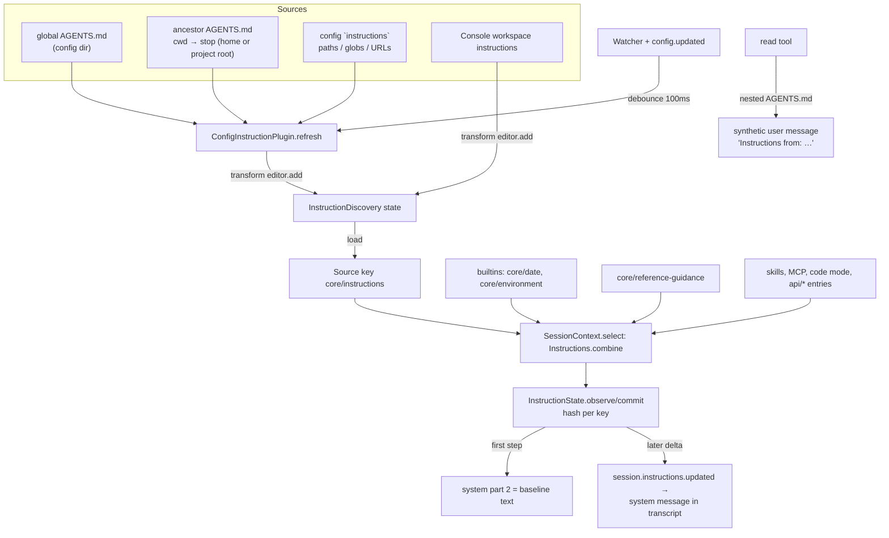

# Memory and instructions

> OpenCode @ 56625a3e1f · paths relative to opencode-reference/

## TL;DR

- OpenCode's only instruction file name is **`AGENTS.md`**. It reads one global file (`<config dir>/AGENTS.md`, normally `~/.config/opencode/AGENTS.md`) and then walks up from the session's Location directory. The walk stops at **`$HOME`** when the directory is under home, and at the project root otherwise (`packages/core/src/config/plugin/instruction.ts:36-58`). It does **not** read `CLAUDE.md`.
- Extra sources come from the `instructions` config array: absolute paths, `~/` paths, relative globs (searched upward from the Location to the project root) and `http(s)` URLs (fetched with a 5 s timeout, keeping the last good copy) (`instruction.ts:98-179`).
- Every instruction source is a keyed, hashed **`Instructions.Source`**. A session freezes a baseline that goes into the **second system part** (`packages/core/src/session/model-request.ts:122-125`). Later edits are sent as **diff-or-full "Instructions updated" system messages** in the transcript, so the cached prompt prefix stays valid.
- Hot reload: every candidate `AGENTS.md` and every matched configured file is watched. Bursts are debounced (100 ms) and a `config.updated` event triggers a full re-resolve (`instruction.ts:211-225`). Remote URLs are re-fetched only when config changes.
- A **nested `AGENTS.md`** below the Location is loaded *on demand*: after a successful `read`, the read tool walks up from the file and injects any new `AGENTS.md` once per session as a synthetic user message (`packages/core/src/tool/plugin/read.ts:131-155`, `packages/core/src/session/instructions.ts:47-94`).
- **No size limits** apply to `AGENTS.md` or configured files. Only API-managed per-session "instruction entries" are capped, at 256 KiB (`packages/schema/src/instruction-entry.ts:30`).
- **No persistent or learned memory exists.** The repo has no memory tool or memory file. The Claude Agent SDK provider explicitly sets `CLAUDE_CODE_DISABLE_AUTO_MEMORY=1` and `CLAUDE_CODE_DISABLE_CLAUDE_MDS=1` (`packages/core/src/plugin/provider/claude-agent/claude/query-options.ts:11-13`).
- The "Claude-compat" plugin loads only **skills** from `~/.claude/skills`, `~/.agents/skills` and project `.claude/skills` and `.agents/skills` (`packages/core/src/config/plugin/compatibility.ts:41-58`). It reads no settings, no CLAUDE.md, no commands and no agents from them.

## Where it lives

| path | role | ~lines |
|---|---|---|
| `packages/core/src/instruction-discovery.ts` | `InstructionDiscovery` service: an editable set of `{path, content}` files, rendering, diff rendering | 150 |
| `packages/core/src/instructions/index.ts` | Generic `Instructions` sources: key, hash, diff, render, `InitializationBlocked` | 287 |
| `packages/core/src/instructions/builtins.ts` | Built-in `core/date` and `core/environment` sources | 60 |
| `packages/core/src/config/plugin/instruction.ts` | Discovery policy: global and ancestor `AGENTS.md`, the `instructions` config, watchers, URL fetch | 254 |
| `packages/core/src/session/context.ts` | Combines all instruction sources for a session step | 235 |
| `packages/core/src/session/instruction-state.ts` | Per-session baseline and delta persistence (hashes and blobs in SQLite) | 277 |
| `packages/core/src/session/model-request.ts` | Places the baseline as the second system part | — |
| `packages/core/src/session/instructions.ts` | On-demand nested `AGENTS.md` injection (synthetic messages) | 126 |
| `packages/core/src/tool/plugin/read.ts` | Triggers nested discovery after a read | 366 |
| `packages/core/src/session/instruction-entry.ts`, `packages/schema/src/instruction-entry.ts` | API-managed per-session JSON instruction entries | 171 / 40 |
| `packages/core/src/reference.ts`, `reference/instructions.ts`, `config/plugin/reference.ts` | `references`: named external directories or git repos, plus model guidance | 129 / 82 / 67 |
| `packages/core/src/config/plugin/compatibility.ts` | Skills from `.claude` and `.agents` | 94 |
| `packages/core/src/plugin/provider/opencode.ts` | Console workspace instructions injected as discovery files | 879 |

## Architecture

The design has three layers:

1. **Discovery plugins** decide *which files* exist. `ConfigInstructionPlugin` and the Console provider push files into the `InstructionDiscovery` editor through `transform` (`instruction.ts:226-232`, `plugin/provider/opencode.ts:513`).
2. **`InstructionDiscovery`** turns the file list into one `Instructions.Source` with key `core/instructions` (`instruction-discovery.ts:17`, `:80-90`).
3. **The session** combines every source and keeps per-key hashes. On the first step it renders the baseline; after that it renders only changed keys (`packages/core/src/session/instruction-state.ts:21-60`).

## Key types and interfaces

| name | file:line | purpose |
|---|---|---|
| `InstructionDiscovery.File` | `packages/core/src/instruction-discovery.ts:10` | `{path, content}`. `path` is an absolute path, a URL, or a synthetic label such as `OpenCode Console instruction <id>` |
| `InstructionDiscovery.Editor` | `instruction-discovery.ts:28` | `add/update/remove/unavailable`. Map insertion order is render order (`:30-31`) |
| `InstructionDiscovery.Options` | `instruction-discovery.ts:47` | `project`, `global` booleans that switch discovery scopes off |
| `Instructions.Source` | `packages/core/src/instructions/index.ts:34` | Keyed source with `read` plus `initial/changed/removed` renderers over canonical JSON |
| `Instructions.unavailable` / `removed` | `instructions/index.ts:21`, `:25` | A temporary read failure (keep the stored value) versus an observed absence |
| `Instructions.InitializationBlocked` | `instructions/index.ts:69` | The first step fails if any source is unavailable and there is no stored baseline (`:144-146`) |
| `Instructions.diff` / `hash` | `instructions/index.ts:144`, `:205` | sha256 of canonical JSON per key gives a delta plus blobs |
| `Instructions.listUpdate` | `instructions/index.ts:244` | Helper for keyed list updates (used by references) |
| `InstructionEntry.Info` / `MaxValueBytes` | `packages/schema/src/instruction-entry.ts:16`, `:30` | API-set `{key, value: Json}` per session, namespaced `api/<key>`, max 256 KiB |
| `Reference.Info` / `Source` | `packages/core/src/reference.ts:19-25` | `local {path}` or `git {repository, branch}`, plus `description` and `hidden` |
| `ConfigReference.Entry` | `packages/schema/src/config/reference.ts:19` | `string \| Git \| Local` |

## How it works: walkthroughs

### 1. Startup discovery (global + ancestor walk)

1. The plugin resolves `start = location.directory`, `root = location.project.directory` and `home` (`packages/core/src/config/plugin/instruction.ts:36-38`).
2. `project = discovery.project && contains(root, start)`. `stop = contains(home, start) ? home : root` (`:39-40`). **For a repo under `$HOME` the walk passes the project root and continues up to `$HOME`**. Tests confirm this: "discovers a newly created instruction file above the project root" and "stops instruction candidates at the project root outside home" (`packages/core/test/instruction-discovery.test.ts:441`, `:485`).
3. The global file is `join(global.config, "AGENTS.md")` (`:41`). `global.config` is `$XDG_CONFIG_HOME/opencode`, or `OPENCODE_CONFIG_DIR` when set (`packages/util/src/global-roots.ts:7`, `packages/util/src/global.ts:79`).
4. Every candidate path is subscribed to the watcher **before** it is read, even if the file does not exist yet (`:51-62`).
5. `projectSource` calls `fs.up({targets:["AGENTS.md"], start, stop})`, which returns **nearest first** (`:87`, `packages/util/src/fs-util.ts:148-170`). If the global dir lies on the walk, the global file is not added twice (`:90`).
6. Read errors: `NotFound` means the file was deleted mid-save. It makes the *whole project source* `unavailable`, so the previous value is kept. Access-denied files are skipped (`:64-76`, `:92`).
7. The final order is **global → project (nearest → farthest) → configured** (`:199`, comment at `instruction-discovery.ts:30-31`).

### 2. The `instructions` config

1. `reconfigure` collects `instructions` from *every* config document and de-duplicates them (`instruction.ts:153-156`). There is no precedence, only a union.
2. URLs (`http:`/`https:` only, `:252-254`) are fetched with concurrency 4 and a 5 s timeout. A failure keeps the previous copy or skips the URL, so it never makes the set unavailable (`:148-177`).
3. The `match` rules for paths (`:98-118`):
   - `~/` expands to home.
   - With an absolute path, a literal parent directory makes the basename the glob. Without one, the whole path is treated as a glob, such as `~/notes/**/*.md`.
   - A relative pattern runs `globUp` from the Location up to the project root, so every ancestor may contribute matches (`packages/util/src/fs-util.ts:177-192`).
   - Without project discovery, relative patterns resolve against the global config dir instead.
4. Matched files are sorted and de-duplicated, then each one is watched through a `FiberMap`. Watches for files that no longer match are dropped (`:120-146`).

### 3. How instructions reach the model

1. `SessionContext.select` loads all sources and combines them in cache-friendly order: code-mode catalog, MCP, references, skills, **discovery**, builtins, then API entries (`packages/core/src/session/context.ts:147-173`, comment `:162-164`).
2. `InstructionState.observe` reads every source, compares hashes with the stored `current_values`, and produces `{delta, blobs}` (`packages/core/src/session/instruction-state.ts:21-35`).
3. On the **first** step the baseline is committed with no text (`:43-58`). `baseTranscript` then places `Instructions.join(initial)` as the **second system part**, after the agent or system prompt (`packages/core/src/session/model-request.ts:107-126`). Each file renders as `Instructions from: <path>\n<content>` (`instruction-discovery.ts:123-125`).
4. On **later** steps a non-empty delta publishes `session.instructions.updated` with frozen text (`instruction-state.ts:47-57`). The projector appends it as a `system` message described as `Instructions updated: <keys>` (`packages/core/src/session/message-updater.ts:154-165`). `toLLMMessages` emits it as `Message.system(text)` (`packages/core/src/session/runner/to-llm-message.ts:278-279`).
5. For a changed file the update text is a unified diff when that is shorter than the full restatement (`instruction-discovery.ts:137-147`). Removed files say "no longer apply" (`:135`).
6. After compaction or a revert, a fresh baseline supersedes older update messages: `history.ts` drops `notice === "instructions"` system messages before the epoch (`packages/core/src/session/history.ts:228-238`).

### 4. Nested `AGENTS.md` on read

1. After a successful non-external read, the read tool walks `fs.up` from the file's directory (or from the directory itself for a listing) to the Location root (`packages/core/src/tool/plugin/read.ts:136-147`).
2. It drops the Location root and its ancestors, since the baseline already covers those, and the file being read (`:148-150`).
3. `SessionInstructions.load` claims the paths in memory, skips paths recorded in earlier synthetic metadata (`instruction.paths`) and publishes one `SessionEvent.Synthetic` with `Instructions from: …` text (`packages/core/src/session/instructions.ts:47-80`). Synthetic messages become **user**-role messages (`to-llm-message.ts:274-275`).
4. Because the ledger is the transcript itself, files that drop out after compaction are re-injected on the next read (`instructions.ts:40-44`).

### 5. Hot reload

- File events go to a sliding PubSub, are debounced 100 ms, then `refresh(file)` runs and `discovery.reload()` follows (`instruction.ts:211-218`).
- `config.updated` triggers `reconfigure → refresh → reload` (`:219-223`).
- `InstructionDiscovery`'s `notify` publishes `instruction-discovery.updated` (`instruction-discovery.ts:20`, `:77`). The new content is admitted at the next session step as a delta (walkthrough 3).

### 6. `references`

1. `references` maps an alias to a string (it is local if it starts with `.`, `/` or `~`, otherwise it is a git URL) or to `{path|repository, branch?, description?, hidden?}` (`packages/core/src/config/plugin/reference.ts:58-62`). Aliases must not contain `/`, whitespace, a backtick or a comma (`:54-56`). Relative paths resolve against the declaring config file's directory (`:24`, `:64-67`).
2. Git references are materialised into `global.repos` (`~/.local/share/opencode/repos`) through `RepositoryCache.ensure` with `refresh: "daily"`. An hourly loop re-checks them (`packages/core/src/reference.ts:76-94`, `:113`).
3. Only references **with a `description`** are advertised to the model, as `<available_references>` XML under key `core/reference-guidance` (`packages/core/src/reference/instructions.ts:57-76`). `hidden` hides a reference from client `@alias` autocomplete (`packages/tui/src/component/prompt/autocomplete.tsx:462`). References are exposed over HTTP as `reference.list` (`packages/server/src/handlers/reference.ts:6-8`).
4. No reference-specific permission exemption was found, so reads under a reference path go through the normal `external_directory` check *(inferred from `packages/core/src/file-access.ts:90-118`)*.

### 7. Claude/agents compatibility

1. Config discovery collects `~/.claude`, `~/.agents` and every `.claude` or `.agents` directory found on the upward walk (`packages/core/src/config/discovery.ts:69-70`, `:152-166`).
2. `Config.compatibility()` filters these down to existing directories (`packages/core/src/config.ts:496-500`).
3. The compat plugin scans `<root>/skills` with `SkillScan` (SKILL.md, or top-level `*.md`, max depth 6, dot-dirs ignored), parses the files and adds the results to the skill registry. It watches those directories (`compatibility.ts:41-81`, `packages/core/src/config/plugin/skill-scan.ts:7-46`).
4. `OPENCODE_DISABLE_CLAUDE_CODE` or `OPENCODE_DISABLE_CLAUDE_CODE_SKILLS` turns off the `.claude` roots. The source comment says ".claude is only read for skills" (`packages/cli/src/server-process.ts:127-131`).

## Configuration and extension points

| key / env | effect |
|---|---|
| `instructions: string[]` | Extra files, globs or URLs (`packages/schema/src/config.ts:97`) |
| `references: Record<alias, Entry>` | External directories or repos (`schema/src/config.ts:100`). V1 `reference` is migrated (`packages/core/src/config/normalize.ts:101-115`) |
| `OPENCODE_CONFIG_DIR` | Moves the global config dir, which also moves the global `AGENTS.md` |
| `InstructionDiscovery.configured({project, global})` | Embedder options to disable scopes (`instruction-discovery.ts:47-51`, `:113`). Configured `instructions` still load (`instruction.ts:24-25`) |
| `OPENCODE_DISABLE_CLAUDE_CODE[_SKILLS]` | Skips the `.claude` skill roots |
| Plugin API | `ctx`/`discovery.transform(editor => editor.add(...))` lets any plugin contribute instruction files (as the Console provider does) |
| HTTP instruction entries | Per-session `api/<key>` JSON values ≤256 KiB (`packages/schema/src/instruction-entry.ts:5-30`) |

## Edge cases, invariants and gotchas

- **Above-root walk.** Under `$HOME`, an `AGENTS.md` in `~/` or `~/work/` applies to every repo beneath it. That is surprising if you expect a stop at the git root.
- **Nearest-first order.** The closest `AGENTS.md` is rendered *first*, with ancestors after it. Claude Code renders the farthest file first. When instructions conflict, which file wins depends on how the model reads them.
- **Unavailable vs removed.** A transient read failure keeps the stored value. On the very first step it fails with `InitializationBlocked` (`instructions/index.ts:144-146`), so a session will not start with half-loaded instructions.
- **Empty render is a bug.** A renderer that returns `""` throws (`instructions/index.ts:284-287`).
- **Duplicate keys throw** in `combine` (`instructions/index.ts:126-134`).
- **Mid-conversation `system` role.** Updates are emitted as `Message.system`. How each provider adapter places a non-leading system message is up to the protocol layer *(inferred; see chapter 07)*.
- **Remote URLs** are not re-fetched on a timer, only on config change.
- **No CLAUDE.md** anywhere in the core source. Claude-compat covers skills only.

## Tests worth reading

- `packages/core/test/instruction-discovery.test.ts`: walk bounds, global toggles, globs, URLs, deletes, creating files above the root.
- `packages/core/test/instructions/index.test.ts`, `packages/core/test/instructions/builtins.test.ts`
- `packages/core/test/instruction-state.test.ts`: baseline and delta persistence.
- `packages/core/test/session-instructions.test.ts`, `packages/core/test/plugin/session-instructions.test.ts`: nested injection and dedupe.
- `packages/core/test/reference.test.ts`, `packages/core/test/reference-instructions.test.ts`
- `packages/core/test/config/skill.test.ts`, `packages/core/test/config/reload.test.ts`: the compat skill roots.

## Genie takeaways

Ticket: [`../../tickets/10-memory.md`](../../tickets/10-memory.md). Pick-list: **#17 instruction discovery** in [`../../research/opencode-pick-list.md`](../../research/opencode-pick-list.md).

- **PORT: keyed, hashed instruction sources with baseline + delta** (`Instructions.Source`, `InstructionState`). Genie delivers GENIE.md as a context message after the system prompt. Adopt OpenCode's split: freeze a per-session baseline (cache-stable) and send later edits as small "instructions updated" messages, using a diff when it is shorter. Store the hashes in Genie session state so resume and compaction can re-render the baseline. Map `Unavailable` and `InitializationBlocked` to Genie's "don't start a turn with a half-read GENIE.md".
- **ADAPT the walk.** Genie's hierarchy is managed → user → project → local. Keep OpenCode's "watch the candidate path before it exists" trick, but stop at the **project root or git root**, not `$HOME`, to avoid leaking `~/GENIE.md`-style files across repos (ticket 32 workspace trust should gate any above-root files). Render **farthest-first** to match Claude semantics.
- **PORT: nested-on-demand via read.** OpenCode's read-tool hook (`read.ts:131-155`) plus the transcript-as-ledger dedupe (`session/instructions.ts`) is exactly Genie's "nested GENIE.md on demand". Extend it to `.genie/rules/*.md` with `paths:` globs: on read, match the path against the rules' globs and inject the matching rules once per session. Use the same metadata ledger so compaction re-injects them.
- **BUILD: @imports (≤4 hops) and size limits.** OpenCode has neither. Add a byte cap per file and a total cap (OpenCode only caps API entries at 256 KiB), with a visible truncation note.
- **AVOID reading AGENTS.md** (decision: GENIE.md only). The Claude importer (ticket [`../../tickets/26-claude-importer.md`](../../tickets/26-claude-importer.md)) can convert CLAUDE.md and `.claude/skills` one time, instead of OpenCode-style live compat roots.
- **BUILD auto-memory.** OpenCode has none and even disables Claude's. Genie's auto-memory is net-new. Reuse the instruction-source abstraction (a `memory` key whose changes arrive as deltas) so memory edits don't break the prompt cache.
- **`instructions` URLs → managed/org policy.** Remote instruction URLs and Console-pushed workspace instructions (`plugin/provider/opencode.ts:364-368`) match Genie's gateway-pushed org content. Withhold them when policy denies the integration, as OpenCode does (`opencode.ts:334-338`). See [`../../tickets/28-telemetry-policy.md`](../../tickets/28-telemetry-policy.md).
- **`references`** are worth porting as a small feature: aliases for external repos, auto-cloned, advertised only when they have a description. Pair them with explicit read permission for those roots.

## Open questions / inferred

- How non-leading `system` messages are serialised per provider (Anthropic, OpenAI, Gemini) was not traced here. See chapter 07.
- Whether reference paths get any implicit `external_directory` allowance (none found) *(inferred)*.
- Whether the above-`$HOME` stop is intentional product behaviour or a side effect. The tests assert it, so it appears intentional.
- Console `/api/v2/instructions` semantics (ordering, size) live server-side and are not in this repo.
