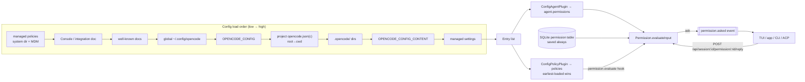
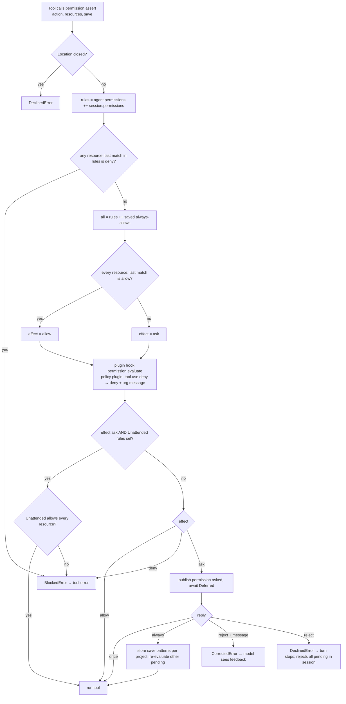

# Config, permissions and policy

> OpenCode @ 56625a3e1f · paths relative to opencode-reference/

## TL;DR

- Config files are `opencode.json` / `opencode.jsonc`, parsed as **JSONC** with trailing commas and `{env:VAR}` / `{file:path}` substitution. There is **no generic deep merge**: each domain plugin reads the ordered `Entry[]` list itself. For scalars the last document wins (`Config.latest`). Arrays such as `permissions` and `instructions` are concatenated or unioned.
- Load order, lowest to highest: managed **policies** → Console/integration docs → well-known remote docs → global `~/.config/opencode` → `OPENCODE_CONFIG` → project `opencode.json[c]` walking from the filesystem root down to the cwd → project `.opencode/` dirs → `OPENCODE_CONFIG_CONTENT` → managed **settings** (system dir + macOS MDM plist) (`packages/core/src/config.ts:367-377`).
- Permission rules are flat `{action, resource, effect: allow|ask|deny}` lists. Matching uses a `*`/`?` wildcard and **the last match wins**. The fallback when nothing matches is `ask`. However, every agent starts from **`* * allow`** (ask only for `.env` reads), so in practice the default is allow (`packages/schema/src/agent.ts:46-51`).
- Deny is checked first against configured (agent + session) rules only. Saved "always" approvals are appended *after* config, so they can override `ask` but never `deny` (`packages/core/src/permission.ts:184-189`).
- Replies are `once | always | reject`, with optional feedback text on reject. `always` stores the request's `save` patterns (for example `git commit *`) per **project** in SQLite (`packages/core/src/permission/saved.ts:69-84`). A reject with no message fails the call. A reject *with* a message turns into tool feedback and the model continues.
- `--auto` (aliases `--yolo` and `--dangerously-skip-permissions`) is **client-side**: the client answers every `permission.asked` with `once`. Denies still block because they never produce a request (`packages/cli/src/run/noninteractive.ts:97-112`).
- **Managed policy** is a separate allow/deny layer over `provider.use`, `tool.use`, `integration.connect`, `integration.use`, `mcp.use`, `skill.use`, `plugin.use` and `websearch.use`. Here the **earliest-loaded document wins**, so managed beats Console org beats user/project. `tool.use` denies go through the permission `evaluate` hook and produce "Blocked by <org>'s policy" (`packages/core/src/config/plugin/policy.ts:98-113`).

## Where it lives

| path | role | ~lines |
|---|---|---|
| `packages/core/src/config.ts` | Config service: load order, JSONC parse, reload, watch, `update`, integration docs | 533 |
| `packages/core/src/config/discovery.ts` | File names, system dir, MDM plist paths, upward walk, `.claude`/`.agents` roots | 168 |
| `packages/core/src/config/normalize.ts` | V1→V2 migration and diagnostics (`permission`→`permissions`, `tools`, `agent`…) | 832 |
| `packages/core/src/config/variable.ts` | `{env:}` / `{file:}` substitution | 81 |
| `packages/core/src/config/watch.ts` | Watch plan for config roots | 41 |
| `packages/core/src/config/plugin/entry-observer.ts` | Domain plugins' reload-on-`config.updated` helper | 79 |
| `packages/schema/src/config.ts` | `Config.Info`: the full top-level key list | 145 |
| `packages/schema/script/config-schema.ts` | JSON Schema generator (V2 + frozen V1) | 86 |
| `packages/util/src/global.ts`, `global-roots.ts` | XDG global paths | 86 / 19 |
| `packages/core/src/permission.ts` | Evaluate, ask/assert, pending map, reply | 388 |
| `packages/core/src/permission/saved.ts`, `sql.ts` | Saved "always" rules per project | 140 / 20 |
| `packages/schema/src/permission.ts` | Rule, Request, Reply, events | 67 |
| `packages/core/src/util/wildcard.ts` | Glob-to-regex matcher | 14 |
| `packages/core/src/file-access.ts` | `external_directory` resources | 166 |
| `packages/core/src/config/plugin/agent.ts` | Applies config `permissions` to agents, `~` expansion | 196 |
| `packages/core/src/plugin/agent.ts`, `plugin/plan.ts` | Built-in agent rulesets, plan restrictions | 119 / 116 |
| `packages/core/src/managed-policy.ts`, `packages/schema/src/config/policy.ts` | Policy statements and decision | 65 / 57 |
| `packages/core/src/config/plugin/policy.ts` | Enforces policy on providers, MCP, skills, websearch and tools | 115 |
| `packages/server/src/handlers/permission.ts`, `packages/protocol/src/groups/permission.ts` | HTTP API | 131 / 160 |

## Architecture

**Decision flow: "a tool wants to run, is it allowed?"**

## Key types and interfaces

| name | file:line | purpose |
|---|---|---|
| `Config.Info` | `packages/schema/src/config.ts:26` | All top-level keys |
| `Config.Document` / `Directory` / `Entry` | `packages/schema/src/config.ts:124-138` | Parsed file vs config directory (for agents, commands and other file-based sources) |
| `ConfigDiscovery.Sources` | `packages/core/src/config/discovery.ts:15` | `system`, `preferences`, `global`, `explicit`, `direct`, `project`, `claude`, `agents` |
| `Config.Options` | `packages/core/src/config.ts:60` | `project`, `global`, `system`, `claude`, `file`, `content` |
| `Config.latest(entries, key)` | `packages/core/src/config.ts:28` | Last document defining the key wins |
| `Permission.Rule` / `Ruleset` / `Effect` | `packages/schema/src/permission.ts:56-66` | `{action, resource, effect}` |
| `Permission.Request` | `packages/schema/src/permission.ts:36` | `id, sessionID, action, resources[], save?[], metadata?, source?, message?` |
| `Permission.Reply` | `packages/schema/src/permission.ts:42` | `once \| always \| reject` |
| `Permission.Event.Asked/Replied` | `packages/schema/src/permission.ts:45-54` | Ephemeral bus events `permission.asked` / `permission.replied` |
| `Permission.evaluate` | `packages/core/src/permission.ts:94` | `findLast`, falling back to `{effect:"ask"}` |
| `Permission.Interface` | `packages/core/src/permission.ts:110` | `ask`, `assert`, `assertNotDenied`, `allows`, `reply`, `list`… |
| `Permission.Unattended` | `packages/core/src/permission.ts:63` | Rules that settle asks when nobody is present (schedules) |
| `BlockedError` / `CorrectedError` / `DeclinedError` | `packages/core/src/permission.ts:67-86` | Deny, reject with feedback, plain reject |
| `PermissionTable` | `packages/core/src/permission/sql.ts:7` | `permission(id, project_id, action, resource)`, unique per project+action+resource |
| `FileAccess.ExternalDirectoryAuthorization` | `packages/core/src/file-access.ts:26` | `{action:"external_directory", directory, resource:"<dir>/*", save:"<project root>/*"}` |
| `ConfigPolicy.Action` / `Info` | `packages/schema/src/config/policy.ts:18`, `:45` | Policy domains. Legacy `integration.use` with an `mcp:` prefix is rewritten |
| `ManagedPolicy.statements/match/decision` | `packages/core/src/managed-policy.ts:10-39` | Ordering and lookup. Default `allow` |

## How it works: walkthroughs

### 1. Config discovery and precedence

1. `discover` resolves the system dir: `/Library/Application Support/opencode` on macOS, `/etc/opencode` on Linux, `%ProgramData%\opencode` on Windows. The global dir is `global.config` (`$XDG_CONFIG_HOME/opencode`, or `OPENCODE_CONFIG_DIR`) (`packages/core/src/config/discovery.ts:28-32`, `:68`; `packages/util/src/global-roots.ts:7`).
2. It walks up from the cwd with **no stop**, all the way to the filesystem root, unless the cwd is itself a global config dir or `project:false`. In each directory it probes `.claude`, `.agents`, `.opencode`, `opencode.jsonc` and `opencode.json` (`discovery.ts:78-82`).
3. Global roots are filtered out so they cannot re-enter through the walk (`:121-126`). `direct` files are reversed so the root-most directory comes first and the cwd last. In the same directory `opencode.jsonc` loads after `opencode.json` (`:143`).
4. The macOS MDM plist is the first file present among `/Library/Managed Preferences/<user>/ai.opencode.managed.plist` and `/Library/Managed Preferences/ai.opencode.managed.plist`. It is converted with `plutil -convert json` and payload metadata keys are stripped (`discovery.ts:35-57`, `packages/core/src/config.ts:250-268`).
5. `load` assembles the final list (`config.ts:279-378`). Managed docs are split: their `policies` go **first**, reversed so the plist outranks the system dir, and their other settings go **last** (`:305-330`). Integration and well-known docs whose `integration.use` is denied by managed policy keep only their `policies` (`:236-248`, `:343-366`).
6. Parsing (`config.ts:138-171`): `jsonc-parser` with `allowTrailingComma`, then `ConfigNormalize.normalize` (V1 migration and per-key diagnostics; invalid keys are dropped with a warning), then the `Info` decode with `onExcessProperty: "ignore"`. A malformed file is **rejected entirely**, with a warning log.
7. Substitution runs before parsing: `{env:VAR}` (JSON-escaped only when needed) and `{file:path}` (relative to the config file; a missing file becomes an empty string; skipped in `//` comment lines) (`packages/core/src/config/variable.ts:26-81`).

### 2. Config hot reload

- `ConfigWatch.plan` watches the system, global and `.opencode` directories, plus parent "entries" watches so file creation and deletion are seen (`packages/core/src/config/watch.ts:8-41`).
- Events are debounced 100 ms. `reload` re-runs discovery and load, reconciles the watches and publishes `config.updated` only if the entries (or the compat roots) changed when compared deep-equal (`config.ts:405-429`). Well-known manifests refresh every 10 min (`:448-466`).
- Domain plugins call `ConfigEntryObserver.observe` to re-read entries and rebuild their state on `config.updated` (`packages/core/src/config/plugin/entry-observer.ts:10-27`).
- `Config.update` only writes `shell` into the last existing global config file, using JSONC edits that keep comments (`config.ts:469-490`).

### 3. How config becomes agent rules

1. `normalize` concatenates `tools` (V1 booleans become `allow`/`deny`), V1 `permission` objects and V2 `permissions` into one ordered list, preserving key order (`packages/core/src/config/normalize.ts:179-183`, `:511-550`). V1 action names are renamed: `bash→shell`, `task→subagent`, `write|patch|apply_patch→edit` (`packages/core/src/v1/config/migrate.ts:29-34`).
2. `ConfigAgentPlugin` takes `permissions` from **all** documents in load order and appends them to every agent. It then appends each `agents.<id>.permissions` (`packages/core/src/config/plugin/agent.ts:64-108`). `~` and `$HOME` are expanded only for `read`, `edit` and `external_directory`, never for shell text (`:112-133`).
3. Built-in rules come from `Agent.Info.default` (`* * allow`, plus `.env` ask and `.env.example` allow) (`packages/schema/src/agent.ts:46-51`). The plugins then refine them: build gets `question allow`, `general` denies `question`/`subagent`, `explore` is deny-all except read and search tools, `title`/`summary` are deny-all (`packages/core/src/plugin/agent.ts:55-116`). An unresolvable agent gets `* * deny` (`permission.ts:20`, `:173`).
4. Session rules (`session.permissions`, set through the `session.permissions` event) are appended after the agent's rules (`permission.ts:169-174`).
5. The tool snapshot hides tools whose last matching rule is `deny` with resource `*` (`packages/core/src/tool.ts:260`, `:385-388`).

### 4. Evaluating and prompting

1. A tool calls `permission.assert({action, resources, save, ...Permission.invocation(ctx)})`. For example, shell scans the command into sub-commands, authorises external working dirs, then asserts `shell` with one resource per sub-command and arity-based `save` prefixes (`packages/core/src/tool/plugin/shell.ts:284-302`, `packages/core/src/shell/parse.ts:16-18`).
2. `evaluateInput`: deny check on configured rules → combine with saved allows → per-resource `findLast`, where any `ask` makes the whole call `ask` → the plugin `permission.evaluate` hook → the `Unattended` settlement (`permission.ts:184-210`).
3. `Wildcard.match` escapes regex characters, maps `*`→`.*` and `?`→`.`, and normalises `\`→`/`. A trailing `" *"` also matches the bare command (`git *` matches `git`). The match is case-insensitive on Windows (`packages/core/src/util/wildcard.ts:3-14`).
4. On `ask`, a pending entry plus a `Deferred` is created and `permission.asked` is published (`permission.ts:229-246`). Clients see it on the SSE event feed. They can also list pending requests with `GET /api/permission/request` or `GET /api/session/:id/permission` and reply with `POST /api/session/:sessionID/permission/:requestID/reply {decision, message?}` (`packages/protocol/src/groups/permission.ts:29`, `:114`, `:142`; `packages/server/src/handlers/permission.ts:76-85`). Saved rules can be managed through `GET/PATCH/DELETE /api/permission/saved[/:id]`.
5. `reply` (`permission.ts:306-366`):
   - `reject` fails this request **and every other pending request in the same session** with the same error. The feedback applies to the whole batch.
   - `always` saves `request.save` for the project, then re-evaluates other pending requests and auto-resolves those that are now `allow`.
   - `always` with an empty `save` behaves like `once`.
6. On a plain reject, the decline is tunnelled as a defect so tool wrappers can't turn it into model-visible output (`permission.ts:272-278`). The session error is `permission.rejected` (`packages/core/src/session/to-session-error.ts:75`).

### 5. `external_directory`

`FileAccess.resolve` treats a path as internal if it lies under the Location dir or the project worktree. Otherwise it produces an `external_directory` authorisation: resource `<dir>/*`, and save `<project root of that dir or dir>/*` (`packages/core/src/file-access.ts:90-118`). `authorizeExternal` dedupes the authorisations and asserts once. Reads check external first, then `read` (`:120-156`). Edit and write follow the same order (comments `packages/core/src/tool/plugin/edit.ts:5`).

### 6. Plan agent

`PlanPlugin` pushes `question allow`, `edit * deny` and `edit ~/.opencode/plan/* allow` onto the `plan` agent (`packages/core/src/plugin/plan.ts:33-41`). It rewrites the `BlockedError` from edit, write or patch into a readable failure (`:44-53`). It injects or retracts `<system-reminder>` text on agent switch and on every request if the reminder is missing (`:57-92`). Shell is **not** restricted, so plan mode is enforced by prompt for shell. Because config `permissions` are appended later (config plugins run in the `post` phase, `packages/core/src/plugin/internal.ts:290-311`), a user `edit allow` rule would override plan's deny *(inferred from ordering)*.

### 7. `--auto` / `--yolo`

`--auto` is described as "Auto-approve permissions that are not explicitly denied". `--yolo` and `--dangerously-skip-permissions` are hidden aliases (`packages/cli/src/commands/commands.ts:37-46`, `packages/cli/src/commands/handlers/default.ts:119`). In `run` (non-interactive), each owned ask is replied `once`, or without `--auto` it is replied `reject` with feedback (`packages/cli/src/run/noninteractive.ts:97-112`). The TUI maps `--auto` or config `session.permissions: "autoaccept"` to a mode that auto-replies `once` (`packages/tui/src/context/permission.tsx:13-15`, `packages/tui/src/routes/session/index.tsx:271-289`). The server has no mode concept.

### 8. Managed policy

1. **Sources**: the system dir `opencode.json[c]`, the MDM plist, the Console org document (`config.integration("opencode", doc)` from `packages/core/src/plugin/provider/opencode.ts:311`), well-known remote docs, and any user or project `policies` key. Remote docs are limited to the keys `providers`, `mcp`, `policies` and `websearch`, and drop unknown actions and effects for forward compatibility (`packages/core/src/config/integration.ts:13-37`).
2. **Order**: `statements` reverses the documents, so with `findLast` the **earliest-loaded wins**, and within one document the last statement wins (`packages/core/src/managed-policy.ts:10-35`). With no match the result is `allow`.
3. **Enforcement** (`packages/core/src/config/plugin/policy.ts`): denied providers are removed (`:56-74`), web search (`:76-85`), MCP servers (`:86-91`) and skills (`:92-97`) likewise. `tool.use` matches `"<action>:<resource>"`, for example `shell:git push*`, in the permission evaluate hook (`:98-113`). `plugin.use` is checked at plugin load (`packages/core/src/plugin/module.ts:53`). `integration.use` withholds integration documents (`config.ts:236-248`). Repository config cannot remove the policy plugin (`internal.ts:312-314`).
4. **Reporting**: a tool block surfaces as `BlockedError` with message "Blocked by configuration policy" or "Blocked by <org>'s policy" (`managed-policy.ts:18-26`). A removed provider, server or skill is only logged at debug level (`policy.ts:73`).

## Configuration and extension points

**Top-level keys** (`packages/schema/src/config.ts:26-116`):

| key | meaning |
|---|---|
| `$schema` | Schema URL |
| `shell` | Default shell for the terminal and shell tool |
| `model` | Default model selection |
| `default_agent` | Default primary agent |
| `update` | `disable` / `notify` / `auto` |
| `share` | `manual` / `auto` / `disabled` |
| `enterprise.url` | Enterprise share service |
| `username` | Display and telemetry name |
| `timezone` | IANA zone for schedules |
| `permissions` | Ordered permission rules |
| `policies` | Ordered policy statements |
| `agents` | Agent overrides and definitions |
| `snapshots` | Undo/revert snapshots |
| `watcher` | File watcher config |
| `formatter` | Formatters |
| `lsp` | Language servers |
| `media` | Media processing |
| `tool_output` | Truncation thresholds |
| `mcp` | MCP servers |
| `compaction` | Compaction behaviour |
| `skills` | Extra skill paths and URLs |
| `commands` | Slash commands |
| `instructions` | Extra instruction files and URLs (chapter 05) |
| `references` | External dirs and repos (chapter 05) |
| `websearch` | Search provider |
| `plugins` | Plugin directives |
| `worktree` | Worktree defaults |
| `warming` | Keep sessions warm |
| `providers` | Provider configs |
| `experimental` | Flags such as `subagent_depth`, `location_idle_timeout` and deprecated `policies` |

V1 keys (`permission`, `tools`, `agent`, `mode`, `provider`, `command`, `plugin`, `autoupdate`, `autoshare`, `snapshot`, `small_model`, `attachment`, `reference`) are migrated. `logLevel`, `server` and `layout` produce an "unsupported" diagnostic (`normalize.ts:45`).

**Schema generation:** `packages/schema/script/config-schema.ts` builds the JSON Schema from `Config.Info` (`Schema.toJsonSchemaDocument`, `onExcessProperty:"error"`). It merges in the frozen `config-v1.json`, marks V1-only keys `deprecated`, sets `additionalProperties:false`, `allowComments` and `allowTrailingCommas`, and uses `$id https://opencode.ai/config.json` (`:12-31`, `:54-80`).

**Env vars:**

| variable | effect |
|---|---|
| `OPENCODE_CONFIG` | Explicit file |
| `OPENCODE_CONFIG_CONTENT` | Inline JSON |
| `OPENCODE_CONFIG_DIR` | Global dir |
| `OPENCODE_DISABLE_PROJECT_CONFIG` / `OPENCODE_CONFIG_PROJECT_DISABLE` | Disable project config |
| `OPENCODE_DISABLE_CLAUDE_CODE[_SKILLS]` | Disable `.claude` skill roots |
| `OPENCODE_DISABLE_FILEWATCHER` | Disable the file watcher (`packages/cli/src/server-process.ts:122-140`) |
| `XDG_*_HOME` | Global path roots |

**Flags:** `--auto`, `--yolo`, `--dangerously-skip-permissions`.

**Extension:** the plugin hook `permission.evaluate` can change `effect` and `message` (`permission.ts:190-198`). `Permission.Unattended` provides rules for unattended runs.

## Edge cases, invariants and gotchas

- **"Default ask" is mostly theoretical.** Agents start with `* * allow`. Users have to add `ask` or `deny` rules to get prompts. Only `.env` reads ask out of the box.
- **Managed `permissions` are not tamper-proof.** Managed settings load last, but agent-specific rules from any document are appended after all global rules (`config/plugin/agent.ts:65-104`), so a project `agents.build.permissions` allow can override a managed global deny *(inferred from ordering)*. Use `policies` → `tool.use` for real enforcement.
- **Saved approvals are per project and have no scope tiers.** They are stored in the global SQLite database with no expiry, and the only edit path is the HTTP API.
- **Reject cascades.** One reject fails all pending asks in that session.
- **Project walk to `/`.** An `opencode.json` in any ancestor, even outside `$HOME`, is loaded. `.opencode/opencode.json` outranks every plain `opencode.json` regardless of depth (`config.ts:367-377`).
- **A malformed file is dropped entirely** with only a log warning. Invalid individual keys are dropped while the rest of the file survives.
- **Remote docs that fail to refresh keep their last good copy**, so org policy never silently lifts (`config.ts:188-195`, `plugin/provider/opencode.ts:296-302`).
- **Windows matching is case-insensitive**, and backslashes are normalised.

## Tests worth reading

- `packages/core/test/permission.test.ts`, `packages/core/test/plugin/permission-assert.test.ts`, `packages/core/test/lib/permission.ts`
- `packages/core/test/plugin/plan.test.ts`
- `packages/core/test/file-access.test.ts`, `packages/core/test/file-access-path.test.ts`
- `packages/core/test/config/discovery.test.ts`, `packages/core/test/config/config.test.ts`, `packages/core/test/config/reload.test.ts`, `packages/core/test/config/watch.test.ts`, `packages/core/test/config/normalization.test.ts`, `packages/core/test/config/agent.test.ts`
- `packages/core/test/config/policy.test.ts`, `packages/server/test/integration-policy.test.ts`, `packages/server/test/handler-policy.test.ts`
- `packages/server/test/permission-saved.test.ts`, `packages/cli/test/acp/permission.test.ts`
- `packages/schema/test/config.test.ts`

## Genie takeaways

Tickets: [`../../tickets/13-settings.md`](../../tickets/13-settings.md), [`../../tickets/08-permissions.md`](../../tickets/08-permissions.md), [`../../tickets/28-telemetry-policy.md`](../../tickets/28-telemetry-policy.md), [`../../tickets/32-workspace-trust.md`](../../tickets/32-workspace-trust.md). Pick-list: **#9 permissions**, **#10 managed policy** in [`../../research/opencode-pick-list.md`](../../research/opencode-pick-list.md).

- **Settings (13), ADAPT.** OpenCode's "ordered `Entry[]`, each domain interprets it" model is a clean Rust shape: a `Vec<SettingsLayer>` tagged with scope, folded per domain. Genie wants Claude's scope ladder (managed > `--settings` > local > project > user) and **strict JSON**, so drop JSONC and `{file:}`/`{env:}` substitution (or keep `{env:}` only for the `providers` block). **Avoid** the unbounded walk to `/` and the "`.opencode` outranks deeper files" rule. Genie reads exactly `.genie/settings*.json` at the project root. Port the watch-before-exists plus 100 ms debounce plus deep-equal suppression reload. Port the policy-first/settings-last split for managed docs.
- **Schema, PORT.** Generate the JSON Schema from the Rust types (schemars) as OpenCode does from Effect Schema, including `deprecated` markers for migrated keys. Ticket 26's importer can reuse the V1→V2 normaliser idea: per-key diagnostics instead of rejecting the whole file.
- **Permissions (08), PORT THE DESIGN, NOT THE SEMANTICS (#9).** Keep: the `{action, resource}` request shape with a separate `save` pattern list (the shell arity table gives good "don't ask again" prefixes), the pending map with a oneshot channel, events plus an HTTP reply, re-evaluating other pending asks after "always", and the evaluate hook. Change: Genie uses `Tool(specifier)` grammar checked **deny→ask→allow, where allow never overrides deny**, instead of last-match-wins, and a default of **ask** for non-read-only tools instead of `* allow`. Make "reject + feedback" the "No + feedback" option. Avoid the reject-cascade unless the UI makes it explicit. Store saved approvals in `.genie/settings.local.json` (an auditable file), not an opaque DB.
- **Modes.** OpenCode has only a client-side auto-accept. Genie's 6 modes must live in the **engine** so headless, CLI, Tauri and VS Code clients behave the same. `plan` should be a mode with engine-enforced write and shell restrictions, not prompt-only (OpenCode leaves shell unrestricted in plan). `bypass` must still honour managed denies, like OpenCode's "denies never become asks".
- **`external_directory` → protected paths and workspace trust (32).** Reuse the "authorise the directory, save as project-root/*" scheme for Genie's additional-directories prompt.
- **Managed policy (28, #10), PORT.** The domain list (`provider.use`, `tool.use`, `mcp.use`, `skill.use`, `plugin.use`, `websearch.use`, `integration.*`) and "earliest/most-authoritative source wins; remote failure keeps the last good copy; withheld integration docs keep their policies" map directly onto Genie's OS file + MDM + gateway org policy. Report blocks with the org name, and emit an OTel audit event for every deny or ask decision (OpenCode only logs at debug level).

## Open questions / inferred

- Exact interplay of plan's `edit` deny with user `permissions`: inferred from plugin phase ordering, not tested here.
- Whether managed-setting `permissions` can be overridden by `agents.*.permissions` in practice: inferred from `config/plugin/agent.ts` ordering.
- How the desktop app (Electron) presents the once/always/reject choices was not traced. The TUI uses `routes/session/permission.tsx` with a "Rejection reason" input.
- The Console server's policy authoring UI and the `/api/v2/config` contract are outside this repo.
