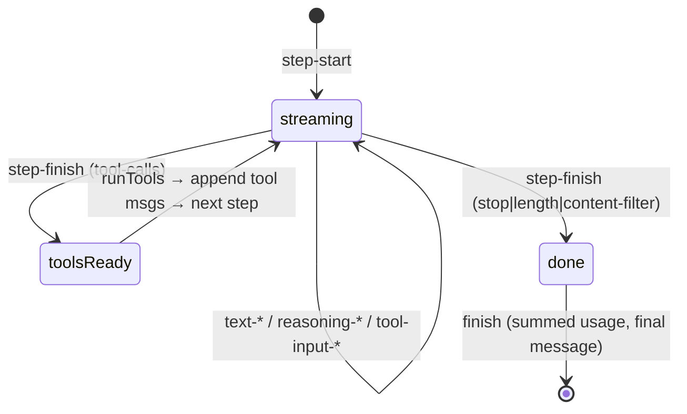

# The AI package and wire protocols

> OpenCode @ 56625a3e1f · paths relative to opencode-reference/

Companion to [08-providers-models-and-credentials.md](08-providers-models-and-credentials.md). This chapter covers `packages/ai`: the canonical data model, the request compiler, the protocol state machines, caching, effort, errors and retry. Chapter 08 covers which provider and model reach these protocols, and with which credentials.

## TL;DR

- **One canonical model, many routes.** Schema classes in `packages/ai/src/schema/` are the only request/response shape. A **Route** is a `Protocol` (body builder plus stream state machine) combined with an `Endpoint`, an `Auth`, and `Framing`/`Transport`. Forty-plus providers reuse about eight core protocols through `Route.make(...)` and `route.with(...)`. The package has about 36K lines.
- **Seven content parts:** `text`, `media`, `tool-call`, `tool-result`, `reasoning`, `compaction` and `effort`. There are **18 stream event types**. Opaque replay data lives in `providerMetadata[<providerMetadataKey>]`, a record keyed by provider. `ReasoningPart.encrypted` is a first-class field.
- **A compile step normalizes every request before any protocol sees it.** It repairs tool history, fixes UTF-16 surrogates, projects tool schemas per model family, strips or lowers effort markers, and auto-places cache breakpoints (`route/client.ts:542`).
- **Stop reasons are derived, not copied.** OpenAI Chat, Gemini and Responses all report `stop` alongside tool calls; OpenCode rewrites that to `tool-calls`. A missing terminal event becomes a retryable `incomplete-stream` error.
- **Reasoning replay is per protocol and fussy.** Anthropic uses `signature`, and `redacted_thinking.data` is replayed verbatim. Responses uses `encrypted_content` with `store:false` and `include:["reasoning.encrypted_content"]` by default. Gemini uses `thoughtSignature`, plus a documented sentinel when the signature is missing. Bedrock uses `reasoningText.signature` and `redactedContent`. Core replays opaque reasoning metadata only to the **same model**, not merely the same provider.
- **Errors are classified with evidence.** `classifyProviderFailure` combines status codes, provider codes, AWS headers and about 40 context-overflow regexes. `AIError.isRetryable` honours `x-should-retry`. Core retries with 2s exponential backoff capped at 10s, up to 10 retries, and a separate 1-hour budget when the network is unreachable.
- **Default timeouts suit reasoning models:** 5 minutes for response headers and **15 minutes between chunks** (`schema/options.ts:56,62`).

## Where it lives

| path | role | ~lines |
|---|---|---|
| `packages/ai/src/schema/{messages,events,options,errors}.ts` | Canonical parts, messages, events, Usage, capabilities, errors | 498+744+437+245 |
| `packages/schema/src/llm.ts` | `FinishReason` literal set | small |
| `packages/ai/src/llm.ts`, `loop.ts` | `generate` / `stream` / `loop` / `collect`, object output | 336+214 |
| `packages/ai/src/tool.ts`, `tool-runtime.ts`, `tool-history.ts` | Tool definition, dispatch, history repair | 256+109+91 |
| `packages/ai/src/route/client.ts` | `Route.make`, request compile, stream execution | 695 |
| `packages/ai/src/route/{protocol,framing,endpoint,auth,executor}.ts`, `route/transport/` | Protocol contract, SSE/lines framing, HTTP executor, WebSocket | ~1,400 |
| `packages/ai/src/protocols/anthropic-messages.ts` | Anthropic Messages | 1,593 |
| `packages/ai/src/protocols/open-responses.ts` (+`-channel`, `-continuation`) | Provider-neutral Responses base, WebSocket continuation | 1,597+198+216 |
| `packages/ai/src/protocols/openai-responses.ts` | OpenAI extensions to Responses | 366 |
| `packages/ai/src/protocols/openai-chat.ts` | Chat Completions plus all OpenAI-compatible quirks | 1,419 |
| `packages/ai/src/protocols/gemini.ts` | Gemini `streamGenerateContent` | 927 |
| `packages/ai/src/protocols/bedrock-converse.ts`, `bedrock-event-stream.ts` | Converse plus AWS binary event-stream | 984+147 |
| `packages/ai/src/protocols/google-interactions.ts` | Gemini Interactions API | 626 |
| `packages/ai/src/protocols/openai-freeform.ts` | Custom (grammar/free-text) tools | 94 |
| `packages/ai/src/protocols/utils/` | tool-stream, partial-json, tool-schema, lifecycle, bedrock-auth, cache | ~2,000 |
| `packages/ai/src/{cache-policy,effort-updates,provider-error}.ts` | Auto cache breakpoints, per-message effort, error classification | 247+25+289 |
| `packages/ai/src/{decision,image,speech,transcription,embedding,video,media,generation}.ts` + `*-client.ts` | Non-chat modalities | ~2,500 |
| `packages/core/src/model-retry.ts` | Retry schedule (lives in core) | 134 |

There are 56 protocol files in total. Besides the eight above, they include Alibaba, Cohere, Mistral, Venice, Z.ai, Meta, xAI, and the speech, transcription, image and video protocols.

## Architecture

```mermaid
flowchart LR
  subgraph Caller
    R[LLMRequest<br/>model + system + messages + tools]
  end
  subgraph Compile["compile() route/client.ts:565"]
    N1[normalizeToolHistory] --> N2[merge model/route options]
    N2 --> N3[sanitizeSurrogates]
    N3 --> N4[ToolSchemaProjection<br/>gemini / moonshot / objectRoot]
    N4 --> N5[applyEffortUpdates]
    N5 --> N6[applyCachePolicy]
    N6 --> N7[route.headers]
  end
  subgraph Route["Route = Protocol + Endpoint + Auth + Transport"]
    B[protocol.body.from] --> V[body.schema validate+encode]
    V --> T[transport.prepare<br/>endpoint, auth, betas]
    T --> X[RequestExecutor<br/>only HTTP path]
    X --> F[Framing: sse / sseWithDone /<br/>sseEvents / AWS event-stream]
    F --> D[stream.event decode]
    D --> S[stream.step state machine]
    S --> H[onHalt flush]
  end
  R --> N1
  N7 --> B
  H --> E[requireTerminalEvent] --> O[LLMEvent stream]
  O --> L[LLM.loop / ResponseFold / core runner]
```

The protocol does not know URLs or auth (`route/protocol.ts:4-26`). That separation lets DeepSeek become a 20-line route over `OpenAIChat.protocol` (`providers/deepseek.ts:25-43`), with a compatibility override of `maxTokensField: "max_tokens"`.

## Key types and interfaces

| name | file:line | purpose |
|---|---|---|
| `TextPart`, `MediaPart` | `ai/src/schema/messages.ts:40,48` | Content with optional `cache: CacheHint` and `providerMetadata` |
| `ToolCallPart` | `messages.ts:138` | `id, name, namespace?, input, providerExecuted?` (server-side tools) |
| `ToolResultPart` | `messages.ts:155` | Result value is `json`/`text`/`error`/`content` (rich, with files) |
| `ReasoningPart` | `messages.ts:186` | `text`, `encrypted?`, `providerMetadata` (signatures live here) |
| `CompactionPart` | `messages.ts:200` | Provider checkpoint: exactly one of `encrypted` or summary `text` |
| `EffortPart` | `messages.ts:222` | "Effort changed here", carried in a single-part system message |
| `SystemMessage/UserMessage/AssistantMessage/ToolMessage` | `messages.ts:240-268` | Role-restricted part unions |
| `ToolDefinition` | `messages.ts:387` | `inputSchema`, `freeform?`, `native?`, `cache?` |
| `LLMRequest` | `messages.ts:485` | Adds `cache` policy, `promptCacheKey`, `includeRaw` |
| `FinishReason` | `packages/schema/src/llm.ts:5` | `stop, length, tool-calls, content-filter, error, unknown` |
| `FinishReasonDetails` | `ai/src/schema/events.ts:269` | `normalized` + `raw` + content-filter `category`/`explanation` |
| `Usage` | `events.ts:64` | Inclusive totals plus a non-overlapping breakdown; `cost`, `contextTokens` |
| `LLMEvent` union | `events.ts:313` | 18 event types, from `step-start` through `finish`, plus `raw` |
| `LanguageModel` | `ai/src/schema/options.ts:297` | `id, provider, route, options, capabilities, compatibility` |
| `Capabilities` | `options.ts:243` | Tools, reasoning (toggle/effort/budget/updates), cache, store, streamUsage… |
| `LanguageModelCompatibility` | `options.ts:213` | Quirk flags: `reasoningField`, `maxTokensField`, `requireSignature`, `cacheFormat`… |
| `Protocol<Body,Frame,Event,State>` | `ai/src/route/protocol.ts:37` | `body.{schema,from}`, `stream.{event,initial,step,terminal?,onHalt?}` |
| `Route` | `ai/src/route/client.ts:48` | Runnable route; `.with(patch)`, `.model(...)` |
| `AIError` + reasons | `ai/src/schema/errors.ts:32-156` | Tagged reasons: InvalidRequest, Authentication, RateLimit, QuotaExceeded, ContentPolicy, ProviderInternal, Transport, InvalidProviderOutput, Timeout, UnknownProvider |

## How it works: walkthroughs

### 1. One streamed call (`LLMClient.stream`)
1. `resolveRequestOptions` runs `normalizeToolHistory` and merges model, route and request options (`route/client.ts:244-255`).
2. `prepareRequest` sanitizes lone surrogates (`utils/sanitize.ts:9`). It dedupes tools by `type:name` and projects every tool schema (`route/client.ts:542-556`). The projection gives each tool an object root, then applies Gemini or Moonshot rules chosen by `compatibility.sanitizer`, then `route.sanitizer`, then a model-name regex (`protocols/utils/tool-schema.ts:65,86`).
3. `compile` rejects un-read `file:` references (`route/client.ts:565-579`). It then calls `protocol.body.from` and `transport.prepare`.
4. Frames are decoded and folded through `stream.step`. `onHalt` flushes at EOF (`route/client.ts:408-470`). `requireTerminalEvent` fails if anything other than `raw` follows `finish`, or if no `finish` arrives (`route/client.ts:316-331`).
5. SSE framing drops `data: null` frames from proxies and Vertex's `data: : keepalive` (`route/framing.ts:55-61`).

### 2. Tool-call assembly (shared)
`protocols/utils/tool-stream.ts` keys pending calls by the provider's stream-local key: a numeric index for Anthropic, Chat and Bedrock, and `item_id` for Responses. `finish(…, input?)` lets an authoritative final argument string win (`tool-stream.ts:212`). `finishAll` closes every pending call when Chat sends `finish_reason` (`:227`). On a JSON parse failure, a client tool emits `tool-input-error` with the raw text. A provider-executed tool fails the stream instead (`:79-98`). Partial JSON is parsed lazily, for UI previews only (vendored MIT `partial-json.ts`).

### 3. The `LLM.loop` helper (SDK/one-shot; the core session runner is separate, see ch. 03)
- `driveLoop` holds back each step's `finish`, sums usage, and computes `pendingCalls` (`llm.ts:218-246`). `pendingCalls` returns nothing on `length`. It skips `providerExecuted` calls and turns each `tool-input-error` into a call with `input: {}` and the error text `Invalid tool arguments: … Received: <raw>` (`loop.ts:25-39`).
- `runTools` runs calls with **unbounded concurrency** and returns results in call order (`tool-runtime.ts:51-59`). An unknown tool returns an error result that tells the model to pick from the list (`:26-31`).
- `nextRequest` downgrades a forced `toolChoice` to `auto` after the first step, unless it is the hidden `generate_object` answer tool (`loop.ts:70-83`, `llm.ts:248`).
- `addUsage` sums every counter except `contextTokens`, which describes only the latest call (`loop.ts:86-111`).

### 4. Tool-history repair (every request)
`normalizeToolHistory` (`tool-history.ts:6-48`) does four things:
- appends a synthetic `"Tool result missing"` error for every unanswered call, before the next user or assistant message;
- holds system messages until pending calls resolve;
- renames results to match their call;
- replaces empty outputs with `"(no tool output)"`.

### 5. Anthropic Messages
- **Request.** `max_tokens` defaults to 32,000 (`anthropic-messages.ts:39,981`). A manual thinking budget is clamped to at most `max_tokens/2` and at least 1,024 (`:946-952`, `shared.ts:193`). The `interleaved-thinking-2025-05-14` beta is always sent. Compaction, mid-conversation `output_config`, fast mode and thinking-binding betas are added when used (`:1556-1578`). Tool ids are scrubbed to `[a-zA-Z0-9_-]` (`:587`). Responses are parsed only for the listed SSE event names (`:42-54`).
- **Replay** (`:862-878`). A reasoning part with a signature becomes `thinking{thinking, signature}`. A part with only `redactedData` becomes `redacted_thinking{data}`. Unsigned text becomes `thinking` with `signature: ""` only when `requireThinkingSignature` is false; that covers Kimi, MiniMax, Qwen and MiMo endpoints, or the `compatibility.requireSignature` override (`:726-745`). Otherwise the part is dropped.
- **Stream.** `signature_delta` is stored per block index and attached at `content_block_stop` (`:1270-1276`, `:1319-1326`). `redacted_thinking` arrives whole and is emitted as an empty reasoning part (`:1209-1212`). `input_json_delta` appends to the tool at that index (`:1282`). The stop reason arrives in `message_delta` together with `stop_details.category/explanation` (`:1344-1365`). An in-stream `error` event goes through the shared classifier (`:1411-1419`).
- **Effort.** Claude Opus 5 and Claude 5.1+ take per-message effort as a system message with `output_config.effort` (`:924-931`, `:818-821`). This avoids changing the top-level effort, which would invalidate the prompt cache (`effort-updates.ts:1-2`).

### 6. OpenAI Responses (open-responses base + openai-responses)
- The OpenAI route defaults to `store: false, include: ["reasoning.encrypted_content"]` (`openai-responses.ts:363`). A reasoning part replays as `{type:"reasoning", id, summary:[summary_text], encrypted_content}` from `providerMetadata[key].reasoningEncryptedContent` (`open-responses.ts:563-578`).
- The terminal events are `response.completed` and `response.incomplete` (clean finishes), and `response.failed` and `error` (hard failures) (`:968-972`). `mapFinishReason` uses `incomplete_details.reason`: `max_output_tokens` maps to `length` and `content_filter` to `content-filter`. With no reason, the finish is `tool-calls` if a function call occurred (`:946-956`).
- **Transport.** The default is WebSocket (`responses_websockets=2026-02-06` beta header), rotating sockets after 55 minutes (`openai-responses.ts:24-25,344-349`). The continuation driver sends only the new input with `previous_response_id`. It falls back to a full send on `previous_response_not_found`, and on an unclassified InvalidRequest during an incremental send (`open-responses-continuation.ts:142-181`).

### 7. OpenAI Chat Completions (and every compatible server)
- **Reasoning.** Reasoning text is read from the configured field, then `reasoning_content`, `reasoning`, `reasoning_text` (`openai-chat.ts:1012-1023`). `reasoning_details` has two dialects: OpenRouter's, which is replayed unmodified, and Kimi's, which merges deltas by `index` and replays without it (`:114-120`).
- **Tool ids are rewritten per destination.** Mistral-family ids become 9 alphanumeric characters, Claude ids are scrubbed, and OpenAI and Azure ids are capped at 40 characters (`:666-679`). Mistral also needs an `assistant: "Done."` bridge after tool messages (`:682-686`).
- **Tool deltas without `index`** fall back to matching by id, then batch position, then the latest call (`:1205-1212`).
- **Token-limit field.** `max_tokens` or `max_completion_tokens` is detected from the provider or base URL: DeepSeek, Moonshot, Together, Z.ai, Nvidia, Cerebras, Chutes and Cloudflare use `max_tokens` (`:766-797`). `stream_options.include_usage` is on by default (`:900`).
- **Finish handling.** `finish_reason: "error"` and `"network_error"` become errors (`:925-939`). A stream without `finish_reason` fails as `incomplete-stream` unless `requireFinishReason` is false. `stop` combined with tool calls becomes `tool-calls` (`:1321-1342`).

### 8. Gemini
- **Request.** Tools go in `parametersJsonSchema`, after Gemini-specific schema normalization (`gemini.ts:281-285`, `utils/gemini-json-schema.ts`). The endpoint is `/models/{id}:streamGenerateContent?alt=sse` (`:914-920`).
- **Replay.** `thoughtSignature` is attached to text, media, reasoning (`thought: true`) and functionCall parts. Only the **first** parallel call needs a signature. If a call has lost its signature, the documented sentinel `skip_thought_signature_validator` is sent (`:36,351-388`). Gemini models below 3 get no function-call ids at all (`:47-50`).
- **Stream.** A missing or duplicate `functionCall.id` is replaced by `tool_<uuid>` (`:750-759`). `STOP` combined with tool calls becomes `tool-calls`. `MALFORMED_FUNCTION_CALL`, `MISSING_THOUGHT_SIGNATURE` and similar reasons become `error` (`:569-580`). On a `CONTINUATION` finish, the transport resends the body with the latest `continuationToken` (`:816-820`).
- **Usage.** `candidatesTokenCount` excludes thoughts, so the two are summed (`:497-520`).

### 9. Bedrock Converse
- **Wire format.** Responses use the binary AWS event-stream, with CRCs checked by `@smithy/eventstream-codec` (`bedrock-event-stream.ts`). Requests are SigV4-signed via `BedrockAuth.auth`. The URL is `/model/{modelId}/converse-stream` (`bedrock-converse.ts:969-980`).
- **Reasoning replay.** Reasoning goes back as `reasoningContent.reasoningText{text, signature}` or `{redactedContent}`. Unsigned reasoning is dropped (`:417-424`).
- **Stream.** `messageStop` (stop reason) and `metadata` (usage) arrive separately and are merged in `onHalt` (`:695`). `guardrail_intervened` maps to `content-filter` (`:664-670`). Mistral-on-Bedrock tool ids are normalized (`:359`).

### 10. Google Interactions
- **Request.** This is a stateful steps API with `store` (default false) and `previous_interaction_id` (`google-interactions.ts:36-40,88-89,359`). Thoughts and function calls carry `signature`, with the same sentinel as Gemini (`:28,295-311`).
- **Status mapping** (`:552-590`):

  | status | finish reason |
  |---|---|
  | `requires_action`, or `completed` with tool calls | `tool-calls` |
  | `incomplete` | `length` |
  | `failed`, `cancelled` | error |

### 11. Errors and retry
- **Error message.** `httpFailure` reads `retry-after-ms` or `retry-after` (seconds or a date) and rate-limit headers (`route/executor.ts:39-50,124-148`). `providerErrorMessage` tries six common error-body layouts in turn (`provider-error.ts:173-190`).
- **Classification order** (`provider-error.ts:216-289`):
  1. context overflow (codes, or about 40 regexes, never on a 429);
  2. payload too large;
  3. content policy;
  4. quota (402, quota codes, or quota text on a 429);
  5. auth (401, 403, or Google's `api_key_invalid` on a 400);
  6. rate limit;
  7. provider internal (408, 409, 5xx, or server codes when no 4xx contradicts them);
  8. invalid request;
  9. unknown, which is retryable.
- **Retryability** (`schema/errors.ts:197-225`). `x-should-retry` overrides everything. RateLimit and ProviderInternal retry. A Transport error retries unless the request was rejected, or was accepted and failed on something other than a read. An `incomplete-stream` failure retries.
- **Core policy** (`core/src/model-retry.ts:12-134`):
  - jittered exponential backoff from 2s, capped at 10s per gap, at most 10 retries;
  - `retry-after` honoured up to 15 minutes;
  - ENOTFOUND, EAI_AGAIN and ENETUNREACH-type errors retry for up to 1 hour, with gaps up to 30s;
  - at most 3 retries after timeouts;
  - one-shot calls (images, decisions) retry only failures the provider clearly never ran.

### 12. Route, decision and non-text clients
- **Decisions.** `Decision` (`decision.ts:47-136`) asks typed questions: predicate, choice and score. Answers include a `refusal` error. It has its own `Protocol` shape (`route/decision.ts`), with OpenAI `/decisions`, Google and Cloudflare implementations. Core calls it from `core/src/generate.ts:188-200`.
- **Media.** Image, speech, transcription and video models extend `MediaModel` (`media-model.ts:19`). Media routes are `inline`, `queued` or `stream` (`route/media.ts:131,182,273`). Queued jobs return a `Generation` that has a serializable `token`, so another process can resume it. It polls every 5s for up to 10 minutes by default (`generation.ts:40-41,62`). Usage is reported in tokens, seconds, characters, credits or compute (`events.ts:103-114`). Embeddings support `query` and `document` intents.

## Protocol comparison

| Protocol | Reasoning on the wire | Replay token | Tool call / id | Arg streaming | Stop-reason mapping | Usage quirk |
|---|---|---|---|---|---|---|
| anthropic-messages | `thinking` / `redacted_thinking` blocks, `thinking_delta` | `signature` (via `signature_delta`); `data` for redacted | `tool_use{id}`; ids scrubbed `[^\w-]→_` | `input_json_delta` by block index | `end_turn`, `stop_sequence`, `pause_turn` → stop; `max_tokens`, `model_context_window_exceeded` → length; `tool_use` → tool-calls; `refusal` → content-filter | `input_tokens` excludes cache; sum for inclusive |
| openai-responses / open-responses | `reasoning` item, `summary_text`, `reasoning_text` deltas | `encrypted_content` (needs `include`) + item `id` | `function_call{call_id}`, `custom_tool_call` | `function_call_arguments.delta` by `item_id`; `.done`/`output_item.done` wins | `incomplete_details.reason`: `max_output_tokens` → length, `content_filter`; no reason + call → tool-calls | Inclusive; subtract cached and reasoning |
| openai-chat | `reasoning_content` / `reasoning` / `reasoning_text` / `reasoning_details` | None for OpenAI; OpenRouter/Kimi `reasoning_details` | `tool_calls[{index,id}]`; id rewritten per family | `function.arguments` by index (fallback id/position) | `stop`/`end` → stop (→ tool-calls if calls); `length`; `content_filter`; `tool_calls`/`function_call`; `error` → error | Needs `stream_options.include_usage` |
| gemini | parts with `thought: true` | `thoughtSignature` on parts; sentinel when lost | `functionCall{id?}`; synth `tool_<uuid>`; no ids sent < Gemini 3 | Whole call per chunk | `STOP` (→ tool-calls if calls); `MAX_TOKENS` → length; safety → content-filter; malformed → error; `CONTINUATION` → resume | `candidatesTokenCount` excludes thoughts |
| bedrock-converse | `reasoningContent.reasoningText` / `redactedContent` | `signature`; `redactedContent` | `toolUse{toolUseId}` | `contentBlockDelta.toolUse.input` | like Anthropic; `content_filtered`, `guardrail_intervened` → content-filter | Usage in separate `metadata` event |
| google-interactions | `thought` steps, `thought_summary` delta | `signature` (`thought_signature` delta) | `function_call` step + signature | `arguments_delta` | status: `requires_action` → tool-calls; `incomplete` → length; `failed`/`cancelled` → error | `total_thought_tokens` |
| openai-freeform | n/a (a tool format) | n/a | Custom tool: raw text ↔ `{field: raw}` | `custom_tool_call_input.delta` | n/a | n/a |

## Configuration and extension points

- **Per-model `compatibility`** (`options.ts:213-229`): `sanitizer`, `reasoningField`, `requireReasoning`, `maxTokensField`, `requireFinishReason`, `requireAssistantAfterTool`, `cacheFormat` (`anthropic`|`alibaba`), `zaiToolStream`, `requireSignature`, `supportsThinkingBlockBinding`. Chapter 08 explains how these come from models.dev and config.
- **Per-model `capabilities`** (`options.ts:243-295`): `reasoning.{effort[],budget,updates}`, `cache.{implicit,explicit.maxBreakpoints}`, `store`, `streamUsage`, `promptCacheKey`, `serviceTier`.
- **Request**: `cache` (`"auto"` by default, `"none"`, or `{tools, system, messages:{tail}|latest-*, ttl}`) (`options.ts:422-436`). Also `promptCacheKey`, `includeRaw`, `timeout{total,headers,chunk}`, `http` middleware, `fetch`.
- **Cache auto-placement** (`cache-policy.ts`):
  - It applies only to routes that honour inline markers (`:62-78`).
  - Up to 4 breakpoints: last tool, first and last system parts, conversation tail (`:27-34`).
  - Through OpenRouter or Vercel, only `anthropic/*` models get the full policy. Qwen gets system plus tail, and Gemini gets nothing, because a tail breakpoint would write a new cache every step (`:80-90`).
  - Hand-placed hints count against the budget (`:215-227`).
- **Extension**: write a `Protocol.make({...})` and wrap it in `Route.make({protocol, endpoint, auth, framing|transport})`. Providers override the route with `route.with({ baseURL, auth, headers, ... })`.
- **Testing**: set `RECORD=true` with the provider key to record a cassette. Replay is the default (`packages/ai/AGENTS.md`).

## Edge cases, invariants and gotchas

- **Usage invariant:** `nonCached + cacheRead + cacheWrite = inputTokens`, and `reasoning ≤ output`. Mappers clamp with `Math.max(0, …)` (`events.ts:19-62`). `cost: 0` is authoritative and means the request was free or covered by a subscription.
- **Same-model replay.** Core sends `providerMetadata` (signatures, encrypted content) only when both the provider and the model id match. After a switch it sends the readable reasoning text without metadata and lets the destination protocol decide (`core/src/session/runner/to-llm-message.ts:146-198`). For Anthropic that means the text is dropped unless `requireSignature` is false.
- **Reasoning that was cut off** (stream error, no finish) is replayed only if a tool call or non-empty text followed it (`to-llm-message.ts:182-189`).
- **`ReasoningEnd.text`** is authoritative and replaces the accumulated deltas (`events.ts:200`).
- **Providers stream thinking with no output for minutes.** The chunk timeout is 15 minutes, at DeepSeek's request (`options.ts:58-62`).
- **Context-overflow detection is regex-heavy and ordered.** A 429 is never treated as overflow. Bedrock's "Too many tokens, please wait" is excluded (`provider-error.ts:62-74`). Overflow drives compaction in core (ch. 04).
- **`/^4(00|13) (no body)/` counts as overflow.** Some gateways return an empty 400 or 413 when the input is too large (`provider-error.ts:74`).
- **Quota and rate limit are separate errors.** Retrying a 402 or "insufficient_quota" would loop forever, so quota is not retried (`provider-error.ts:89-97`).
- **No HTTP outside `RequestExecutor`.** A lint rule enforces this (`AGENTS.md`), so request hooks and recording have one choke point.

## Tests worth reading

- `packages/ai/test/tool-history.test.ts`, `tool-stream.test.ts`, `partial-json.test.ts`, `loop.test.ts`, `loop-steps.test.ts`
- `packages/ai/test/provider-error.test.ts` (overflow corpus), `cache-policy.test.ts`, `effort-updates.test.ts`, `http-timeout.test.ts`, `raw-events.test.ts`
- `packages/ai/test/provider/anthropic-messages.test.ts`, `anthropic-thinking-binding.test.ts`, `openai-chat.test.ts`, `openai-compatible-chat.test.ts`, `open-responses-replay.test.ts`, `open-responses-finals.test.ts`, `openai-responses-websocket.recorded.test.ts`, `gemini.test.ts`, `bedrock-converse.test.ts`, `bedrock-mistral-ids.test.ts`, `missing-tool-input.test.ts`, `golden.recorded.test.ts`
- Cassettes: `packages/ai/test/fixtures/recordings/` (90 scenario directories). These are **real recorded streams**, which the Genie prototype lacks.

## Genie takeaways

Pick-list [#1 protocols](../../research/opencode-pick-list.md) is **PORT CODE**: translate the protocol state machines into Rust in `genie-providers`. They belong to [ticket 03](../../tickets/03-provider-layer.md) and are verified under [ticket 34](../../tickets/34-live-provider-verification.md). The shape maps directly: `Protocol { body.from, stream.initial/step/onHalt }` becomes a pure `build_request` plus an `SseMapper` fold.

**Keep (the prototype already agrees with OpenCode):**
- Derived stop reasons. OpenCode does the same in Chat, Gemini and Responses.
- An error result for invalid tool JSON, and no tool execution on `length`.
- Synthesized ids for Gemini.
- Both OpenAI adapters.
- Effort per model.

**Adapt (quirks the prototype does not handle yet):**
1. **Replay identity.** OpenCode replays opaque data only to the same *model*. The prototype replays to the same *provider*. Anthropic's thinking-binding and Gemini signatures are model-bound, so use `(provider, model)` in `Message.origin` *(inferred risk)*. Also send readable reasoning to a new provider as plain text, rather than always dropping it.
2. **The `opaque` field must be able to express:**
   - Anthropic `redacted_thinking` (a separate block type);
   - a Responses reasoning item `id` plus `encrypted_content`;
   - Gemini signatures on **text and tool-call parts**, not only reasoning;
   - Chat `reasoning_details` arrays.

   Add the `skip_thought_signature_validator` fallback.
3. **Tool-id rewriting per destination on replay:** the Anthropic charset, Mistral's 9 characters, OpenAI's 40-character cap. Gemini below 3 gets no ids at all.
4. **Five events are too few for the UI.** Add `ToolInputStart/Delta/End` and `ToolInputError`, step boundaries, a `raw` passthrough for debugging, and provider-executed tool results. Require a terminal event, and treat a stream that ends without one as retryable.
5. **History repair before every request:** missing tool results, empty outputs, system messages placed between a call and its result.
6. **OpenAI-compatible quirk flags.** Port `LanguageModelCompatibility` almost verbatim, so the Ollama and vLLM adapters need no forks. Also handle `data: null` and keepalive frames, and tool deltas without an index.
7. **Usage.** Adopt the inclusive-plus-breakdown `Usage` with its invariant. The prototype's three counters cannot price cache reads and writes.
8. **Cache and effort.** Port the 4-breakpoint auto policy and per-message effort markers. Changing effort otherwise invalidates the cache.
9. **Errors and retry.** Port `classifyProviderFailure`, the overflow regex list, the `x-should-retry` and `retry-after-ms` handling, and the `model-retry` schedules. The prototype has none of these.
10. **Timeouts:** headers 5 minutes, chunk gap 15 minutes.

**Avoid or defer:**
- The Responses WebSocket and `previous_response_id` incremental transport (complex; HTTP SSE with full replay is enough for M1).
- Google Interactions and the decision and media clients (not M1).
- 1,500-line protocol files. Split each Rust adapter into request, stream and usage modules.

## Open questions / inferred

- Which protocol the Genie Gateway speaks: if it is Responses-shaped, the open-responses base is the one to port first *(inferred)*.
- The dated betas (`thinking-binding-controls-2026-08-01`, `mid-conversation-output-config-2026-07-01`, `compact-2026-01-12`) and the Opus 5 / 5.1 effort-update gating need checking against Anthropic docs under ticket 34.
- WebSocket "accepted" delivery semantics are taken from code comments only, not from an observed run *(inferred)*.
- Whether OpenCode's same-model rule is stricter than necessary for Anthropic models on the same provider was not checked *(inferred)*.
