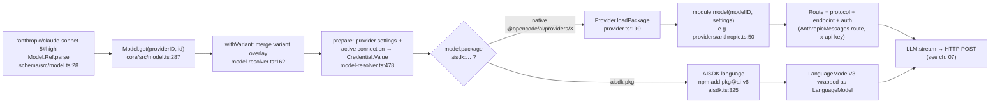
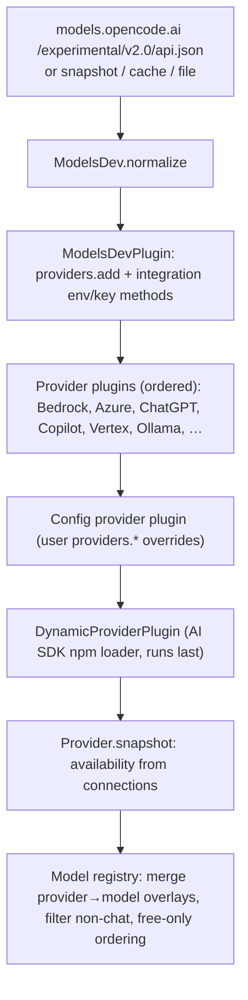

# Providers, Models and Credentials

> OpenCode @ 56625a3e1f · paths relative to opencode-reference/

Companion to [07-ai-package-and-protocols.md](07-ai-package-and-protocols.md), which covers the wire protocols. This chapter covers what sits above them: provider modules, core provider plugins, the model catalog, reasoning variants, and credential storage.

## TL;DR

- **Three layers.** (1) `packages/ai/src/providers/*`: 45 thin provider modules. Each exports `model(modelID, settings)` and binds one or more protocol routes to a base URL and an auth scheme. (2) `packages/core/src/plugin/provider/*`: about 30 *plugins* that edit the provider/model registry at runtime. They handle discovery (Ollama, LM Studio, vLLM, Azure deployments), cloud auth (Bedrock, Vertex, Azure), subscription logins (Copilot, ChatGPT, GitLab), and per-host quirks. (3) The **catalog**: models.dev data, normalized by `core/src/models-dev.ts`.
- **The catalog decides the protocol per model, not per provider.** Each models.dev model lists APIs with an AI-SDK npm package name. OpenCode rewrites known names (e.g. `@ai-sdk/anthropic`) to native `@opencode/ai/providers/*` entrypoints (`core/src/aisdk-native.ts:113`, `:179`). Only unknown packages fall back to the Vercel AI SDK, which is npm-installed at runtime (`core/src/plugin/provider/sdk-factory.ts:5`).
- **The catalog never blocks boot.** The order is: an explicit file (`OPENCODE_MODELS_PATH`), then the KV cache, then a bundled ~8 MB snapshot, then a fetch. A background refresh runs every 5 minutes with ETag and digest dedupe (`core/src/models-dev.ts:649`, `:671`).
- **Reasoning "variants" are per-protocol request overlays, not an enum.** `core/src/variant.ts` turns the catalog's `{toggle, effort[], budget}` into named variants (`none`, `low`…`max`, `thinking`). Each one is a `settings`/`headers`/`body` patch whose spelling differs for each of about 40 packages (`variant.ts:606`).
- **Credentials are plaintext JSON rows in SQLite** (`core/src/credential/sql.ts:5`). They come in three shapes (`key`, `oauth`, `external`). Refresh is single-flight and file-locked, and a refresh result is discarded if the row changed meanwhile (`core/src/credential.ts:142-182`). OpenCode uses no OS keychain anywhere.
- **Connection precedence:** stored credentials (active one first) beat env vars (`core/src/integration.ts:387-401`). Env vars come from the catalog's `env` list, and plugins override that list for each provider.
- **Small model** for titles: the agent's configured model, else the first active text model in the session's provider whose family is `gpt-luna`, `gemini-flash-lite`, `gemini-flash` or `claude-haiku`, else the primary model at a lower reasoning variant (`core/src/model.ts:308-320`, `core/src/session/context.ts:99-137`).
- **Usage limits** only exist for OpenCode's own Console/Go subscription (`core/src/usage-limits.ts:35`). Generic provider rate limits go through retry (see ch. 07).

## Where it lives

| Path | Role | ~lines |
|---|---|---|
| `packages/ai/src/providers/*.ts` + subdirs | 45 provider modules (`model()`, `configure()`, auth, base URL) | 5,400 |
| `packages/ai/src/route/auth.ts`, `auth-options.ts` | Auth combinators (`bearer`, `header`, `config(env)`, `none`) | 230 |
| `packages/core/src/plugin/provider/*` | Provider plugins (incl. `claude-agent/` ≈2,400) | 9,000 |
| `packages/core/src/plugin/provider.ts` | Ordered plugin list | 65 |
| `packages/core/src/models-dev.ts`, `models-dev/v1.ts`, `models-dev/snapshot.txt` | Catalog fetch/normalize/cache; v1→v2 convert; bundled snapshot (8.2 MB, one line) | 920 |
| `packages/core/src/plugin/models-dev.ts` | Feeds catalog into provider + integration registries | 110 |
| `packages/core/src/provider.ts` | Provider registry, availability, package loader | 553 |
| `packages/core/src/model.ts` | Model registry, default and small model, free-model handling | 366 |
| `packages/core/src/model-resolver.ts` | Catalog entry + variant + credential → runtime `LanguageModel` | 624 |
| `packages/core/src/variant.ts` | Reasoning variant synthesis per protocol | 691 |
| `packages/core/src/aisdk.ts`, `aisdk-native.ts` | AI SDK bridge; AI-SDK→native package rewrite | 1,460 |
| `packages/core/src/credential.ts`, `credential/sql.ts` | Credential store + refresh lock | 365 |
| `packages/core/src/integration.ts`, `integration/connection.ts` | Auth methods (oauth/key/env/external/command), connections | 876 |
| `packages/core/src/oauth/*` | Callback page; pasted-redirect fallback | 318 |
| `packages/core/src/account/sql.ts` | OpenCode Console account rows (legacy + current) | 36 |
| `packages/core/src/usage-limits.ts` | Console budgets and Go meter | 192 |
| `packages/schema/src/{model,provider,credential,model-compatibility}.ts`, `config/provider.ts`, `config/model.ts` | Schemas | ~600 |

## Architecture

## Key types and interfaces

| Name | File:line | Purpose |
|---|---|---|
| `Model.Ref` + `parse` | `packages/schema/src/model.ts:20`, `:28` | `provider/model#variant`; provider is everything before the **first** `/`, so `openrouter/openai/gpt-x` works |
| `Model.Info` | `packages/schema/src/model.ts:117` | Catalog model: `modelID` (wire id) vs `id` (catalog id), `package`, `capabilities`, `variants`, `cost[]` tiers, `limit`, `status`, overlays |
| `Model.Info.default` | `packages/schema/src/model.ts:157` | Unknown models default to 200k context / 32k output |
| `Model.Compatibility` | `packages/schema/src/model-compatibility.ts:26` | Quirk flags: `reasoningField`, `requireReasoning`, `maxTokensField`, `requireFinishReason`, `requireAssistantAfterTool`, `supportsPromptCacheKey`, `streamUsage`, `cacheFormat`, `supportsThinkingBlockBinding`, `supportsEffortUpdates`, `mediaInput` |
| `Provider.Info` / `Settings` | `packages/schema/src/provider.ts:93-134` | `activation` (auto/enabled/disabled), `package`, `integrationID`, `canonical`; settings incl. `timeout`, `headerTimeout`, `chunkTimeout`, `compaction`, `cache`, `transport`, `encoding`, `tls` |
| `Provider.Snapshot` | `packages/core/src/provider.ts:328` | `records`, `available`, `providers` |
| `ModelResolver.Resolved` | `packages/core/src/model-resolver.ts:119` | Runtime `LanguageModel` + catalog `ref`, capabilities, cost, limit, compaction, cache, transport |
| `Variant.Support` | `packages/core/src/variant.ts:7` | `effort{values}` / `toggle` / `budget_tokens{min,max}` |
| `Credential.Value` | `packages/schema/src/credential.ts:33-61` | `oauth{methodID, access, refresh, expires, metadata}` / `key{key, metadata}` / `external{methodID, metadata}` |
| `Credential.Interface.refresh` | `packages/core/src/credential.ts:57` | Locked refresh contract |
| `Integration.Interface` | `packages/core/src/integration.ts:172` | `connection.{active,resolve,key,external,activate,remove,status}`, `oauth.{connect,status,complete,cancel}`, `command.*` |
| `ProviderPackage` module contract | `packages/core/src/provider.ts:546` | A package must export `model(modelID, settings)` |
| `AISDK.Interface` | `packages/core/src/aisdk.ts:247` | `hook.sdk` / `hook.language` for plugins to construct AI-SDK providers |

## How it works: walkthroughs

### 1. Catalog boot and refresh
1. The CLI passes `{url: OPENCODE_MODELS_URL, file: OPENCODE_MODELS_PATH, fetch: !OPENCODE_DISABLE_MODELS_FETCH}` (`packages/cli/src/server-process.ts:117-121`).
2. `populate` tries the file, then KV cache key `models-dev:v2:catalog`, then the bundled snapshot, then a locked fetch (`models-dev.ts:649-665`). The default source is `https://models.opencode.ai` with path `/experimental/v2.0/api.json?type=chat,decision,image` (`:505-508`). A custom mirror that returns 404 is retried at v1 `/api.json` and converted (`:600-604`).
3. `normalize` decodes each model on its own. Bad models are skipped and logged, not fatal (`:182-243`). `route()` picks the first API that has a loadable package: a native `opencodeai` entrypoint, else an `aisdk` name mapped through `AISDKNative.native` (`:252-289`). The provider's `package`/`baseURL` is the **most common** one among its models. A model that differs carries its own (`:200-214`). Bedrock, Azure, Vertex and Cloudflare packages ignore catalog URLs because they build their own (`:164-180`).
4. `cost()` keeps only per-token text prices and turns context-size overrides into tiers (`:320-359`). `experimental.modes` (e.g. a fast mode) become sibling models `id-mode` with request overlays and scaled prices (`:221-228`, `:370`).
5. `Variant.resolve` attaches reasoning variants (`:215`).
6. A forked loop calls `refresh()` every 5 minutes. It sends `If-None-Match`, and a byte-identical body does not invalidate anything or publish `Refreshed` (`:671-703`). Cache writes are best-effort because the catalog outgrew a 2 MB KV value limit (`:622-639`).
7. `ModelsDevPlugin` registers each provider plus `key` and `env` integration methods taken from the catalog's `env` list (`core/src/plugin/models-dev.ts:41-66`).

### 2. Model id string → HTTP request
1. `Model.Ref.parse("anthropic/claude-x#high")` (`schema/src/model.ts:28`). Config accepts the same short form (`schema/src/config/model.ts:18`).
2. `SessionRunnerModel.select` uses the session model, else the agent model, else `resolver.fallback()` (the default model, else the first available text model) (`core/src/session/runner/model.ts:81-99`, `model-resolver.ts:542`). The plugin hook `experimental.model.resolve` may swap it, but only within the same provider (`runner/model.ts:108-119`).
3. `prepare` finds the active connection and resolves it to a `Credential.Value`, refreshing OAuth if it is expiring. It merges provider settings under model settings (`model-resolver.ts:478-490`).
4. `withVariant` overlays the variant's settings/headers/body. A variant cannot change `cache` (`:162-190`).
5. For a native package, `loadCatalogPackage` expands `${VAR}` placeholders in `baseURL` from env, using the `region` setting for `${AWS_REGION}` (`:381-396`). It then injects the credential: `key`→`apiKey`, `oauth`→`authToken` (Anthropic), `accessToken` (Vertex) or `apiKey`. Bedrock gets `auth:"sigv4"`, and Azure gets a placeholder that a request hook replaces with an Entra token (`:408-429`).
6. `module.model(modelID, settings)` builds the route. Timeouts, encoding and TLS land on transport options (`:248-266`). Defaults are a 5-minute header timeout and a **15-minute chunk timeout**, because DeepSeek asks for it (`provider.ts:244-251`).
7. For a provider whose `activation` is `enabled`, with no credential and no configured key, auth is replaced by `Auth.none` (`model-resolver.ts:494-500`). This is how keyless local servers work.

### 3. Credential refresh
`Integration.connection.resolve` returns env keys directly. For stored OAuth it calls `Credential.refresh` only when the token expires within 5 minutes (`integration.ts:699-713`, `credential.ts:33`). `refresh` joins an in-flight fiber for the same id, then takes a cross-process file lock `credential-refresh:<id>`, then re-reads the row. If another caller already refreshed it, that row is returned. After refresh, if the stored access/refresh changed meanwhile, the stored row wins (`credential.ts:142-182`). GitLab rotates refresh tokens on every use, which is why this matters (`plugin/provider/gitlab.ts:48`).

### 4. Title model selection
`selectTitle` (`session/context.ts:99`): if the `title` agent has a model, use it with its variant, else the minimal variant. Otherwise use `model.small(primaryProvider)`, a family preference list (`model.ts:317`), with variant `none`→`minimal`→`low` (`context.ts:201-205`). Otherwise use the primary model at a variant ranked lower than the selected one (`:210-213`). Legacy `small_model` config is migrated into the `title` agent (`config/normalize.ts:137-151`). Compaction uses the `compaction` agent's model, else the session model (`session/compaction.ts:278-299`). Copilot overrides titles with its free `gpt-4o-mini` utility model (`plugin/provider/github-copilot.ts:502`).

## Provider modules (`packages/ai/src/providers`)

Env vars below are the fallbacks the module reads through `Auth.config` when no `apiKey` is passed (`route/auth-options.ts:42-56`). Auth is `Authorization: Bearer` unless noted.

| Module | Protocol routes | Auth / env |
|---|---|---|
| anthropic | anthropic-messages | `x-api-key` (`ANTHROPIC_API_KEY`) or bearer `authToken` (`anthropic.ts:32`, `:60`) |
| anthropic-compatible | anthropic-messages | bearer or `x-api-key` |
| openai | openai-responses (default `model`), openai-chat (`chatModel`), images, speech, transcription, embeddings, decisions | `OPENAI_API_KEY` (`openai.ts:31`, `:181`) |
| openai-compatible / openai-compatible-responses | openai-compatible-chat (+ embeddings, images, system-one) / openai-compatible-responses | bearer, no env |
| google | gemini (default), google-interactions, embed, images, speech, transcription, video, decisions | `x-goog-api-key` (`GOOGLE_GENERATIVE_AI_API_KEY`) |
| google-vertex (+ `-chat`, `-messages`, `-mistral`, `-responses`, `-interactions`) | gemini; openai-chat; anthropic-messages; mistral-chat; open-responses; google-interactions | ADC access token (`google-vertex-shared.ts`) or `GOOGLE_VERTEX_API_KEY` |
| amazon-bedrock | bedrock-converse | SigV4 (default chain/profile) or bearer `AWS_BEARER_TOKEN_BEDROCK` |
| amazon-bedrock-mantle | anthropic-messages, open-responses, openai-chat | same as Bedrock |
| azure | openai-responses, openai-chat, anthropic-messages, images, embeddings | `api-key` header (`AZURE_OPENAI_API_KEY`) or Entra bearer |
| alibaba | alibaba-chat/-messages/-responses/-images, embeddings | `ALIBABA_API_KEY`, `DASHSCOPE_API_KEY` |
| baseten, cerebras, deepinfra, deepseek, fireworks, groq, togetherai | openai-chat (+ embeddings / system-one) | `<NAME>_API_KEY` |
| cohere | cohere-chat, openai-chat, embeddings | `COHERE_API_KEY` |
| mistral | mistral-chat | `MISTRAL_API_KEY` |
| meta, minimax, moonshot | openai-chat + anthropic-messages + (meta-/open-)responses (+ images/video) | `META_API_KEY`, `MINIMAX_API_KEY`, `MOONSHOT(AI)_API_KEY` |
| xai | xai-responses, open-responses-channel, openai-chat, images, video | `XAI_API_KEY` |
| zai, zai-coding-plan | zai-chat, zai-messages, openai-chat, open-responses | `ZAI_API_KEY` |
| openrouter | open-responses, openai-chat, embeddings, images, video, system-one | `OPENROUTER_API_KEY` |
| vercel-ai-gateway | anthropic-messages, open-responses, openai-chat, … | `AI_GATEWAY_API_KEY` / `VERCEL_OIDC_TOKEN` |
| cloudflare-ai-gateway / cloudflare-workers-ai | provider-prefixed routing; openai-chat, images, decisions | `cf-aig-authorization` (`CF_AIG_TOKEN`) + `CLOUDFLARE_API_TOKEN` |
| digitalocean, venice | open-responses, openai-chat (+ venice-chat) | `DIGITALOCEAN_ACCESS_TOKEN`…, `VENICE_API_KEY` |
| opencode, typesafe-ai | system-one (decisions) | `OPENCODE_API_KEY`, `TYPESAFE_API_KEY` |
| assemblyai, deepgram, elevenlabs, cartesia | transcription / speech | `authorization`, `Token` scheme, `xi-api-key`, bearer |
| byteplus, volcengine | seedance-video | `BYTEPLUS_API_KEY`, `ARK_API_KEY` |

## Core provider plugins (`packages/core/src/plugin/provider`)

Registered in order in `plugin/provider.ts:33-64`. `DynamicProviderPlugin` runs last, in the `post` group (`plugin/internal.ts:307`).

| Plugin | What it does |
|---|---|
| ollama / lmstudio / vllm (via `local.ts:33`) | Probes `127.0.0.1:11434` / `:1234` / `:8000` every 30 s. Ollama: `/api/tags`, then `/api/show` per model (cached by digest), keeping only models whose capabilities include `completion`; tools/vision/context come from `show` (`ollama.ts:55-88`). LM Studio: `/api/v1/models`, context = min of loaded instances (`lmstudio.ts:33-48`). vLLM: `/health` + `/v1/models`, tools unknown (`vllm.ts:21-30`). All become `openai-compatible`, `activation: enabled`, apiKey `""` (`local.ts:76-84`). |
| amazon-bedrock | Env method only `AWS_BEARER_TOKEN_BEDROCK` (other AWS vars are not keys). Adds a key method and an `aws-profile` external method listing profile **names** from `~/.aws/config`/`credentials` without running helpers. Ambient chain env enables the provider. Region defaults to `us-east-1`. `endpoint`→`baseURL` (`amazon-bedrock.ts:12-116`). The catalog plugin hides profile-only Bedrock ids (`plugin/models-dev.ts:11`). |
| google-vertex | `google-adc` external method. Project from config or `GOOGLE_VERTEX_PROJECT`/`GOOGLE_CLOUD_PROJECT`/`GCP_PROJECT`/`GCLOUD_PROJECT`/gcloud config/ADC `quota_project_id`. Location defaults to `global`. Host is `aiplatform.googleapis.com`, `aiplatform.{eu,us}.rep.googleapis.com`, or `{region}-aiplatform…` (`google-vertex.ts:17-51`, `:94`, `:181`). |
| azure | Env `AZURE_API_KEY`/`AZURE_COGNITIVE_SERVICES_API_KEY`, key and external (Azure CLI) methods. Entra tokens come from `az account get-access-token --scope https://cognitiveservices.azure.com/.default`, minted per request in transport hooks. Deployments are discovered through Resource Graph/ARM or the data-plane `2022-12-01` API. The resource name is validated as a hostname label (`azure.ts:20-26`, `:97`, `:128`, `:434`). |
| github-copilot | Device flow with client id `Ov23li8tweQw6odWQebz`, Enterprise domains, an entitlement check via `/copilot_internal/user`. The route per model is Messages, Responses or Chat (`github-copilot/models.ts:228`). Sends `X-Interaction-Type`, `x-initiator`, `Copilot-Session-Token` for the Auto router (`github-copilot.ts:22`, `:311-315`). |
| chatgpt | OpenAI "token sharing" OAuth on `auth.openai.com` with dynamic client registration, loopback `127.0.0.1:<port>/auth/callback`, scope `… chatgpt.tokens.use.direct`. Forces zstd bodies (rejects >1 MiB uncompressed), adds Codex-style `session-id` headers, uses summary compaction, sets cost to zero, hides `pro` mode, and marks some error codes non-retryable (`chatgpt.ts:25`, `:154`, `:272-333`, `:543`). |
| gitlab | PKCE OAuth (`GITLAB_OAUTH_CLIENT_ID` override for self-managed). Model discovery comes from `gitlab-ai-provider` (AI SDK). Refresh-token rotation is shared (`gitlab.ts:23-55`). |
| databricks | Env `DATABRICKS_TOKEN`. Expands `${DATABRICKS_HOST}`. Claude gets `cacheFormat: anthropic` (`databricks.ts:9-27`). |
| snowflake-cortex | OAuth / PAT key / env `SNOWFLAKE_CORTEX_TOKEN|_PAT`. Sets `maxTokensField: max_completion_tokens` and Claude `cacheFormat` (`snowflake-cortex.ts:71-198`). |
| sap-ai-core | AI SDK `sdk` hook with `AICORE_SERVICE_KEY`, deployment and resource group (`sap-ai-core.ts:11-37`). |
| claude-agent | Drives the local `claude` binary through `@anthropic-ai/claude-agent-sdk` as an AI-SDK model (`aisdk:@opencode/claude-agent`). Skipped where processes can't spawn (`claude-agent/index.ts:24`, `provider.ts:14`). |
| dynamic (+ `aisdk.ts`) | For any `aisdk:` package no plugin claimed: `npm add` (official `@ai-sdk/*` pinned to the `ai-v6` dist-tag), take the first `create*` export, call it with options (`dynamic.ts:10-16`, `sdk-factory.ts:5-24`). |
| others | `prompt-cache-key` (flags hosts accepting `prompt_cache_key`), `openai-context-caps` (272k/500k input caps on ChatGPT plans), opencode (Console device login, org config/policies), cerebras, cloudflare-*, digitalocean, kilo, llmgateway, modal, neon, nvidia, openrouter, poe, xai, zenmux. |

## Configuration and extension points

- **Env:** `OPENCODE_MODELS_URL`, `OPENCODE_MODELS_PATH`, `OPENCODE_DISABLE_MODELS_FETCH` (`cli/src/server-process.ts:117-121`); `OPENCODE_DISABLE_FREE_MODELS` (`model.ts:100`, `:231`); per-provider key vars from the catalog `env` list; cloud vars above; `${VAR}` placeholders in any `baseURL`.
- **Config `providers.<id>`** (`schema/src/config/provider.ts:113-122`): `name`, `env`, `package` (native id or `aisdk:<npm>`), `canonical`, `compatibility`, `settings` (`baseURL`, `apiKey`, timeouts, `transport`, `encoding`, `tls` client cert, `cache`, `compaction`, plus free-form provider options), `headers`, `body`. `models.<id>`: `modelID`, `type`, `family`, `package`, `capabilities` (incl. `reasoning`), `variants[]` (`id` + overlays, never `cache`), `cost`, `limit`, `disabled` (`:75-111`).
- **Selection:** top-level `model: "provider/model#variant"`; per-agent `model`; legacy `small_model` → `title` agent.
- **CLI:** `--model provider/model#variant`; `auth login|list|switch|logout|export|import` (`cli/src/commands/handlers/auth/*`). `auth export` prints secrets with a warning (`export.ts:20`).
- **Plugin hooks:** `ctx.provider.transform`, `ctx.model.transform`, `ctx.integration.transform`, `ctx.aisdk.hook("sdk"|"language")`, `ctx.session.hook("model.request"|"http.request")`, retry decision hooks.

## Edge cases, invariants and gotchas

- Catalog `id` and wire `modelID` differ. Durable records must store the catalog `ref`, never the API id (`model-resolver.ts:120-122`).
- Provider `package`/`baseURL` is a *majority vote* over its models (`models-dev.ts:200-203`). A per-model override is the norm for multi-protocol hosts (Mantle: Claude→Messages, gpt-oss→Chat, else Responses, `aisdk-native.ts:191`).
- Availability: a provider is available if `activation: enabled`, or if it has a connection, or if it has no integration at all. A plugin's discovered models are hidden when the active connection differs from the one they came from (`provider.ts:473-486`).
- A model's non-chat types (`image`, `decision`) never reach the session picker (`model.ts:236-245`).
- Signed out, only free OpenCode models are available, ordered by a hard-coded preference list rather than release date (`model.ts:327-343`).
- An empty `apiKey: ""` setting is stripped. `apiKey: false` means "send no auth" (`model-resolver.ts:355-358`, `route/auth-options.ts:11`).
- Unresolved `${VAR}` in `baseURL` fails fast with `UnresolvedProviderVariablesError` (`model-resolver.ts:398-406`).
- `tls` client certs force HTTP transport, because WebSocket can't present them (`model-resolver.ts:513-514`).
- Anthropic variant logic parses Claude versions out of ids: 3.7 and 4.0–4.5 use manual `budgetTokens` (capped at 32k), Opus 4.5 is special-cased, ≥4.6 uses `adaptive` thinking + `effort`, and "always-reasoning" families drop `none` (`variant.ts:68-88`, `:325-355`).
- Credential rows predating v2.1 use a legacy shape and are decoded through `CredentialLegacy` (`credential.ts:93-94`).
- OAuth over SSH: the user can paste the browser's redirect URL, which is checked against `state` (`oauth/redirect.ts:29-40`).

## Tests worth reading

- `packages/core/test/plugin/models-dev.test.ts` (+ `fixtures/models-dev*.json`), `core/test/models.test.ts`, `core/test/catalog.test.ts`
- `packages/core/test/variant.test.ts`, `core/test/model-resolver.test.ts`, `core/test/model.test.ts`, `core/test/model-free.test.ts`
- `packages/core/test/aisdk-native.test.ts`, `core/test/aisdk.test.ts`, `core/test/plugin/provider-dynamic.test.ts`
- `packages/core/test/credential.test.ts`, `credential-refresh.test.ts`, `integration.test.ts`, `integration-refresh.test.ts`
- `packages/core/test/plugin/provider-{ollama,lmstudio,vllm,amazon-bedrock,google-vertex,azure,github-copilot,chatgpt,gitlab,gitlab-oauth,snowflake-cortex}.test.ts`
- `packages/ai/test/keyless-auth.test.ts`, `ai/test/auth.test.ts`, `ai/test/provider-package.test.ts`, `ai/test/provider/`

## Genie takeaways

Mapped to [ticket 03](../../tickets/03-provider-layer.md), [04](../../tickets/04-model-catalog.md), [14](../../tickets/14-cli-auth.md), [34](../../tickets/34-live-provider-verification.md) and the [pick-list](../../research/opencode-pick-list.md).

**Port the design (pick-list #2):**
- Split the layers the same way. Rust `genie-providers` = protocol adapters + thin provider modules (base URL + auth + route set). A separate registry layer handles discovery, cloud auth and quirk flags. The prototype's `Provider` trait conflates the two.
- Add a **`Compatibility` flag struct** to the OpenAI-compatible adapter. The prototype's single `openai` adapter "also covers Ollama" but has no knobs. OpenCode needs `reasoningField`, `requireReasoning`, `maxTokensField`, `requireFinishReason`, `requireAssistantAfterTool`, `streamUsage`, `cacheFormat` to cover real servers (`schema/src/model-compatibility.ts:26-49`). Snowflake and Databricks set some of these per host.
- Choose the **protocol per model**, not per provider. Bedrock Mantle, Copilot, Azure (`useCompletionUrls`), Vercel and Cloudflare gateways all mix Messages/Responses/Chat within one provider. Genie's Gateway will likely face the same *(inferred)*.
- **Local discovery:** copy Ollama's `/api/tags` + `/api/show` approach, with its capability filter and `*.context_length` lookup. The prototype hard-codes nothing here, and ticket 34's "Ollama `reasoning` field" check belongs with these flags.
- Default **chunk timeout 15 min**, header timeout 5 min. Reasoning models stream nothing for minutes.

**Adapt (pick-list #3, ticket 04):**
- The catalog strategy fits ticket 04's open question: *bundled snapshot as boot floor + cached fetch + 5-min ETag refresh + per-model tolerant decode*, plus env overrides for air-gapped users. Check the models.dev data licence before shipping its data. Normalize into Genie's own schema so a Gateway-served catalog can replace it.
- **Effort is not an enum.** The prototype's `Effort {Low..Max}`, with OpenAI mapping xhigh/max→high and Gemini unmapped, is lossier than OpenCode. OpenCode's variants are per-protocol overlays derived from catalog `{toggle, effort[], budget{min,max}}`. Gemini uses `thinkingLevel` *or* `thinkingBudget` (−1/0); Bedrock uses `additionalModelRequestFields` whose shape differs for Claude, gpt-oss and Nova; Claude switches between manual budgets and adaptive thinking by version. Keep Genie's picker-facing levels, but make the mapping a per-(protocol, model) table driven by catalog data, and expose `none` only where the model allows it.
- **Small-model policy:** Genie needs a defined title/summary model rule. OpenCode's is "same provider, cheap family list, minimal reasoning variant, else the primary at a lower variant". Prefer a catalog flag over a hard-coded family list.

**Credentials (ticket 14):**
- **Avoid** OpenCode's plaintext SQLite secrets and its plaintext `auth export`. Genie's rule (keychain/env, never settings) is stricter. Keep OpenCode's *model* (`key`/`oauth`/`external` values, multiple labelled credentials per integration, one active) and its precedence rule (stored beats env) *or* document the reverse deliberately.
- **Port** the refresh semantics: single-flight per credential, a cross-process lock (multiple Genie processes: CLI, Tauri, VS Code), re-read under the lock, discard if the row changed meanwhile. Rotating refresh tokens (GitLab) break without this. The prototype has no refresh at all.
- **Port** the pasted-redirect fallback for headless/SSH logins (`oauth/redirect.ts`). It answers part of ticket 14's "headless Linux" question.
- Cloud auth details the prototype skips (now M1 per ticket 03):
  - Bedrock: bearer `AWS_BEARER_TOKEN_BEDROCK` beats SigV4. Profile names come from files without running helpers. Default `us-east-1`. Some ids need inference profiles.
  - Vertex: four project env aliases, the `global` location, `eu`/`us` REP hosts.
  - Azure: Entra tokens per request via `az`, the `api-key` header for keys, deployment discovery.

  Each of these is a ticket 34 verification item.

**Skip (pick-list #45):** ChatGPT token sharing and Copilot device login, which are consumer-subscription terms-of-service risks. Also skip `claude-agent` (it wraps another vendor's CLI). Note how much hidden protocol they need (zstd >1 MiB, session-affinity headers, Auto-router tokens). Avoid copying any client ids.

**Pick-list #1 linkage:** reasoning replay and stop-reason handling live in the protocols (ch. 07). This chapter's resolver is where Genie's `Message.origin` rule would key on `(provider, canonical, package)`, not on provider id alone. A Gateway forwarding to Anthropic must still count as "Anthropic" for signature replay *(inferred)*.

Housekeeping (fixed 2026-11-16): the prototype README now links `../../tickets/03-provider-layer.md`.

## Open questions / inferred

- How `google-vertex-shared.ts` mints ADC access tokens (metadata server vs gcloud) was not traced line-by-line.
- Whether models.dev v2 `experimental.modes` are populated for production models was not checked against the snapshot contents *(inferred: used for "fast" tiers)*.
- Model ids and families in code (e.g. `gpt-luna`, `claude-fable-5`) reflect this fork's catalog. Verify them against real provider ids before reusing any list.
- `opencode.ts` Console policy delivery (org-pushed provider config) was skimmed only. It may matter for a Genie Gateway "managed settings" design.
- The Claude Agent plugin's sync/checkpoint machinery (`claude-agent/sync/*`) was not read.
