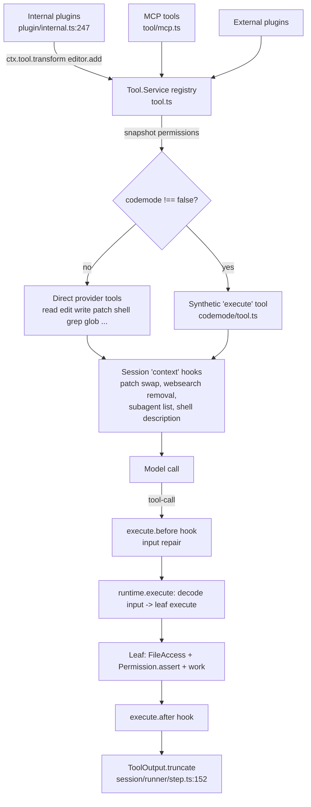
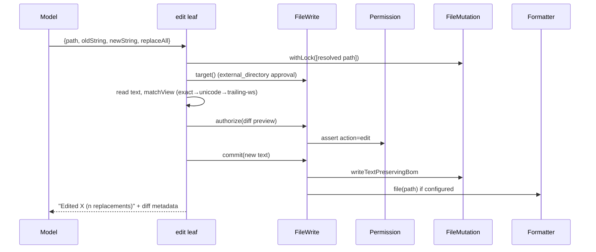

# Tools: framework, built-ins, file mutation and Code Mode

> OpenCode @ 56625a3e1f · paths relative to opencode-reference/

## TL;DR

- One registry (`Tool.Service`, `packages/core/src/tool.ts`) holds every tool, whether built-in, plugin or MCP. A tool is a plain object: `name`, `description`, `input`/`output` schema (Effect Schema, Standard Schema such as Zod, or raw JSON Schema), `execute`, and `options { namespace, permission, codemode, pinned }`. Built-ins are ordinary internal plugins under `core/src/tool/plugin/*`.
- **The registry does no authorization.** Each tool's `execute` calls `permission.assert({action, resources, save})` itself. At snapshot time the registry only hides tools that a `deny` rule with resource `*` removes entirely (`tool.ts:385-388`).
- **Tools go into Code Mode unless they opt out.** Any tool without `codemode: false` is hidden from the provider tool list and reachable only through one synthetic `execute` tool, which runs model-written JavaScript in the `@opencode/codemode` interpreter. Every core coding tool sets `codemode: false`; the `opencode_*` tools and MCP tools stay in Code Mode.
- Generic output bounding runs after execution: 2,000 lines / 50 KiB. The full text spills to `<data>/tool-output/tool_*` and is kept 7 days (`tool-output.ts:13-15`). Read uses the same limits internally. Shell keeps a bounded tail and a path to its own full output file.
- Edit tries an exact match first, then a Unicode-normalized match (quotes, dashes, spaces), then a line match that ignores trailing whitespace. It works on an LF view and preserves CRLF/BOM. On a miss it returns a "closest lines" hint. **There is no read-before-edit check and no staleness/mtime check.**
- GPT models (ids containing `gpt-`, except `oss` and `gpt-4*`) get `patch` (Codex-style envelope with a Lark grammar sent as a "freeform" tool) **instead of** `edit`/`write`. The swap happens in a session `context` hook (`patch.ts:292-302`).
- Shell: a 2-min default timeout, after which the command **moves to the background** rather than being killed. Commands are statically scanned into per-command permission resources, and unparseable ("opaque") commands fail closed. On Windows the shell is chosen in the order pwsh, powershell, Git Bash, cmd.
- File mutations are serialized by a process-local keyed mutex per resolved path. The formatter runs after every write/edit/patch, but **only if `formatter` is set in config**.

## Where it lives

| path | role | ~lines |
|---|---|---|
| `packages/schema/src/tool.ts` | `Tool.Info`, `Context`, `Options`, `Content`, `Error` types | 120 |
| `packages/core/src/tool.ts` | Location-scoped registry, snapshot, Code Mode split, hooks, image normalization | 430 |
| `packages/core/src/tool/runtime.ts` | schema→JSON Schema, input decode, output encode, naming | 298 |
| `packages/core/src/tool/AGENTS.md` | architecture rules for tool authors | 100 |
| `packages/core/src/tool-output.ts` (+ `config/plugin/tool-output.ts`) | post-execution truncation and spill files | 220 |
| `packages/core/src/tool/plugin/*.ts` | built-in tools (read, write, edit, patch, glob, grep, shell, webfetch, websearch, todo, question, skill, subagent, mcp-resource, mcp-events, opencode, artifact, schedule, image-generate) | ~4,000 |
| `packages/core/src/tool/read-filesystem.ts` | paging, binary/media detection for read | 392 |
| `packages/core/src/tool/html-markdown.ts`, `http-body.ts` | HTML→Markdown for webfetch | 680 |
| `packages/core/src/tool/patch.txt`, `patch-grammar.txt`; `packages/util/src/patch.ts` | patch prompt, Lark grammar, parser/applier | 430 |
| `packages/core/src/file-access.ts`, `file-write.ts`, `file-mutation.ts` | path resolution, external_directory + edit approval, locking, BOM | 420 |
| `packages/core/src/formatter.ts`, `formatter/builtins.ts`, `config/plugin/formatter.ts` | post-edit formatting | 470 |
| `packages/core/src/ripgrep.ts`, `ripgrep/binary.ts` | rg runner, pinned rg 15.1.0 download | 456 |
| `packages/core/src/shell.ts`, `shell/{select,parse,scan,result}.ts` | process lifecycle, shell choice, permission scanning | 4,700 |
| `packages/core/src/websearch.ts`, `plugin/websearch/*` | provider registry + 5 providers | 690 |
| `packages/core/src/codemode/*`, `packages/codemode/src/*` | Code Mode host glue + interpreter | 900 + 9,200 |
| `packages/core/src/plugin/tool-input-repair.ts` | repairs malformed model arguments; `bash`→`shell` alias | ~150 |

## Architecture

## Key types and interfaces

| name | file:line | purpose |
|---|---|---|
| `Tool.Info` | `packages/schema/src/tool.ts:109` | the single tool shape: name, input, freeform, description, execute, output, options |
| `Tool.Options` | `packages/schema/src/tool.ts:49` | `namespace`, `permission`, `codemode`, `pinned` (pinned only allowed with codemode) |
| `Tool.Context` | `packages/schema/src/tool.ts:26` | sessionID, agent, messageID, call id, `progress`, optional `cancel` |
| `Tool.Freeform` | `packages/schema/src/tool.ts:12` | wire encoding for single-string tools: `text`, `regex`, `lark` grammar |
| `Tool.Editor` | `packages/core/src/tool.ts:27` | `add/update/remove/namespace` used in transforms |
| `Tool.Snapshot` | `packages/core/src/tool.ts:68` | per-request definitions + Code Mode catalog + `execute` |
| `whollyDisabled` | `packages/core/src/tool.ts:385` | last matching rule is `deny` on `*` → tool hidden |
| `definition` / `execute` | `packages/core/src/tool/runtime.ts:22`, `:31` | build provider definition; validate input, coerce foreign errors to `Tool.Error` |
| `effectiveName` | `packages/core/src/tool/runtime.ts:291` | `<namespace with . → _>_<name>` |
| `ToolOutput.truncate` | `packages/core/src/tool-output.ts:75` | bound text content, write spill file, add marker |
| `FileAccess.authorizeRead` | `packages/core/src/file-access.ts:139` | external_directory approval, then `read` |
| `FileWrite.Interface` | `packages/core/src/file-write.ts:25` | `target` / `authorize` / `commit` / `write` |
| `FileMutation.withLock` | `packages/core/src/file-mutation.ts:37` | sorted keyed locks for a read-modify-write transaction |
| `ShellParse.Result` | `packages/core/src/shell/parse.ts:16` | `{commands: {resource, save}[], directories}` |
| `CodeModeTool.create` | `packages/core/src/codemode/tool.ts:85` | builds the `execute` tool over an inventory |

## How it works: walkthroughs

### 1. Defining and registering a tool

1. A plugin calls `ctx.tool.transform(editor => editor.add({...}))`. See the read tool at `core/src/tool/plugin/read.ts:45-54`. Built-ins are registered in a fixed order in `core/src/plugin/internal.ts:247-288`. `PatchTool` comes before the prompt-optimizer plugins so that prompts see the final editing tools.
2. `commit` → `register` checks the name `/^[A-Za-z0-9_-]+$/` (`tool.ts:404`), reserves `execute` for Code Mode (`tool.ts:407`), and converts the schema once to a provider `ToolDefinition` (`tool.ts:414`). Invalid tools are logged and skipped, not thrown (`tool.ts:235-246`).
3. Schema conversion flattens `allOf`, inlines local `$ref`s, and removes Effect's safe-integer bounds "so tool schemas don't change and bust prompt caches" (`runtime.ts:176-215`).
4. Transforms are replayed in registration order. The latest active registration for a name wins, and disposing it reveals the earlier one (`tool/AGENTS.md`, Registration section).

### 2. Building the per-request tool list

1. `snapshot(permissions)` drops wholly-denied tools. A tool's permission action defaults to its effective name; `edit`, `write`, `patch` and `opencode_worktree_remove` set `permission: "edit"` (`tool.ts:259-261`).
2. If `execute` is not wholly denied, tools without `codemode: false` move behind the `execute` tool. Otherwise they are exposed directly so they stay reachable (`tool.ts:263-268`). Direct definitions are sorted by name for cache stability (`tool.ts:297-300`).
3. Session `context` hooks then edit `event.tools` per request. They swap patch for edit/write (`patch.ts:292-302`), remove websearch when no provider exists (`websearch.ts:182-190`), add the available subagents to the subagent description (`subagent.ts:247-270`), and put the resolved shell name into the shell description (`shell.ts:486-494`).

### 3. Executing a call

1. The `execute.before` hook runs first (`tool.ts:311`). `ToolInputRepairPlugin` uses it to coerce stringified JSON, numeric strings and nulls, and to alias `bash`→`shell` (`plugin/tool-input-repair.ts:7-23`).
2. `runtime.execute` decodes the input. A failure returns a model-readable list of up to 5 issues plus the arguments sent (`runtime.ts:90-101`). Non-`Tool.Error` failures are wrapped so a plugin cannot leave a call unsettled (`runtime.ts:34-47`).
3. The leaf runs. Permission declines **tunnel as defects** past leaf `mapError` and reappear as typed failures at the session layer. A decline *with feedback* (`CorrectedError`) stays a normal tool failure, so the model continues (`tool/AGENTS.md`, Construction section).
4. `execute.after` may rewrite the result. Images are re-encoded or resized, and undecodable or oversized images become `[n images omitted: …]` notes (`tool.ts:94-121`).
5. The session runner forks each tool call **as it streams in** (calls run concurrently) and pipes the result through `toolOutput.truncate` (`session/runner/step.ts:144-152`). Truncation is skipped if the tool already set `metadata.truncated` (`tool-output.ts:76`). The marker reads `[showing lines 1-N of M; full output saved to …]` (`tool-output.ts:113`).

### 4. Read

- Input: `path`, `offset` (1-based), `limit` (default and maximum 2,000) (`read.ts:20-28`). The response describes a file as `N: content` lines.
- Limits are 2,000 lines, 50 KiB per page, 2,000 characters per line (longer lines get a suffix), and a 256 KiB first chunk (`read-filesystem.ts:15-23`). A NUL byte gives `BinaryFileError` (`read-filesystem.ts:159`).
- Media: PNG, JPEG, GIF, WebP and PDF are detected by magic bytes and returned base64 as a file part, up to 20 MiB (`read-filesystem.ts:17,24,141-154`). The model sees "Image read successfully" plus the attachment (`read.ts:325-335`).
- Directories are listed with paging (`read-filesystem.ts:127-137`).
- Recovery on a miss: Unicode look-alike filename recovery (`read.ts:181-188`), re-rooting a path written against the wrong root (`read.ts:200-214`), and "Did you mean" suggestions ranked by edit distance (`read.ts:266-293`).
- `skill://id/file` paths read bundled skill files from an in-memory filesystem after `skill` + `read` approval (`read.ts:58-96`).
- Side effect: after a successful read, the tool walks up from the target looking for nested `AGENTS.md` files and loads them as session instructions. The location root is excluded (`read.ts:131-156`).
- Permission: `external_directory` (outside the location), then `read`. The default agent ruleset sets `read *.env` to ask.

### 5. Write

`{path, content}`, action `edit` (`write.ts:17-22,41`). `FileWrite.write` resolves the target, asks for external-directory approval, computes an added/modified diff preview for the approval prompt, then commits. Commit preserves an existing UTF-8 BOM and runs the formatter (`file-write.ts:92-101`). Parent directories are created automatically. Write does not take the transaction lock `withLock`. Only the inner per-target write lock applies (`file-mutation.ts:112-125`).

### 6. Edit (exact replace + fallbacks)

1. The tool rejects `oldString === newString` and an empty `oldString` (`edit.ts:276-285`).
2. `matchView` works on an LF view of the file. Tier 1 is an exact `indexOf`. Tier 2 applies `normalizeForMatch` to both sides: smart quotes→ASCII, Unicode dashes→`-`, exotic spaces→space (`edit.ts:45-50`). Tier 3 matches line by line, ignoring trailing whitespace (`findLineOccurrences`, `edit.ts:62-98`). Tiers run only when the previous tier found nothing (`edit.ts:170-173`).
3. Line endings in the replacement come from the matched region through an LCS alignment, so mixed-ending files keep their bytes (`edit.ts:108-158`). An edit that differs only in `\r` is applied to raw bytes (`edit.ts:302-305`).
4. Approval with a diff preview is requested **before** the match checks (`edit.ts:317`). A miss then fails with "Could not find oldString…", plus a "closest lines" hint only if `read` is allowed (`edit.ts:318-330`). Several matches without `replaceAll` fail with a count (`edit.ts:331-335`).
5. Commit and formatter run, and the result carries a diff of the formatted text (`edit.ts:343-349`). The whole transaction holds `fileMutation.withLock` (`edit.ts:351`).

**Read-before-edit and staleness:** a search for `stale`, `mtime`, `FileTime`, `readBefore` and similar finds nothing in the tool or session code. Edit re-reads the file inside the lock, so the operation is atomic with respect to other OpenCode tools. It does not check whether the model ever read the file or whether the file changed since that read.

### 7. Patch (GPT models)

- Input: `{patchText}`, also sent as a freeform tool with the Lark grammar from `patch-grammar.txt` (`patch.ts:23-27,68`). Hunks are Add, Delete, Update, an optional `*** Move to:`, `@@` context lines and `*** End of File`.
- The parser (`util/src/patch.ts:49`) trims heredoc wrappers. The applier searches for context with progressively looser comparators: exact, rstrip, trim, Unicode-normalized (`util/src/patch.ts:344-375`).
- All hunks are prepared and verified against an in-memory `updates` map. One `edit` permission prompt covers all files and shows a combined diff (`patch.ts:192-202`). Files are then written **sequentially**. On failure the error lists "Completed before failure: …", with no rollback (`patch.ts:81-85,204-250`; TODO at `file-mutation.ts:139-140`). Case-only renames on case-insensitive filesystems take a write-then-rename path (`patch.ts:210-238`).
- Model selection: `gpt-` and not `oss` and not `gpt-4` → delete `edit` and `write`. Every other model loses `patch` (`patch.ts:294-301`).

### 8. Glob and grep (ripgrep)

- glob: `{pattern, path?, hidden?, limit?}`, action `glob`, resource = pattern (`glob.ts:19-30,69-80`). It runs `rg --files` with `--glob=!**/.git/**` and hides dotfiles unless `hidden` is set (`ripgrep.ts:179-187`).
- grep: `{pattern, path?, include?, literal?, caseSensitive?, limit?}` (`grep.ts:18-39`). It runs `rg --json --hidden --no-messages`, which **includes hidden files** and excludes `.git` (`ripgrep.ts:231-243`). Matched lines are clipped to 2,000 characters, with at most 100 submatches (`ripgrep.ts:21-22`). Output is grouped by file as `Line N: text` (`grep.ts:45-62`).
- Both default to 100 results with a 30 s timeout. They request `limit+1` to detect truncation (`filesystem.ts:66-67`, `tool/search.ts:16-28`).
- The binary is the system `rg` if found, otherwise rg **15.1.0** downloaded from GitHub releases and checked against a pinned SHA-256 (`ripgrep/binary.ts:15-17,121-158`).

### 9. Shell

1. Input: `command`, `workdir?`, `timeout?` (ms), `background?` (`shell.ts:52-65`). The default timeout is 120,000 ms (`shell.ts:25`). A foreground `timeout: 0` falls back to the default (`shell.ts:355`).
2. `prepare`: resolve the workdir, then run `ShellParse.scan`. The scan is a hand-written POSIX/bash/zsh/PowerShell scanner in `shell/scan.ts` (2,565 lines). Each simple command becomes a permission `resource`, with a saved-approval prefix built from an arity table such as `git status *` or `npm run test *` (`shell/parse.ts:20-60,226-245`). `cd`/`pushd` targets become directories that need `external_directory` approval (`shell.ts:289-295`). A command the scanner reports as opaque (unterminated quote, some heredocs, compound structures it cannot resolve) **fails the call**: "Portable shell scanner cannot analyze command" (`shell/parse.ts:168-170`).
3. Env: `AGENT=1`, `OPENCODE=1`, `AI_AGENT=opencode`, `OPENCODE_SESSION_ID` (`shell.ts:388-391`).
4. Foreground: block on the job. When the timeout fires, `jobs.background(job.id)` runs and the tool returns "Command moved to the background (shell ID …) Output is streaming to: <file>" (`shell.ts:425-463`). Background (`background: true`): the call returns at once. A synthetic session message is posted when the job settles, and the model is told **not to poll** (`shell.ts:29-30,135-167`).
5. User stop: SIGTERM, then SIGKILL after 3 s. The tool fails with the output gathered so far (`shell.ts:326-343`; `core/src/shell.ts:169`). Commands run under a process daemon and can be re-attached after a server restart (`shell.ts:240-270`).
6. Output is a bounded tail at ToolOutput limits, with `outputPath` pointing to the full file (`core/src/shell.ts:832-833`).
7. Shell selection (`shell/select.ts`): a configured `shell`, else `$SHELL`, as long as it is "compatible" (fish and nu are denied, `select.ts:13-23`). Fallbacks are macOS `/bin/zsh`, otherwise `bash`, then `/bin/sh` (`select.ts:135-140`). Windows tries pwsh → powershell → Git Bash (found next to `git.exe` or set with `gitbash`) → `%COMSPEC%` (`select.ts:96-108,126-133`). Arguments: PowerShell gets `-NoLogo -NoProfile -NonInteractive -Command`, cmd gets `/c`, zsh gets `+o nomatch -c` (`select.ts:165-172`).

### 10. Web tools

- **webfetch** `{url, format=markdown|text|html, timeout?≤120 s}` (`webfetch.ts:24-32`). Only http/https URLs are accepted, and URLs with userinfo are refused so `https://user@evil.com` cannot slip past a rule (`webfetch.ts:71-75`). It follows at most 10 redirects manually and runs `assertNotDenied` on each hop (`webfetch.ts:77-109,161-167`). The body is capped at 5 MiB (`html-markdown.ts:50`). Images and non-text types are rejected. If a Cloudflare challenge returns 403, the request is retried with UA `opencode` (`webfetch.ts:62-66,169`). HTML→Markdown uses a streaming htmlparser2 converter that drops script, style, iframe and similar tags (`html-markdown.ts:3`).
- **websearch** `{query}`, action `websearch` (`websearch.ts:24-55`). It is **not provider-native**. Five HTTP backends register through `WebSearchProvider.register`: Exa (MCP endpoint, key optional), Firecrawl, Parallel, Tavily, TinyFish (`plugin/websearch/index.ts`, `provider.ts:9-44`). The first use with no selection shows a form: allow / choose / disable (`websearch.ts:64-146`). `random` selection keeps session affinity and moves on from providers that return 429 (`core/src/websearch.ts:143-214`). The config key is `websearch: false | {provider}` (`config/plugin/websearch.ts:13-17`).

### 11. Interaction, orchestration and namespaced tools

- **todowrite** `{todos:[{content,status}]}` replaces the whole list. It is gated by the experimental `todo` flag, which is off on release channels (`todo.ts:52-56`; `flag.ts:35`).
- **question** `{questions:[{header,question,options,multiple}]}` opens a form with free-text answers allowed. A dismissal *dies* with `CancelledError` and ends the step, unless the client sends a message (`question.ts:87-95`). Action `question`, allowed for build/plan and denied for general.
- **skill** `{id}`, action `skill`, resource = skill id. Returns a `<skill_content>` block (see chapter 10).
- **subagent** `{agent, description, prompt, model?, sessionID?}`. It **always runs in the background** and creates a child session (`subagent.ts:50-56,178-224`). Depth limit is `experimental.subagent_depth`, default 1 (`subagent.ts:129-133`). Primary agents are rejected (`subagent.ts:136-137`). Action `subagent`, resource = agent id.
- **MCP tools**: `<server>_<tool>`, Code Mode by default, action = effective name, resource `*` (`tool/mcp.ts:57-68`). **opencode_list_mcp_resources** / **opencode_read_mcp_resource** check per-server resources (`mcp-resource.ts:19-66`).
- **opencode_*** (namespace `opencode`, all Code Mode): `session_rename`, `session_move` (pinned, needs external_directory approval outside project worktrees), `worktree_create/list/remove` (pinned; remove asserts `edit`), and `models` (search the catalog) (`opencode.ts:114-240`). `artifact_create/read/update/delete` (flag `artifacts`), `schedule_create/list/pause/resume/delete` (flag `schedules`, own session only), `watch_mcp_event` (flag `mcp_events`), and `experimental_image_generate` (direct tool, flag-gated).

### 12. Code Mode in brief

`packages/codemode` is a pure interpreter for a JavaScript subset: a hand-written VM of about 3,100 lines in `vm.ts`. It is not an isolate. Programs reach the outside world **only** through host tools and extensions. There are no timers, imports, filesystem or `process` (`codemode/README.md:7-25`). The host builds one `execute` tool that takes freeform text (`core/src/codemode/tool.ts:85-95`). Tools appear as `tools.<namespace>.<name>(input)`. Single-string tools can take the string directly (README "freeform"). A synchronous `search()` built-in finds tools that are not listed inline. The catalog inlines pinned tools and fills a 2,000-unit budget (`codemode/catalog.ts:52-77`). `fetch` is provided as an extension and goes through `webfetch` permission (`codemode/fetch.ts:33-51`). Each inner call runs the normal leaf, so the same permission checks apply. Results include per-call progress rows (`codemode/tool.ts:118-145`). The model-facing runtime passes **no execution limits** (`codemode/tool.ts:279-283`). Only `Tool.check`, used by schedules, sets limits (`schedule/check.ts:26-28`).

## Tool summary table

| tool | inputs | permission action (resource) | limits |
|---|---|---|---|
| read | path, offset?, limit? | external_directory, read (path) | 2,000 lines, 50 KiB, 2,000 chars/line, media ≤20 MiB |
| write | path, content | external_directory, edit (path) | — (formatter after) |
| edit | path, oldString, newString, replaceAll? | external_directory, edit (path) | single match unless replaceAll |
| patch | patchText (freeform lark) | external_directory, edit (all paths) | GPT-only; sequential, no rollback |
| glob | pattern, path?, hidden?, limit? | glob (pattern) | 100 results, 30 s |
| grep | pattern, path?, include?, literal?, caseSensitive?, limit? | grep (pattern) | 100 matches, 30 s, 2,000 chars/line |
| shell | command, workdir?, timeout?, background? | external_directory, shell (each parsed command) | 2 min → background; 2,000 lines/50 KiB tail |
| webfetch | url, format?, timeout? | webfetch (url; each redirect assertNotDenied) | 5 MiB, 30 s default/120 s max, 10 redirects |
| websearch | query | websearch (query) | provider-dependent (Exa: 8 results) |
| todowrite | todos[] | todowrite (*) | flag `todo` |
| question | questions[] | question (*) | dismissal ends step |
| skill | id | skill (skill id) | samples ≤10 files |
| subagent | agent, description, prompt, model?, sessionID? | subagent (agent id) | depth 1 default; always background |
| `<server>_<tool>` (MCP) | server schema | effective name (*) | Code Mode by default |
| opencode_list/read_mcp_resource | server?, uri | same name (server) | Code Mode |
| opencode_session_*, worktree_*, models | various | none / external_directory / edit (remove) | Code Mode |
| opencode_artifact_*, schedule_*, watch_mcp_event | various | none / own-session / same name | flags |
| execute (Code Mode) | code (freeform text) | execute (wholly-deny disables) | no limits on the model path |

## Configuration and extension points

- `tool_output: {max_lines, max_bytes}` (`config/plugin/tool-output.ts:16-21`).
- `formatter: true | false | {<name>: {command[], extensions[], environment{}, disabled}}`. When the key is absent, **no formatters** run (`config/plugin/formatter.ts:30-31`). Built-ins include prettier, oxfmt, biome, clang-format, ruff, uv, air, ocamlformat and pint (`formatter/builtins.ts`). Formatters for a file's extension are tried in order, and the first that exits 0 wins (`formatter.ts:56-93`). `$FILE` in a command is replaced with the path.
- `shell: "<path>"` (`config/plugin/shell.ts:16`). `gitbash` option on Windows (`shell/select.ts:31-33`).
- `websearch: false | {provider}`. Provider keys come from env: `EXA_API_KEY` and the equivalents for the others (`websearch/exa.ts:34`).
- `experimental.subagent_depth`. `OPENCODE_FLAGS=todo,schedules,artifacts,mcp_events,…` or `experimental.<flag>` (`flag.ts:26-60`).
- Per-MCP-server `codemode: false` keeps that server's tools as direct tools. Known Code Mode servers (executor.sh) are switched automatically (`plugin/mcp-codemode-defaults.ts:9-38`).
- Hooks: `tool.execute.before/after`, and session `context`/`compaction`/`generate` to edit the tool list per request.
- Tool authoring: `editor.add` with any Standard Schema. Use `codemode: false` for tools that must be direct. A `namespace` gives `ns_name`.

## Edge cases, invariants and gotchas

- **Visibility is not authorization.** Only a `deny` on `*` hides a tool. A resource-scoped deny leaves the tool listed and fails at call time (`tool/AGENTS.md`, Permissions section).
- **Wholly denying `execute` turns every Code Mode tool into a direct tool**, so MCP and opencode_* tools then flood the tool list (`tool.ts:264-267`).
- Several Code Mode tools (`session_rename`, `models`, `artifact_*`, `schedule_*`, `worktree_create`) make no `permission.assert` call. Their only gate is `execute` itself.
- The registry forbids a direct tool named `execute`, but a Code Mode tool may use the name (`tool.ts:407`).
- Edit asks for approval before it knows the match succeeded, so the user can approve an edit that then fails (`edit.ts:313-330`).
- Patch is not atomic. A mid-way failure leaves earlier files written.
- File locks are process-local. External editors can still race (`file-mutation.ts:71-74`).
- grep searches hidden files by default and glob does not. Expect results to differ.
- Glob treats the literal strings `"undefined"` and `"null"` in `path` as absent, a workaround for weak models (`glob.ts:66`).
- Shell background notifications arrive as synthetic user-side messages. The tool description and results tell the model not to poll.
- The formatter runs after edits, so the diff returned to the model is post-format. The model's next `oldString` must match the formatted text.
- `tool-output` spill files are swept hourly and kept 7 days (`tool-output.ts:161-170`).

## Tests worth reading

`packages/core/test/tool-registry.test.ts`, `tool-execute.test.ts`, `tool-schema.test.ts`, `tool-output.test.ts`, `tool-read.test.ts`, `tool-read-filesystem.test.ts`, `tool-edit.test.ts`, `tool-write.test.ts`, `tool-patch.test.ts`, `patch.test.ts`, `tool-search.test.ts`, `ripgrep.test.ts`, `tool-shell.test.ts`, `shell-parse.test.ts`, `shell-parse-syntax.test.ts`, `shell-parse-parity.test.ts`, `shell-restart.test.ts`, `tool-webfetch.test.ts`, `tool-html-markdown-budget.test.ts`, `tool-websearch.test.ts`, `tool-subagent.test.ts`, `tool-question.test.ts`, `tool-todo.test.ts`, `file-mutation.test.ts`, `formatter.test.ts`, `codemode.test.ts`, `test/codemode/catalog.test.ts`, `packages/codemode/test/codemode.test.ts`.

## Genie takeaways

- **Tool shape (ticket `../../tickets/06-builtin-tools.md`)**: port the idea that the leaf owns authorization, with the registry used only to hide tools. In Rust this maps to a `Tool` trait whose `execute` receives a `PermissionCtx`. Keep the "foreign errors become model-readable tool errors" boundary (`runtime.ts:34-47`) and the 5-issue input-error message. Port the input-repair aliases (`bash`→our Bash tool), because models carry habits from other harnesses.
- **Search via Bash**: OpenCode always ships glob and grep. Genie's plan of no Glob/Grep on macOS/Linux is the opposite choice. Still adopt the ripgrep detail if we ship Grep on Windows: pinned-hash download with system `rg` as first choice (`ripgrep/binary.ts`). Avoid the hidden-file inconsistency between grep and glob.
- **Edit fallbacks (pick-list #4)**: **port code** for the three-tier matcher, the LF view with region-preserving line endings, BOM preservation, and the "closest lines" miss hint. **Add what OpenCode lacks**: Genie's model-dependent read-before-edit and the staleness check (record mtime and hash on Read, compare inside the lock). OpenCode confirms that neither exists. Ask for approval *after* the match succeeds, not before.
- **Patch (pick-list #5)**: port the grammar and the per-model swap. Make the swap data-driven (a model-catalog capability) rather than `id.includes("gpt-")`. Add rollback for the whole patch, which OpenCode leaves as a TODO.
- **Shell (pick-list #6, ticket `../../tickets/07-bash-execution.md`)**: port the design: the 2-min foreground timeout moves the command to the background, completion arrives as a notification, and the model is told not to poll. This matches Genie's "Bash 2 min → background". Also port the Windows order pwsh→powershell→Git Bash→cmd, the zsh `+o nomatch`, and the env markers. The static command scanner (arity-based saved prefixes, fail-closed on opaque commands) is a strong design for Genie's permission rules. Port the design and write our own scanner.
- **Output spill**: Genie's "output spill" matches OpenCode's 2,000-line / 50 KiB cap with the saved path in the marker. Read's limits are line and byte based rather than Claude's ~25K tokens. Pick one unit and apply it consistently.
- **Web search (pick-list #8)**: OpenCode has no provider-native search, only BYO HTTP providers with consent forms. Genie's provider-native search with gateway fallback is stronger. Borrow the 429 failover and session affinity for the gateway path. Copy webfetch's redirect-by-redirect permission check and its userinfo rejection.
- **Formatter (pick-list #22)**: the opt-in, first-success-wins design is simple. If Genie adopts it, return the post-format diff to the model, as OpenCode does, so the next edit matches.
- **Code Mode (pick-list #27)**: skip for M1. Note that OpenCode now routes *all* MCP and namespaced tools through it by default, which makes it the main extension path. For Genie's "extensions only via MCP + hooks + skills", plain MCP tools stay simpler.
- **Subagents (pick-list #15, ticket `../../tickets/19-subagents.md`)**: the always-background model with follow-up by `sessionID` and a depth limit is described in chapter 10.

## Open questions / inferred

- Exact behaviour of `ShellScan` on common heredoc and `$(…)` forms. Tests show some substitutions are scanned (`test/shell-parse.test.ts:36-41`) and some are opaque. The full matrix is not catalogued *(inferred)*.
- Whether any shipped config adds `ask` rules for edit/shell. The built-in default ruleset allows `*` (`packages/schema/src/agent.ts:46-51`), so edits run without prompts unless the user configures otherwise. See chapter 10.
- Code Mode catalog budget units (characters or tokens) are not verified *(inferred: characters)*.
- Whether `opencode_artifact_*` providers send content off-machine depends on the provider plugin and is not traced *(inferred)*.
