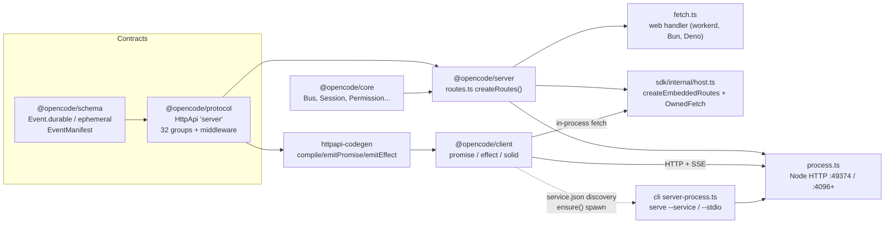
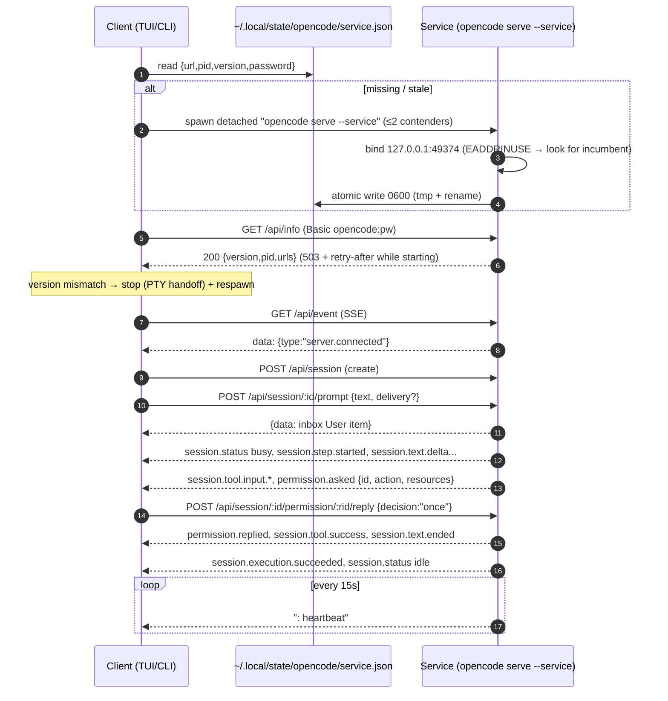

# Server, Protocol, Client and SDK

> OpenCode @ 56625a3e1f · paths relative to opencode-reference/

## TL;DR

- The contract has three layers with a strict dependency direction: `@opencode/schema` (browser-safe wire and storage schemas, event definitions) ← `@opencode/protocol` (an Effect `HttpApi` with **32 groups** under `/api/...`) ← `@opencode/server` (handlers, auth, SSE, Node and workerd hosts) (`packages/schema/AGENTS.md:3-7`).
- Events come in two kinds. **Ephemeral** events (deltas, `permission.asked`, `session.status`) exist only on the live bus. **Durable** events carry `{aggregateID, seq, version}` and are committed per session aggregate (`packages/schema/src/event.ts:34-126`). Token deltas are always ephemeral. `*.ended` events are the durable, replayable boundary (`packages/schema/src/session-event.ts:419`).
- `GET /api/event` is a **volatile** SSE fan-out. It always starts with `server.connected`, sends a `: heartbeat` comment every 15 s, and has a 4,096-frame queue per subscriber. Overflow **fails** the stream. There are no SSE `id:` lines and no `Last-Event-ID` resume (`packages/protocol/src/groups/event.ts:69`, `packages/server/src/handlers/event.ts:13-23`, `packages/server/src/event-feed.ts:8,66-68`).
- There are two ways to recover after a reconnect. Clients can **refetch state** when they see `server.connected` (`packages/client/src/solid/data.ts:742-747`). Or they can read the experimental per-session durable log `GET /api/experimental/session/:id/log?after=<seq>&follow=true`, which replays events, emits a `log.synced` marker and then tails live (`packages/core/src/bus.ts:829-875`).
- One **background service** per user and channel. It is elected by **binding a fixed port** (0xC0DE = 49374 on stable channels), not by a lock file. It announces itself through a 0600 registration file `~/.local/state/opencode/service.json` with `{id, version, url, pid, password}`. The password persists in the CLI's service config (`packages/cli/src/services/service-config.ts:46-60,183-192`, `packages/cli/src/services/service-registration.ts:22-46`).
- `Service.ensure()` probes `/api/info`, reuses, waits for, or replaces the service on a version mismatch, and otherwise spawns at most two detached `opencode serve --service` contenders. Persistent terminals are handed off across the replacement (`packages/client/src/effect/service.ts:49-127`, `packages/client/src/service-probe.ts:22-32`).
- Auth is HTTP Basic with user `opencode` and the server password. It is also accepted as `?auth_token=`, as an HMAC-signed 30-day session token from 5-minute single-use pairing codes, or as a per-port cookie (`packages/server/src/auth.ts:16-66`, `packages/server/src/pairing.ts:7-31`).
- The same route graph serves three hosts: a Node listener (`packages/server/src/process.ts`), a web `fetch` handler for workerd, Deno or Bun (`packages/server/src/fetch.ts:43-58`), and an **in-process SDK** whose client `fetch` calls the router directly with `:memory:` SQLite (`packages/sdk/src/internal/host.ts:30-71`).

## Where it lives

| Path | Role | ~Lines |
|---|---|---|
| `packages/schema/src/` | Wire and storage contracts; `event.ts`, `event-manifest.ts`, `durable-event-manifest.ts`, `event-log.ts`, `session-event.ts`; `v1/` legacy | 8.7k (incl. tests) |
| `packages/protocol/src/api.ts`, `groups/*.ts`, `errors.ts`, `middleware/` | `HttpApi` definition: 32 groups, typed errors, Authorization and schema-error middleware | 5.4k |
| `packages/protocol/src/client.ts` | `ClientApi` with stub middleware identities, used for codegen | 92 |
| `packages/server/src/routes.ts` | Builds the service graph and binds handlers to `Api` | 211 |
| `packages/server/src/process.ts` | Node listener: port scan, readiness gate, `/api/info` while booting, restart continuity | 252 |
| `packages/server/src/{auth,pairing,cors,request-site,request-tracing}.ts`, `middleware/` | Security and tracing | ~280 |
| `packages/server/src/event-feed.ts`, `handlers/event.ts` | SSE fan-out | 131 |
| `packages/server/src/{fetch,workerd}.ts` | Web-handler host and Cloudflare Durable Object profile | 223 |
| `packages/server/src/handlers/*.ts` | One handler module per group | ~4k |
| `packages/client/src/{service,service-probe,service-contender,service-timing,pty-handoff}.ts`, `effect/service.ts`, `promise/service.ts` | Discovery, ensure, stop, terminal handoff | ~830 |
| `packages/client/src/{promise,effect}/generated/`, `effect/api/` | Generated clients (Promise, Effect) | ~10k |
| `packages/client/src/shared-events.ts`, `solid/connection.ts`, `solid/data.ts` | One shared SSE connection, reconnect, resync | ~2.6k |
| `packages/httpapi-codegen/src/index.ts` | `HttpApi` → TS client generator | 2,320 |
| `packages/sdk/src/` | Embedded SDK (in-process router), workerd SDK | ~600 |
| `packages/cli/src/server-process.ts`, `services/service-{config,registration}.ts`, `commands/handlers/service/*` | `opencode serve` and `opencode service ...` | ~770 |
| `packages/core/src/bus.ts` | Bus: live listeners plus the durable aggregate log | ~900 |

## Architecture

## Key types and interfaces

| Name | Location | Purpose |
|---|---|---|
| `Event.ID` | `packages/schema/src/event.ts:9-13` | `evt_` + monotonic ascending id. Gives ordering within a process. |
| `Event.Seq`, `Event.Version` | `packages/schema/src/event.ts:21-32` | Position in one aggregate's durable log, and the per-type schema version |
| `Event.durable()` / `Event.ephemeral()` | `packages/schema/src/event.ts:90-150` | Builds an event schema `{id, created, metadata?, type, durable?, location?, data}` |
| `Event.latest`, `Event.durableMap` | `packages/schema/src/event.ts:156-188` | Latest definition per type, and the `type.version` registry for replay decoding |
| `EventManifest.ServerDefinitions` | `packages/schema/src/event-manifest.ts:72-83` | The public SSE event set. `Definitions` (`:88-102`) also includes LSP, V1-legacy and workspace events. |
| `Durable` | `packages/schema/src/durable-event-manifest.ts:7` | Durable registry: session durable events plus `worktree.resolved` |
| `EventLog.Synced` | `packages/schema/src/event-log.ts:12-20` | `log.synced` replay-to-live boundary marker |
| `SessionEvent.Definitions` / `DurableDefinitions` | `packages/schema/src/session-event.ts:665-725` | About 50 session event types; the aggregate key is `sessionID` (`:33-38`) |
| `Permission.Request`, `Permission.Reply` | `packages/schema/src/permission.ts:36-53` | `{id, sessionID, action, resources[], save?, metadata?, source?, message?}`. Reply is `once\|always\|reject`. |
| `SessionStatusEvent.Status` | `packages/schema/src/session-status-event.ts:9-43` | `idle \| busy \| retry{attempt,message,next,action?}` |
| `SessionInbox.Delivery` | `packages/schema/src/session-inbox.ts:11` | `steer \| queue`: how a prompt joins a running turn |
| `makeApi` / `makeDefaultApi` | `packages/protocol/src/api.ts:145-264` | Composes the groups; `Authorization` and `SchemaErrorMiddleware` cover everything (`:207-208`) |
| `ClientApi`, `groupNames` | `packages/protocol/src/client.ts:28-50` | API with placeholder middleware, used as the codegen input |
| `ServerInfo` | `packages/protocol/src/groups/server.ts:5-21` | `/api/info`: `{version, pid, hostname?, urls, paths.tmp, capabilities?}` |
| `ServerOptions` | `packages/server/src/options.ts:7-54` | Host options: password, cors, database, `events.persist`, models, config, fs |
| `EventFeed.Interface` | `packages/server/src/event-feed.ts:23-27` | `subscribe(types?) → Stream<string>` of pre-encoded SSE frames |
| `ServerAuth.Info` | `packages/server/src/auth.ts:11-26` | `{password: Option, username:"opencode"}` |
| `Service.Info` (registration) | `packages/client/src/effect/service.ts:142-148` | `{id?, version?, url, pid, password?}` |
| `EnsureOptions`, `EnsureReason` | `packages/client/src/service.ts:25-35` | `command`, `env`, `version` gate, `onStart("missing"\|"version-mismatch")` |
| `LocalService`, `decide()` | `packages/client/src/service-probe.ts:10-32` | Probe classification into reuse, wait, replace or fail |
| `ServiceConfig.Info` | `packages/cli/src/services/service-config.ts:15-28` | CLI-owned `{disabled, remote, hostname, port, password, cors, env}` |

## How it works: walkthroughs

### 1. Contract → server → client generation
1. Event and payload schemas are defined in `packages/schema` with `Event.durable`/`Event.ephemeral` (`packages/schema/src/event.ts:90-150`). Current names are unversioned, and V1 types live only in `src/v1/` (`packages/schema/AGENTS.md:14-18`).
2. `packages/protocol/src/api.ts:167-208` adds 32 groups to `HttpApi.make("server")`. Most groups get `locationMiddleware`. That middleware resolves the working directory from `?location[directory]=`, then the `x-opencode-directory` header, then `process.cwd()` (`packages/server/src/location.ts:75-78`).
3. The server builds `Api` with real middleware (`packages/server/src/api.ts:6-12`) and serves it with `HttpApiBuilder.layer(Api, { openapiPath: "/openapi.json" })` (`packages/server/src/routes.ts:195`).
4. `packages/client/script/generate.ts:56-67` runs `compile(ClientApi, …)` from `packages/httpapi-codegen/src/index.ts:116`. It then emits the Promise client (`emitPromise`, `:419`), the Effect client (`emitEffectImported`, `:379`) and an Effect shape (`emitEffectShape`, `:396`). CI runs `check:generated`, which fails on any diff (`packages/client/package.json:33`).
5. The Promise client parses SSE by keeping `data:` lines and calls `onActivity` on every chunk, heartbeats included (`packages/client/src/promise/generated/client.ts:421-453`).

### 2. Request path (Node host)
1. `ServerProcess.start` refuses to run without a password (`packages/server/src/process.ts:56-57`). The default host is `127.0.0.1` (`:58`). With no port it scans upward from 4096 on `EADDRINUSE` (`:151-158`).
2. Middleware order, from outside in: CORS (`:78`), compression, `RequestSite` (`:76`), then `dispatch`.
   - `RequestSite` rejects cross-site browser requests to `/api/*`. It uses `Sec-Fetch-Site`/`Mode`, so CLI and SDK clients without those headers pass (`packages/server/src/request-site.ts:15-24`).
   - CORS allows localhost, 127.0.0.1, `oc://renderer`, Tauri origins, `*.opencode.ai` and `--cors` extras (`packages/server/src/cors.ts:11-20`).
3. `dispatch` checks readiness (`packages/server/src/process.ts:182-211`).
   - Before the app layer is built, `GET /api/info` still answers. Authentication is required, and the status is 503 with `retry-after: 1` while starting, or 500 if boot failed (`:197-200,213-227`).
   - Other routes get `service_starting`, `service_stopping` or `service_failed` JSON (`:229-243`).
4. `Authorization` middleware (`packages/server/src/middleware/authorization.ts:74-104`) accepts any of these:
   - Basic credentials, from the header or `?auth_token=` (`:33-40`)
   - a signed session token used as the password (`packages/server/src/auth.ts:33-37`)
   - the same-origin cookie `opencode_session_<port>` (`authorization.ts:65-72`)

   Ticketed PTY/MCP WebSocket connects and `/auth/connect/:code` skip this check (`:87-94`). The `WWW-Authenticate` challenge is sent only to non-browser clients and navigations (`:46-49`).
5. Each request runs without the startup span as its parent, so every request is its own trace (`packages/server/src/request-tracing.ts:4-9`, used at `process.ts:82,131`).
6. At boot, `installRestartContinuity` resumes sessions whose execution claim was never released (`packages/server/src/process.ts:250-252`).

### 3. Event fan-out (live SSE)
1. `EventFeed.make` registers one Bus listener. Each published event goes through `isOpenCodeEvent` (manifest types, `rpc.*` and `server.connected`; `packages/protocol/src/groups/event.ts:85`). It is JSON-encoded **once** into `data: …\n\n` (`packages/server/src/event-feed.ts:29-31,48-65`).
2. Every subscriber has a `Queue.dropping(4096)`. A failed offer removes the subscriber and fails its stream with `SubscriberOverflowError` (`:66-68,78-79`).
3. The handler prepends a synthetic `server.connected` event and merges a 15 s `: heartbeat` comment. It sets `Cache-Control: no-cache, no-transform` and `X-Accel-Buffering: no` (`packages/server/src/handlers/event.ts:13-33`).
4. `?types=a&types=b` filters on the server. `server.connected` is always delivered (`packages/protocol/src/groups/event.ts:38-53`).
5. The client keeps **one** shared SSE connection for all subscribers, with a 4,096-item queue per subscriber (`packages/client/src/shared-events.ts:33,113-115`). It replays the cached `server.connected` to late subscribers (`:130`).
6. The Solid connection layer handles failures. It requires the first frame to be `server.connected` (`packages/client/src/solid/connection.ts:106-107`). Connect timeout is 2 s, reconnect delay is 1 s, and idle timeout is 45 s (`:32-37`). On each `server.connected` the data layer re-hydrates from `session.active()` (`packages/client/src/solid/data.ts:742-747`).

### 4. Durable log replay (resume)
1. A durable publish runs in a SQLite transaction. It checks `seq == latest+1` for the aggregate and bumps `EventSequenceTable`. The payload goes into `EventTable` **only when `persist` is true** (`packages/core/src/bus.ts:376-386,622-631`). `persist` defaults to false (`:214`). Only the workerd profile forces it on (`packages/server/src/workerd.ts:73`).
2. `GET /api/experimental/session/:id/log?after=N&follow=true` (`packages/protocol/src/groups/session.ts:659-676`) calls `Bus.log` (`packages/core/src/bus.ts:829-875`).
   - When following, it subscribes to wake-ups **before** reading the watermark, so nothing falls in the gap (`:854-855`).
   - It pages history up to the watermark, emits `log.synced{seq}`, then reads newly committed rows on every wake.
3. Ordering guarantees: `seq` is strictly ordered per session. `evt_` ids increase within a process (`packages/schema/src/identifier.ts:8-20`). Text and reasoning deltas carry an `ordinal` (`packages/schema/src/session-event.ts:420-428`). Nothing orders events across sessions.

### 5. Prompt and permission round-trip
1. `POST /api/session/:id/prompt` durably admits one inbox item and schedules the agent loop unless `resume:false`. `delivery: "steer"|"queue"` controls how it joins a running turn (`packages/protocol/src/groups/session.ts:342-362`).
2. A permission check publishes the ephemeral `permission.asked` with the full `Request` (`packages/schema/src/permission.ts:45`).
3. The client calls `POST /api/session/:id/permission/:requestID/reply {decision, message?}` (`packages/protocol/src/groups/permission.ts:142-159`). The handler forwards it to core `reply({requestID, reply, message})` (`packages/server/src/handlers/permission.ts:76-81`). `permission.replied` follows (`packages/schema/src/permission.ts:46-53`).
4. Other control endpoints:
   - `POST …/interrupt?resume=` returns `{interrupted}` (`packages/protocol/src/groups/session.ts:679-695`)
   - `POST /api/experimental/session/:id/wait` blocks until the session is idle (`:462-473`)
   - `POST …/background` moves running backgroundable tools to background observation (`:698-709`)

### 6. Background service lifecycle
1. **Discover** (`packages/client/src/effect/service.ts:25-31`). Read the registration file: `$XDG_STATE_HOME/opencode/service.json`, or `~/.local/state/...` (`packages/client/src/service-probe.ts:39-41`). Non-stable channels use `service-<channel>.json` (`packages/cli/src/services/service-config.ts:41-44`).
   - Then probe `/api/info` with a 2 s timeout. The `pid` must match, and so must `version` if the file records one (`packages/client/src/service-probe.ts:49-90`).
   - A 404 means the service is "incompatible", which is not the same as old (`:65-75`).
2. **Decide** (`packages/client/src/service-probe.ts:22-32`). The result is one of:
   - version mismatch: replace, with PTY handoff if the service is ready, otherwise clear
   - incompatible: fail
   - ready: reuse
   - failed: fail
   - otherwise: wait
3. **Ensure** loop (`packages/client/src/effect/service.ts:49-127`). It polls every 25 ms for up to 120 s (`packages/client/src/service-timing.ts:16-24`).
   - Three consecutive probe timeouts against the same registration lead to SIGTERM, then SIGKILL, and immediate recruitment (`effect/service.ts:75-89,182-197`).
   - Contenders are spawned `detached`, with stdio `ignore/ignore/pipe(stderr tail 8 KB)` (`packages/client/src/service-contender.ts:19-24`).
   - The pool keeps at most two contenders and backs off from 5 s to 30 s when contenders exit 0 because another one won (`:61-118`).
4. **Election** is by port. `serve --service` uses port 49374 (0xC0DE) on latest, dev, beta and next, 49375 on `local`, and a hash in 10000–59999 for other channels. On Windows the port is remapped below 32768 (`packages/cli/src/services/service-config.ts:46-60`).
   - Before binding, the service checks for a healthy incumbent at that URL and exits quietly if it finds one (`packages/cli/src/server-process.ts:74-78`).
   - On `EADDRINUSE` it retries the incumbent check and the bind for 15 s. After that it fails with a message naming the port's owner (`:164-188`).
5. **Register** (`packages/cli/src/services/service-registration.ts:14-78`).
   - It writes `{id: randomUUID, version, url, pid, password}` to a temp file with mode 0600 and renames it into place.
   - Every 5 s it re-reads the file and **shuts itself down** if another instance's data has replaced it (`:47-73`).
   - On exit it removes the file only if the file is still its own (`:75-78`).
6. **Password.** The service reuses `ServiceConfig.password` or generates 32 random bytes and saves them once (`packages/cli/src/server-process.ts:91-96,151`; `packages/cli/src/services/service-config.ts:183-192`).
   - Foreground `serve` takes `OPENCODE_PASSWORD`/`OPENCODE_SERVER_PASSWORD` (`packages/cli/src/env.ts:10-11`) or prints a generated one (`server-process.ts:209`).
   - `--stdio` deletes the password from its env so tools never inherit it. It prints one `{"url"}` line and exits when stdin closes (`:86-90,208,212-213`).
7. **Commands** (`packages/cli/src/commands/commands.ts:502-542`):
   - `service start` runs `ensure` and prints the URL.
   - `service restart` runs `stop` then `ensure`.
   - `service status` runs `discover` and prints the URL or "stopped".
   - `service stop` sends SIGTERM, escalates to SIGKILL, and removes the file.
   - `service get|set|unset <key>` cover `disabled, remote, hostname, port, password, cors, env` (handlers in `packages/cli/src/commands/handlers/service/*.ts`).
8. **Version policy per command.** The TUI default and `mini` use `mismatch: "replace"`, so a newer CLI replaces an older daemon. `api` uses `"ignore"`. `run` uses `autostart:false`, which reuses the service if it is up and otherwise starts a private `--stdio` child (`packages/cli/src/commands/handlers/{default.ts:38,mini.ts:14,api.ts:22,run.ts:10}`, `packages/cli/src/services/server-connection.ts:55-62,89-99`). `service set disabled true` makes every command use a private child (`:51-52`).

### 7. Embedded SDK and workerd
1. `OpenCode.create()` builds `createEmbeddedRoutes`, which has **no password** (`packages/server/src/routes.ts:115-121`). It runs inside a `ManagedRuntime` with `database.path: ":memory:"` by default (`packages/sdk/src/internal/host.ts:36-48`).
2. It converts the router to a web handler, wraps it in `OwnedFetch`, which tracks and aborts in-flight requests and streaming bodies on `close()` (`packages/sdk/src/internal/fetch.ts:3-45`), and hands it to the normal generated client with base URL `http://opencode.local` (`packages/sdk/src/promise.ts:56`). SSE works unchanged over this transport.
3. `ServerWorkerd.create` uses the same routes. SQLite runs on Durable Object storage. Spawning, PTY, file system, npm and VCS are stubbed. `events.persist` is forced on so a turn orphaned by eviction can be replayed at the next boot (`packages/server/src/workerd.ts:58-95`).

## Configuration and extension points

### Protocol groups (`packages/protocol/src/groups/*.ts`; all under `/api`)

| Group | Main endpoints |
|---|---|
| server | `GET /info`, `POST /pair`, `GET /auth/connect/:code` |
| location | `GET /location`, `POST /location/reload` |
| agent / plugin | `GET /agent[/:id]`; `GET /plugin`, `GET /plugin/gui`, `POST /plugin/check`, `POST /plugin/update` |
| session | list, create, get, PATCH, DELETE, `fork`, `agent`, `model`, `move`, `prompt`, `command`, `synthetic`, `shell`, `compact`, `revert/stage\|commit`, DELETE `revert`, `context`, `diff`, `inbox` (list, cancel, update), `generate`, `interrupt`, `background`, `message/:mid`, `form/*`, `environment`, `view`, `GET /session/active`. Experimental: `stats`, `import`, `export`, `skill`, `wait`, `log`, `instructions/entries` |
| message | `GET /session/:id/message` |
| model / provider | `GET /model`, `/model/default`; `GET /provider[/:id]` |
| generate / voice | `POST /experimental/generate/{text,image,decisions}`; `/experimental/voice/{models,session}` |
| integration | list, get, `connect/{key,external,oauth,command}` with status and cancel |
| mcp | `GET /mcp`, `/mcp/resource`; experimental add, remove, connect, disconnect; client token and WebSocket |
| credential / project | CRUD and `activate`; `GET /project`, `PATCH /project/:id` |
| form | `GET /form` |
| permission | `GET /permission/request`, `/permission/saved` (PATCH, DELETE); `/session/:id/permission` (create, list, get, `/:rid/reply`) |
| fs | `GET /fs/read/*`, `/fs/list`, `/fs/find`; experimental `write`, `watch`, `unwatch` |
| command / skill / reference | `GET /command`, `/skill`, `/reference` |
| rpc | `POST /rpc/:rpcID/:method` (plugin RPC; results arrive as `rpc.*` events) |
| event | `GET /event` (SSE) |
| pty | CRUD, `connect-token`, WebSocket `connect` |
| experimental | persistent PTY (session terminals, handoff, shutdown, snapshot), `media/:hash`, `schedule` CRUD, pause and resume, `artifacts` CRUD and view, `job` |
| shell | `GET/POST /shell`, `GET /shell/:id[/output]`, DELETE |
| worktree / vcs | `GET/POST/DELETE /worktree`, `/worktree/refresh`; `/vcs`, `/vcs/{init,base,status,branch,diff}` |
| debug / migration | `POST /debug/heap-dump`, `GET/DELETE /debug/location`; `GET /experimental/migration/v1` |
| websearch / usage / config | `GET /websearch/provider`, `POST /websearch`; `GET /experimental/usage/limits`; `GET /config`, `/config/shell`, `PATCH /experimental/config` |

### Configuration and environment

- **Service config file**: `<config>/service.json`, mode 0600. Keys are `disabled, remote{route}, remoteAccepted, hostname, port, password, cors[], env{}` (`packages/cli/src/services/service-config.ts:15-31`). Saved `env` never overrides `XDG_STATE_HOME` (`:137-141`).
- **`serve` flags**: `--hostname --port --cors (repeatable) --service --stdio` (`packages/cli/src/commands/commands.ts:579-591`). `--service` and `--stdio` are mutually exclusive (`packages/cli/src/commands/handlers/serve.ts:9`).
- **Server environment** (`packages/cli/src/server-process.ts:104-143`):
  - `OPENCODE_PASSWORD`/`OPENCODE_SERVER_PASSWORD`, `OPENCODE_CONFIG{,_DIR,_CONTENT}`, `OPENCODE_MODELS_{URL,PATH}`
  - `OPENCODE_DISABLE_{MODELS_FETCH,PROJECT_CONFIG,CLAUDE_CODE,FILEWATCHER,FFF}`, `OPENCODE_SIMULATE`, `OPENCODE_CLIENT`, `OPENCODE_GIT_BASH_PATH`
  - `OPENCODE_PTY_HANDOFF`: internal, carries the terminal handoff (`:49-60`)
- **`ServerOptions`** (embedders): `events.persist`, `fetch` (replaces outbound fetch), `database`, `config.content` and so on (`packages/server/src/options.ts:7-54`).
- **Extension points**:
  - Plugin RPC (`/api/rpc` plus `rpc.*` events)
  - `LayerNode` replacements for whole runtime profiles (`packages/server/src/routes.ts:127-169`)
  - SDK `plugins`, `workspaceProviders` and per-session `instances` (`packages/sdk/src/internal/host.ts:18-23`)

## Edge cases, invariants and gotchas

- **SSE cannot resume.** A slow consumer fails, and events sent during a disconnect are lost. This is stated in the contract (`packages/protocol/src/groups/event.ts:69`). Clients have to refetch state after a reconnect.
- **`session.log` history is usually empty on the Node service.** The CLI never sets `events.persist`, so only sequence numbers are written, and replay finds no `EventTable` rows (`packages/core/src/bus.ts:214,631`). *(inferred: the effective service default is `persist=false`, so the log yields roughly a bare `log.synced` plus live tail.)*
- Deltas are never durable. A reconnecting client sees `text.ended`/`reasoning.ended` (with the full value in the message projection), never partial streams (`packages/schema/src/session-event.ts:419,458`).
- `permission.asked` is **ephemeral**. A client that connects after the ask has to call `GET /api/session/:id/permission` or `/api/permission/request` to find pending requests.
- Overflow is all or nothing per subscriber. If one encode fails, **all** subscribers fail (`packages/server/src/event-feed.ts:41-46,57-63`).
- Rotating the server password revokes every pairing session, because the HMAC key is derived from the password (`packages/server/src/auth.ts:39-44,63-66`). Session cookies carry the port in their name because browsers share cookies across ports (`:57-61`).
- The registration file holds the plaintext password, protected only by mode 0600 (`packages/cli/src/services/service-registration.ts:40`). Any local process running as the same user can drive the service.
- A service whose registration was overwritten **kills itself** within 5 s. This keeps the system at one service, but a hand-edited file stops the daemon (`packages/cli/src/services/service-registration.ts:56-72`).
- In service mode the process `chdir`s to `$HOME` (`packages/cli/src/server-process.ts:63-66`). The working directory comes from each request's location, not from the process cwd.
- `/api/info` returning 404 marks the service "incompatible", and `ensure` **fails rather than replacing it**, so a very old daemon needs a manual `service restart` (`packages/client/src/service-probe.ts:25-28,63-75`).
- The OpenAPI title still says "Experimental HttpApi surface" at version `0.0.1` (`packages/protocol/src/api.ts:200-205`). Many routes sit under `/api/experimental` with no compatibility promise (`packages/protocol/src/groups/experimental.ts:7`).
- Without a password, the embedded/fetch host serves **unauthenticated** requests, so the embedder has to put its own access control in front (`packages/server/src/fetch.ts:34-36`).

## Tests worth reading

- `packages/server/test/event-feed.test.ts`, `sse-failure.test.ts`: fan-out, overflow and encode failure
- `packages/server/test/{auth,cors,request-site,request-tracing,process,service-status}.test.ts`
- `packages/server/test/{fetch,workerd}.test.ts`: web handler and Durable Object profile
- `packages/client/test/{service,service-decision,service-reconnect,service-contender-pool,promise-service}.test.ts`: ensure, election and replacement
- `packages/client/test/{shared-events,solid-connection,solid-refresh,solid-inbox-race}.test.ts`: reconnect and resync
- `packages/cli/test/{service,service-lifecycle,standalone}.test.ts`
- `packages/schema/test/{event,event-manifest,contract-hygiene}.test.ts`; `packages/protocol/test/{event,openapi-stabilize}.test.ts`
- `packages/httpapi-codegen/test/generate.test.ts`; `packages/sdk/test/{embedded,transport,request-retention}.test.ts`

## Genie takeaways

- **Event taxonomy: port.** Split events into *durable* ones (with an aggregate, `seq` and a per-type `version`) and *ephemeral* ones (deltas, status, permission asks). Make `*.ended` the durable boundary. This maps directly onto Genie's "complete messages by default, opt-in deltas" stream-json design ([02 protocol](../../tickets/02-event-protocol.md)). Give each Genie NDJSON line a monotonic `seq` within the session so the desktop and VS Code hosts can resume from a cursor after a reconnect. OpenCode has the pieces for this (`log?after=`, `log.synced`), but its default configuration does not use them.
- **Make reconnect replay the default rather than an extra.** Genie has one engine per session over stdio, so it needs no fan-out queue. When the Tauri or VS Code host re-attaches, though, it should send `{resume_after_seq}` in the init handshake and get a `synced` marker back. Treat OpenCode's volatile-SSE-plus-refetch approach as a gotcha to avoid ([01](../../tickets/01-engine-architecture.md), [25](../../tickets/25-headless-sdk.md)).
- **Permission round-trip: adapt.** OpenCode's `permission.asked` with `{id, action, resources[], save?, source{tool,messageID,id}}` and reply `once|always|reject` (+`message` feedback) maps onto Genie's `control_request`/`control_response`. Keep the `message` feedback field, which tells the model *why* a request was rejected. Make pending asks re-queryable after a re-attach, since OpenCode's ask is ephemeral.
- **Inbox `steer|queue` delivery and `interrupt?resume=`** are good models for Genie's control messages: a prompt sent while a turn is running, interrupt, and "wait until idle" ([02](../../tickets/02-event-protocol.md)).
- **Background service daemon: skip, as pick-list #43** ([pick-list](../../research/opencode-pick-list.md)) **decided.** Port election, the registration file, the contender pool and PTY handoff add a lot of machinery that Genie does not need with one engine per session. Two pieces are still worth borrowing:
  - **The `--stdio` child pattern**: one `{"url"}` readiness line, a stdin-EOF ownership lease, and a random password removed from the child's environment. This is how a Genie host (Tauri or VS Code) should own an engine process.
  - **Version gating through an info endpoint**: replace on mismatch, fail on unknown protocol. Genie's init handshake should return `{protocol_semver, engine_version, capabilities}`, the way `ServerInfo.capabilities` does with optional fields.
- **Contract-first codegen: adapt.** OpenCode generates clients from one schema source and fails CI on drift (`check:generated`). For Genie, define the protocol in Rust (serde types), generate JSON Schema, then generate TS types for the VS Code and Tauri clients, with a CI drift check ([02](../../tickets/02-event-protocol.md), [25](../../tickets/25-headless-sdk.md)).
- **In-process SDK transport: adapt for tests.** The embedded SDK runs the same router behind an in-memory `fetch`. Genie's equivalent is an in-process channel transport that carries the same NDJSON messages, for an embedding SDK and for hermetic protocol tests ([25](../../tickets/25-headless-sdk.md)).
- **Auth: mostly skip.** Pairing codes, cookies and the `Sec-Fetch` CSRF guard exist because OpenCode serves HTTP to browsers. Genie over stdio does not need them. If Genie later exposes a socket for ACP or remote use, copy the `RequestSite` cross-site guard and the password-derived HMAC sessions ([14 auth](../../tickets/14-cli-auth.md)). Note that `genie login` (provider credentials) is a separate concern from engine transport auth.
- **ACP (#24) and headless (#25)** sit on this server in OpenCode. See [chapter 14](14-cli-headless-and-acp.md). Genie's ACP adapter should translate Genie's own NDJSON event stream the way OpenCode's adapter folds SSE events ([27 distribution](../../tickets/27-distribution.md) covers versioning between the engine and its adapters).

## Open questions / inferred

- *(inferred)* `session.log` replay on the default Node service returns no history, because `events.persist` is never set by `packages/cli/src/server-process.ts`. Confirm with `packages/server/test/session-*` or by tracing `Bus.configured` in Desktop builds (not checked).
- *(inferred)* The order of events across different sessions on the SSE stream is just the Bus publish order within one process. Nothing documents a cross-session ordering guarantee.
- Not checked: how the Desktop app (Tauri) launches the service. A comment says it "can launch the service directly without injecting its saved environment" (`packages/cli/src/server-process.ts:79`).
- Not checked in depth: `RemoteTunnel` (`opencode pair --remote`) exposure model and `service set remote`.
- The details of `httpapi-codegen` output, such as streaming and wildcard inputs, were sampled, not fully audited (`packages/httpapi-codegen/src/index.ts`, 2,320 lines).
