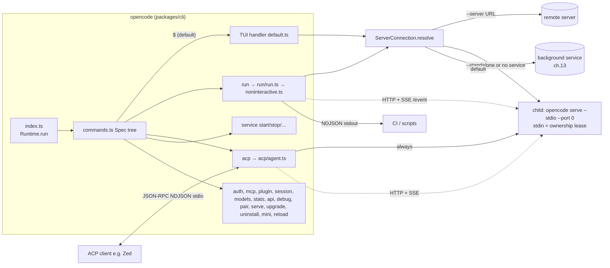
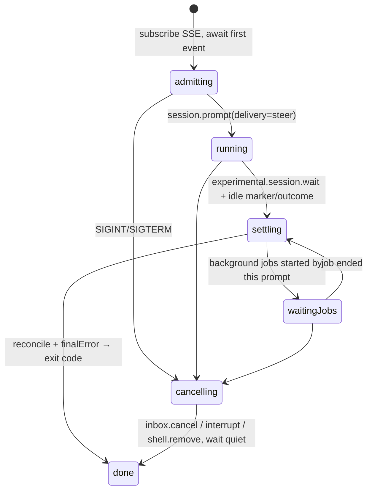

# CLI, Headless Run and ACP

> OpenCode @ 56625a3e1f · paths relative to opencode-reference/

## TL;DR

- `packages/cli` is a thin **client** of the v2 HTTP server. Every command (TUI, `run`, `acp`, `session …`, `auth …`) gets a server endpoint first, then talks to it through the generated `@opencode/client`. Three ways to get one: an explicit `--server URL`, a private `--standalone` child (`opencode serve --stdio --port 0`), or the shared background service (chapter [13](13-server-protocol-and-sdk.md)).
- The command tree is declared in one place (`packages/cli/src/commands/commands.ts`, 596 lines) with Effect's `effect/cli`. Handlers are lazy-imported per command (`packages/cli/src/index.ts:44-99`).
- `opencode run` is the headless mode. `--format json` writes **one-way NDJSON** made of 8 event types (`step_start`, `step_finish`, `text`, `reasoning`, `tool_use`, `retry`, `background_wait`, `error`). Text is emitted **once per finished part**, never as token deltas. There is no init event and no final "result" event, so the exit code is the completion signal.
- Headless permission policy: without `--auto`, every `permission.asked` in the run's session tree is **auto-rejected**, and the model gets a feedback string telling it to continue without that action. Question forms are cancelled with similar feedback. Any other input form fails the run (exit 1).
- Exit codes are 0 for success and 1 for any failure, including session failed or interrupted. A signal gives 130 (SIGINT) or 143 (SIGTERM), and a stuck shutdown gives 1 after a 10 s deadline.
- `opencode acp` runs the Agent Client Protocol (`@agentclientprotocol/sdk` 1.6.0) over stdio. It always starts a **private** server. The adapter covers 12 ACP request methods plus `session/cancel` and two `_meta` extensions: mid-turn steering and child-session updates. It does this by folding the server's SSE events into ACP `session/update` notifications.
- The updater looks up a version for the build's **channel** at `opencode.ai/update/api/<channel>/<artifact>/<distribution>`. It supports 8 install methods (curl, npm, pnpm, bun, yarn, vp, brew, winget). The default policy is `notify`, and the TUI re-checks every 10 minutes. The `install` script downloads the npm tarball for the platform and does **no checksum verification**.
- The DB file is `opencode.db` on release channels (latest, dev, beta, next, prod) and `opencode-<channel>.db` on any other channel. `OPENCODE_DB` can override it. Profiling uses signals (`SIGPROF` for a 10 s CPU profile, `SIGUSR1` for a heap snapshot) and `opencode debug heap-dump`.

## Where it lives

| Path | Role | ~Lines |
|---|---|---|
| `packages/cli/src/index.ts` | Entry: proxy env, handler table, signal/exit-code teardown, layers | 183 |
| `packages/cli/src/commands/commands.ts` | Whole command tree + global flags | 596 |
| `packages/cli/src/commands/handlers/**` | One lazy module per command | 3,344 |
| `packages/cli/src/framework/{runtime,spec,flag}.ts` | Spec → `effect/cli` Command wiring, lazy handler loading | 194 |
| `packages/cli/src/run/{run,noninteractive,ui}.ts` | `opencode run` headless | 935 |
| `packages/cli/src/session-target.ts` | `--continue/--session/--fork/--worktree` resolution | 199 |
| `packages/cli/src/services/server-connection.ts` | `--server` / `--standalone` / service resolution | 118 |
| `packages/cli/src/services/standalone.ts` | Private child server with stdin lease | 65 |
| `packages/cli/src/acp/*` (20 files) | ACP agent adapter | 3,479 |
| `packages/cli/src/services/updater.ts` (+`updater-action.ts`, `update-preflight.tsx`) | Self-update | 713 (+48, 473) |
| `packages/cli/src/config/*` | `cli.json` load/merge/migrate | 455 |
| `packages/cli/src/database-path.ts` | DB filename per channel | 13 |
| `packages/cli/src/{cpu-profile,heap,shutdown-deadline}.ts` | Signal profiling, bounded teardown | ~170 |
| `install` (repo root) | curl\|bash installer | 492 |
| `packages/script/src/index.ts` | Build-time channel/version derivation | ~75 |

## Architecture

Headless run state machine (from the doc comment at `packages/cli/src/run/noninteractive.ts:60-65`):

## Key types and interfaces

| Name | file:line | Purpose |
|---|---|---|
| `PrintLogs`, `Standalone`, `Server` global flags | `packages/cli/src/commands/commands.ts:7`, `:14`, `:21` | `--print-logs` (all commands), `--standalone` / `--server URL` (opt-in per command via `globalFlags: ServerFlags`) |
| `PermissionParams` | `packages/cli/src/commands/commands.ts:37-47` | `--auto`, plus the hidden aliases `--yolo` and `--dangerously-skip-permissions` |
| `Root` spec | `packages/cli/src/commands/commands.ts:49` | Default command: `[directory] -c -s --prompt` plus server/permission flags |
| `Runtime.handlers` / `Runtime.run` | `packages/cli/src/framework/runtime.ts:64`, `:84` | Maps the Spec tree to lazy `import()` handlers and adds `PrintLogs` as a global flag |
| `RunCommandInput` | `packages/cli/src/run/run.ts:16` | Normalised `run` options |
| `runNonInteractivePrompt` | `packages/cli/src/run/noninteractive.ts:66` | Turn lifecycle, permission/form policy, event rendering |
| `finalError` | `packages/cli/src/run/noninteractive.ts:310` | **Sole** source of the run's exit status |
| `renderer().emit` | `packages/cli/src/run/noninteractive.ts:363-367` | NDJSON line writer: `{type,timestamp,sessionID,...data}` |
| `ServerConnection.resolve` | `packages/cli/src/services/server-connection.ts:27` | Picks the endpoint (explicit / standalone / service, with version-mismatch policy) |
| `Standalone.start` | `packages/cli/src/services/standalone.ts:61` | Spawns a private server, reads a `{url}` ready line, uses random basic-auth password |
| `resolveSessionTarget` | `packages/cli/src/session-target.ts:33` | Continue/session/fork/create logic shared by TUI, mini, run |
| `ACP.connect` | `packages/cli/src/acp/agent.ts:26` | Registers ACP handlers on `agent({name:"opencode"})` |
| `ACPService.Interface` | `packages/cli/src/acp/service.ts:50` | One method per ACP request |
| `ACPTurn.Interface` | `packages/cli/src/acp/turn.ts:37` | prompt / steer / cancel / close |
| `ACPTranslate.fold` | `packages/cli/src/acp/translate.ts:95` | Pure reducer: OpenCode event → ACP outputs |
| `Updater.Interface` | `packages/cli/src/services/updater.ts:111` | run/check/apply/method/latest/upgrade/removal |
| `action` / `Policy` | `packages/cli/src/services/updater-action.ts:1-14` | `disable|notify|auto` decision |
| `databasePath` | `packages/cli/src/database-path.ts:4` | DB filename per channel |
| CLI `Info` schema | `packages/cli/src/config/schema.ts:6` | `cli.json` = `$schema` + TUI `Config.Info` fields |

## How it works: walkthroughs

### 1. Command tree and global flags

All commands, from `packages/cli/src/commands/commands.ts`:

| Command | Line | Notable params |
|---|---|---|
| `opencode [directory]` (TUI) | 49-69 | `-c/--continue`, `-s/--session`, `--prompt`, `--auto`, `--standalone`, `--server` |
| `upgrade` (alias `update`) | 71 | `[target]`, `-m/--method curl\|npm\|pnpm\|bun\|yarn\|vp\|brew\|winget` |
| `uninstall` | 86 | `--dry-run`, `-f/--force` (keeps sessions/config/state) |
| `acp` | 100 | `--login` (runs `auth login` instead) |
| `api <operationId \| METHOD path>` | 109 | `-d/--data`, `-H/--header` (≤100), `--param k=v` |
| `debug agents\|config\|heap-dump\|paths [name]` | 126-162 | `paths` names: db, home, data, config, cache, state, tmp, bin, log, repos |
| `auth list\|login\|logout\|export\|import\|switch` | 165-236 | `login [target] --method --answer k=v` (repeatable); `export` prints secrets as JSON |
| `mcp list\|add\|auth\|logout` | 238-280 | `add <name> [-- cmd…] --url --header --env --global` |
| `plugin list\|add\|check\|update\|remove` | 282-327 | npm or Git specifiers |
| `models` | 329 | — |
| `stats` | 333 | `--days --year --all --project --models --tools --cost --full --limit --json` |
| `mini` | 364 | minimal UI; `--fork --replay/--no-replay --replay-limit -m --agent --prompt` |
| `run [message..]` | 400-451 | see walkthrough 2 |
| `session list\|delete\|export\|import` | 452-500 | `list -n --format table\|json`, `export --sanitize`, `import <file\|URL> --directory` |
| `service start\|restart\|status\|stop\|get\|set\|unset` | 502-543 | keys: disabled, remote, hostname, port, password, cors, env (`packages/cli/src/services/service-config.ts:31`); lifecycle in ch.13 |
| `reload` | 544 | reload server configuration |
| `pair` | 548 | `--url`, `--remote` (OpenTunnel, internet exposure), `-y/--yes` |
| `serve` | 579 | `--hostname --port --cors (repeat) --service --stdio` |

Global flags: `--print-logs` applies to every command (`packages/cli/src/framework/runtime.ts:85`) and sets `OPENCODE_PRINT_LOGS=1` (`:98`). `--standalone` and `--server` apply only where a spec lists `globalFlags: ServerFlags`, or where the command declares them in its own params (Root does at `commands.ts:52`). `--version` comes from `Command.run(..., { version })` (`runtime.ts:85`). Handler modules load lazily, so `opencode run` never imports the TUI (`index.ts:44-99`).

### 2. `opencode run` end to end

1. **Resolve the server without leaving one behind.** `ServerConnection.resolve({ autostart: false })` (`packages/cli/src/commands/handlers/run.ts:10`) uses the background service only if it is already running (`Service.discover`). Otherwise it starts a private standalone server (`packages/cli/src/services/server-connection.ts:57-60`). The comment says: "A one-off run uses the background service when it is already up, but never leaves a new one running" (`run.ts:9`).
2. **The standalone child** runs `opencode serve --stdio --port 0` with a random 32-byte password in `OPENCODE_PASSWORD`. Its `stdin: "pipe"` is the *ownership lease*: EOF ends the server even if the parent is SIGKILLed (`packages/cli/src/services/standalone.ts:17-32`). The server prints `JSON.stringify({ url })` as its ready line (`packages/cli/src/server-process.ts:208`).
3. **Validate flags.** `--fork` needs `--continue` or `--session`, and `--worktree` cannot be combined with either (`packages/cli/src/run/run.ts:59-61`).
4. **Input.** The message args are joined with spaces. Piped stdin is appended: read in full when there is no argument, and with a 1 s grace period when there is one, so that an open-but-silent stdin from `spawn` does not hang the run (`run.ts:64-73`, `PIPED_INPUT_GRACE_MS` at `:51`). Each `-f` file is capped at 10 MiB. Text files are inlined as `<file name="…">` and everything else becomes a `data:` URI attachment (`run.ts:170-199`).
5. **Worktree / session target.** `-w/--worktree [name]` calls `worktree.create` and keeps the caller's subfolder if that path exists in the new worktree (`packages/cli/src/session-target.ts:136-159`). `resolveSessionTarget` behaves like this: `--session ID` looks the session up and creates one with that ID if it is missing (`session-target.ts:106-110`, `:62-71`); `--continue` takes the newest non-archived top-level session whose directory matches exactly (`:168-189`); `--fork` forks either of them (`:113-131`). The model is given as `provider/model#variant` (`commands.ts:428`). On the background service, the client's whole env (minus passwords) is pushed with `session.environment` (`run.ts:106`, `packages/cli/src/env.ts:15-22`).
6. **Title/archive.** `--title ""` derives a title from the first 50 characters. `--archived` archives the session *before* the prompt is admitted, so the session never shows up in an inbox (`run.ts:118-126`).
7. **Admission.** It subscribes to SSE and waits for the first event (`server.connected`) before prompting, so no event is missed (`packages/cli/src/run/noninteractive.ts:68-69`). It then switches agent and model if asked, and sends `session.prompt({ id: messageID, delivery: "steer" })` with a client-generated message ID (`:212-223`).
8. **Promotion gate.** Events are rendered only after `session.inbox.delivered` for this `messageID` and only for the root session ID. Subagent text is not printed (`noninteractive.ts:172-177`).
9. **Asks.** `permission.asked` and `form.created` are handled for any session whose parent chain leads to the run's session (`ownsSession`, `:86-95`). Permission handling is at `:97-112`, form handling at `:122-140`. Asks that were pending before the subscription saw them are swept after admission (`:225-236`).
10. **Settling.** Loop on `experimental.session.wait`. Once an idle marker or terminal outcome is seen, check for background jobs that *this prompt* started (`job.time.started >= admission time`), then queued inboxes, then active sessions in the tree (`:183-208`, `:241-254`). While jobs are pending, a `background_wait` event is emitted.
11. **Reconcile + exit.** After settling, the stored messages after this prompt are re-read (`projectedMessages`, `:340-354`). Anything the live stream missed is printed, and only the unseen suffix of each part (`:375-392`, `:596-638`). `finalError` picks the first idle marker. Later markers count only when background jobs were awaited (`:310-326`). Any non-success outcome sets `process.exitCode = 1` and emits `error` (`:299-302`).
12. **Cancel.** SIGINT/SIGTERM aborts the run. If the prompt was not yet promoted, it cancels the inbox entry. It also interrupts the session and subagent children, removes shell jobs, and keeps interrupting any wake-up that starts until the tree is quiet. Image jobs are not waited on (`:259-284`).

### 3. NDJSON output (`--format json`)

Each line is `JSON.stringify({ type, timestamp, sessionID, ...data })` followed by EOL (`noninteractive.ts:363-367`). Default format prints human text instead, and plain lines when stdout is not a TTY (`:406`).

| `type` | Fields (beyond `type, timestamp, sessionID`) | When emitted (source event) | file:line |
|---|---|---|---|
| `step_start` | `part{ id, sessionID, messageID, type:"step-start", snapshot }` | first `session.step.started` per assistant message (retries don't repeat it); or on reconcile if unseen | `noninteractive.ts:495-499`, `:457-461`, `:602-603` |
| `step_finish` | `part{ id, sessionID, messageID, type:"step-finish", reason, snapshot, cost, tokens }` | `session.step.ended`; or reconcile when message has `finish`+`tokens` | `:501-505`, `:630-636` |
| `text` | `part{ id, sessionID, messageID, type:"text", text, time{start,end} }` | `session.text.ended` (complete part; `text` is the not-yet-printed suffix) | `:515-525`, `:393-402` |
| `reasoning` | as `text` + `metadata` (provider native) | `session.reasoning.ended`, **only with `--thinking`** | `:387`, `:399` |
| `tool_use` | `part{ partID, sessionID, messageID, type:"tool", id, tool, state{ status:"completed"\|"error", input, output\|error, title?, metadata, time{start,end} } }` | `session.tool.success` / `session.tool.failed` (input deltas/progress are accumulated, not emitted) | `:421-441`, `:556-593` |
| `retry` | `messageID, attempt, nextRetryAt, error` | `session.retry.scheduled` | `:480-493` |
| `background_wait` | `jobs[{ id, kind, title }]` | settling found jobs started by this prompt (count changed) | `:468-476`, `:249` |
| `error` | `error{ type, message }` | final non-success outcome, unhandled form, or setup failure (`sessionID` may be `""`) | `:464-466`, `packages/cli/src/run/run.ts:228-238` |

`tool_use.state.metadata` also carries `providerCall`, `providerResult` and `rawInput` from the native tool-call events (`noninteractive.ts:564-578`). Error types seen in tests include `provider.transport`, `unknown` and `aborted` (`packages/cli/test/run/noninteractive.test.ts:88`, `:198`).

### 4. Permissions, questions and exit codes in headless mode

- `--auto` (or the hidden `--yolo` / `--dangerously-skip-permissions`, `packages/cli/src/commands/handlers/run.ts:34`) replies `"once"` to every ask. Rules that explicitly deny an action never produce an ask, so they still apply *(inferred from the flag text "not explicitly denied", `commands.ts:39`)*.
- Without it, the reply is `decision: "reject"` with `message: PERMISSION_REJECTED_FEEDBACK`, and a warning goes to stdout in default mode (`noninteractive.ts:57-58`, `:97-112`). The run continues and the model adapts.
- Forms with `metadata.kind === "question"` are cancelled with `QUESTION_CANCELLED_FEEDBACK` ("make reasonable assumptions and state them", `:54-55`). Any other form, such as MCP OAuth/elicitation, is cancelled and **fails** the run (`:135-139`). Global MCP forms are claimed only when the run owns a standalone server for the same directory (`:117-120`).
- Exit codes: `process.exitCode = 1` on failure (`noninteractive.ts:301`, `run.ts:229`). Teardown maps SIGTERM to 143, because runMain reports every signal as 130 (`packages/cli/src/index.ts:105-108`, `:176`). A second signal during shutdown, or a shutdown that takes longer than 10 s, exits 1 and lists the finalizers still pending (`packages/cli/src/shutdown-deadline.ts:5`, `:31-35`). Output is flushed by ending stdout/stderr before `process.exit` (`index.ts:177-180`).

### 5. The ACP server (`opencode acp`)

1. **Boot.** Sets `OPENCODE_CLIENT=acp`, starts a **standalone** server, and builds an Effect client with the basic-auth headers (`packages/cli/src/commands/handlers/acp.ts:24-34`). The ACP connection runs JSON-RPC NDJSON over stdout and stdin (`:35`). The process exits 1 if the server dies or an incoming message exceeds the SDK size limit (`:36-56`).
2. **Implemented methods** (`packages/cli/src/acp/agent.ts:68-127`), mapped in `packages/cli/src/acp/service.ts`:

| ACP method | OpenCode mapping | file:line |
|---|---|---|
| `initialize` | Stores client capabilities. Returns `protocolVersion: 1`, `loadSession`, MCP `{http:true, sse:false}`, prompt `{embeddedContext, image}`, session caps `{additionalDirectories, close, delete, fork, list, resume}`, `_meta.steering`, and the auth method `opencode-login` (a terminal `--login` when supported) | `service.ts:120-146` |
| `authenticate` | Only validates the method ID. The real login is `opencode acp --login` / `auth login` | `service.ts:147-151` |
| `session/new` | Loads the catalog first, then `session.create({location, additional dirs})`, attaches and registers client MCP servers through `experimental.mcp.add`. The session is marked "unprompted" | `service.ts:152-163`, `sessions.ts:96-110` |
| `session/load` | `session.get`, checks that cwd matches (`SessionDirectoryMismatchError`), then replays history as `user_message_chunk` etc. | `service.ts:164-180`, `replay.ts:43-54` |
| `session/list` | `session.list({directory, order:"desc", limit:100, cursor})` | `service.ts:181-208` |
| `session/delete` | Cancels the turn, `session.remove`, detaches | `service.ts:209-219` |
| `session/resume` | Like load, but without replay | `service.ts:220-227` |
| `session/close` | `turn.close` interrupts the server even when idle. Then detach, and delete the session if it was never prompted and has no messages | `service.ts:228-233`, `:106-117`, `turn.ts:454-461` |
| `session/fork` | `session.fork`, then re-grants additional dirs | `service.ts:234-243` |
| `session/set_config_option` / `session/set_mode` | Config options `model`, `effort` (model variants) and `mode` (agent). Invalid values trigger a catalog reload and one retry | `config-option.ts:22-68`, `service.ts:81-86`, `:244-255` |
| `session/prompt` | One turn per session (a second turn gives `ServiceFailureError`). Embedded context is sent as a `session.synthetic` steer. `/compact` → `session.compact`. `/cmd` → `session.command`. Otherwise `session.prompt(delivery:"steer")` | `turn.ts:413-431`, `:249-287`, `prompt.ts:21-43` |
| `session/cancel` (notification) | Interrupts the turn fiber, then `session.interrupt` and a drain of up to 5 s before outstanding tools are marked abandoned | `turn.ts:451-453`, `:289-307`, `:46-49` |
| `_session/steering` (extension) | Inject into the running turn only (`resume:false`). Returns `promptRequired/noRunningTurn` if the session is idle | `agent.ts:120-127`, `turn.ts:432-450` |

3. **Event translation** (`packages/cli/src/acp/translate.ts`). `session.text.delta` → `agent_message_chunk` (`:310-318`). `session.reasoning.delta` → `agent_thought_chunk` (`:319-327`). `tool.input.started` → `tool_call` (pending) (`:328-346`). `tool.called` and `tool.progress` → `tool_call_update` (running) (`:347-382`). `tool.success` and `tool.failed` → completed or failed `tool_call_update`, with file diffs rebuilt from the patch metadata (`:383-420`, `permission.ts:83-116`). `session.retry.scheduled` → `session_info_update` carrying `_meta` (`:281-290`). Tool kinds map as follows: shell→execute, webfetch→fetch, edit/patch/write→edit, grep/glob→search, read→read, subagent→think (`packages/cli/src/acp/tool.ts:16-39`). Stop reasons: interrupted/aborted→`cancelled`, finish `length`→`max_tokens`, content filter→`refusal`, everything else `end_turn` (`translate.ts:484-493`). After each turn a `usage_update` is sent with the context size and USD cost (`turn.ts:365-386`).
4. **Permissions.** `permission.asked` becomes `session/request_permission` with options `once`/allow_once, `always`/allow_always and `reject`/reject_once. Edit, write and patch requests carry diff previews and file locations (`packages/cli/src/acp/permission.ts:39-74`). Anything other than once or always counts as `reject`, and the reply goes to `permission.reply` (`:72-81`). Asks are serialised through one queue per turn. They race against cancellation (fallback `reject`) and against the `permission.replied` event, so a reply from another client of the same server settles the ACP prompt (`turn.ts:132-159`, `:213-218`).
5. **Forms → elicitation.** Forms are sent as `elicitation/create` only when the client declared form elicitation and the form is credential-free ("Form mode must not collect secrets", `packages/cli/src/acp/elicitation.ts:20`). Otherwise the form is cancelled (`turn.ts:195-212`).
6. **Subagents.** If the client sets `_meta["opencode/child-session-updates"]`, child-session updates go out as the `opencode/session/child_update` ext notification (`packages/cli/src/acp/capabilities.ts:3`, `packages/cli/src/acp/child.ts:3`). Children outlive a cancelled turn. Their asks keep flowing through a background fiber (`turn.ts:323-349`).
7. **Model/agent drift.** A separate SSE subscription watches `session.model.selected` and `session.agent.selected`. When another client changes the selection, it sends `config_option_update` and `available_commands_update` (`packages/cli/src/acp/sessions.ts:53-91`).

### 6. Updater and install script

- **Channel.** It is fixed at build time: an explicit `OPENCODE_CHANNEL`; otherwise `latest` when the version is not `0.0.0-*`; otherwise the git branch, sanitised. Preview versions are `0.0.0-<channel>-<run#>` (`packages/script/src/index.ts:24-47`). An unbuilt checkout reports `local` (`packages/cli/src/version.ts:9`, `:28`).
- **Release lookup.** `https://opencode.ai/update/api/<channel>/<artifact>/<npm|homebrew>?current=<version>` with a 10 s timeout. Homebrew-core uses `formulae.brew.sh` and winget queries winget (`packages/cli/src/services/updater.ts:315-330`, `:401-406`).
- **Method detection.** Checks whether the executable is the curl-installed binary, a brew formula (`opencode`, `opencode-beta`, `opencode-v2`), or a global install from one of the package managers. Volta and mise copies are reported as "managed" and are never touched (`updater.ts:162-176`, `:255-263`, `:407-428`). For curl upgrades it downloads `https://opencode.ai/v2/install` and runs it (`:535-552`).
- **Policy.** Read from `config.json`, `opencode.json` and `opencode.jsonc` in the global config dir. The last file wins, and it accepts `update: disable|notify|auto` or the legacy `autoupdate: false|"notify"|true`. The default is **notify** (`updater.ts:127-142`, `:198-206`). `OPENCODE_DISABLE_AUTOUPDATE=1|true` and local builds skip the check (`:608-614`). `action()` returns the policy whenever current ≠ latest. It is **not** a "newer than" test, so a channel can roll clients back (`packages/cli/src/services/updater-action.ts:8-14`).
- **Cadence.** The TUI handler runs `updater.run` immediately and then `Schedule.spaced("10 minutes")`. A semaphore keeps installs from overlapping (`packages/cli/src/commands/handlers/default.ts:67-86`). `run` and `acp` never check for updates.
- **`install`.** Parses `-v/--version`, `-b/--binary` and `--no-modify-path` (`install:11-26`). It detects `os-arch` (6 combos), musl, and AVX2 (falls back to the `-baseline` build) (`install:80-170`). Without `--version` it fetches the latest metadata from `https://opencode.ai/update/api/latest/cli/npm`, which is hard-wired to the **latest** channel. It then downloads `registry.npmjs.org/<scope>/cli-<target>/-/…tgz`, falling back to the legacy `@opencode-ai` scope (`install:177-212`). The binary goes to `$HOME/.opencode/bin` (`install:69`), an `opencode2` shim is written (`install:344-366`), and the directory is added to PATH in the shell rc or to `$GITHUB_PATH`. There is no SHA or signature check (grep for sha/integrity/checksum finds nothing).

### 7. Database path and profiling

`databasePath(data)` returns `OPENCODE_DB` if set, otherwise `opencode.db` for latest/dev/beta/next/prod or when `OPENCODE_DISABLE_CHANNEL_DB` is set, otherwise `opencode-<channel>.db`. `:memory:` is passed through, and the file lives under the global data dir (`packages/cli/src/database-path.ts:4-13`). The server receives the path at startup (`packages/cli/src/server-process.ts:114-116`), and `opencode debug paths db` prints it. Profiling has no flags. Instead, `SIGPROF` writes a 10 s CPU profile `cpu-<pid>-<ts>.cpuprofile` to the log dir (`packages/cli/src/cpu-profile.ts:15-28`), and `SIGUSR1` writes a heap snapshot (`packages/cli/src/heap.ts:12-21`). Neither works on Windows. The `bin/opencode.cjs` launcher forwards SIGUSR1 to the native child (`packages/cli/bin/opencode.cjs:8-9`), and `opencode debug heap-dump` asks a running server for a snapshot over HTTP.

## Configuration and extension points

| Key / env / flag | Effect | Source |
|---|---|---|
| `<config>/cli.json` | TUI/CLI prefs: theme, keybinds, plugins, leader, scroll, attention, diffs, terminal, prompt, session, tabs, mini, debug, experimental, animations, highlights, mouse, cursor; `$schema` = `https://opencode.ai/v2/cli.json` | `packages/cli/src/config/schema.ts:4-9`, `packages/tui/src/config/index.tsx:69-258` |
| `OPENCODE_CLI_CONFIG_CONTENT` | JSON overlay merged on top of `cli.json` | `packages/cli/src/config/config.ts:32-34` |
| legacy `tui.json` | migrated into `cli.json` | `packages/cli/src/config/migrate.ts:100` |
| `OPENCODE_CONFIG_DIR` | overrides the global config dir | `packages/cli/src/index.ts:145` |
| `OPENCODE_PASSWORD` (legacy `OPENCODE_SERVER_PASSWORD`) | basic-auth password for `--server`; never forwarded into session env | `packages/cli/src/env.ts:10-22` |
| `OPENCODE_DB`, `OPENCODE_DISABLE_CHANNEL_DB` | DB file selection | `packages/cli/src/database-path.ts:6-9` |
| `OPENCODE_DISABLE_AUTOUPDATE`; `update`/`autoupdate` in global config | updater policy | `packages/cli/src/services/updater.ts:608`, `:127-142` |
| `OPENCODE_GIT_BASH_PATH` | Windows curl-upgrade shell | `updater.ts:241` |
| `OPENCODE_CLIENT` | client name sent to server/telemetry (`acp` sets it) | `index.ts:154`, `handlers/acp.ts:24` |
| `OPENCODE_PRINT_LOGS` / `--print-logs` | logs to stderr; standalone server stderr inherited | `framework/runtime.ts:98`, `services/standalone.ts:29` |
| `OTEL_EXPORTER_OTLP_ENDPOINT/HEADERS` | OpenTelemetry export | `index.ts:151-157` |
| `OPENCODE_MODELS_URL/PATH`, `OPENCODE_DISABLE_MODELS_FETCH`, `OPENCODE_DISABLE_PROJECT_CONFIG`, `OPENCODE_DISABLE_CLAUDE_CODE(_SKILLS)`, `OPENCODE_SIMULATE` | server start options passed by the CLI | `server-process.ts:113-130` |
| `NO_PROXY`/`no_proxy` | merged with loopback so local service calls bypass proxies | `index.ts:22-33` |
| `OPENCODE_BIN_PATH` | launcher override for the native binary | `bin/opencode.cjs:33` |
| `VERSION` env / `--version` | installer target version | `install:30`, `:40-47` |

## Edge cases, invariants and gotchas

- **Headless output has no envelope.** No `init` line (session ID, model and tools are unknown until the first event) and no terminal `result` line. A consumer must watch for EOF and read the exit code. Cost and tokens arrive per step in `step_finish`.
- **No deltas at all in `run --format json`.** Text is written on `*.ended` or at reconcile. The `text` field holds only the suffix not printed yet, so in rare reconcile cases one logical part can span two lines with the same `part.id` (`noninteractive.ts:388-392`).
- **Subagent output is invisible** in `run`, because only the root session's events render (`noninteractive.ts:172`). Subagent permission asks are still auto-handled through the parent-chain check.
- **The `promoted` gate.** A prompt that ends up queued behind another client's busy period (`delivery:"steer"` on a shared service) fails with "Prompt was not promoted" if the busy period ends with an error first (`:175`, `:315`).
- **`--session <unknown-id>` creates** a session with that ID instead of failing, unless `--fork` is set (`session-target.ts:107-109`).
- **`run` never leaves a background service running**, but it will reuse one that is already up. The TUI default path *does* auto-start it and *replaces* it on version mismatch (`handlers/default.ts:35-47`). `--server` only warns on a version mismatch (`server-connection.ts:45-48`).
- **ACP is always standalone.** Two ACP clients therefore never share a server, while `run` might share one with the TUI.
- **ACP one-turn-per-session** is enforced synchronously in `prompt`. A JSON-RPC `$/cancel_request` for the prompt behaves like `session/cancel` instead of failing the request (`turn.ts:414-430`).
- **ACP rejects SSE MCP servers.** Only stdio and http are accepted (`service.ts:266-276`). `authenticate` is a no-op check.
- **The updater can downgrade**, because `action` compares for equality, not ordering (`updater-action.ts:12`). The default `notify` policy means auto-install only happens when the user opts into `auto`.
- **The installer is unauthenticated.** It trusts TLS to npm and opencode.ai, and the curl path only installs from the `latest` metadata endpoint.
- **SIGHUP** is turned into SIGTERM only when a TTY is attached, so `nohup` and the service keep their ignore behaviour (`shutdown-deadline.ts:39-42`).

## Tests worth reading

- `packages/cli/test/run/noninteractive.test.ts` covers event fixtures, permission rejection, form cancellation and reconcile. `test/run/process.test.ts` covers stdin grace and exit 143. `test/run/archived.test.ts` covers archive-before-prompt.
- `packages/cli/test/acp/*` has unit tests (translate, turn, permission, elicitation, replay, compaction, config-option) and subprocess tests (`lifecycle.subprocess.test.ts`, `background-turn.subprocess.test.ts`), along with `wire-fixture.ts`, which records ACP wire traffic.
- `packages/cli/test/updater-install.test.ts`, `test/upgrade.test.ts` and `src/services/updater.test.ts` cover method detection and upgrade commands.
- `packages/cli/test/session-target.test.ts`, `test/server-connection.test.ts` and `test/standalone.test.ts` cover target and endpoint resolution.
- `packages/cli/test/shutdown-deadline.test.ts`, `test/cpu-profile.test.ts`, `test/debug-heap-dump.test.ts` and `test/debug-paths.test.ts` cover shutdown and profiling.
- `packages/cli/test/config.test.ts` covers the `cli.json` merge, migration and atomic writes.

## Genie takeaways

Pick-list references: **#25 headless** (SKIP code: OpenCode's stream is one-way), **#24 ACP** (LATER), **#43 service daemon** (SKIP). See `../../research/opencode-pick-list.md`.

- **Protocol shape ([02](../../tickets/02-event-protocol.md), [25](../../tickets/25-headless-sdk.md)).** Port the *ideas* behind the NDJSON events, not the format:
  - complete parts by default (matches our "complete messages, opt-in deltas");
  - a `retry` event that carries `nextRetryAt`;
  - a `background_wait` event so CI logs explain a pause;
  - per-step `cost/tokens`.
  
  Avoid what OpenCode leaves out. Genie needs a `system/init` line (version, session ID, model, tools, cwd) and a final `result` line (outcome, turns, total cost, duration, error) so consumers never have to infer completion from EOF.
- **Headless permissions ([25](../../tickets/25-headless-sdk.md), [08](../../tickets/08-permissions.md)).** Adapt OpenCode's policy, and note one gap. Rejecting with a feedback string to the model ("continue without this action") is better than aborting the run, and should be Genie's default `-p` behaviour when no `control_request` consumer is attached. Cancelling questions with "make reasonable assumptions and state them" is worth copying word for word in spirit. The gap is that OpenCode has no permission-prompt delegation in headless mode. In Genie's `stream-json` input mode, asks should go out as `control_request` and auto-reject only when the input side says it will not answer.
- **Exit codes ([25](../../tickets/25-headless-sdk.md)).** OpenCode collapses everything to 0 or 1 (plus 130/143). Genie should define distinct codes for max-turns or budget exceeded, auth failure, permission denied and provider error. Keep 130/143 and the bounded 10 s shutdown with a "still pending" report, which is cheap and very useful.
- **Engine ownership ([01](../../tickets/01-engine-architecture.md)).** OpenCode's standalone child, with **stdin EOF as the ownership lease** and a JSON `{url}` ready line, is the cleanest pattern here, and it fits "one engine per session, no shared daemon" exactly: when the host (desktop app, VS Code) dies, the engine dies with it. Port that. Skip the shared service and the version-mismatch replacement logic (#43).
- **Session-target flags.** Port the semantics of `--continue` (newest top-level, non-archived session in the exact cwd), `--session` (create if missing), `--fork`, `--worktree` (incompatible with resume) and `--archived` for CI runs. `--archived` maps naturally onto a `--bare`-style CI preset ([24](../../tickets/24-worktrees.md), [12](../../tickets/12-sessions-persistence.md)).
- **Admission ordering.** Subscribe before you submit, wait for the connected event, use a client-generated message ID, and reconcile from storage at the end. Genie gets this for free with a single in-process stream, but the reconcile-on-settle idea is worth keeping for `--resume` replays.
- **ACP adapter later (#24).** Port the method set and its mapping onto Genie's own protocol:
  - permission option IDs `once`/`always`/`reject`;
  - a separate subscription that keeps config options in sync when the selection changes elsewhere;
  - discarding sessions that were opened but never prompted;
  - a drain timeout on cancel that then marks tools abandoned;
  - stop-reason mapping.
  
  Treat the `_session/steering` extension as evidence that Genie's protocol needs a first-class "steer/inject" command. Don't implement ACP until protocol v1 is stable.
- **Distribution ([27](../../tickets/27-distribution.md)).** Adapt the channel-scoped update endpoint (`/update/api/<channel>/<artifact>`), install-method detection (refuse to self-update brew, Volta or mise copies and say why), `notify` as the safe default, and per-channel DB filenames, which stop preview builds from migrating the stable DB. Avoid three things: an installer without checksum or signature verification (Genie should ship SHA-256 plus a signature), a curl path that ignores channels, and equality-based "update" semantics unless rollback is intentional.
- **CLI structure ([05](../../tickets/05-cli-terminal-ui.md), [14](../../tickets/14-cli-auth.md)).** Declare the whole command tree in one file and lazy-load handlers per command, which is easy with `clap` in Rust. `auth login|logout|list|switch|export|import` with `--answer key=value` for non-interactive provider forms is a good template for `genie login`. The `auth export` of raw secrets is a risk to decide on consciously.

## Open questions / inferred

- Exactly how "explicitly denied" rules interact with `--auto` lives in core permission evaluation (not read here). *(inferred: deny rules never emit `permission.asked`.)*
- Whether `opencode run` with no TTY and no message falls into `readStdin()` blocking forever when stdin is an open pipe with no writer *(inferred: yes, only the with-argument case has a grace timeout)*.
- How `debug heap-dump` reaches the server (an HTTP endpoint is assumed, not verified here; see ch.13).
- The server side of `opencode.ai/update/api/...` (rollout percentages, `current=` usage) is not in the repo. *(inferred: server-side staged rollout.)*
- `mini` (229 + 172 lines) and `pair`/`serve` handlers were only skimmed. Pairing and auth are covered in ch.13.
