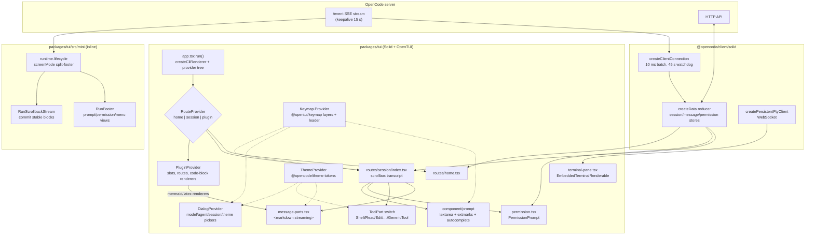

# TUI and Rendering

> OpenCode @ 56625a3e1f · paths relative to opencode-reference/

## TL;DR

- `packages/tui` (~117K lines TS/TSX) is a SolidJS app rendered by **@opentui/solid 0.8.4**. It comes with `@opentui/core` (renderables, layout, markdown/code/textarea, tree-sitter, clipboard) and `@opentui/keymap` (layered keymap with a leader key). OpenTUI is an external npm dependency and is **not in this repo**, so its internals here are inferred from call sites.
- There are **two front-ends** in the package. One is the full-screen app (`src/app.tsx`: routes home/session/plugin, tabs, sidebar, dialogs). The other is **`opencode mini`** (`src/mini/`, ~18K lines), an **inline split-footer mode**: scrollback is append-only and a 4-row repaintable footer holds the prompt, permission prompts, the slash menu and status. Mini is what Genie's inline CLI should study, not the full-screen app.
- Server events arrive over one SSE stream (`client.event.subscribe`). The stream must start with `server.connected`, is batched every 10 ms inside Solid `batch()`, has a 45 s idle watchdog against the server's 15 s keepalive, and reconnects after 1 s. A ~60-case reducer (`client/src/solid/data.ts`) projects the events into Solid stores.
- The full TUI renders markdown with OpenTUI's `<markdown streaming>` renderable. **patchmark** (the streaming CommonMark/GFM parser with tail "healing") is used by the **web/desktop** `session-ui`, not by the TUI. It is a clean, dependency-free, fuzz-tested port candidate.
- Themes are semantic tokens (`text.action.primary.$focused`, `diff.background.added`, `markdown.*`, `syntax.*`) over 9-step hue scales, with dialog surfaces. A "system" theme is built from the terminal's queried 16-colour palette, and light/dark is detected from the background luminance.
- Feature plugins (sidebar panels, diff viewer, stats, storybook, and the `merman` Mermaid and `latex` code-block renderers) use the same `Plugin.define` API as third-party TUI plugins.
- Performance tools: mount budgets for the transcript (40 entries plus 60-entry backfill chunks), event coalescing, markdown renderer memoisation, sticky scroll, and committing only *stable* markdown blocks to scrollback in mini mode.

## Where it lives

| path | role | ~lines |
|---|---|---|
| `packages/tui/src/app.tsx` | `run()`: renderer creation, provider tree, route switch, global commands | 1485 |
| `packages/tui/src/routes/session/` | transcript (`index.tsx` 3838), permission/question prompts, forms, grouping, mount budget | 7941 |
| `packages/tui/src/component/prompt/` | prompt editor (`index.tsx` 2044) + autocomplete (`@`, `/`) | 3650 |
| `packages/tui/src/component/` | dialogs (model, agent, sessions, MCP, themes), session tabs, terminal pane | 12429 |
| `packages/tui/src/context/` | Solid contexts: client, data, keymap, theme, storage, route, local, session-terminals | 4102 |
| `packages/tui/src/ui/` | dialog/select/toast primitives, spinners, animation | 3817 |
| `packages/tui/src/mini/` | inline split-footer front-end (`opencode mini`) | 18334 |
| `packages/tui/src/plugin/` | TUI plugin host: slots, routes, markdown renderers | 1764 |
| `packages/tui/src/feature-plugins/` | built-in plugins (sidebar, prompt, system/diff-viewer, storybook) | ~4K |
| `packages/tui/src/config/` | TUI config schema + default keybinds | 781 |
| `packages/client/src/solid/{connection,data}.ts` | SSE connection loop + event→store reducer | 277 / 2224 |
| `packages/theme/src/tui/` | token schema, expansion, resolution, OKLCH helpers, v1 migration | 2026 |
| `packages/tui/src/theme/assets/*.json` | 33 legacy (v1) + 2 v2 theme files | — |
| `packages/patchmark/src/` | streaming markdown → block patches + heal | 4026 |
| `packages/merman/src/` | Mermaid → terminal cell grid (6 diagram kinds) | ~22K incl. tests |
| `packages/latex/src/` | LaTeX math → Unicode cell layout | ~2.6K |

## Architecture

**Renderer.** `run()` builds `createCliRenderer` with `targetFps: 60`, `externalOutputMode: "passthrough"`, `exitOnCtrlC: false`, `useKittyKeyboard: {}`, `autoFocus: false` and `useMouse: config.mouse` (`packages/tui/src/app.tsx:250-262`). Then `render(() => …)` mounts about 30 nested providers (`app.tsx:319-460`). Layout is flexbox props on `<box>` (e.g. `flexDirection`, `flexGrow`, `minWidth={0}`; `app.tsx:1405-1440`), and Yoga-style layout is *inferred* inside OpenTUI. Custom native renderables join JSX through `extend({...})` (e.g. `embeddedTerminal`, `component/terminal-pane.tsx:19`). `OPENCODE_DRIVE` swaps in a simulated renderer from `@opencode/simulation` for scripted tests (`app.tsx:275`).

**Routes.** `Route = HomeRoute | SessionRoute | PluginRoute` lives in a reconciled store (`context/route.tsx:7-46`). `<Switch>` picks `<Home/>`, `<SessionFrame/>` or `<PluginRoute/>` (`app.tsx:1443-1460`). The `<Slot path="app"/>` overlay lets plugins inject UI.

**Mini (inline).** `createRuntimeLifecycle` creates the renderer with `screenMode: "split-footer"`, `footerHeight: 4`, `externalOutputMode: "capture-stdout"`, `targetFps: 30`, no mouse, and `clearOnShutdown: false` (`mini/runtime.lifecycle.ts:160-176`). Scrollback is immutable. `RunFooter` (`mini/footer.ts:163`) is the only region that repaints, and it resizes itself through `renderer.footerHeight = height` (`footer.ts:766`).

## Key types and interfaces

| name | file:line | purpose |
|---|---|---|
| `TuiInput`, `run` | `packages/tui/src/app.tsx:187`, `:213` | entry: server endpoint, args, config, optional terminal handoff |
| `Route` | `packages/tui/src/context/route.tsx:27` | navigation state |
| `useClient` (`ClientProvider`) | `packages/tui/src/context/client.tsx:16-75` | API, event bus (`createGlobalEmitter`), connection, persistent-PTY client |
| `useEvent` | `packages/tui/src/context/event.ts:9` | typed `on(type)` / `subscribe` over the bus |
| `createClientConnection` | `packages/client/src/solid/connection.ts:40` | SSE loop, batching, reconnect |
| `createData` / `handleEvent` | `packages/client/src/solid/data.ts:280` / `:742` | event reducer into Solid stores |
| `TextPart` | `packages/tui/src/routes/session/message-parts.tsx:174` | streaming `<markdown>` for assistant text |
| `ToolPart` | `packages/tui/src/routes/session/index.tsx:2577` | per-tool renderer switch |
| `PermissionPrompt` | `packages/tui/src/routes/session/permission.tsx:113` | once/always/reject + reject-message stage |
| `Keymap` context, `slash` command field | `packages/tui/src/context/keymap.tsx:30-37` | commands carry an optional `slash: {name, aliases, arguments}` |
| `TuiKeybind` defaults | `packages/tui/src/config/keybind.ts:41-48` | leader `ctrl+x`; `app.exit` = `ctrl+c,ctrl+d,<leader>q` |
| `Storage` / `createStorage` | `packages/tui/src/context/storage.tsx:10`, `:48` | per-channel JSON stores + in-memory stores |
| `createMarkdownRenderer` | `packages/tui/src/plugin/markdown.ts:5` | memoised merge of plugin code-block renderers |
| `RunScrollbackStream` | `packages/tui/src/mini/scrollback.surface.ts:88` | streaming entry → scrollback commits |
| `ResolvedThemeTokens` | `packages/theme/src/tui/types.ts:25` | semantic token tree |
| `PatchmarkStream`, `MarkdownBlock`, `BlockPatch`, `StreamFrame` | `packages/patchmark/src/stream.ts:99`, `types.ts:87-127` | streaming parse API |
| `computeTailHeal` / `TailHeal` | `packages/patchmark/src/heal.ts:49` / `:4` | the heal algorithm |
| `createMermaidCodeBlockRenderer` | `packages/merman/src/markdown.ts:268` | Mermaid fence → `StaticDiagramRenderable` |

## How it works: walkthroughs

### 1. Event stream → screen

1. `ClientProvider` calls `createClientConnection(api, {onEvent: e => events.emit(e.type, e)})` (`context/client.tsx:32-47`).
2. `connect()` opens `api.event.subscribe({signal, onActivity})`. The first event must be `server.connected`, otherwise the attempt counts as failed (`client/src/solid/connection.ts:97-107`). Every chunk calls `touch()`, which re-arms the "Event stream stalled" abort (`connection.ts:90-91`). The default idle limit is 45 s and the server keepalive is 15 s (`connection.ts:22-36`).
3. `publish` queues events and flushes them every `flushInterval ?? 10` ms inside Solid `batch()` (`connection.ts:65-74`). A burst of deltas therefore causes one reactive pass.
4. On error it reconnects after `reconnectDelay = 1_000` ms. A managed service can supply a new endpoint, in which case the persistent-PTY client is rebuilt too (`connection.ts:150-181`, `context/client.tsx:34-41`).
5. `createData.handleEvent` switches on the event type (`data.ts:742`). On `server.connected` it re-hydrates the active sessions and lets events that arrived during hydration override the snapshot (`data.ts:743-760`). Text streaming is incremental: `session.text.delta` appends, and `session.text.ended` replaces with the final text (`data.ts:1092-1100`). Tool, reasoning, step, compaction, permission and form events update the same stores.
6. Components read the stores reactively. `TextPart` renders `<markdown content={text} streaming={message.time.completed === undefined} internalBlockMode="top-level" conceal={markdownMode==="rendered"} …/>` (`message-parts.tsx:187-197`).

### 2. Tool calls and permission prompts (full TUI)

1. `ToolPart` maps `toolDisplay(part.name)` onto dedicated components (Shell, Glob, Read, Grep, WebFetch, WebSearch, Write, Edit, Subagent, Execute, ApplyPatch, TodoWrite, Question, Skill), with `GenericTool` as the fallback (`routes/session/index.tsx:2577-2646`). The output stays `undefined` while the state is `streaming`.
2. A `permission.asked` event adds a pending request (`data.ts:1343`). The session view mounts `<PermissionPrompt>` inline above the prompt (`index.tsx:1625`).
3. The prompt pulls the originating tool part's input and metadata for its preview (`permission.tsx:122-132`). It replies through `data.session.permission.reply({decision: "once"|"always"|"reject", message})`, and "reject" opens a text field for a reason (`permission.tsx:136-150`, `:241-256`).

### 3. Prompt, slash commands and pickers

1. The prompt is an OpenTUI textarea. File/agent/skill/paste references are **extmarks** with their own syntax style ids (`component/prompt/index.tsx:334-337`), mapped back to prompt parts (`:362-369`). History, stash and frecency are separate providers (`prompt/history.tsx`, `stash.tsx`, `frecency.tsx`).
2. Autocomplete triggers on `@` (files, agents, skills, references) and `/`. Keymap commands that declare a `slash` field become slash entries, together with server-side commands (`component/prompt/autocomplete.tsx:493-506`). An entry with `arguments: true` inserts `/name ` instead of running.
3. Model/agent pickers are dialogs (`component/dialog-model.tsx`, `dialog-agent.tsx`) built on `ui/dialog-select.tsx`, with `fuzzysort` ranking.

### 4. Mini (inline) streaming to scrollback

1. `runInteractiveDeferredMode` paints first, then resolves config, model and session, creates the split-footer lifecycle, starts the event transport, and runs a serial prompt queue (`mini/runtime.ts:1-10`, `mini/runtime.queue.ts`).
2. The transport subscribes to the same SSE stream (`mini/stream-v2.transport.ts:1504`) and turns events into `StreamCommit`s that are appended to the footer's queue. Commits coalesce in a microtask (`mini/footer.ts:1-14`).
3. `RunScrollbackStream` keeps one **active retained surface** per streaming entry. For markdown it sets `renderable.content` and `streaming`, waits for `surface.settle()`, then commits rows only up to `renderable._stableBlockCount` (all blocks once done) through `surface.commitRows(start, end)` (`mini/scrollback.surface.ts:316-338`, helper `:40-66`). Code and text bodies commit everything except the last row until the entry is done (`:297-307`). Committed rows become terminal scrollback and are never rewritten.
4. Permission requests switch the footer view to a three-stage machine (permission, always-confirm, reject-reason), operated with ←/→, Enter and Esc (`mini/footer.permission.tsx:1-12`). Ctrl-C clears the draft first. Interrupt and exit then need a second press within 5 s (`footer.ts:24-26`).

### 5. Streaming-markdown heal algorithm (patchmark)

patchmark turns a growing string into a list of blocks with stable IDs, plus minimal patches (`append`/`replace`/`finalize`/`truncate`, `types.ts:108-112`).

**Block level (`stream.ts:247-424`).**

1. `append(delta)`/`update(text)` feeds only **complete lines** into a persistent CommonMark block parser, which is a line-by-line port of commonmark.js (`feedCompleteLines`, `stream.ts:511`; `blocks.ts:1-3`).
2. The trailing partial line is the *visible tail*. If it is only a bare block opener (`-`, `*`, `+`, `##`, `1.`, `>`, a lone fence or `$$`, or a setext `---`/`===` candidate), it is **held back** (`heldMarker`) so that a paragraph does not flash into a list or heading for one frame (`splitPendingMarker`, `stream.ts:20-64`; `RE_SETEXT_CANDIDATE`, `:68`).
3. Top-level blocks that the parser has closed become **settled**. Their objects are kept by reference identity from then on (`stream.ts:297-361`). Headings and thematic breaks settle early.
4. For the tail, the parser **forks only its open spine**, meaning the chain of open last children. Closed nodes are shared (`BlockParser.fork`, `blocks.ts:309-329`). The fork incorporates the visible partial line and `finish()`es, which produces provisional tail blocks. The cost is therefore O(open depth + delta), not O(document).
5. The tail blocks are reconciled with the previous frame by position. Unchanged `raw`/`liveRaw` reuse the old object, and changes emit `replace` (`stream.ts:378-399`). Late reference-link definitions back-patch the settled blocks that use them (`backfillRefs`, `:426`). An unclosed `$$` is re-parsed with that opener disabled (`reparse`, `:534`).

**Inline heal (`heal.ts:49-233`).** This runs only when the fork's tip is a paragraph, heading or table, and only on that tip's content (the last row for tables; `stream.ts:574-585`). The result is a `{strip, append}` edit relative to the right-trimmed text.

1. **Unfinished link/image:** if the text ends in `[label](partial-url` (`reLinkTail`, `heal.ts:14`), replace it with `label`. An unfinished image is removed entirely (`:57-66`).
2. **Single left-to-right scan** with a delimiter stack:
   - Inside a code span, look only for a backtick run of the same length (`:92-102`).
   - Skip a `\` escape, or a complete `\(…\)` math span (`:108-117`).
   - Skip complete `$…$`/`$$…$$` spans. The regex follows Pandoc's currency rules, so `$5` stays text (`:11-12`, `:125-134`).
   - For a run of `*`, `_` or `~`, compute `canOpen`/`canClose` from the flanking characters. These are simplified CommonMark rules: `_` cannot open after or close before an alphanumeric; a single `*` cannot open intraword unless the word already contains emphasis (`:142-147`).
   - Closers pop matching openers. A run of 3 or more is pushed as a 2-run plus a 1-run, i.e. strong plus em (`:153-178`). `~~~` and longer are ignored (`:148-151`).
3. **Code span still open:** if nothing follows the opening backticks, strip them. Otherwise append the same number of backticks (`:190-197`).
4. **Unwind the stack innermost-first:** an opener with content after it gets its closer appended. An opener with *no* content after it is **stripped, together with the whitespace before it**, so `Hello **` renders as `Hello`, not `Hello ****` or a thematic break (`:205-223`).
5. **Closers hug the text:** trailing spaces are stripped before appending closers (`:226-230`). The link edit and the delimiter edit are then composed (`compose`, `:30-35`).
6. The healed text becomes `block.liveRaw`, and the inline AST is parsed from the healed content (`stream.ts:634`, `:735-743`). Settled blocks are never healed.

Results are checked differentially against commonmark.js 0.31.2 (5,000 seeded cases with zero diffs) and micromark-gfm (2,000 cases with known divergences whitelisted) (`patchmark/test/fuzz-differential.test.ts:5-33`). `slow-inputs.test.ts` guards against pathological inputs.

## Configuration and extension points

| key / var | where | effect |
|---|---|---|
| `mouse` (default true) | `tui/src/config/index.tsx:257,320` | mouse capture |
| `theme.name`, `theme.mode` (`system`/`dark`/`light`) | `config/index.tsx:70-76` | theme selection |
| `keybinds.*`, `leader.timeout` | `config/index.tsx:78-88`, `config/keybind.ts` | rebinding; `"none"` disables |
| `session.markdown` (`rendered`/`source`) | `config/index.tsx:177` | conceal markdown markers or show source |
| `session.verbosity`, `thinking`, `grouping`, `scrollbar`, `image_preview`, `permissions` (`prompt`/`autoaccept`) | `config/index.tsx:152-186` | transcript behaviour |
| `terminal.copy` (`select`/`manual`; `manual` default on Windows), `terminal.title` | `config/index.tsx:131-137`, `ui/dialog.tsx:484` | clipboard/title |
| `prompt.paste` (`compact`/`full`), `prompt.editor` | `config/index.tsx:139-150` | paste summarising, external editor |
| `mini.mono` | `config/index.tsx:230` | monochrome ASCII inline output |
| `plugins[]` | `config/index.tsx:79` | TUI plugin packages |
| `OPENCODE_STORY` | `plugin/builtins.ts:31-33` | registers the storybook plugin (component gallery route) |
| `OPENCODE_DRIVE`, `OPENCODE_ROUTE` | `app.tsx:275`, `:738` | simulation driver / initial route |
| Plugin API | `tui/src/plugin/api.tsx` | `Plugin.define({id, setup(ctx)})`: slots, routes, `ctx.markdown.registerCodeBlockRenderer(lang, r)` (e.g. `merman/src/plugin.ts:5-15`, `latex/src/plugin.ts`) |

Client-local state goes through `useStorage().store(key, …)`. The files are JSON under `<state>/<channel>/tui/<key>.json`, with a `locks` directory, atomic writes, and an `fs.watch` that reloads after a 50 ms debounce so several TUI processes stay in sync. `memory(key)` is process-local and survives plugin hot reload (`context/storage.tsx:10-24`, `:48-55`, `:114-123`, `:137`). The *channel* is the app's release channel, so dev and stable builds do not share state *(inferred from `useTuiApp().channel`)*.

## Edge cases, invariants and gotchas

- **Terminal compatibility:**
  - Kitty keyboard protocol is requested by default. In mini it is only on for Windows (`events: platform === "win32"`) and fully disabled in mono mode (`mini/runtime.lifecycle.ts:168-170`).
  - On Windows, `terminal.suspend` is unbound and Ctrl+Z becomes undo, because there is no SIGTSTP (`config/index.tsx:296-303`).
  - The terminal title is only set when not suspended, and C0/C1 control characters are stripped (`util/renderer.ts:6-9`).
  - `SIGHUP` destroys the renderer cleanly (`app.tsx:309-312`).
  - Mini sets the title only on Linux (`runtime.lifecycle.ts:178-182`).
- **Palette/theme detection** runs serially with frame output. The first paint uses a cached palette or the fallback, and detection is retried while `paletteDetectionStatus === "detecting"` (`context/theme.tsx:170-206`). Mode comes from `renderer.waitForThemeMode(1000)`, defaulting to dark (`app.tsx:316`). The "system" theme derives grays and muted text from the queried background and ANSI 0–15 (`theme/system.ts:4-30`).
- **Width:** `#string-width` resolves to `Bun.stringWidth` on Bun and to the npm package on Node (`util/string-width.bun.ts`). Use a single width function everywhere.
- **Markdown renderer churn:** changing `renderNode` makes OpenTUI rebuild every markdown block, so plugin renderers are merged with shallow-equality memoisation (`plugin/markdown.ts:8-17`).
- **Mermaid while streaming:** merman caches the **last good diagram** per OpenTUI block ID. On a syntax error mid-stream it shows the previous render, or re-renders the prefix up to the bad line (`merman/src/markdown.ts:272-318`). Width is capped at `min(120, ctx.width)`. It supports flowchart, gantt, gitGraph, sequence, state and timeline (`merman/src/detect.ts:9-16`). Layout is rank-based with orthogonal edge routing (`flowchart/layout.ts`, `routing.ts`) onto a cell canvas (`core/canvas.ts`).
- **LaTeX:** fences tagged `latex` or `math` render through a parser and a box layout with baselines and Unicode super/subscripts (`latex/src/layout.ts`). Limits are 100K characters and nesting depth 256 (`latex/src/limits.ts:3-4`).
- **Transcript mounting** is budgeted by rendered entries. A collapsed group costs 1. The tail is 40 entries and older rows mount in chunks of 60 as you scroll up (`routes/session/index.tsx:147-150`, `mount-budget.ts`). The `scrollbox` uses `stickyScroll`, which is turned off when the user scrolls away from the bottom.
- **Embedded terminal pane:** `EmbeddedTerminalRenderable` is fed from the persistent-PTY WebSocket. On resize or reattach it writes `ESC c` followed by the daemon's VT checkpoint (`component/terminal-pane.tsx:119-120`, `:187`). See ch. 16.
- **Heal only touches the active tail.** It never repairs settled blocks, never heals inside fenced code, and holds markers only up to 12 characters (`stream.ts:24`).

## Tests worth reading

- `packages/patchmark/test/patchmark.test.ts`: reference stability, held markers, heal cases (`"Hello **world"` → `<strong>`, `[docs](https://ex…` → `docs`), the `**` that must never turn into `
` (`:53-64`, `:171-183`).
- `packages/patchmark/test/{fuzz-differential,commonmark-spec,slow-inputs}.test.ts`
- `packages/tui/test/mini/scrollback.surface.test.ts`, `footer.test.ts`, `permission.shared.test.ts`, `runtime.queue.test.ts`: the inline-UI contract.
- `packages/tui/test/component/terminal-pane-theme.test.ts`, `session-tabs-*.test.tsx`
- `packages/merman/src/*/diagram.test.ts`, `src/layout-audit.test.ts`; `packages/latex/src/render.test.ts`
- `packages/theme/test/theme.test.ts`

## Genie takeaways

Related tickets: `../../tickets/05-cli-terminal-ui.md` (primary), `../../tickets/07-bash-execution.md`. Pick-list: `../../research/opencode-pick-list.md` #32, #33, #35, #36.

- **Correct pick-list #35:** OpenCode is *not* only a full-screen TUI. `opencode mini` is a working **Claude-Code-style inline UI**: append-only scrollback, a fixed repaintable footer that grows for menus and permissions, inline permission prompts, and a two-press Ctrl-C. Genie should copy its *design* (we cannot use the code; it is TS on OpenTUI):
  - Keep one "active" streaming entry rendered off-screen.
  - Commit to real scrollback only rows that belong to **stable** markdown blocks.
  - Keep the unstable tail in the live region.
  - Never rewrite committed rows.
  This maps directly onto **ratatui's inline viewport** (`Viewport::Inline(h)` + `insert_before` for committed rows). With plain crossterm we would have to manage the footer's cursor save/restore ourselves. Recommendation for ticket 05 *(our judgement)*: use ratatui inline, with patchmark's settled/streaming split deciding what gets inserted above the viewport.
- **Port patchmark (#32) as code.** It is ~4K lines, has no runtime dependencies, and has a clear spec (CommonMark 0.31.2 + GFM + math) and a differential-fuzz harness we can port as well. The heal step is ~250 self-contained lines and should be the first port. Two Rust caveats: offsets are UTF-16 code units (`types.ts:91-93`), so use byte offsets and re-check `isSpace`/`isAlnum` on bytes; and fork-the-open-spine needs an arena or `Rc` tree. Alternative: run pulldown-cmark on `liveRaw`. That still needs the heal and held-marker logic, which is the valuable part.
- **Theme tokens (#36): port the design.** Use role tokens (`text.{base,muted,faint}`, `text.action.<variant>.<state>`, `background.raised.*`, `diff.*`, `markdown.*`, `syntax.*`), hue scales 100–900 referenced as `$hue.neutral.200`, and per-surface overrides (`@dialog`, `@footer`). For an inline CLI, also copy the **system theme from the queried terminal palette** and the luminance-based light/dark guess. Degrade to ANSI 16 when truecolor is absent *(Genie needs this; OpenCode assumes OpenTUI's RGBA)*.
- **Event consumption:** require a hello event (`server.connected`), use an idle watchdog longer than the keepalive, batch deltas about every 10 ms before redraw, and on reconnect re-hydrate and let in-flight events override the snapshot. Apply all of this to Genie's engine→CLI event channel (ticket 02).
- **Slash menu:** make commands first-class keymap entries with an optional `slash {name, aliases, arguments}`. One registry then drives keybinds, the palette and the `/` menu.
- **Mermaid/LaTeX (#33): later.** Valuable lessons are the last-good-render fallback while streaming and capping diagram width. The OpenTUI renderable code is not portable, but the parser/layout/canvas split in `merman/src/core` would port to Rust *(estimate: substantial; flowchart routing alone is 1.5K lines)*.
- **Avoid:** a ~30-deep provider pyramid and a 3.8K-line session view. Also avoid dependence on private renderer internals (`_blockStates`, `_stableBlockCount` in mini). Genie owns its markdown model, so it should expose block stability explicitly.

## Open questions / inferred

- OpenTUI internals (native core, Yoga layout, diffed frame buffer, tree-sitter worker) are not in this repo and are *inferred*. Check `@opentui/core@0.8.4` if needed.
- Whether OpenTUI's `<markdown streaming>` heals inline markers like patchmark does is unknown. `_stableBlockCount` suggests it at least tracks block stability *(inferred)*.
- The storage "channel" semantics are *inferred* from `useTuiApp().channel`.
- How `opencode mini` handles terminal resize of committed scrollback (reflow by the terminal versus re-render) was not traced.
