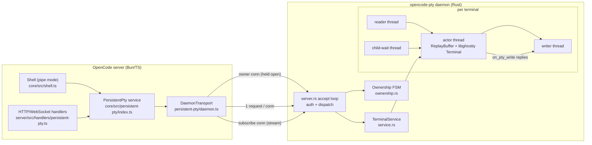

# PTY Process Daemon (opencode-pty)

> OpenCode @ 56625a3e1f · paths relative to opencode-reference/

## TL;DR

- `packages/process-daemon` is a standalone Rust crate and binary, `opencode-pty` v0.5.2 (MIT, edition 2024, Rust 1.90). It has about 12.4K lines in `src/` and 4.8K lines of integration tests. It has no TypeScript dependency. OpenCode spawns it as a child process and talks to it over a local socket.
- It owns two kinds of process. **PTYs** use `portable-pty`, and their output is parsed by **libghostty-vt**, which keeps the authoritative screen, answers terminal queries and produces a VT "checkpoint" for repainting. **Pipe processes** have no terminal: stdout and stderr go into one file, and OpenCode's shell tool uses this mode for local commands.
- Each terminal gets four OS threads (reader, actor/parser, writer, child-wait) and bounded crossbeam queues. Output goes into a 2 MiB raw replay ring addressed by absolute byte offsets. Truncation is reported explicitly, never hidden.
- Wire protocol v8: a 4-byte big-endian length, then either a JSON envelope `{token, request:{op,...}}` or a binary output frame (tag `0`, start u64, end u64, bytes). Frames are capped at 8 MiB. Auth is a 128-bit random token in a private registration file (`service.json`, mode 0600, or a current-user-only ACL on Windows).
- Lifetime is tied to one **owner connection**. If the owner drops, the daemon stops, unless the owner first ran `prepare_handoff`. That returns a ticket valid for 120 s, and a restarted server presents the ticket to adopt the live terminals. OpenCode passes the ticket to the next server through `OPENCODE_PTY_HANDOFF`.
- Windows is a full peer for the daemon and protocol: ConPTY through portable-pty, a named pipe with `PIPE_REJECT_REMOTE_CLIENTS` and a server-PID check, and Job Objects for pipe processes. The interactive Rust client/playground is Unix-only.
- **Genie verdict:** this is the most reusable piece of OpenCode for us. Vendor the crate, either as a library inside the engine or as a sidecar binary. The main costs are the Zig 0.16 build of libghostty and our own process-tree hardening.

## Where it lives

| path | role | ~lines |
|---|---|---|
| `packages/process-daemon/src/lib.rs` | module list; `ownership`/`transport` only on unix/windows | 11 |
| `src/main.rs` | `fn main` → `client::run_cli()` | 6 |
| `src/client.rs` | CLI (`daemon`, `play`, `status`, `list`, `watch`, `stop`) + Unix `TerminalClient` | 900 |
| `src/daemon.rs` | `Registration`, runtime dir resolution, platform module wiring | 132 |
| `src/daemon/server.rs` | accept loop, auth, dispatch, subscriptions, signal handling | 1286 |
| `src/daemon/control.rs` | shared `Control` (ownership state + wake) | 147 |
| `src/daemon/unix.rs` / `windows.rs` | runtime dir, lock, atomic registration, endpoint bind | 381 / 399 |
| `src/daemon/sweep.rs` | removes abandoned sibling runtime dirs (>10 min) | 221 |
| `src/service.rs` | `TerminalService`: PTY/pipe spawn, actor, replay, fan-out | 3203 |
| `src/service/pipe.rs` + `pipe/{unix,windows}.rs` | pipe-process spawn/kill/wait | 346 + 420 + 1131 |
| `src/service/windows.rs` | ConPTY child-wait + `ClosePseudoConsole` hand-off | 79 |
| `src/protocol.rs` | `Request`/`Response` enums, framing | 616 |
| `src/ownership.rs` | owner/handoff state machine (pure, unit-tested) | 286 |
| `src/transport/{mod,unix,windows,retained}.rs`, `transport/windows/security.rs` | byte-stream endpoints, overlapped I/O, ACLs | ~1550 |
| `src/ghostty/{mod,ffi,effects,tests}.rs` | safe wrapper over generated libghostty-vt C API | 1259 |
| `src/musl.rs` | `statx` shim for musl builds of Zig-compiled libghostty | 59 |
| `build.rs` | fetches pinned Ghostty, builds with Zig, links static archive | 151 |
| `tests/*.rs` | integration suites (see below) | ~4800 |
| `npm/` | `@opencode/pty` wrapper exposing `binaryPath` | small |
| `packages/core/src/persistent-pty/{daemon,index}.ts` | TS client and Effect service | 750 / 661 |
| `packages/core/src/shell.ts` | shell tool runs local commands as daemon pipe processes | — |

## Architecture

The daemon is one process. Its registry holds many terminals, and each terminal is isolated, so a blocked or slow terminal cannot stall the control path (engineering rules in `packages/process-daemon/AGENTS.md`). Data flow inside a terminal (SPEC.md): PTY output goes to the reader thread, then the bounded actor queue, then the replay append, then `vt_write`, then the collected parser replies, then the bounded writer queue, then the PTY. User input enters through the actor and the same writer queue, so terminal-generated replies and keystrokes are serialized together.

## Key types and interfaces

| name | file:line | purpose |
|---|---|---|
| `PROTOCOL_VERSION = 8`, `FEATURES = []`, `MAX_FRAME_BYTES = 8 MiB` | `src/protocol.rs:12-20` | breaking changes bump the version; additive ones extend `features` |
| `Envelope { token, request }` | `src/protocol.rs:31` | every frame from a client |
| `enum Request` (tag `op`) | `src/protocol.rs:38` | `ping, own, prepare_handoff, create_pty, create_pipe, list, get, wait, signal, set_metadata, write, resize, control, input, snapshot, read_rows, rename, replay, subscribe, terminate, shutdown` |
| `enum Response` (tag `type`) | `src/protocol.rs:139` | `owned, handoff, pong, created, process(es), ok, snapshot, rows, replay, attached, resized, exited, controller_changed, title_changed, foreground_process_changed, error` |
| `read_envelope` | `src/protocol.rs:243` | parses the token first; an unknown op becomes `Error{"unsupported request: <op>"}` so clients can probe for features |
| `write_output_frame` | `src/protocol.rs:281` | binary frame: tag 0, start, end, bytes (17-byte header) |
| `Registration` | `src/daemon.rs:10` | `instance_id, pid, protocol, socket, token, features` |
| `runtime_dir` / `default_runtime_root` | `src/daemon.rs:40` / `:23` | `${XDG_STATE_HOME:-~/.local/state}/opencode/pty/<name>`; the name is restricted to `[A-Za-z0-9._-]` |
| `Ownership` + `enum State {Starting, Owned(Option<Handoff>), Waiting, Stopped}` | `src/ownership.rs:24-35` | owner/handoff FSM; `ACQUIRE_TIMEOUT = 5 s`, `HANDOFF_TIMEOUT = 120 s` (`:5-6`) |
| `TerminalService` | `src/service.rs:285` | thread-safe API used by the daemon and directly by tests |
| constants | `src/service.rs:24-33` | default 100×30, `REPLAY_CAPACITY` 2 MiB, actor/writer queues 128, subscriber queue 1024, output batch 8 KiB / 1 ms, max input 1 MiB, max rows 1 MiB |
| `ReplayBuffer` | `src/service.rs:1969` | `VecDeque<u8>` ring with absolute `head`/`tail` u64 offsets |
| `ghostty::Terminal` | `src/ghostty/mod.rs:31` | `!Send` (via `PhantomData<Rc<()>>`) wrapper; `vt_write`, `resize`, `format(Plain/Vt)`, `format_row` |
| `TerminalClient` | `src/client.rs:25` | Rust client (Unix only; `start` bails on other platforms, `:128`) |
| `DaemonTransport` (TS) | `packages/core/src/persistent-pty/daemon.ts:188` | `request`, `requestIfRunning`, `wait`, `shutdown`, `handoff`, `subscribe` |
| `PersistentPty.Handoff` (TS schema) | `packages/schema/src/persistent-pty.ts` | `{directory, instanceID, ticket, expiresAt}` |

## How it works: walkthroughs

### 1. Daemon startup and claim

1. The TS side picks a fresh UUID runtime name per server (`persistent-pty/index.ts:207-215`; regenerated on retry at `daemon.ts:340`) and runs `opencode-pty daemon --runtime-dir <root> --name <id>` detached, with `windowsHide` and `stdio: "ignore"` (`daemon.ts:275`).
2. `daemon::server::run` (`src/daemon/server.rs:21`) first blocks SIGTERM/SIGINT on every thread so that a dedicated signal thread turns them into an orderly stop. It then binds via `platform::Runtime::bind` and creates `Ownership::new` *after* the bind, so slow bind I/O does not eat into the 5 s acquire window (`server.rs:28-30`).
3. On Unix, bind sets the runtime dir to 0700 and the socket to 0600. It writes the registration through a temp file and `rename` (`src/daemon/unix.rs:28,43,220-234`). The socket path is a SHA-256 of the canonical runtime dir, placed under `/tmp/opencode-pty-<uid>/` to stay inside `sun_path` limits (`unix.rs:195`). `OPENCODE_PTY_SOCKET_DIR` overrides the parent directory (`unix.rs:169-185`).
4. The TS side polls `discover()` every 50 ms for up to 5 s. It reads `service.json`, sends `ping`, and checks that `instance_id`, `pid` and `protocol` all match (`daemon.ts:255-266`, `:290-312`). Then it opens the owner connection with `{op:"own", instance_id, ticket?}` (`daemon.ts:487-512`). If the attempt fails for any reason other than spawn or protocol, it retries once in a fresh directory (`daemon.ts:323-335`).
5. `handle_connection` compares the token and then calls `ownership.claim` (`server.rs:310-345`). `owner_connection` then loops on the same socket, answering `prepare_handoff`/`shutdown` and fencing superseded owners with `"owner connection has been superseded"` (`server.rs:393-415`).

### 2. PTY creation and output draining

1. `TerminalHandle::spawn_pty` (`src/service.rs:711`) calls `native_pty_system().openpty`, builds a `CommandBuilder` from `program/args/cwd/env`, and **forces** `TERM=xterm-256color`, `COLORTERM=truecolor` (`service.rs:733-734`). It spawns on the slave, clones the reader, takes the writer and drops the slave.
2. `start_actor` (`service.rs:651`) spawns `opencode-pty-actor-{id}` and waits on an init channel. libghostty `Terminal::new` runs *on the actor thread*, with `max_scrollback = replay_capacity` (`service.rs:1175-1180`).
3. The reader thread uses an 8 KiB buffer and sends `ActorMessage::output`. `EIO` on Unix counts as EOF. On Windows the reader keeps draining even after the actor stops, because `ClosePseudoConsole` can block until its output pipe drains (`service.rs:804-843`).
4. The actor coalesces consecutive `Output` messages until it has 8 KiB or 1 ms has passed. A non-output message stops coalescing early and is kept as `pending` (`service.rs:1679-1697`).
5. On each output batch the actor does, in order: `replay.append`, then `terminal.vt_write`, then `forward_replies` (libghostty's `on_pty_write` responses go to the writer queue), then `update_offsets`, then `broadcast(Output{start,end,bytes})`, then a title check (`service.rs:1221-1258`).
6. `broadcast` (`service.rs:2020`) delivers to the **controller** with a blocking `select_biased!`, which gives backpressure, and to **observers** with `try_send`. A full observer is dropped. If the controller is dropped, the newest remaining subscriber is promoted and gets `ControllerChanged` (`service.rs:2041-2075`).

### 3. Subscribe / replay-to-live / reattach

1. A client sends `subscribe{id, offset, attachment_id, role, takeover}`. `stream_subscription` (`server.rs:456`) calls `service.attach`. The replay and the switch to live events happen inside one actor command, so no bytes are lost or duplicated.
2. The first frame is `Attached{process, role, generation, requested_offset, available_offset, end_offset, truncated, replay_base64}`. After that come binary output frames and JSON events (`resized` with a checkpoint, `title_changed`, `controller_changed`, `exited`).
3. `ReplayBuffer::read_from` (`service.rs:2001`) returns `truncated = requested_offset < head`. A client that fell behind the 2 MiB window then repaints from a **snapshot checkpoint** (`format_terminal(…, Format::Vt)`), not from partial bytes. In the TUI, `component/terminal-pane.tsx:120` writes `ESC c` followed by the checkpoint.

### 4. Ownership handoff across a server restart

1. The client service calls the `persistentPty.handoff` HTTP endpoint (`server/src/handlers/persistent-pty.ts:95-99`). That sends `prepare_handoff` on the owner socket (`core/src/persistent-pty/daemon.ts:420-440`).
2. `Ownership::prepare` (`src/ownership.rs:81`) returns the existing ticket if one is already prepared, so a ticket is never renewed. Otherwise it mints a `{:032x}` random u128 ticket that expires in 120 s.
3. The supervisor writes `{source, handoff, expiresAt}` to a `<file>.pty-handoff` sidecar by atomic rename (`packages/client/src/pty-handoff.ts:17-66`) and passes `OPENCODE_PTY_HANDOFF=<json>` to the replacement process (`pty-handoff.ts:78`). If it cannot prepare a handoff, it shuts the terminals down before replacing the server (`pty-handoff.ts:36-38`).
4. The new server reads and deletes the env var (`packages/cli/src/server-process.ts:49-50`), reuses the old runtime directory, and sends `own{instance_id, ticket}`.
5. `claim` accepts a valid ticket even while the old owner is still connected (`ownership.rs:62-75`). `disconnect` of a stale generation is a no-op, and if the owner disconnects while a handoff is pending the state moves to `Waiting` (`ownership.rs:122-133`). Expiry stops an *unowned* daemon but only cancels the handoff for a connected one (`ownership.rs:50-60`).

### 5. Shell tool commands as pipe processes (incl. Windows)

1. `Shell` decides per Location: `runs = location.workspaceID === undefined && PersistentPty.available ? daemon.at(location) : undefined` (`core/src/shell.ts:621-622`). Local commands on every platform therefore go to the daemon when it is available, and remote workspaces keep the in-server spawner.
2. `create` calls `pty.createPipe({program: shell, args, cwd, env, groupID: project.id, outputPath, metadata})` (`shell.ts:463-471`). The daemon replaces the environment entirely, so the TS side filters out undefined vars (`shell.ts:935-938`).
3. Errors are split carefully. `UnavailableError` means the daemon never ran the command, so the code logs it and falls back to a local spawn. `RequestError` means the command *may* have run, so it fails and never runs it again (`shell.ts:947-957`).
4. In the daemon, pipe children get exactly `env`, stdin `/dev/null` or `NUL`, and stdout and stderr on one pipe written straight to `output_path`. There is no replay buffer, and the `\n` count is updated under the same lock as `output_tail` (SPEC.md "Pipe Processes"). On Windows the child runs with `CREATE_NO_WINDOW` inside a `JOB_OBJECT_LIMIT_KILL_ON_JOB_CLOSE` job, and **every signal is a hard `TerminateJobObject`** (`src/service/pipe/windows.rs:40-49,200-204`).
5. After a restart, `recover()` lists pipe processes and re-adopts those whose stored metadata matches the Location (`shell.ts:485-490`). An hourly cleanup terminates finished processes whose output file has expired (`shell.ts:185-237`).

## Configuration and extension points

| knob | where | effect |
|---|---|---|
| `--name NAME` (required), `--runtime-dir DIR` | `client.rs:490` | runtime dir `DIR/NAME` |
| `XDG_STATE_HOME` | `daemon.rs:25` | default root `…/opencode/pty`; temp dir only if there is no home (macOS purges `/tmp` files) |
| `OPENCODE_PTY_SOCKET_DIR` | `daemon/unix.rs:169` | Unix socket parent; must be absolute with no `..` |
| `OPENCODE_PTY_BIN` | `core/src/persistent-pty/binary.bun.ts:9` | override the daemon binary; otherwise the embedded asset is checksum-verified and installed into a private versioned directory |
| `OPENCODE_PTY_HANDOFF` | `cli/src/server-process.ts:49` | JSON handoff for the replacement server |
| `GHOSTTY_SOURCE_DIR`, `OPENCODE_ZIG_CPU` | `build.rs:9-10` | reuse a Ghostty checkout (C headers verified); pin the Zig CPU (`baseline` for releases) |
| `ghostty-revision` | crate root | pins `ab0b9da9…`; `build.rs:12-19` asserts that `ffi.rs` was generated from the same revision |
| `features` in `Pong`/registration | `protocol.rs:15` | additive capability negotiation |

## Edge cases, invariants and gotchas

- **Invariants** (SPEC.md): one reader and one writer per PTY; libghostty is created, used and dropped on one thread; callbacks never block or do IPC; queues are bounded by bytes, not only by count; child exit and PTY EOF are separate signals; PID is metadata, not identity; resize applies to the PTY and the parser in one actor command and publishes a checkpoint before any later output.
- **Exit ordering on Windows:** when the root exits, the master is handed to the wait thread (`service/windows.rs:19`), and the final `Exited` is published only at the real output-pipe EOF. After that, input and resize fail, but snapshot, rows and replay remain readable.
- **Exit code 259:** Windows waits on the process handle rather than `GetExitCodeProcess`, because a real exit code 259 would otherwise read as `STILL_ACTIVE` (`service/windows.rs:27-34`).
- **Named-pipe squatting:** after a crash, the stale registration's pipe name can be claimed by another local user. Clients must call `GetNamedPipeServerProcessId` and compare it with the registered PID *before* sending the token (`transport/windows.rs:261`). *(Inferred: the TS client relies on Node `net` and does not appear to make this check. Verify before copying that pattern.)*
- **Token compare** is a plain `!=` (`server.rs:317`, `:411`), not a constant-time comparison. This is acceptable for a 0600 local socket, but use a constant-time comparison in Genie.
- **Known Linux leak:** a child that exits while a large PTY write is still queued can leave the writer thread blocked forever, so `terminate` may hang (README "Known Linux cleanup limitation").
- **Process trees:** PTY children are killed only through portable-pty's root killer. Grand-children can survive (README "Current Limits"). Pipe processes get a process group (Unix) or a Job (Windows). If an outer job forbids nesting, the daemon logs a warning and kills only the root.
- **A pipe descendant that keeps the pipe open** (`cmd &`) delays the exit by at most 1 s. After that the reader closes the pipe and later writers get EPIPE.
- **Unknown ops** return an error frame instead of dropping the connection, which makes `features` probing safe.
- **A daemon crash loses every terminal by design.** There is no state persistence.
- On musl builds, `src/musl.rs` supplies a `statx` symbol, because Zig 0.16 assumes musl 1.2.5.

## Tests worth reading

- `tests/ownership.rs` (12, Unix): owner loss, handoff preservation, a superseded owner being fenced, the final exit frame arriving before close.
- `tests/service.rs` (12, Unix): resize reports reach a silent child, control resize precedes input, bounded replay for hidden terminals.
- `tests/runtime.rs` (12, cross-platform): real self-spawned console children, Unicode, cwd/env/argv, console resize, query replies through ConPTY.
- `tests/pipe.rs` (23) / `tests/pipe_windows.rs` (17): environment exactness, output-file truncation, signal reporting, descendants holding the pipe.
- `tests/windows-daemon.rs` (7): named-pipe auth/handoff, stale registration, cancellation of partial requests.
- `tests/ghostty-effects.rs` + `tests/transport-retained.rs`: callback/`OVERLAPPED` ownership, run under Miri (Stacked and Tree Borrows).
- `src/ownership.rs` unit tests (`:140-280`): the FSM as a table. `tests/support/terminal_fixture.rs` is a reusable child fixture.

## Genie takeaways

Pick-list #7 (`../../research/opencode-pick-list.md`) rates this **REUSE**, and the code supports that. Relevant tickets: `../../tickets/07-bash-execution.md`, `../../tickets/09-sandboxing.md`, `../../tickets/05-cli-terminal-ui.md`.

- **Port as-is (vendor the crate):** `service.rs` with the actor, replay ring and controller/observer fan-out; `protocol.rs`; `ownership.rs`; and the Windows transport and security modules. The code is MIT. Keep the `LICENSE` (James Long, 2026) and `src/ghostty/LICENSE` (Ghostty contributors, MIT) files. The direct crates are permissive. Checked locally: anyhow, base64, crossbeam-channel, rand, sha2 and windows-sys are `MIT OR Apache-2.0`. From the crates' published metadata, not checked here *(inferred)*: portable-pty and nix are MIT; serde, serde_json, libc, fs2 and shell-words are MIT/Apache-2.0. Run `cargo deny` on vendoring.
- **Library mode first:** Genie's engine is Rust, so we can embed `TerminalService` directly. It is already a thread-safe API, and `tests/runtime.rs` drives it with no daemon. Keep the daemon and protocol only for (a) surviving engine restarts (the handoff design) and (b) sharing terminals with the future Tauri desktop app.
- **Bash tool (ticket 07):** use the **pipe mode**, not a PTY, for agent commands. The combined output file plus the newline count gives cheap paginated reads, and a restart loses nothing. Copy OpenCode's error split: "unavailable, so run locally" versus "may have run, so never retry". On Windows, PowerShell runs as `program=pwsh.exe`/`powershell.exe` with explicit args. The daemon does no shell resolution and searches for the executable relative to the *daemon*, not the request's `cwd` (SPEC.md).
- **Sandboxing (ticket 09):** the daemon has no sandbox hooks. Children get exactly `env` and `cwd`, nothing more. Genie must wrap `program/args` (Seatbelt/bwrap/AppContainer launcher) before `create_pipe`, or add a spawn hook. Windows Job Objects are already there for kill-tree.
- **Adapt:** (1) add constant-time token compare; (2) finish process-tree kill for PTYs (process group on Unix, Job on Windows); (3) fix the Linux blocked-writer leak (a non-blocking master or a writer timeout); (4) port the Windows `TerminalClient` if Genie's CLI talks to the daemon directly.
- **Build cost:** libghostty-vt needs **Zig 0.16** and Git at build time, plus a fetch from GitHub. That affects CI images and offline builds. If the CLI only needs pipe mode at first, put the PTY+ghostty path behind a Cargo feature *(Genie decision, not in upstream)*. The `links = "ghostty-vt"` key prevents a second libghostty from being linked.
- **Desktop terminal (later):** the snapshot checkpoint plus replay offsets is the right reattach model for a Tauri xterm.js pane. Repaint from the checkpoint when `truncated`, then stream binary frames.
- **Avoid:** the stale README claim that "OpenTUI client integration is not implemented". The TUI now has a terminal pane (`tui/src/component/terminal-pane.tsx`). Trust the code over the docs.

## Open questions / inferred

- Whether the TS named-pipe client checks the server PID (*inferred*: not seen in `daemon.ts`).
- Licences of portable-pty, nix, serde, libc, fs2 and shell-words are from crate metadata knowledge and were not checked in this clone *(inferred)*. Transitive crates (`serial2`, `winreg`, `shared_library`, `filedescriptor`) come in through portable-pty and need a `cargo deny` pass.
- The Windows daemon loop polls every 25 ms, while Unix uses `poll(2)` plus a wake pipe and a 2 s safety net (README). The idle CPU cost on Windows was not measured.
- Code signing of released binaries is "added later" (README). Genie would sign its own build anyway.
