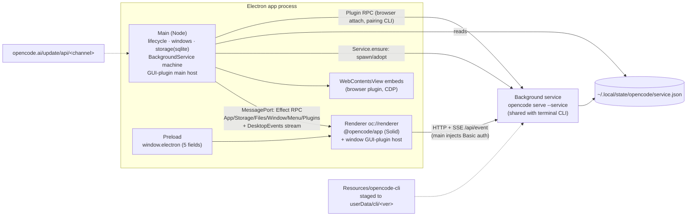

# Desktop shell (Electron)

> OpenCode @ 56625a3e1f · paths relative to opencode-reference/

## TL;DR

- `packages/desktop` is a **thin Electron 44 shell** (`packages/desktop/package.json:50`, ~13K lines of main-process code). It does not run the agent. It finds or starts the shared **background service** (the CLI's `opencode serve --service`) and points a SolidJS renderer (`@opencode/app`) at it over HTTP + SSE.
- The CLI ships **inside the app but outside `app.asar`** as `Resources/opencode-cli[.exe]` with a sidecar version file (`electron-builder.config.ts:104-110`). On first use it is copied into a per-version "stage" under `userData/cli/<stage>/` (`src/main/service/desktop-cli.ts:144-169`), so updates and antivirus locks never touch a running binary.
- Service discovery is file-based. `Service.ensure` (`packages/client/src/promise/service.ts:28`) reads `~/.local/state/opencode/service.json`, probes `/api/info`, and then reuses, waits on, replaces or spawns the service. The CLI and the desktop therefore **share one service**, and the desktop adopts one the CLI already started.
- **The renderer never sees the service password.** Main injects `Authorization: Basic` into the renderer's top-frame requests to `127.0.0.1` with `session.webRequest.onBeforeSendHeaders` (`src/main/windows/security.ts:100-114`) and rewrites CORS headers (`src/main/windows/headers.ts:11-24`). This is the hardest seam to port to Tauri.
- Renderer↔main IPC is an **Effect `RpcServer` over a `MessageChannelMain` port** posted to each window (`src/main/ipc.ts:71-76`). There are 7 typed RPC groups (`src/shared/ipc-rpc.ts:24`) plus one event stream that carries 14 event types (`src/shared/ipc-rpc/events.ts:79-94`). The preload exposes only five fields (`src/preload/index.ts:26-32`).
- Most "desktop features" are **GUI plugins**: updater, SSH, WSL, pairing, browser, debug. They have main-process entries that run *inside Electron main* with real `electron` and Node modules (`src/main/plugin/module.ts:43`). The updater is `electron-updater` against `https://opencode.ai/update/api/<channel>/desktop/opencode/` (`electron-builder.config.ts:224,243,267`).
- Packaging: dmg+zip (mac), one-click per-user NSIS (win), AppImage/deb/rpm (linux). Builds are **unsigned in CI build jobs**. A separate release job signs inside-out with hardened runtime, notarizes with `notarytool`, staples, and signs Windows with Azure Trusted Signing (`.github/workflows/release.yml:416-513`).
- The codebase is strongly machine-driven. Every lifecycle (connection, quit, deep links, window recovery, updater) is a pure `transition(state, event)` with a thin driver (`packages/app/AGENTS.md:29-39`). This pattern is worth porting to Genie's Rust/Tauri side.

## Where it lives

| path | role | ~lines |
|---|---|---|
| `packages/desktop/src/main/index.ts` | Entry: configure, lock, scheme, early window, sidecar probe, lazy-import `desktop.ts` | 38 |
| `packages/desktop/src/main/desktop.ts` | Effect layer graph: IPC, BackgroundService, DesktopCli, lifecycle, plugins | 52 |
| `src/main/lifecycle/*` | configure (userData, switches), quit/relaunch machine, onboarding, shutdown | 800 |
| `src/main/service/*` | Background-service machine, CLI resolve/stage/install, credentials, probe | 1,000 |
| `src/main/windows/*` | BrowserWindow creation, early window, `oc://` scheme, security/headers, state, crash recovery | 2,700 |
| `src/main/ipc*.ts`, `src/main/ipc-handlers/*` | RPC server over MessagePort, handler layers | 900 |
| `src/main/plugin/*` | Main-process GUI-plugin host, `WebContentsView` embeds, bundle evaluator | 3,100 |
| `src/main/storage/*` | `node:sqlite` + drizzle (`drafts.sqlite`), write-behind, window snapshots | 1,400 |
| `src/main/native/*` | Menu, logging/crash dumps, spellcheck, install-CLI, native translations | 1,700 |
| `src/main/deep-links/*` | `opencode://` delivery machine | 250 |
| `src/preload/*`, `src/shared/*` | `window.electron` bridge, RPC schemas | 750 |
| `src/renderer/*` | Desktop `Platform` adapter, startup machine, splash, onboarding around `@opencode/app` | 4,000 |
| `electron-builder.config.ts`, `script/*`, `resources/windows/installer.nsh` | Packaging | 1,600 |
| `perf/startup.bench.ts` | Cold-start benchmark with `@hona/strobe` | 223 |
| `packages/gui-plugins/src/{updater,ssh,wsl,pairing,browser,debug}/main.ts` | Main entries of built-in plugins | ~10K incl. machines |
| `.github/release/sign-desktop-macos.sh`, `entitlements/` | Signing/notarization | 100 |

## Architecture

Startup is split in two on purpose. The entry module shows a window before the rest of the main bundle evaluates (`src/main/index.ts:11-37`). It then loads `desktop.ts`, which builds the Effect layers (`src/main/desktop.ts:43-52`).

## Key types and interfaces

| name | file:line | purpose |
|---|---|---|
| `BackgroundServiceMachine.State` | `src/main/service/background-service-machine.ts:21-43` | `connecting / ready / reconnecting / failed / disposed`, with attempt ids and waiter lists shared by all windows |
| `BackgroundService.Interface` | `src/main/service/background-service.ts:19-22` | `connection` / `reconnect` effects that return `{url,password}` |
| `DesktopCli.Resolved` | `src/main/service/desktop-cli.ts:20-24` | `{version, command, binary?}` of the CLI to spawn |
| `SidecarCredentials` | `src/main/service/sidecar-credentials.ts:5-42` | Main-only credential holder; `ready()` strips the password before replying to the renderer |
| `DesktopRpcs` | `src/shared/ipc-rpc.ts:24` | Merge of App, Storage, Files, Window, Menu, Event and Plugin RPC groups |
| `DesktopEvent` | `src/shared/ipc-rpc/events.ts:79-94` | Union pushed to windows (SidecarChanged, DeepLinksOpened, Storage/Plugin/Window events) |
| `ElectronNative` | `src/preload/types.ts:4-10` | Preload surface: `windowID`, `bootstrap`, `storageSnapshot`, `plugins`, `getPathForFile` |
| `WindowBootstrap` | `src/shared/window-bootstrap.ts:3-8` | Passed through `--opencode-window=` argv so the shell mounts before the port exists |
| `ElectronAPI` | `src/renderer/api-types.ts:17-82` | ~65 renderer-side methods wrapping RPCs (the Tauri porting checklist) |
| `Platform` | `packages/app/src/runtime/platform/platform.tsx:36-152` | The app's host abstraction (`web` vs `desktop`); desktop fills it in `src/renderer/platform/index.ts:17` |
| `ApplicationLifecycle.Interface` | `src/main/lifecycle/index.ts:24-36` | relaunch, `restart(keep, handoff)` (used by the updater), window creation |
| `Updater` Ipc | `packages/plugin/src/gui/updater.ts:16-44` | App-wide state `disabled/idle/checking/downloading/ready/download-required/up-to-date/installing/error` |
| `Pairing` Ipc | `packages/gui-plugins/src/pairing/contract.ts:9-24` | remote access on/off (through the CLI) and the display-sleep blocker |

## How it works: walkthroughs

### 1. Cold start to first paint

1. `configureApplication()` runs synchronously before `ready`. It does `chdir(home)`, sets `OPENCODE_DISABLE_EMBEDDED_WEB_UI=true`, adds the `proxy-bypass-list <-loopback>` switch and sets `userData = appData/<APP_ID>` (`src/main/lifecycle/configure.ts:23,27,47`). It also enables Node's compile cache (`:56`).
2. A single-instance lock is taken (`configure.ts:60`). The `oc` scheme is registered as privileged with `codeCache` (`src/main/windows/scheme.ts:35-50`).
3. On `ready`, it creates the early window (`index.ts:24`) with `contextIsolation`, `sandbox: true` and no Node (`src/main/windows/early.ts:102-110`), then starts the sidecar probe (`index.ts:26`). The probe calls `Service.discover({version})` against the bundled CLI version, but only in packaged builds (`src/main/service/sidecar-probe.ts:14-20`).
4. It waits for the renderer's asset burst to be served (quiet 40 ms, cap 400 ms), then `import("./desktop")` (`index.ts:30-36`). That builds the layers, registers IPC, then starts the main GUI plugins (`desktop.ts:22-26`). The crash reporter starts 500 ms later (`desktop.ts:31-33`).
5. Timing marks (`entry, ready, window, served, bundle, …`) are epoch stamps in `src/main/lifecycle/marks.ts:5-7`. `perf/startup.bench.ts:15-31` scrapes them from `main.log` to split cold-start time.

### 2. Background service connection (`Service.ensure`)

1. `BackgroundServiceMachine.make` dispatches the initial `connect` at once (`background-service-machine.ts:256-345`). With a probed service it goes `ready` immediately, publishes, then **verifies** with `ensure("initial")` (`:135-143`). If the verify returns a different endpoint, it re-publishes (`:213-217`).
2. `prepare` resolves the CLI and the version requirement (`background-service.ts:100-121`). `beta` accepts any version (`src/main/service/cli-version.ts:18`).
3. `Service.ensure` runs `[cli, "serve", "--service"]` (`background-service.ts:61-75`). Its loop (`packages/client/src/promise/service.ts:50-80`) reads the registration file and probes `/api/info` (`packages/client/src/service-probe.ts:49-55`). It then decides `reuse / wait / replace / fail` (`service-probe.ts:22-32`). An owner that times out three times is terminated, and its PTY handoff is cleared (`service.ts:55-68`).
4. If the version is incompatible, it retries with the bundled CLI version (`background-service.ts:77-83`). Old stages are cleaned only after `ensure` settles (`:87-95`, `cli-stages.ts:6-30`).
5. `adopt` requires Basic auth, rewrites `0.0.0.0` to `127.0.0.1` and returns `{url: origin, password}` (`background-service.ts:123-154`). `publish` stores the credentials and broadcasts `SidecarChanged` to **every** window (`:35-40`).
6. The renderer calls `AppAwaitInitialization`. It gets `{url}` only (`src/main/ipc-handlers/app.ts:26`, `sidecar-credentials.ts:31-33`). `AppReconnectService` joins or starts a shared reconnect attempt. Windows that only asked for the connection still get the old service if the reconnect fails (`background-service-machine.ts:190-195`).

### 3. Renderer IPC handshake

1. On every `did-finish-load`, main creates a `MessageChannelMain`, binds `port1` to the RPC server and posts `port2` on channel `desktop-rpc-port` (`src/main/ipc.ts:71-85`).
2. The preload forwards that port to the page with `window.postMessage` (`src/preload/index.ts:11-15`). The page-side client speaks Effect's RPC wire format (`src/renderer/ipc-client.ts:16,50`).
3. Before the page runs, the preload also invokes `desktop-window-snapshot` (`preload/index.ts:22-24`). This pre-hydrates three storage namespaces (`src/shared/ipc-transport.ts:36-42`), so the first render does not flash.
4. Payloads cross by structured clone, and `undefined` keys are stripped to match the JSON codec (`ipc-transport.ts:9-22`, `src/main/ipc-transport.ts:40-42`).

### 4. Update check and install (updater GUI plugin)

1. The main entry loads `electron-updater` only when packaged (`packages/gui-plugins/src/updater/main.ts:13,27-29`). It checks at start and then every 10 minutes (`updater/machine.ts:207-210`).
2. Config: channel `latest`, `autoDownload=false`, `allowDowngrade=true`, `autoInstallOnAppQuit` on macOS only, and a UA `opencode/<channel>/<ver>/desktop` (`updater/platform.ts:17-30`). On Windows under ARM64 emulation it filters to the arm64 installer (`:48-55`).
3. Staging: on Windows the NSIS download is pre-unpacked with `installer.exe --stage` (`platform.ts:108-124`). On macOS it waits for `update-downloaded` (`:81-102`).
4. Install goes through `lifecycle.restart(keep=updater, handoff)`. Every other plugin stops, and the updater stays alive so a failed `quitAndInstall` (10 s timeout) can recover (`updater/main.ts:41-45`, `platform.ts:126-160`).
5. "Check for Updates…" is a `MenubarItem` (`updater/main.ts:110-125`). Beta reports in-app, the other channels use native dialogs.

### 5. Deep links

1. `opencode://` is registered in `protocols` (`electron-builder.config.ts:175-178`). URLs arrive via `second-instance` argv (Win/Linux) or `open-url` (mac) (`src/main/lifecycle/index.ts:105-120`).
2. `transitionDeepLinks` queues each link and targets a window. A `opencode://console/authorized?window=<id>` return targets the window that started the login (`src/main/lifecycle/deep-link.ts:1-14`). Otherwise the link goes to the preferred window (`src/main/deep-links/machine.ts:51-58`).
3. Delivery is acknowledged per attempt. An unacknowledged link is redelivered if the renderer disconnects (`deep-links/index.ts:25-33`). The renderer re-emits links as a `opencode:deep-link` DOM event (`src/renderer/startup/deep-links.ts:7-20`).

### 6. Pairing / remote access

The pairing plugin's main entry runs `<cli> service …` to turn remote access (an HTTPS tunnel) on or off. It also holds `powerSaveBlocker("prevent-display-sleep")` (`packages/gui-plugins/src/pairing/main.ts:52-95`). The remote origin is the server's HTTPS URL (`pairing/remote.ts:5-7`). The paired device runs the web build of the same app with `?auth_token=` (`packages/app/src/entry.tsx:82`).

## Configuration and extension points

| key | where | effect |
|---|---|---|
| `OPENCODE_CHANNEL` (`local/dev/beta/prod`, `latest`→prod) | `src/main/constants.ts:5-7`, `electron-builder.config.ts:33-41` | App name/ID, update feed, icons |
| `OPENCODE_VERSION` | `constants.ts:9`, `electron-builder.config.ts:78-80` | Version stamping |
| `OPENCODE_DESKTOP_CLI_DEV=<dir>` | `desktop-cli.ts:59-76` | Run the CLI from source with `bun run` |
| `OPENCODE_DESKTOP_ISOLATED_SERVER=1` | `background-service.ts:104-108` | Dev: private service on port `0x0c0c` with its own `XDG_STATE_HOME` |
| `OPENCODE_DESKTOP_SERVER_CHANNEL=local` | `background-service.ts:111-118` | Use `service-local.json` |
| `ELECTRON_RENDERER_URL` | `scheme.ts:7-17` | Vite dev server instead of `oc://renderer` |
| `OPENCODE_DESKTOP_REMOTE_DEBUGGING_PORT`, `OPENCODE_DESKTOP_MEMORY_LOG`, `OPENCODE_DESKTOP_TEST_ROOT`, `OPENCODE_TEST_ONBOARDING` | `configure.ts` | Diagnostics/tests |
| `VITE_SENTRY_DSN/ENVIRONMENT/RELEASE` | `src/renderer/startup/sentry.ts:7-28` | Renderer Sentry (no Breadcrumbs; prod also drops global handlers) |
| `APPLE_NOTARY_KEY(_ID)`, `APPLE_NOTARY_ISSUER_ID`, `AZURE_TRUSTED_SIGNING_*` | `release.yml:457-513` | Signing |
| Plugin `./gui-experimental` export | `src/main/plugin/host.ts:568-629` | Third-party GUI plugin bundles listed from the app's own server |

Persistence: `drafts.sqlite` through `node:sqlite` + drizzle, with WAL and `synchronous=NORMAL` (`src/main/storage/database.ts:8-17`). The tables are `document`, `blob`, `state` and `plugin` (`storage/schema.ts:4-35`). Package rules say to prefer SQLite over ad-hoc files, because of EPERM problems on Windows (`packages/desktop/AGENTS.md:22`).

## Edge cases, invariants and gotchas

- **Credential scoping:** only the renderer's *own top-level frame* on the `oc://renderer` origin gets the Authorization header. Embedded pages and service workers do not (`security.ts:94-99`). Permissions are limited to `clipboard-sanitized-write`, `notifications` and audio-only `media` (`security.ts:6,37-48`).
- **Navigation:** any non-renderer URL opens externally, and in-window navigation is denied (`security.ts:74-86`).
- **CORS preflight caching:** the server's own `Access-Control-Allow-Headers` is kept, because Chromium reuses a cached preflight only when `authorization` is named explicitly (`headers.ts:5-17`).
- **Quit ordering:** quitting from a microtask in `before-quit` gets overwritten, so exit uses `setImmediate` (`lifecycle/index.ts:69-81`). Shutdown and resume each have 10 s timeouts (`:50-68`).
- **Windows specifics:** taskbar pins and per-channel install directories (`resources/windows/installer.nsh:1-54`). Executables cannot be deleted while running, so stage cleanup retries on the next launch (`cli-stages.ts:3-5`). x64 and ARM64 installs share `userData` (`desktop-cli.ts:147`).
- **The first `--version` can take seconds** while antivirus or Gatekeeper scans a 200 MB binary. The build writes `opencode-cli.version` so a packaged app never has to spawn for it (`desktop-cli.ts:97-119`).
- **Main-process plugin code is fully trusted.** Bundles are run with `new Function` (`packages/plugin/src/gui/host.ts:248-251`) and get the real `electron` and Node built-ins (`src/main/plugin/module.ts:43`). The trust boundary is "whatever the server already loads" (`host.ts:241`).
- **Linux AppImage quirk:** an executable ending in `.desktop` breaks libappimage, so it is renamed (`electron-builder.config.ts:49-60`).
- The release script notes that `.app.tar.gz` was only read by the **retired Tauri updater feed** (`.github/release/sign-desktop-macos.sh:5`). OpenCode used to ship on Tauri and moved to Electron. *(inferred: the reasons are not documented here)*

## Tests worth reading

- `packages/desktop/src/main/service/background-service-machine.test.ts`: shared connect, reconnect, joiner semantics.
- `packages/desktop/src/main/ipc-transport.test.ts`, `src/main/ipc-machine.test.ts`: port binding and reload handoff.
- `packages/desktop/src/main/windows/security.test.ts`, `headers.test.ts`: credential and CORS invariants.
- `packages/desktop/src/main/deep-links/machine.test.ts`, `src/main/lifecycle/machine.test.ts`, `windows/recovery-machine.test.ts`.
- `packages/desktop/electron-builder.config.test.ts` (asserts no `notarize` or `signtoolOptions` at build time, `:118-121`), `script/windows-installer.test.ts`.
- `packages/gui-plugins/src/updater/machine.test.ts`, `packages/client/src/service*.ts` (ensure/probe).

## Genie takeaways

Genie's desktop is Tauri on macOS and Windows, embeds the Rust engine (one instance per session), and has Chat and Code modes. That puts OpenCode's *process topology* mostly in the **avoid** column. Its *contracts and machines* are very portable. Pick-list #41 (Electron shell) stays **SKIP**. Read this chapter for the seams. Context: WAYFINDER far fog (`../../WAYFINDER.md`), ticket 01 (`../../tickets/01-engine-architecture.md`), ticket 27 (`../../tickets/27-distribution.md`).

**Port (design):**
- The **pure-machine-plus-driver** pattern for every lifecycle (connection, quit/relaunch, deep links, updater, window recovery). It maps directly onto Rust enums with a `fn transition(State, Event) -> (State, Vec<Command>)`.
- **Credential never reaches the webview** (`sidecar-credentials.ts:30-33`). Genie has no HTTP sidecar, but the same rule applies to provider keys. Engine calls go through Tauri commands, and the webview gets opaque handles.
- **Early window + deferred heavy init + startup marks + scripted benchmark** (`index.ts`, `marks.ts`, `perf/startup.bench.ts`).
- **Stage the bundled CLI per version** outside the signed bundle if Genie Desktop also ships the `genie` CLI for terminal use (ticket 27). Also the macOS "Install CLI" action (`desktop-cli.ts:43-52`).
- **Release flow:** build unsigned, sign inside-out with hardened runtime and separate entitlements for the JIT CLI, one `notarytool` submission, staple, then build dmg/zip from the stapled app. On Windows, use Azure Trusted Signing. The ARM64-under-emulation updater fix is also worth taking. All of this belongs to ticket 27.

**Adapt:**
- **Service sharing.** OpenCode's desktop and CLI share one daemon via `service.json`. Genie embeds the engine in-process instead (ticket 01). If Genie later wants the terminal CLI and the desktop to see the same live sessions, copy the *registration file + health probe + version-decide* contract (`service-probe.ts:22-32`), not the Electron code.
- **Updater:** Genie should use `tauri-plugin-updater` with its own feed and channels (dev/beta/prod), the same `autoDownload=false` and "restart into staged" UX, and an updater that survives a failed install. *(Tauri details inferred)*

**Avoid:**
- Running untrusted plugin JS in the privileged host process with Node access (`module.ts:43`).
- `webRequest`-based header injection. Tauri has no equivalent for `http://127.0.0.1` *(inferred)*, and an embedded engine makes it unnecessary.
- Any OpenCode identifiers (`opencode://`, `ai.opencode.desktop`, `oc-2` theme, update URLs).

**Tauri replacement map (if Genie reused this renderer).** The renderer needs these capabilities. Each line gives the RPC (all in `src/shared/ipc-rpc/*`) and a Tauri-side equivalent *(the Tauri side is inferred, not from this code)*:

| Capability the renderer uses | Electron seam | Tauri-side replacement |
|---|---|---|
| Bootstrap: `windowID`, `bootstrap`, `storageSnapshot`, `plugins` | preload `contextBridge` (`preload/index.ts:26-32`) | `initialization_script` + a `get_window_snapshot` command |
| `getPathForFile(File)` | `webUtils.getPathForFile` | Tauri drag-drop event paths; the webview `File` has no path |
| RPC transport | MessagePort + Effect RPC (`ipc.ts:71-76`) | `invoke` commands + `Channel` for the `DesktopEvents` stream |
| App: `AwaitInitialization`, `ReconnectService`, deep-link ready/ack, onboarding pending/finish, `CheckAppExists`, `ResolveAppPath`, `SetBackgroundColor`, `ExportDebugLogs`, `SetForceFocus`, `RecordFatalRendererError`, spellcheck get/set, `SetNativeTranslations`, `Relaunch` (`ipc-rpc/app.ts:8-70`) | handlers in `ipc-handlers/app.ts` | Rust commands; `tauri-plugin-process` for relaunch |
| Storage: `StorageItems/Update/Clear`, `DraftsGet/Set/Delete/PutBlob/GetBlob` (`ipc-rpc/storage.ts:5-38`) | `node:sqlite` in main | `rusqlite` commands |
| Files: directory/file pickers, `ReadPickedFile`, `ReleasePickedFiles`, `SaveFile`, `OpenExternal`, `OpenBrowser`, `OpenLocalFile`, `OpenPath`, `RevealPath`, clipboard image read, clipboard text write (`ipc-rpc/files.ts:29-80`) | `dialog`, `shell`, `clipboard` | `tauri-plugin-dialog`, `-opener`, `-clipboard-manager` |
| Window: `ThemeReady`, mic request, voice-call flag, focus/fullscreen/show, zoom factor/level, pinch zoom, `SetTitlebar`, `SetTrafficLightsPosition` (`ipc-rpc/window.ts:5-50`) | `BrowserWindow`, `titleBarOverlay` (`windows/defaults.ts:57-73`) | `WebviewWindow` APIs, overlay title bar + traffic-light position (mac); custom caption buttons on Windows |
| Menu: `MenuRunAction` (19 actions, `ipc-rpc/menu.ts:5-26`) + plugin `MenubarItem`s | `Menu` | Tauri menu API |
| Events: SidecarChanged, DeepLinksOpened, MenuCommandTriggered, Window{Fullscreen,Focus,PinchZoom,Zoom}Changed, StorageChanged, Plugin{State,Event,Available,sChanged,GuisChanged,MenubarItemsChanged} | `DesktopEvents` stream | `emit`/`Channel` |
| Plugins: `PluginCall/Subscribe/Embed/Capture/MenubarItem(s)/Configure/Guis/List/Enable/Disable/Reload` (`ipc-rpc/plugins.ts:96-117`) | main plugin host | Rust plugin host, or drop main entries |
| Auth header + CORS for the service | `webRequest` (`security.ts:89-119`) | not needed with an embedded engine; otherwise proxy through a custom URI scheme |
| `oc://renderer` + V8 code cache | `protocol.handle` (`windows/protocol.ts:90`) | default Tauri asset protocol |
| Embedded browser + CDP | `WebContentsView` + `webContents.debugger` (`gui-plugins/src/browser/cdp.ts:24-40`) | **No WKWebView CDP on macOS**: needs a bundled Chromium. WebView2 has CDP on Windows |
| Notifications, single instance, deep links, power-save, crash dumps | Electron built-ins | `tauri-plugin-notification`, `-single-instance`, `-deep-link`, a keep-awake crate, minidump/Sentry Rust |

## Open questions / inferred

- Why OpenCode left Tauri for Electron is not recorded in the code. Candidates are CDP and `WebContentsView` for the browser plugin, `webRequest`, and Node-hosted GUI plugins. *(inferred)*
- No in-app consumer of the `opencode:deep-link` DOM event was found in `packages/app` at this commit. Links other than console-login returns may be inert. *(unverified)*
- The crash reporter keeps dumps local (`uploadToServer: false`, `src/main/native/logging.ts:261`). They are only shared through "Export debug logs", and whether anything uploads them was not traced.
- Every Tauri capability in the replacement table should be checked against Tauri 2 docs before ticket work.
