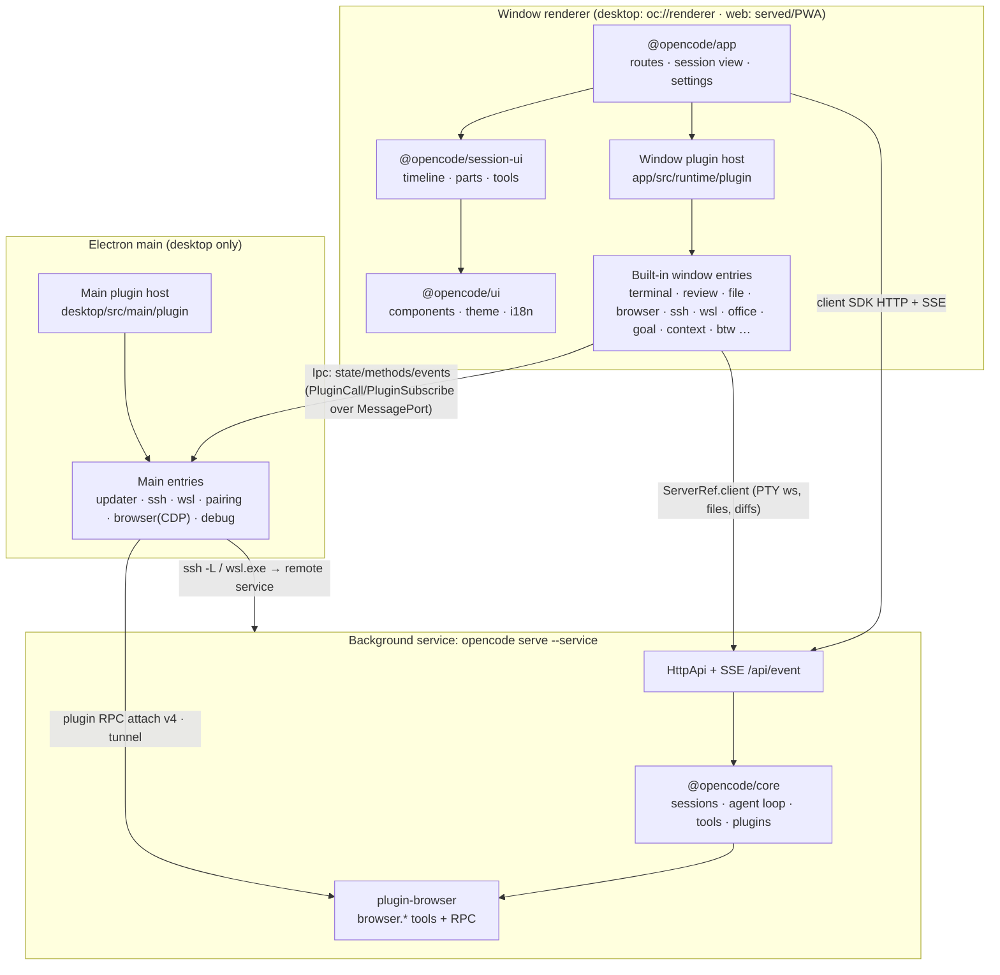

# App UI and GUI plugins

> OpenCode @ 56625a3e1f · paths relative to opencode-reference/

## TL;DR

- `packages/app` (~347K lines incl. ~96K of i18n dictionaries) is **one SolidJS renderer** used by both the Electron desktop and the web/PWA build. All host differences sit behind a single `Platform` object (`packages/app/src/runtime/platform/platform.tsx:36-152`). A server is just an HTTP origin, so the renderer cannot tell whether it is local, sidecar, SSH-tunnelled or remote.
- It talks to the server with the **generated client SDK** (`OpenCode.make`, `packages/app/src/runtime/server/api.ts:25-37`) plus **one SSE stream per server** (`/api/event`). That stream must start with `server.connected`, is fanned out through an in-memory emitter, and reconnects after 1 s with a 45 s idle watchdog (`packages/client/src/solid/connection.ts:20-36,95-140`).
- The **session view** (`packages/app/src/session/`) owns routing, composer, permission/question docks and the virtualized timeline. **`packages/session-ui`** is the presentation layer: it projects `SessionMessageInfo[]` into timeline rows and renders message parts and tools. The tool renderer switch covers read/list/glob/grep/browser/webfetch/websearch/subagent/shell/execute/edit/write/patch/question/skill (`packages/session-ui/src/tools/tool-renderer.tsx:296-330`).
- **`packages/ui`** is the Kobalte-based component library and holds the **desktop theme engine**. A theme is a JSON file of seed colours. Scales are generated (OKLCH) and emitted as CSS variables (`packages/ui/src/theme/resolve.ts:4,557-560`), and there are 36 bundled themes. `packages/theme` is the **TUI** theme package only (`packages/theme/package.json` exports `./tui`).
- **Every non-core feature is a GUI plugin** built on the public SDK `@opencode/plugin/gui`: terminal, review, files, browser, SSH, WSL, Office previews, goal, context, /btw, pairing, updater, details, sources, debug. The built-ins are listed in `packages/gui-plugins/src/renderer.ts:39-55` and `main.ts:19-35`. Window entries run in each window. Main entries run in Electron main and talk to their window half over typed `Ipc` (state + methods + events), and every Ipc is `inactive` on the web.
- **`packages/plugin-browser`** is the *server* half of the agent-driven browser. It exposes `browser.*` tools to Code Mode, and the desktop's browser GUI plugin attaches over plugin RPC (`version: 4`) and executes them with CDP in a `WebContentsView`.
- **i18n is strict and heavy.** 63 locales are lazy-loaded (`packages/app/src/runtime/i18n/language.tsx:116,180-193`). English is the source of truth with English fallback, plurals go through `plural()`, and hardcoded strings are banned in every package. Native menus get a typed bundle pushed from the renderer (`desktop-native.ts:234,325`).

## Where it lives

| path | role | ~lines |
|---|---|---|
| `packages/app/src/app.tsx`, `entry.tsx`, `desktop.ts` | Provider tree, web entry, desktop exports | 250 |
| `packages/app/src/shell/` | Layout, routes, titlebar, tabs, command palette, notifications | 22K |
| `packages/app/src/runtime/server/` | Server registry, SDK client, SSE, global/server sync, request queue | 4.7K |
| `packages/app/src/runtime/plugin/` | **Window GUI-plugin host** (registries, panels, dialogs, embeds, Ipc) | 12.6K |
| `packages/app/src/runtime/i18n/` | Locales, language provider, native bundle | 96K |
| `packages/app/src/session/` | Session screen, timeline controller, composer, requests | 31K |
| `packages/app/src/{composer,new-session,home,settings,providers,voice,workspaces,usage}` | Feature areas | 54K |
| `packages/session-ui/src/` | Timeline projection, message parts, tools, markdown (worker), diffs, file presentation | 54K |
| `packages/ui/src/` | Components, theme engine, tokens, icons, motion, ui i18n | 70K |
| `packages/theme/src/tui/` | TUI themes (see ch. 15) | 2K |
| `packages/plugin/src/gui/` | GUI plugin SDK + contracts (file, review, browser, updater) | 7.3K |
| `packages/gui-plugins/src/<plugin>/` | 15 built-ins | 112K |
| `packages/plugin-browser/src/` | Server-side browser tools, RPC schema, tunnel/proxy | 2.6K |

## Architecture

Provider order: Meta → Font → Theme → Language → UiI18nBridge → ErrorBoundary (Sentry) → TanStack Query → Dialog → **PluginRoot** → FileComponent (`packages/app/src/app.tsx:51-85`). Below that: Servers → Settings → Router whose root is Tabs → Global → ProjectIcons → Command → Voice (`app.tsx:87-123`).

## Key types and interfaces

| name | file:line | purpose |
|---|---|---|
| `Platform` | `packages/app/src/runtime/platform/platform.tsx:142-152` | Host seam: pickers, open/reveal, notify, storage, draftStore, fetch, zoom, clipboard, `plugins?: Bridge` |
| `ServerConnection.{Http,Sidecar,Plugin,Any}` | `packages/app/src/runtime/server/registry.tsx:154-185` | Servers the window knows; plugin servers come from SSH/WSL |
| `createApiForServer` | `packages/app/src/runtime/server/api.ts:25-37` | SDK client per server (Basic auth only when a password is known; desktop sidecar uses none) |
| `createOpenCodeEventSource` | `packages/app/src/runtime/server/client.tsx:27-58` | Typed fan-out of SSE events, filterable by `location.directory` |
| `createClientConnection` | `packages/client/src/solid/connection.ts:40` | Stream loop, reconnect, idle watchdog, page-lifecycle resync |
| `SessionDocument` | `packages/session-ui/src/document.ts:3-8` | `{sessionID, messages, status, diffs}`: what the timeline renders |
| `Timeline` projection | `packages/session-ui/src/timeline/projection.ts:1-40` | Messages → rows, turn phase, reasoning mode `hidden/compact/full` |
| `Presentation*` types | `packages/session-ui/src/file-presentation.ts:1-34` | File diff/content/source shapes shared by the timeline and viewers |
| `Plugin.define` / `Entry` / `compose` | `packages/plugin/src/gui/host.ts:23,56` | Manifest plus lazy `windowEntry`/`mainEntry` |
| Window `Context` | `packages/plugin/src/gui/context.ts:48,102,111,150` | `ctx.layout`, `ctx.sessions`, `ctx.desktop`, `ctx.use/provide/add/main` |
| `MainContext` | `packages/plugin/src/gui/main.ts:176-251` | `storage, log, app, serverEndpoints (incl. password), windows, embeds, cli` |
| Registries | `packages/plugin/src/gui/registries.ts:936-1084` | `Command, MenuItem, Panel, SettingsPage, Server, LinkHandler, TitlebarItem, ComposerPill, CodeBlock, CodeBlockAction, Slot, Style, Theme`; main adds `MenubarItem` (`main.ts:309`) |
| Contracts | `file.ts:70,92,132`, `review.ts:77`, `browser.ts:38`, `updater.ts:32` | `FileTree`, `OpenInApp`, `FileViewer` registry, `Changes`, `Browser`, `Updater` Ipc |
| `Browser.Operations` | `packages/plugin-browser/src/rpc.ts:155` | Source of truth for every `browser.*` tool |

## How it works: walkthroughs

### 1. Boot and routing

1. Desktop: `DesktopApp` builds the desktop `Platform` and runs a startup machine (splash → sidecar → plugin servers ready → reveal), then mounts `AppBaseProviders` + `AppInterface` (`packages/desktop/src/renderer/desktop-app.tsx:51-76`). Web: `entry.tsx` builds the web platform, registers a service worker and accepts `?auth_token=` (`packages/app/src/entry.tsx:55-56,82-106`).
2. Routes: `/` Home, `/settings`, `/server/:serverKey/session/:id`, `/new-session`, and `/components` (dev/beta lab only) (`packages/app/src/shell/routes/routes.tsx:51-78`). Desktop uses a per-window memory router that restores the last URL (`packages/desktop/src/renderer/window/router.tsx`). Session routes resolve the server by key and are lazy, with `preloadRoute` warming chunks (`routes.tsx:39-50`).

### 2. Server data and live events

1. `createApiForServer` wraps `OpenCode.make({baseUrl, fetch, headers})` (`api.ts:25-37`). Each request runs through a request queue in which writes go first and `/api/event` bypasses the queue (`packages/app/src/runtime/server/request-queue-machine.ts:150-157`).
2. `createClientConnection(api, {reconnect, flushInterval: 16, pageLifecycle: true, onEvent})` (`client.tsx:108-136`). The first event must be `server.connected` (`connection.ts:106-107`). Events are published to the emitter and consumed by global/server sync stores (`packages/app/src/runtime/server/sync.tsx:151`). On desktop, a `SidecarChanged` from main moves the transport to the new origin (see ch. 17).
3. Durable events carry `aggregateID/seq` (`connection.ts:127-132`). Resync happens on endpoint change (`client.tsx:99-105`). Server-side semantics are in ch. 13.

### 3. Session view render path

1. `session/route.tsx` → `screen.tsx` (602 lines) composes the header, the timeline and the composer region. `createSessionTimelineInteraction` drives follow/scroll (`packages/app/src/session/screen.tsx:40,132`).
2. The timeline controller builds a `SessionDocument` and projects it through session-ui (`app/src/session/timeline/controller.tsx:38-40`, "New timeline" experiment flag at `:76`). Rows are virtualized with `@tanstack/solid-virtual` (`timeline/virtualizer.tsx:2-8,144`).
3. Rows render message parts. Markdown streams through a **web worker** with a cache and phase machines (`packages/session-ui/src/components/markdown.worker.ts`, `markdown-stream.ts`). Tools dispatch by name (`tool-renderer.tsx:296-330`). Edit/write/patch become diffs (`:1005,1084,1120`). Shell output is ANSI-parsed (`tools/ansi.ts`, `shell-output.ts`).
4. Requests (permission, question, elicitation, websearch) are docks above the composer, each with its own machine (`app/src/session/requests/*-machine.ts`). Auto-approve is a machine too (`requests/auto-approve-machine.ts`).

### 4. A GUI plugin from definition to pixels (pairing as example)

1. `index.ts` calls `Plugin.define({os?, stores?, i18n})`. `compose` attaches the id and the lazy entries (`packages/gui-plugins/src/main.ts:28`, `renderer.ts:48`). Window entries are `eager` so the window renders only once every built-in is active (`renderer.ts:33-36`).
2. Window `setup(ctx)` is **synchronous** (`packages/gui-plugins/AGENTS.md:40`). It contributes with `ctx.add(Registry, item)`, provides contracts with `ctx.provide`, and calls its main half with `ctx.main(Pairing)`.
3. Main `setup(ctx)` (may be async) provides the `Ipc` implementation (`gui-plugins/src/pairing/main.ts:118-127`). The host carries calls as `PluginCall` and state as `PluginSubscribe`/`PluginState` over the desktop MessagePort (`packages/desktop/src/shared/ipc-rpc/plugins.ts:96-117`).
4. Third-party plugins ship a `./gui-experimental` CommonJS bundle on the server. Main lists it and evaluates it with `new Function` against shared module instances (`packages/plugin/src/gui/host.ts:248-251`). Windows load what main sends.

### 5. Agent drives the browser

1. Server: `opencode.browser` registers tools and a connection (`packages/plugin-browser/src/index.ts:6-13`). The tools are hidden until a desktop attaches (`src/skill.ts:9`).
2. Desktop: the browser main entry lazy-loads the pane on first registration (`gui-plugins/src/browser/main.ts:25-46`). The pane attaches with `rpc.attach({sessionID, connectionID, version: 4})` and waits for an `attached` control frame (`browser/pane.ts:168,263,284`).
3. A model call `tools.browser.click({tabID, ref})` makes the server announce a request id. The desktop fetches the command, runs it with CDP on the tab's `WebContentsView` (`browser/cdp.ts:24-40`, `chromium.ts:214`) and posts `result`. Tab inventory must be published (`state`) before `tabs.open` resolves (`plugin-browser/README.md`).
4. Page traffic is relayed through `tunnel.*` over the authenticated RPC, so `localhost:8000` means the *server's* port 8000. Each transfer is capped at 5 MiB (`rpc.ts:8-9`). File URLs are only allowed inside session roots (`gui-plugins/src/browser/policy.ts`).

## Configuration and extension points

- **Plugin enablement** is per plugin (Extensions › Plugins). Built-ins can be disabled. The server browser plugin is disabled with `{"plugins": ["-opencode.browser"]}` (`packages/plugin-browser/README.md`).
- **Stores:** window keys `plugin.<id>.<key>`, main namespace `plugin.<id>`, migrations via `from` (`gui-plugins/AGENTS.md:54-60`).
- **Themes:** a `DesktopTheme` JSON with `seeds` or `palette` per light/dark plus `overrides`/`v2Overrides` (`packages/ui/src/theme/types.ts:34-75`, schema `desktop-theme.schema.json`). Plugins can contribute themes through the `Theme` registry (`registries.ts:1084`).
- **Build flags:** `VITE_OPENCODE_CHANNEL` gates the components lab (`routes.tsx:28-34`), and `VITE_SENTRY_*` sets up Sentry.
- **Locale:** stored at `opencode.global.dat:language`, otherwise detected from `navigator.languages` (`language.tsx:200-233`).

### i18n rules (pick-list #37)

- 63 locales per package (app, ui, each gui-plugin). They are lazy dictionaries with English as the fallback, and RTL is supported (`language.tsx:40`). The ui layer gets copy through `UiI18nBridge` (`:449`). Built-in plugins use `builtinCatalog({en, de: () => import(...)})` (`packages/plugin/src/gui/builtin.ts:436-458`).
- Rules are repeated in every AGENTS.md (`packages/session-ui/AGENTS.md:1-10`, `packages/ui/AGENTS.md:1-13`, `packages/desktop/AGENTS.md:23-31`): no hardcoded user-visible strings; new work adds English only; `plural(key, n)`, never hand-picked `.one/.other`; never edit English to make translation easier; verify against CLDR, Microsoft and Apple style guides and Mozilla corpora, not model knowledge.
- Native menus and dialogs: the renderer pushes a typed `DesktopNativeBundle` (`AppSetNativeTranslations`), and main reads it with `nativeT(key)` (`packages/desktop/src/main/native/translations.ts:28`). Locale logic stays out of main.

## Edge cases, invariants and gotchas

- **Lifetimes:** a window plugin instance can be torn down at any `await`, so after each await it checks `ctx.signal`. Never cache a `ServerRef.client`, because a reconnect creates a new controller under the same id (`gui-plugins/AGENTS.md:37-43`).
- **Failure is a contract:** `ctx.use(token)` returns `pending | inactive`. Every action must answer, and silent returns or endless spinners are banned (`gui-plugins/AGENTS.md:45-50`).
- **Storage asymmetry:** web storage is synchronous, while desktop storage loads over IPC. A read before load passes the web e2e tests and still breaks the desktop (`gui-plugins/AGENTS.md:54`). This is why the preload pre-hydrates snapshots.
- **Host never names plugins** (`gui-plugins/AGENTS.md:31`). Generic SDK fields are added instead.
- **Artifact sandboxing:** HTML artifacts render in an `<iframe sandbox="allow-scripts allow-popups allow-forms allow-modals">` with an opaque origin and no-referrer. PDFs use Chromium's unsandboxed viewer (`packages/gui-plugins/src/file/artifact-view.tsx:720-736`).
- **HTTP LAN origins:** use `uuid()` from `@opencode/util`, never `crypto.randomUUID()` (it is missing in insecure contexts) (`packages/app/AGENTS.md:18-24`).
- **Suspense guard:** never read a resource in render without the `state` guard, or the UI flashes on first load (`packages/app/AGENTS.md:48`).
- Browser results are untrusted. A lost response does not prove that a click did not happen, and nothing is replayed (`plugin-browser/README.md`).

## Feature inventory (desktop app)

| Feature | Where | Notes |
|---|---|---|
| Multi-server home, projects, sessions, tabs | `app/src/home`, `shell/tabs`, `runtime/server/registry.tsx` | Local sidecar, remote HTTP, SSH and WSL servers side by side |
| Session timeline, streaming markdown, Mermaid, KaTeX | `session-ui/src/timeline*`, `components/markdown*` | Virtualized; reasoning `hidden/compact/full` |
| Composer: attachments, queue, steer, todos, subagent bar, model pick | `app/src/composer`, `session/composer` | Drafts and blobs persist in SQLite on desktop |
| Permission / question / elicitation / websearch docks, auto-approve | `app/src/session/requests` | |
| Voice input / voice call | `app/src/voice` | Mic permission via `WindowRequestMicrophone` |
| Review: uncommitted or branch diffs, line comments, init git | `gui-plugins/src/review` | `Changes` contract; `@pierre/diffs` |
| File tree, file viewer, find, open-in-app, artifacts (md, html, pdf, svg, csv, mermaid) | `gui-plugins/src/file` | `@pierre/trees`; sandboxed HTML |
| Office previews (docx, xlsx, pptx) | `gui-plugins/src/microsoft-office` | `@betteroffice/*` in web workers |
| Terminal tabs on persistent PTYs | `gui-plugins/src/terminal` | `ghostty-web`; server PTY daemon (ch. 16) |
| Agent-driven browser: tabs, inspect, console/network, traces, heap, Lighthouse | `gui-plugins/src/browser` + `plugin-browser` | Desktop only (CDP) |
| SSH remote servers | `gui-plugins/src/ssh` | System `ssh` + `-L` forward, remote CLI bootstrap, askpass prompts |
| WSL servers | `gui-plugins/src/wsl` | `os: ["windows"]` (`wsl/index.ts:6`) |
| Pairing / remote access from phone | `gui-plugins/src/pairing` | HTTPS tunnel, keep display awake |
| `/goal` pill, `/btw` side questions, Context tab (usage, system prompt, raw messages, export), Sources | `gui-plugins/src/{goal,btw,context,sources}` | /btw asks with tools disabled (`btw/model.ts:8-12`) |
| Session details: MCP status, move to worktree | `gui-plugins/src/details` | |
| Updater, What's New | `gui-plugins/src/updater` | See ch. 17 |
| Debug bar: heap snapshots, motion tuning, focus | `gui-plugins/src/debug` | Dev/beta |
| Settings: providers, keybinds, themes (36), language (63), servers, plugins | `app/src/settings`, `app/src/providers` | |

## Tests worth reading

- `packages/app/src/runtime/server/{request-queue,health,registry}.test.ts`, `packages/client/src/solid` (stream semantics).
- `packages/session-ui/src/timeline/projection.test.ts`, `timeline-next/projection.test.ts`, `components/markdown-stream.test.ts`, `session-ui/component-tests/*.spec.ts` (Playwright component tests).
- `packages/app/src/runtime/plugin/{ipc,instance-machine,machine}.test.ts`: window plugin host contracts.
- `packages/gui-plugins/src/*/**.test.ts` (112 files), especially `browser/policy.test.ts`, `ssh/*`, `updater/machine.test.ts`.
- `packages/plugin-browser/test/{rpc,machine,tools,tunnel}.test.ts`.
- `packages/app/e2e/{user-story,regression,stability}`, `packages/ui/src/theme/machine.test.ts`.

## Genie takeaways

Context: the desktop is far fog on `../../WAYFINDER.md`. Genie Desktop is Tauri, with Chat and Code modes and an embedded Rust engine per session (`../../tickets/01-engine-architecture.md`). The UI framework is not decided. The product is branded Genie.

**Port (design):**
- **#36 theme tokens.** Copy the *model*, not the files: a few seed colours → generated OKLCH scales → semantic CSS variables (`text-strong`, `background-base`, `diff-add`…) with light/dark variants (`ui/src/theme/resolve.ts`). Genie ships its own brand theme. `oc-2.json` and the 36 bundled themes are OpenCode-flavoured and should be avoided.
- **#37 i18n discipline.** Adopt from day one, even English-only: an i18n key for every visible string, `plural()`, English fallback, lazy locale dictionaries, and a typed native-menu bundle pushed from the webview to the Rust side.
- **Platform seam.** Whatever framework Genie picks, define one `Platform` interface (`platform.tsx:36-152`) so the same UI can later run in Tauri, the VS Code webview and a browser.
- **SessionDocument → projection → rows.** A pure projection from engine events into timeline rows, separate from rendering, is framework-agnostic. It matches Genie's event protocol work (ticket 02).
- **Sandboxed artifacts panel.** OpenCode's `iframe sandbox` without `allow-same-origin` (`artifact-view.tsx:733`) is the right baseline for Genie's artifacts side panel. Genie should add a CSP, serve artifacts from a separate custom scheme, and use `postMessage`-only communication. *(Genie design, inferred)*

**Adapt (#38 app, #39 gui-plugins):**
- Do not take the 347K-line Solid app wholesale. It assumes a multi-server HTTP world, OpenCode server schemas and Effect everywhere. Use it as a **feature and UX reference** for Code mode: review diffs, file tree, terminal, permission docks and the context tab.
- The **plugin-per-feature** architecture (registries, contracts, `Live` pending/inactive, per-plugin i18n and stores) is a strong internal modularity pattern even without third-party GUI plugins. Genie should keep the registries but **avoid** evaluating third-party JS with host privileges (`new Function` + Node in main).
- Main-process entries (ssh, wsl, pairing, updater, browser) become **Rust Tauri plugins/commands** in Genie.

**Later (#40 browser plugin):** the split is useful: the server owns tools and permissions, the desktop owns CDP, and requests are pull-based so arguments never travel on the global event stream. So are its rules ("no replay", explicit tab IDs, untrusted page data). On macOS, WKWebView has no CDP, so Genie would need a bundled or managed Chromium. *(inferred)*

**Avoid:** OpenCode strings, icons, the `opencode://` scheme and theme names in anything client-facing. Also avoid the multi-server registry complexity until Genie has remote engines.

## Open questions / inferred

- Do third-party `./gui-experimental` bundles load on the web build at all? The SDK says main alone lists them (`gui-plugins/AGENTS.md:9`). The web path was not traced.
- The "New timeline" (`timeline-next`) appears to be replacing `timeline/`. Which one is the default in prod was not confirmed.
- How much of `packages/app` would survive a Solid-in-Tauri port depends on Genie's UI framework decision and on how closely Genie's event protocol follows OpenCode's `SessionMessageInfo`.
- The ~1.3K English keys in `app/src/runtime/i18n/en.ts` is a line-count estimate.
