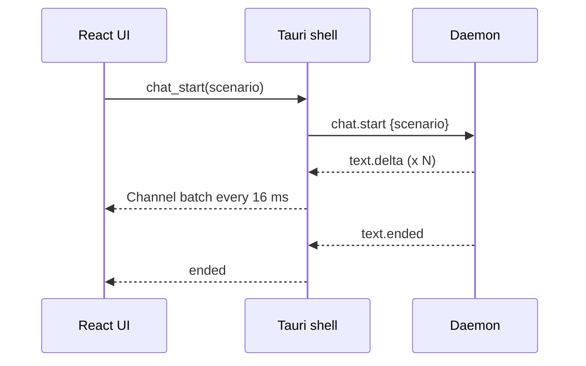
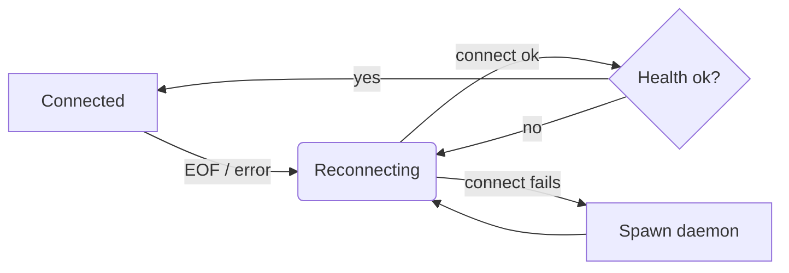

## Overview

Here is a walkthrough of the change. The relay keeps a **single connection** to the daemon and forwards events to the UI. Each event carries a sequence number, so the client can detect gaps and *re-sync* without guessing. The important pieces are `ConnectionManager`, `Coalescer` and the `Channel` handle.

- The daemon owns the conversation state.
- The shell relays events; it never parses Markdown.
- The renderer splits text into blocks and only re-parses the tail.
- Crash recovery is driven by EOF on the pipe, not by timeouts.

## Rust: the reader loop

```rust
use tokio::io::{AsyncBufReadExt, BufReader};

pub async fn read_loop<R: tokio::io::AsyncRead + Unpin>(r: R, tx: Sender<Event>) -> anyhow::Result<()> {
    let mut lines = BufReader::new(r).lines();
    while let Some(line) = lines.next_line().await? {
        let msg: RpcMessage = serde_json::from_str(&line)?;
        match msg.method.as_deref() {
            Some("text.delta") => tx.send(Event::Delta(msg.params)).await?,
            Some("text.ended") => tx.send(Event::Ended).await?,
            _ => tracing::debug!(?msg, "ignored"),
        }
    }
    Ok(()) // EOF: the daemon went away
}
```

## TypeScript: batching on animation frames

```typescript
type Delta = { seq: number; text: string; emittedAt: number };

export function createBatcher(commit: (text: string) => void) {
  let pending: Delta[] = [];
  let scheduled = false;
  return (d: Delta) => {
    pending.push(d);
    if (scheduled) return;
    scheduled = true;
    requestAnimationFrame(() => {
      scheduled = false;
      const text = pending.map((p) => p.text).join("");
      pending = [];
      commit(text);
    });
  };
}
```

## Python: a quick estimator

```python
import statistics

def percentile(samples: list[float], p: float) -> float:
    """Nearest-rank percentile; good enough for frame times."""
    if not samples:
        return float("nan")
    s = sorted(samples)
    k = max(0, min(len(s) - 1, round(p / 100 * len(s)) - 1))
    return s[k]

frames = [16.6, 16.7, 16.8, 33.3, 16.5]
print(f"p95={percentile(frames, 95):.1f}ms mean={statistics.mean(frames):.1f}ms")
```

## Comparison table

| Approach | Parse cost per frame | Memory | Notes |
|---|---|---|---|
| Re-parse whole message | O(n) | low | simplest; degrades on long replies |
| Settled + tail blocks | O(tail) | medium | settled blocks are memoised |
| Incremental lexer | O(delta) | high | complex; hard to get right with tables |
| Web worker parse | O(n) off-thread | medium | adds a hop of latency |

## The maths

Throughput is the number of tokens rendered per second, $r = \frac{N}{t_{end} - t_{start}}$, and frame budget at 60 Hz is $\frac{1000}{60} \approx 16.7$ ms. If each frame commits $k$ tokens, the latency bound is roughly:

$$
L_{p95} \le t_{coalesce} + t_{ipc} + \frac{1000}{f_{display}} + t_{parse}(b_{tail})
$$

where $b_{tail}$ is the size of the streaming block. For a softmax over logits $z_i$ we have $\sigma(z)_i = \frac{e^{z_i}}{\sum_j e^{z_j}}$.

## Go: the daemon side

```go
package main

import (
	"bufio"
	"encoding/json"
	"time"
)

type Delta struct {
	Seq     int    `json:"seq"`
	TEmitUs int64  `json:"t_emit_us"`
	Text    string `json:"text"`
}

func stream(w *bufio.Writer, tokens []string, rate float64) error {
	start := time.Now()
	for i, t := range tokens {
		due := start.Add(time.Duration(float64(i) / rate * float64(time.Second)))
		time.Sleep(time.Until(due))
		b, _ := json.Marshal(Delta{Seq: i, TEmitUs: time.Now().UnixMicro(), Text: t})
		w.Write(append(b, '\n'))
		w.Flush()
	}
	return nil
}
```

## SQL: storing transcripts

```sql
CREATE TABLE message (
  id          INTEGER PRIMARY KEY,
  session_id  TEXT NOT NULL REFERENCES session(id),
  role        TEXT NOT NULL CHECK (role IN ('user', 'assistant', 'tool')),
  created_at  INTEGER NOT NULL,
  body        TEXT NOT NULL
);
CREATE INDEX message_session_created ON message (session_id, created_at);

SELECT role, count(*) AS n, avg(length(body)) AS avg_len
FROM message
WHERE session_id = ?1
GROUP BY role
ORDER BY n DESC;
```

## Flow of a request



## Recovery states



## Shell: running the bench

```bash
#!/usr/bin/env bash
set -euo pipefail
pnpm install --frozen-lockfile
pnpm tauri build --no-bundle
GENIE_BENCH=1 ./target/release/genie-proto-37 --bench
jq '.scenarios.normal.frames' bench-results.json
```

## Checklist

1. Start the daemon, or connect to the running one.
2. Perform the `health` handshake and record the version.
3. Subscribe the webview to the channel.
4. Stream, coalesce, and paint.
5. On EOF, show *reconnecting* and retry with backoff.

> Note: none of this touches the network. Everything stays on a user-only pipe, so there is no TLS and no port to firewall.

That covers the main path. Ask if you want the details of the cancellation protocol or the backpressure rules next.
