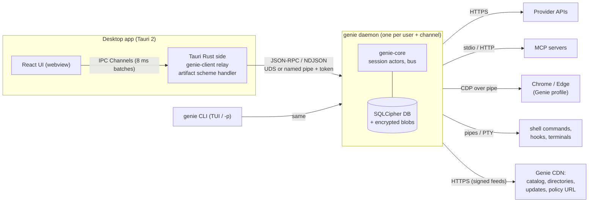
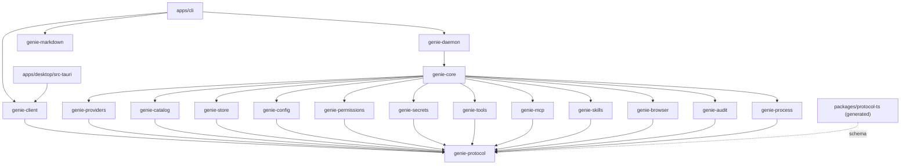
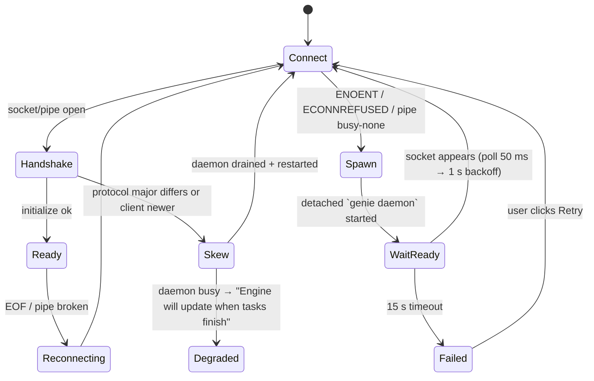
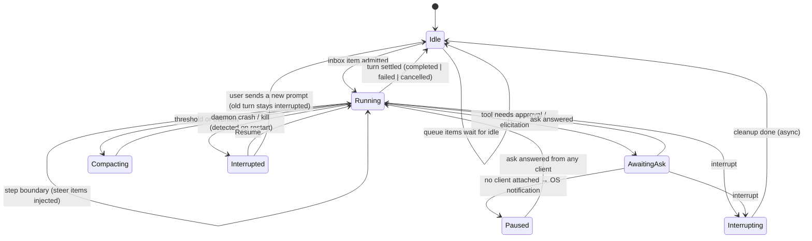
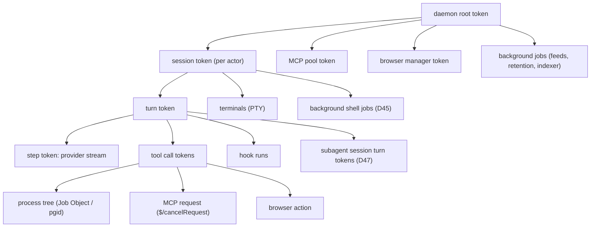

# 01 — Architecture

Implements D1, D4, D5, D8, D14, D20, D22 (transport side), D41 (repo layout), D45/D55 (`genie-process`), D42 (`genie-markdown`); tickets 01, 30, 38. Background: research/desktop-shell.md, KB ch.01–03.

## 1. Process topology

One shared daemon per user and channel serves every client (D4, D14, D20). An in-process engine and an engine per session were considered and rejected (t01). This overrides the KB's "avoid the shared daemon" advice.

### 1.1 Processes

| Process | Started by | Lifetime | Notes |
|---|---|---|---|
| `genie daemon` | the first client's `ensure` (§4.1) | until idle exit (§4.3) or update drain | Same binary as the CLI (`genie`). The desktop bundles it (t01, D40). |
| Desktop app | user | user-controlled | Webview never sees the daemon token (research/desktop-shell.md §5). |
| CLI `genie` | user / scripts | per invocation | `-p` and non-TTY run headless (D51). `--standalone` starts a private daemon (§4.4). |
| MCP stdio servers | daemon (`genie-mcp`) | one process per server config, shared by sessions (t17) | User privileges; in the daemon's Job Object / process group. |
| Shell commands | daemon (`genie-process`, pipe mode) | per command; may move to background (D45) | Kill-tree on Stop. |
| Terminals | daemon (`genie-process`, PTY mode) | per Terminal tab (D55) | Die with the session or daemon. |
| Hooks | daemon (`genie-process`) | per event, with timeout (D48) | Minimal env; no provider credentials. |
| Chrome/Edge | daemon (`genie-browser`) | per daemon, started on first browser use | `--remote-debugging-pipe`, separate Genie profile (D21, D56). |
| git (checkpoints, worktrees) | daemon | per call | Child process via `genie-process` (D49, D50). |
| Native notifier | daemon | per notification | Only when no desktop client is attached (D22). |

**All children are bound to the daemon.** On Windows the daemon puts children in a Job Object with `KILL_ON_JOB_CLOSE`. On macOS/Linux each child gets its own process group, and the daemon kills the group on exit. On Linux the daemon also sets `PR_SET_CHILD_SUBREAPER` so orphaned grandchildren are reaped (research/sandbox.md R7/R8). Chrome is the exception: it gets its own Job Object / group so that killing a shell command never kills the browser.

### 1.2 Per-user endpoint and token

- **macOS/Linux:** a Unix domain socket at `<data dir>/run/daemon.sock`. The `run/` directory is `0700`. The daemon also checks the peer UID on accept (`SO_PEERCRED` / `getpeereid`) and refuses other users.
- **Windows:** a named pipe `\\.\pipe\genie-<channel>-<sid-hash>` with a DACL that grants access only to the current user SID. `FILE_FLAG_FIRST_PIPE_INSTANCE` prevents pipe squatting. The daemon checks the client's process token SID.
- **Token:** 32 random bytes, written to `<data dir>/run/daemon.token` (`0600` / user-only ACL) at daemon start. `initialize` must carry it. The comparison is constant-time (a KB fix for opencode-pty, D45).
- **Data dir per channel:** `~/.genie` (stable), `~/.genie-beta`, `~/.genie-dev` (D40). On Windows `%USERPROFILE%\.genie` for config and `%LOCALAPPDATA%\Genie\<channel>` for run/blobs/DB.

**Spec assumption (SA-02):** the exact socket, pipe and token file names above, and a new token per daemon start. Reason: t01 fixes the mechanism but not the names; a per-start token limits the life of a leaked token.

### 1.3 Desktop internals

- The React app reaches the host only through a **Platform adapter** (D8 condition 2). No `@tauri-apps/*` import outside `src/platform/tauri/`. A lint rule enforces this.
- The Tauri Rust side owns a `genie-client` connection, relays daemon messages to React over **Tauri IPC Channels**, and coalesces deltas every **~8 ms** (D57).
- It also serves the **artifact scheme** (D28) and the **updater** (D40), and forwards OS notifications.
- The token never reaches JavaScript.

## 2. Crate graph

Cargo + pnpm monorepo (D41, t38). Ticket 38 lists 18 crates (17 + `genie-process` from D45); D42 adds `genie-markdown`. That gives 19.

| Crate | Owns | Key decisions |
|---|---|---|
| `genie-protocol` | Wire types, events, errors, config schema types (serde + schemars). **No internal deps.** | D22, D23 |
| `genie-core` | `EngineBuilder`, per-directory context map, session actor, inbox, bus, turn loop, context assembly, compaction, agents, subagents, hooks dispatch | D20, D31–D33, D46–D48 |
| `genie-providers` | 4 protocol adapters, Executor, SSE parser, compile step, `Compat`, auth kinds, errors, retry | D18, D26 |
| `genie-catalog` | Catalog load/verify/refresh, live discovery, effort map, pricing | D27 |
| `genie-store` | SQLCipher DB, migrations, blobs, FTS, retrieval index, export | D24, D32 |
| `genie-config` | Layers, managed policy merge, watcher, diagnostics, schema | D23, D38 |
| `genie-permissions` | Rule grammar, evaluation, modes, shell command scanner | D25, D45 |
| `genie-secrets` | Keychain + passphrase-encrypted file; DB key | D26, D24 |
| `genie-tools` | `Tool` trait, registry, chat + code tools, spill | D35 |
| `genie-mcp` | MCP client, transports, OAuth, directory client | D30 |
| `genie-skills` | Skills scanner/index, commands, skills directory client | D37, D44 |
| `genie-process` | Process runner migrated from `opencode-pty` (MIT): pipe mode; PTY mode behind feature `pty` | D45, D55 |
| `genie-sandbox` | **v2.** OS-native sandboxes (design accepted) | D44 |
| `genie-browser` | CDP client over pipe, `BrowserBackend`, snapshot serializer, screencast, site policy | D21, D56 |
| `genie-audit` | OTel exporter, local JSONL audit, telemetry and crash reporting | D38, D39 |
| `genie-daemon` | Socket/pipe transport, handshake, lifecycle, version skew | D20, D22 |
| `genie-client` | Rust client used by the CLI and the Tauri side; reconnect + resume | D22 |
| `genie-markdown` | Port of patchmark (MIT): streaming Markdown with block stability | D42 |
| `genie-testkit` | In-memory transport, cassettes, fixtures, fake providers | D41, t34 |

Apps and packages: `apps/cli` (binary `genie`: CLI, TUI, `genie daemon`), `apps/desktop/src-tauri`, `apps/desktop/src`, `packages/protocol-ts` (generated), `packages/ui` (tokens + components), `packages/artifact-runtime` (sandbox page, esbuild-wasm, bundled libraries), `feeds/`, `release/` (t38).

### 2.1 Dependency rules

1. Direction is **apps → client/daemon → core → subsystems → protocol** (t38).
2. `genie-protocol` depends on nothing internal. CI checks this with `cargo metadata` (D20).
3. Subsystem crates don't depend on each other. When one needs another, `genie-core` defines a trait and injects an implementation. Examples: `genie-tools` needs permissions → `trait PermissionGate` in core; `genie-mcp` needs secrets → `trait SecretStore`.
   - **Allowed exceptions** (plain leaf utilities, listed in `deny.toml`-style allowlist): `genie-process` may be used by `genie-tools`, `genie-mcp`, `genie-browser` and core; `genie-secrets` may be used by `genie-providers` and `genie-mcp` for token refresh.
   - **Spec assumption (SA-38):** these two exceptions. Reason: routing every process spawn and token read through core traits adds indirection with no safety gain; both crates are leaves with no upward deps.
4. **Lint-as-architecture** (t01): clippy `unwrap_used`, `expect_used` (outside tests), `await_holding_lock`; no `tokio::spawn` outside a `TaskTracker` (a custom lint or grep check); `cargo deny` for licences and advisories.
5. Generated code (`protocol-ts`, config JSON Schema, Settings metadata) is never edited by hand. CI fails on drift (t38).
6. One version for the whole repo. The channel is a build-time setting (D40).
7. Adapted OpenCode code carries an MIT notice header (C3).
8. The React app imports only `packages/protocol-ts` types and the Platform adapter for host calls.

## 3. Engine structure inside the daemon

- **Runtime:** tokio multi-thread. An explicit `EngineBuilder` wires services; there is no DI framework (t01).
- **Process-wide services:** store, secrets, provider registry, catalog, MCP pool, browser manager, audit, policy, feed client.
- **Per-directory context (`DirContext`):** a light version of OpenCode's Location (t01). Keyed by canonical project root. Holds the effective config layers, trust state, instruction sources, permission rules, skills/agents/commands registries and the git identity (pick-list #42). Built lazily, rebuilt on file-watch events, shared by sessions in that folder. Chat sessions use a synthetic "user" context.
- **Per-session actor:** one task per open session (§5).
- **Bus:** `Bus::publish(event)` takes the session's lock, inserts the durable event with the next `seq`, runs projectors (message/part rows, session status, usage) and any commit hooks (execution claim, subagent outbox) **in one SQLite transaction**, then fans the event out to subscribers (D20, KB ch.03). Ephemeral events skip the DB.
- **Store writer:** SQLite allows one writer. The store runs a dedicated writer task with a bounded queue; reads use a small connection pool (WAL).
- **File mutation locks:** one async mutex per canonical path, shared across sessions and clients (t06).

## 4. Daemon lifecycle

### 4.1 Ensure (client side)

- **Spawn race:** two clients may spawn at once. The daemon takes an exclusive lock file `<data dir>/run/daemon.lock` before binding. The loser exits with code `already_running`, and its client simply connects.
- **UI:** the desktop shows "Starting engine…" during Spawn/WaitReady and an error card with **Retry** and **Open logs** on Failed. The CLI shows a spinner (t05).
- **Stale socket:** if connect fails but the lock file is not held, the client deletes the stale socket and spawns.
- Prototype 37 measured kill→reconnect at 281–324 ms on Windows, mostly EOF detection (D57).

**Spec assumption (SA-03):** a 15 s readiness timeout, 50 ms → 1 s connect backoff and one automatic retry before the error card. Reason: t01 says "timeout and retries" without numbers; 15 s allows for antivirus scans of a new binary on Windows.

### 4.2 Version skew

The handshake carries `protocol` (semver) and `engine_version` (D22).

| Case | Behaviour |
|---|---|
| Same major, any minor/patch | Proceed. Features are gated by `capabilities` in the handshake. |
| Client newer (build) and daemon has no running or paused turns | Daemon replies `restart_pending`, finishes the handshake for no one, drains (closes subscriptions with `daemon.restarting`), exits; client re-runs ensure with its own bundled binary. |
| Client newer and daemon busy | Client connects in **degraded** mode if the major matches; otherwise it shows "Genie is finishing N tasks before updating" with **Stop tasks and update**. |
| Client older, different major | Client is refused with `protocol_mismatch`; the message says to update the client. |
| After an app update (D40) | Same as "client newer": drain, then restart on the new binary. Interrupted turns show Resume. |

**Spec assumption (SA-04):** "newer" compares build version, and a newer client with the same protocol major still triggers the drain-and-restart when idle. Reason: t01 says "if the client is newer… drains and restarts"; doing it even for compatible versions keeps one engine version in the field.

### 4.3 Shutdown

- **Idle exit:** when there are no clients, no running turns, no paused asks waiting for an answer, no background shell jobs and no open terminals, for **10 minutes**.
- **Clean shutdown:** stop accepting connections → cancel the daemon root token → wait up to 5 s for tasks → mark running turns `interrupted` → close the DB → kill remaining child groups → remove the socket.
- **Crash:** clients see EOF, re-run ensure, re-subscribe with their last `seq`. On start, the daemon scans `execution_claim` rows; each unsettled claim → durable `turn.interrupted` → the UI shows **Resume** (D20). There is no auto-resume, because a resume can repeat side effects.
- **Panics** inside a session task are caught (`catch_unwind` around the actor future). That session fails with `internal_error`; others keep running (t01).

**Spec assumption (SA-01):** the 10-minute idle period and the "paused asks keep the daemon alive" rule. Reason: t01 says "N minutes"; a pending approval must still be able to notify and resume without a restart.

### 4.4 Standalone daemon (CI)

`genie -p --standalone` starts a private daemon on a random socket path under a temp dir, with an ephemeral token, owned by the CLI process. It exits on stdin EOF of its parent (the KB lease pattern) (D51).

## 5. Session actor

### 5.1 State machine

`session.status` values stored in the DB: `idle | running | awaiting_ask | interrupted` (t12). `Paused` is `awaiting_ask` with no driver attached. `Interrupting` and `Compacting` are transient and only reported as ephemeral status.

### 5.2 Inbox, steer and queue

- `session.prompt {delivery}` writes an `inbox` row (durable) and rings the actor's doorbell (a `Notify`). The protocol call returns once the row is committed (pick-list #19).
- **`steer`:** if a turn is running, the item is injected as a user message at the **next step boundary** (after the current step's tool calls are joined). If idle, it starts a turn.
- **`queue`:** delivered as a new turn after the current turn settles. Queued items can be edited or removed while waiting (`session.inbox.remove`).
- Synthetic items use the same inbox: background shell completion (D45), subagent reports (D47), "Fix with Genie" errors (D28), hook `turn.end` continuations (D48).
- Admission order is the inbox order. One actor task drains the inbox; no two turns of one session run at once.

### 5.3 Interrupt

- `session.interrupt` returns immediately after the turn token is cancelled (t01). Cleanup runs asynchronously: in-flight HTTP streams are dropped, tool tasks get their tokens cancelled, process trees are killed, partial text is kept as a settled part with `finish = cancelled`.
- Pending asks in that turn are resolved as `cancelled` (not "declined").
- Subagents: the client asks "Stop running subagents too?" (default yes) and passes `stop_subagents` (D47).

### 5.4 Resume

- **Resume** after `interrupted` re-runs the turn from its last durable point: completed tool results are kept; tool calls without results are failed with `interrupted` and the model is told so (KB ch.03: "unsettled tool calls left by a crash are failed when the next drain starts"). The next step starts with a fresh request.
- Resume is user-initiated only (D20).

### 5.5 Actor lifetime

Actors are created on first subscribe or prompt and dropped after 15 minutes with no subscribers and no turn. State lives in the DB, so dropping is cheap.

**Spec assumption (SA-05):** the 15-minute actor eviction. Reason: not specified; it bounds memory with many open sessions.

## 6. Cancellation tree

Every task is spawned on a `TaskTracker` with a child `CancellationToken` (t01).

Rules:
- Cancelling a parent cancels all children. A child never cancels its parent.
- **Background shell jobs** belong to the **session**, not the turn, so they outlive the turn that started them. Stop on the session, session delete and daemon exit kill them.
- **Subagents** hang off the parent's **turn** (D47), so interrupting the parent stops them by default.
- The permission wait is a `oneshot` raced against the turn token (t01).
- A cancelled provider request is never retried (t03).

## 7. Error taxonomy

Errors are typed by layer. Each type says who sees it.

| Layer | Type | Examples | Model sees | User sees | Retry |
|---|---|---|---|---|---|
| Provider | `ProviderError{kind}` (see 03 §7) | `RateLimited`, `QuotaExceeded`, `ContextOverflow`, `Authentication`, `ReplayRejected` | No (except as a turn failure) | Banner with class + fix link (e.g. `genie://settings/providers/azure`) | Per kind (03 §7) |
| Tool | `ToolError::InvalidInput{issues≤5}` | bad JSON, schema errors | **Yes**, as tool result text | Collapsed row | Model decides |
| Tool | `ToolError::Failed{msg, may_have_run}` | file not found, MCP error | Yes | Row in error state | Never auto-retried if `may_have_run` (D45) |
| Tool | `ToolError::Declined{message?}` | user rejected | **Only** the user's message, as feedback, never as output (D20, D25) | "Declined" chip | No |
| Tool | `ToolError::Blocked{rule, source}` | policy or deny rule | Short "blocked by policy/rule X" | "Blocked by <org> policy" | No |
| Tool | `ToolError::Timeout` | MCP 10 min, fetch 30 s | Yes | Row | Model decides |
| Engine | `TurnError` | max steps, compaction failed twice | Final step gets "answer without tools" (t18) | Divider + Retry | Manual |
| Protocol | JSON-RPC error with `data.kind` (02 §8) | `not_driver`, `protocol_mismatch` | No | Toast / inline | Client-specific |
| Config | `Diagnostic{key, severity}` | unknown key, malformed JSON | No | Settings → Problems badge (D23) | — |
| Internal | `Defect` | panic, invariant broken | **Never** (t02) | "Something went wrong" + **Copy diagnostics** | Session fails; daemon lives |

Rules:
1. Internal defects are mapped to `internal_error` and never shown to the model (t02).
2. Secrets are wrapped in `secrecy::SecretString`; `Debug` prints `[redacted]`. Error bodies from providers are cut to a 2 KiB excerpt and scrubbed of keys before logging (t34).
3. Every error has a stable `code` string for docs and support (`GENIE-PROV-429`, …) and, where useful, a deep link to the setting that fixes it (D34).

## 8. Observability

- `tracing` spans per session, turn, step and tool call, with ids, never prompt content.
- Logs: rotating files `<data dir>/logs/daemon.log` and `desktop.log` (10 × 10 MiB). Shown in Settings → Developer (D34).
- Crash reports (on by default, opt-out) and usage analytics (opt-in) via `genie-audit` (D39; see 08 §6).
- Audit stream (OTLP / JSONL) is separate from logs (D38; see 08 §5).
- `genie doctor` checks: daemon reachable, versions, keychain backend, DB open, providers reachable, catalog age, Chrome/Edge found, ripgrep found, git found, WebKitGTK version and DMABUF workaround (Linux), disk space (D34).
